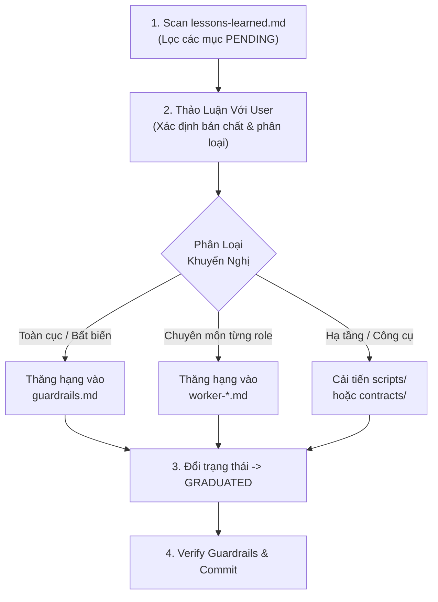

# Workflow: Self-Refining Retrospective & Rule Promotion

> Quy trình định kỳ giúp Lead Architect rà soát các bài học kinh nghiệm, thảo luận với User và thăng hạng (promote) các giải pháp thực tế thành luật bất biến hoặc tài liệu định hướng chuyên sâu.

---

## 1. Mục Đích & Chu Kỳ Kích Hoạt
- **Mục đích:** Đảm bảo hệ thống tác tử ngày càng thông minh hơn qua từng phiên làm việc, không lặp lại các bug hoặc sự cố đã từng xảy ra.
- **Thời điểm kích hoạt:**
  1. Sau mỗi vòng merge PR tính năng lớn hoặc khi đóng một chu kỳ phát triển.
  2. Khi trong `.agent/memory/lessons-learned.md` có ít nhất 1 entry mang trạng thái `PENDING`.
  3. Khi User yêu cầu kiểm điểm chất lượng hệ thống (Audit / Retro).

---

## 2. Quy Trình 4 Bước Dành Cho Lead Architect



### Bước 1: Quét & Tổng Hợp (Scan & Filter)
- Mở file `.agent/memory/lessons-learned.md`.
- Lọc danh sách tất cả các entry có: `Status: PENDING`.
- Trích xuất ngắn gọn: Bối cảnh, Root Cause và Workaround mà worker đã áp dụng.

### Bước 2: Thảo Luận & Phân Loại (Triage & User Alignment)
Trình bày với User theo cấu trúc:
1. *Vấn đề đã gặp:* Tóm tắt triệu chứng và nguyên nhân.
2. *Đề xuất thăng hạng (Promotion Target):*
   - **Hard Rule (Hệ thống):** Nếu là lỗi mang tính hệ thống, bảo mật, hoặc tính toàn vẹn dữ liệu -> Thêm vào `.agent/rules/guardrails.md`.
   - **Domain Tip (Chuyên sâu vai trò):** Nếu là kinh nghiệm xử lý tài chính (CAMEL), API FastAPI, hoặc styling UI -> Thêm vào file role tương ứng (`worker-data.md`, `worker-api.md`, `worker-ui.md`).
   - **Infrastructure Tooling:** Nếu là vấn đề môi trường hoặc tự động hóa -> Cập nhật trực tiếp vào `scripts/worker-start.*` hoặc `scripts/sync-and-cleanup.*`.

### Bước 3: Thực Thi Thăng Hạng (Graduation Execution)
1. Chỉnh sửa file đích được phê duyệt (`guardrails.md`, `worker-*.md`, hoặc script).
2. Quay lại file `.agent/memory/lessons-learned.md`, cập nhật entry:
   - Đổi `Status: PENDING` -> `Status: GRADUATED`.
   - Ghi rõ ngày và file đích đã tiếp nhận quy tắc (ví dụ: `Graduated to guardrails.md (Mục 7) on 2026-09-20`).

### Bước 4: Kiểm Thử & Ghi Nhận (Verification & Git Flow)
1. Chạy lệnh kiểm tra kiến trúc:
   ```powershell
   python scripts/check_architecture_guardrails.py
   ```
2. Chạy test suite tương ứng để bảo đảm không gây regression:
   ```powershell
   $env:PYTHONPATH='src'; python -m unittest discover -s tests -q
   ```
3. Commit thay đổi theo chuẩn Conventional Commits:
   ```bash
   git add .agent/ scripts/
   git commit -m "chore(rules): promote lesson <Mã-bài-học> into <File-đích>"
   ```
