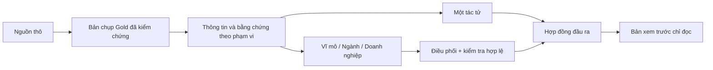

# Bản trình chiếu — Phân tích ngân hàng dựa trên nguồn có truy nguyên

## Trang 1 — Bài toán và câu hỏi nghiên cứu

**Khi nào kiến trúc đa tác tử phân cấp đáng dùng hơn kiến trúc một tác tử?**

- Nhiều ngân hàng, nhiều quý, nhiều chỉ số và nhiều nguồn tạo ra ngữ cảnh cùng
  bằng chứng phức tạp.
- Cần so sánh chất lượng đồng thời với chi phí, độ trễ và tỷ lệ thất bại.
- Mục tiêu là tìm điểm chuyển lợi thế, không mặc định đa tác tử luôn thắng.

## Trang 2 — Hệ thống đề xuất

- Tầng dữ liệu: mã nguồn tính toán và kiểm tra kỳ/đơn vị.
- Tầng bằng chứng: vị trí nguồn, bằng chứng theo trang, dữ liệu thiếu và mâu
  thuẫn.
- Tầng tác tử: truy xuất, giải thích, phản biện và tổng hợp.

## Trang 3 — Đầu vào, xử lý, đầu ra

**Đầu vào:** 5 ngân hàng × 4 quý × 4 chỉ số, bản chụp Gold, chính sách nguồn,
bộ câu hỏi, mã bằng chứng, cấu hình mô hình.

**Xử lý:** truy vấn xác định chỉ đọc → đóng gói ngữ cảnh → phân vai tác tử →
kiểm tra hợp đồng → phát hiện bất thường/kiểm tra có giới hạn → tổng hợp.

**Đầu ra:** bảng so sánh, xu hướng, nhận định, chi tiết bằng chứng, giới hạn,
trạng thái chất lượng và bản ghi số liệu vận hành gồm token/chi phí/độ trễ/
thất bại.

## Trang 4 — Nền dữ liệu và kiểm soát công bằng

| Hạng mục | Giá trị |
|---|---:|
| Ô mục tiêu | 80 |
| Quan sát hợp lệ | 76 |
| Ô thiếu rõ ràng | 4 |
| Ô hợp lệ có bằng chứng đã rà soát | 76/76 |
| Đoạn bằng chứng | 116 |
| Mô hình cố định | `gpt-5.6-luna` |

Ba nhánh xử lý dùng cùng bản chụp, thông tin/bằng chứng, bộ câu hỏi, chính sách
nguồn, mô hình và hợp đồng đầu ra. Khác biệt chính nằm ở cách tổ chức vai trò
và việc có bật phản biện hay không.

## Trang 5 — Thiết kế và kết quả thực nghiệm

- 75 bản ghi chạy dự kiến: 5 mức số lượng ngân hàng × 3 nhánh × 5 lần lặp.
- 61 lượt hoàn tất; 14 lượt thất bại: 9 lỗi ngữ cảnh, 2 lỗi lược đồ/kiểm tra,
  3 lỗi kết nối API.
- 244 dòng chấm mù của con người trên bốn chiều: tính đúng, tính hữu ích,
  bằng chứng và giới hạn.

| Nhánh | Điểm nổi bật |
|---|---|
| Một tác tử | Rẻ và nhanh ở khối lượng nhỏ |
| Đa tác tử phân cấp, không phản biện | Có lợi ích tại 3 ngân hàng |
| Đa tác tử phân cấp, phản biện giới hạn | Chưa có điểm chuyển lợi thế; chi phí và lỗi cao hơn |

## Trang 6 — Điểm chuyển lợi thế và đánh đổi

**Điểm chuyển lợi thế quan sát được ở 3 ngân hàng:**

- đa tác tử phân cấp không phản biện tăng chất lượng **+0,05**;
- **3/5** lần lặp cho kết quả dương;
- chi phí bằng **2,622757 lần** một tác tử;
- độ trễ bằng **1,698339 lần** một tác tử;
- tỷ lệ thất bại trong cặp so sánh là **0%**.

Ở 4–5 ngân hàng, tỷ lệ thất bại làm phép so sánh chưa đầy đủ. Đây là kết quả có
điều kiện trong giao thức hiện tại, không phải quy luật mở rộng phổ quát.

## Trang 7 — Kết luận và bước tiếp theo

- Câu hỏi nhỏ: dùng một tác tử.
- Nhiều ngân hàng và nhiều góc nhìn: cân nhắc đa tác tử phân cấp không phản biện.
- Có bất thường và còn đủ ngân sách: bật kiểm tra phản biện có giới hạn.
- Hoàn thiện báo cáo có thể ra quyết định, giao diện xem trước và lượt chạy kiểm
  tra độ bền; giữ nguyên Gold/bộ câu hỏi/mô hình/tiêu chí.
- Chỉ mở rộng lên 8 quý hoặc 200 ô sau khi rà soát bằng chứng và được thầy duyệt
  phạm vi.
