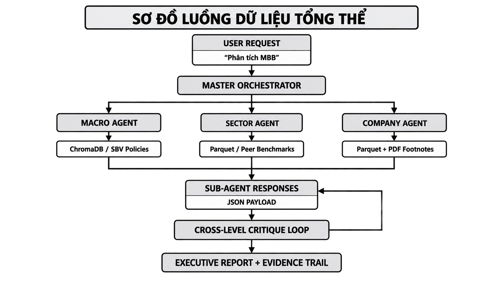
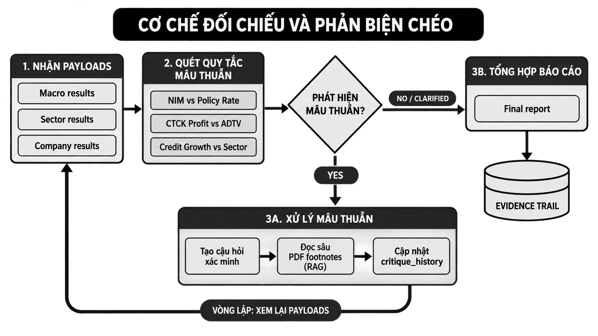

# Khoá luận tốt nghiệp - Cường - GVHD: Lê Văn

> Converted from `Khoá luận tốt nghiệp - Cường - GVHD_ Lê Văn.pdf`. Original page count: 33.

## Trang 1

Đề cương sơ bộ

---

## Trang 2

PHẦN 1: ĐỀ CƯƠNG SƠ BỘ KHÓA LUẬN TỐT NGHIỆP
Ngành: Fintech - Đại học Kinh tế TP.HCM (UEH)
Tên đề tài (Tiếng Việt): Thiết kế và đánh giá hệ thống Multi-Agent Hierarchical hỗ
trợ phân tích ngành Ngân hàng và Chứng khoán niêm yết tại Việt Nam
Tên đề tài (Tiếng Anh): A Hierarchical Multi-Agent System for Sector Analysis: A
Case Study of Vietnam's Listed Banking and Securities Industry
1. Bối cảnh và vấn đề nghiên cứu
Phân tích ngành Ngân hàng và Chứng khoán đòi hỏi sự kết hợp chặt chẽ logic
top-down: Chính sách điều hành của Ngân hàng Nhà nước (lãi suất, room tín dụng,
thanh khoản hệ thống) $\rightarrow$ Xu hướng và định giá toàn ngành (tăng trưởng
tín dụng, CASA, nợ xấu, thanh khoản thị trường) $\rightarrow$ Báo cáo tài chính và
sức khỏe nội tại của từng tổ chức niêm yết.
Hiện nay, phần lớn các hệ thống AI tài chính tại Việt Nam vận hành theo cấu trúc
phẳng (flat) hoặc tập trung trả lời tác vụ đơn lẻ cho từng mã cổ phiếu, thiếu cơ chế đối
chiếu chéo (cross-level critique) giữa các tầng thông tin khi dữ liệu vĩ mô, ngành và
doanh nghiệp phát tín hiệu trái ngược nhau. Đề tài tập trung giải quyết khoảng trống
này bằng việc xây dựng một kiến trúc phân tầng có cơ chế kiểm tra tính nhất quán tự
động.
2. Mục tiêu nghiên cứu
- Thiết kế và phát triển prototype hệ thống Hierarchical Multi-Agent with
Supervisor Loop phục vụ phân tích nhóm ngành Ngân hàng và Chứng khoán
niêm yết.
- Tích hợp cơ chế Cross-level Critique & Feedback Loop vào Master
Orchestrator Agent để tự động phát hiện mâu thuẫn giữa số liệu doanh nghiệp
với bối cảnh ngành/vĩ mô trước khi xuất báo cáo.
- Đánh giá hiệu quả của hệ thống thông qua so sánh thực nghiệm với mô hình
Single-Agent Baseline về: độ sâu insight, tính nhất quán logic, khả năng trích
xuất bằng chứng (evidence trail) và độ chính xác dữ liệu.

---

## Trang 3

3. Dữ liệu và phương pháp nghiên cứu
- Phạm vi đối tượng: Nhóm 15-20 cổ phiếu Ngân hàng và Chứng khoán có
thanh khoản và chất lượng công bố thông tin cao trên HOSE/HNX.
- Chiến lược dữ liệu:
  - Dữ liệu doanh nghiệp & ngành (Định lượng): Thu thập tự động qua thư
viện API mã nguồn mở (vnstock), chuẩn hóa các chỉ số đặc thù (NIM,
CASA, NPL, CIR, Margin, FVTPL) và tự động tính ma trận so sánh
ngang (peer benchmark).
  - Dữ liệu vĩ mô & chính sách (Định tính/Bán cấu trúc): Xây dựng kho tri
thức chọn lọc (Curated Knowledge Base) từ văn bản điều hành của
NHNN, UBCKNN và báo cáo chiến lược ngành, tích hợp qua kỹ thuật
Retrieval-Augmented Generation (RAG).
- Kiến trúc hệ thống:
  - Master Orchestrator Agent (Supervisor & Synthesis): Đóng vai trò
Trưởng nhóm phân tích, chịu trách nhiệm tiếp nhận truy vấn, phân rã
nhiệm vụ cho sub-agents, chạy vòng lặp kiểm định chéo logic (Critique
loop), tổng hợp báo cáo và push-back/tương tác với người dùng.
  - 3 Specialized Sub-Agents: Macro Agent (chính sách, lãi suất, thanh
khoản), Sector Agent (cơ cấu ngành, benchmark trung vị), Company
Agent (bóc tách báo cáo tài chính và chỉ số cơ bản).
- Phương pháp nghiên cứu: Design Science Research (DSR) kết hợp Case
Study thực nghiệm.
4. Kết quả dự kiến
4.1. Prototype hệ thống multi-agent hierarchical
Một hệ thống vận hành được, nhận đầu vào là yêu cầu phân tích (ví dụ: "phân tích
ngành Ngân hàng quý gần nhất, tập trung nhóm ngân hàng tư nhân lớn, đánh giá tác
động của thay đổi lãi suất điều hành"), và tự động điều phối qua các tầng agent
(Macro → Sector → Company → Critique → Synthesis) để tạo báo cáo hoàn chỉnh,
không cần người dùng tự tổng hợp thủ công từng nguồn.

---

## Trang 4

4.2. Báo cáo phân tích có cấu trúc, kèm evidence trail
Không phải một đoạn văn tổng hợp chung chung, mà là báo cáo có:
- Nhận định ở từng tầng (vĩ mô, ngành, doanh nghiệp), mỗi nhận định gắn với
nguồn số liệu cụ thể đã dùng để suy ra kết luận đó.
- Bảng so sánh peer giữa các công ty trong phạm vi phân tích, đặt trong bối cảnh
ngành/vĩ mô hiện tại (không phải bảng số liệu thô).
4.3. Danh sách các trường hợp mâu thuẫn được phát hiện
Đây là kết quả quan trọng nhất để chứng minh giá trị của kiến trúc multi-agent so với
phân tích thông thường - tập hợp các trường hợp cụ thể mà Critique Agent phát hiện
độ lệch giữa kết luận tầng doanh nghiệp và bối cảnh tầng ngành/vĩ mô (ví dụ: một
công ty có chỉ số cải thiện ngược chiều xu hướng chung của ngành), kèm mức độ tin
cậy và diễn giải nguyên nhân khả dĩ.
4.4. Bộ so sánh định lượng: multi-agent vs single-agent baseline
Chạy cùng một bộ câu hỏi phân tích trên hai hệ thống (multi-agent hierarchical có
critique, và single-agent/pipeline tuần tự thông thường dùng cùng mô hình nền tảng),
đánh giá trên:
- Số lượng và chất lượng mâu thuẫn/insight phát hiện được (qua spot-check thủ
công, đối chiếu với đánh giá độc lập).
- Mức độ nhất quán giữa các tầng phân tích trong cùng một báo cáo.
- Độ đầy đủ của evidence trail - báo cáo có cho phép truy nguyên lại nguồn số
liệu hay không.
- Thời gian và chi phí xử lý (số lượt gọi model, thời gian phản hồi).
4.5. Thảo luận hạn chế và điều kiện áp dụng thực tế
Phân tích rõ: hệ thống phụ thuộc vào chất lượng và độ đầy đủ của dữ liệu đầu vào; kết
quả trên dữ liệu mẫu/sample hẹp mang tính minh họa kiến trúc (proof of architecture),

---

## Trang 5

chưa phải đánh giá ở quy mô dữ liệu thời gian thực đầy đủ; nêu rõ điều kiện cần để
mở rộng sang dữ liệu real-time và sang các ngành khác.
5. Ý nghĩa của nghiên cứu
5.1. Đối tượng hưởng lợi và bài toán được giải quyết
Đối tượng hướng đến là chuyên viên phân tích tại công ty chứng khoán/quỹ đầu tư và
nhà đầu tư cá nhân có nhu cầu phân tích ngành ở mức độ chuyên sâu (không phải giao
dịch ngắn hạn). Bài toán thực tế mà nhóm đối tượng này gặp phải: phân tích ngành
theo logic top-down (vĩ mô → ngành → doanh nghiệp) hiện phụ thuộc vào việc tự
tổng hợp thủ công nhiều nguồn dữ liệu rời rạc, và không có cơ chế hệ thống để kiểm
tra tính nhất quán giữa các lớp phân tích - dẫn đến rủi ro bỏ sót mâu thuẫn (ví dụ
đánh giá tích cực về một doanh nghiệp mà không đối chiếu với xu hướng ngược chiều
của toàn ngành).
5.2. Giá trị cụ thể mà hệ thống mang lại
- Giảm thời gian tổng hợp phân tích top-down: hệ thống tự động hóa bước thu
thập và liên kết dữ liệu giữa ba tầng, để người dùng tập trung vào việc thẩm
định và ra quyết định thay vì thao tác tổng hợp thủ công.
- Giảm rủi ro bỏ sót mâu thuẫn nhờ cơ chế đối chiếu chéo có hệ thống: khác
với phân tích thủ công (phụ thuộc vào việc người phân tích có nhớ đối chiếu đủ
các nguồn hay không), cơ chế critique trong kiến trúc multi-agent thực hiện
việc đối chiếu này một cách nhất quán ở mọi lần chạy.
- Tăng khả năng giải thích và truy vết (explainability): mỗi kết luận trong báo
cáo đều có thể truy ngược về nguồn dữ liệu cụ thể, khác với việc chỉ nhận một
khuyến nghị mà không rõ căn cứ - đặc điểm quan trọng khi kết quả phân tích
được dùng làm cơ sở cho quyết định đầu tư/khuyến nghị.
5.3. Đóng góp học thuật
Nghiên cứu đề xuất và kiểm chứng thực nghiệm một kiến trúc multi-agent có cơ chế
đối chiếu chéo giữa các tầng phân tích (cross-level critique) áp dụng cho bài toán phân

---

## Trang 6

tích ngành tài chính - khác biệt với phần lớn hệ thống hiện có tại Việt Nam vốn vận
hành theo cấu trúc phẳng hoặc phân tầng yếu, tập trung trả lời nhanh về từng mã cổ
phiếu riêng lẻ mà thiếu cơ chế kiểm tra tính nhất quán xuyên suốt giữa bối cảnh vĩ mô,
ngành và doanh nghiệp. Kết quả so sánh định lượng với baseline single-agent góp
phần làm rõ khi nào kiến trúc multi-agent thực sự tạo ra giá trị gia tăng so với việc chỉ
dùng một mô hình ngôn ngữ lớn với prompt phức tạp.
5.4. Giới hạn về mức độ ứng dụng thực tế ở giai đoạn khóa luận
Ở quy mô một khóa luận tốt nghiệp, nghiên cứu chứng minh tính khả thi của kiến trúc
(proof of architecture) trên dữ liệu mẫu/sample hẹp, chưa phải một sản phẩm sẵn sàng
triển khai cho người dùng thực tế sử dụng liên tục với dữ liệu thời gian thực. Giá trị
thực tiễn ở giai đoạn này nằm ở việc cung cấp bằng chứng thực nghiệm và nguyên tắc
thiết kế (design principles) làm cơ sở cho các bước phát triển tiếp theo, nếu tổ chức có
nhu cầu triển khai ở quy mô lớn hơn.

---

## Trang 7

Data

---

## Trang 8

3. THIẾT KẾ & TÍNH KHẢ THI CỦA HỆ THỐNG DỮ LIỆU (HYBRID DATA
PIPELINE)
3.1. Triết lý Thiết kế (Design Philosophy)
Trong phân tích tài chính, việc để LLM tự tính toán hoặc trích xuất số liệu trực tiếp từ
văn bản thuần dễ dẫn đến hiện tượng ảo giác (hallucination) và sai lệch số học. Do
đó, đề tài xây dựng kiến trúc Hybrid Data Pipeline tách biệt hai luồng xử lý:
1. Luồng Định lượng (Quantitative Tabular Pipeline): Thu thập và tính toán số
liệu tài chính có cấu trúc bằng mã nguồn Python xác thực, lưu trữ offline để
phục vụ truy vấn chính xác $100\%$.
2. Luồng Định tính (Qualitative Semantic RAG Pipeline): Trích xuất ngữ
nghĩa, bối cảnh chính sách và các phần thuyết minh báo cáo tài chính phức tạp
thông qua hệ thống Vector Database được đánh chỉ mục (indexing) chi tiết.
3.2. Sơ đồ Kiến trúc Dữ liệu (Data Flow Diagram)
3.3. Ma trận Nguồn Dữ liệu & Đánh giá Tính Khả thi
Tầng phân Nguồn dữ Định dạng & Danh mục chỉ Mức độ
tích liệu Công cụ số / Thông tin khả thi
(Source) cốt lõi
Doanh - vnstock - Bảng cấu Ngân hàng: 95%
nghiệp trúc NIM, CASA,
(Company) (DataFrame) NPL (Nhóm
3-5), LLR, CIR,
LDR, CAR.
- Repo (Dữ liệu
PDF sẵn có,
thanhnp-uel - PDF BCTC chuẩn hóa
kiểm toán cao)
Chứng khoán:
Margin/Vốn
CSH, FVTPL,
Doanh thu Môi
giới.

### Bảng trích xuất

| Tầng phân tích | Nguồn dữ liệu (Source) | Định dạng & Công cụ | Danh mục chỉ số / Thông tin cốt lõi | Mức độ khả thi |
| --- | --- | --- | --- | --- |
| Doanh nghiệp (Company) | - vnstock - Repo PDF thanhnp-uel | - Bảng cấu trúc (DataFrame) - PDF BCTC kiểm toán | Ngân hàng: NIM, CASA, NPL (Nhóm 3-5), LLR, CIR, LDR, CAR. Chứng khoán: Margin/Vốn CSH, FVTPL, Doanh thu Môi giới. | 95% (Dữ liệu sẵn có, chuẩn hóa cao) |

---

## Trang 9

Thuyết minh:
Chi tiết dư nợ
theo ngành, cơ
cấu nợ xấu.
Toàn ngành - Engine - Time-series - Trung vị ngành 90%
(Sector) tính toán tổng hợp (Sector Median)
nội bộ của toàn bộ 27
NHTM & 30
CTCK.
(Tự động
- PDF Chiến tính từ tập
- Báo cáo lược ngành dữ liệu
CTCK gộp)
(SSI, - Tăng trưởng
Vietcap) tín dụng toàn hệ
thống.
- Giá trị giao
dịch bình quân
(ADTV) & Thị
phần môi giới.

### Bảng trích xuất

|  |  |  | Thuyết minh: Chi tiết dư nợ theo ngành, cơ cấu nợ xấu. |  |
| --- | --- | --- | --- | --- |
| Toàn ngành (Sector) | - Engine tính toán nội bộ - Báo cáo CTCK (SSI, Vietcap) | - Time-series tổng hợp - PDF Chiến lược ngành | - Trung vị ngành (Sector Median) của toàn bộ 27 NHTM & 30 CTCK. - Tăng trưởng tín dụng toàn hệ thống. - Giá trị giao dịch bình quân (ADTV) & Thị phần môi giới. | 90% (Tự động tính từ tập dữ liệu gộp) |

---

## Trang 10

Vĩ mô - Cổng - PDF Văn - Lãi suất điều 85%
(Macro) thông tin bản pháp quy hành (Tái cấp
SBV vốn, Tái chiết
khấu).
(Kho tri
- Chuỗi thời thức chọn
- GSO & gian CSV lọc
FiinGroup - Lãi suất liên Curated
ngân hàng KB)
(Overnight, 1W,
1M).
- Thông tư điều
hành trọng điểm
(TT02/2023,
TT06/2023).
3.4. Chi tiết Quy trình Thu thập, Tiền xử lý & Lưu trữ
A. Xử lý Dữ liệu Định lượng (Tabular Data Engine)
- Thu thập tự động: Sử dụng script Python kết nối thư viện vnstock để cào tự
động BCTC 8-12 quý gần nhất của 16 mã mục tiêu và toàn bộ nhóm cổ phiếu
ngành.
- Tính toán chỉ số phái sinh (Feature Engineering):
  - Biên lãi thuần: $\text{NIM} = \frac{\text{Thu nhập lãi
thuần}}{\text{Tổng tài sản sinh lời bình quân}}$
  - Tỷ lệ tiền gửi không kỳ hạn: $\text{CASA} = \frac{\text{Tiền gửi
không kỳ hạn}}{\text{Tổng tiền gửi khách hàng}}$
  - Phân vị ngành: Tự động xếp hạng percentile rank từng mã so với đối thủ
cùng phân khúc.
- Lưu trữ cục bộ: Xuất ra định dạng file Parquet / SQLite đặt tại thư mục dự
án (data/processed/), đảm bảo tốc độ truy vấn mili-giây và tính tái lập
(reproducibility) khi thực nghiệm đối đầu với baseline.
B. Xử lý Dữ liệu Thuyết minh & Văn bản (Unstructured RAG Pipeline)

### Bảng trích xuất

| Vĩ mô (Macro) | - Cổng thông tin SBV - GSO & FiinGroup | - PDF Văn bản pháp quy - Chuỗi thời gian CSV | - Lãi suất điều hành (Tái cấp vốn, Tái chiết khấu). - Lãi suất liên ngân hàng (Overnight, 1W, 1M). - Thông tư điều hành trọng điểm (TT02/2023, TT06/2023). | 85% (Kho tri thức chọn lọc Curated KB) |
| --- | --- | --- | --- | --- |

---

## Trang 11

- Khai thác kho tài liệu PDF (thanhnp-uel & SBV): Lọc BCTC kiểm toán và
BCTN của 16 mã nghiên cứu giai đoạn 2023-2025.
- Chiến lược Chunking & Metadata Filtering:
  - Chia nhỏ văn bản theo đoạn ngữ nghĩa (Semantic Chunking, kích thước
800 tokens, overlap 150 tokens).
  - Gắn nhãn Metadata bắt buộc cho từng chunk:
  - JSON
{
"ticker": "MBB",
"doc_type": "BCTC_Kiem_toan",
"fiscal_year": 2024,
"period": "Q4",
"section": "Thuyet_minh_du_no_khach_hang"
}
  -
  -
  - Vector Database: Lưu trữ cục bộ trên ChromaDB, sử dụng embedding
model đa ngôn ngữ tối ưu cho văn bản tài chính
(text-embedding-3-small hoặc bge-m3).
3.5. Giao thức Trao đổi Dữ liệu giữa các Agent (Data Contract)
Dữ liệu trả về từ các Tool truy xuất được ép kiểu chặt chẽ bằng Pydantic Schema để
bảo đảm Master Orchestrator nhận đúng định dạng phục vụ kiểm tra chéo:
Python
from pydantic import BaseModel, Field
from typing import List, Dict, Optional
class FinancialMetricPayload(BaseModel):
ticker: str
period: str
metrics: Dict[str, float] = Field(description="Chỉ số định lượng: NIM, CASA, NPL,
LLR...")
sector_medians: Dict[str, float] = Field(description="Trung vị ngành cùng kỳ")
percentile_rank: Dict[str, int] = Field(description="Xếp hạng phân vị (1-100)")
class QualitativeEvidence(BaseModel):
source_document: str = Field(description="Tên văn bản hoặc báo cáo BCTC")
page_number: Optional[int]
evidence_text: str = Field(description="Đoạn văn bản trích dẫn nguyên văn")

---

## Trang 12

class SubAgentResponse(BaseModel):
agent_id: str
status: str
quantitative_data: Optional[FinancialMetricPayload]
qualitative_evidences: List[QualitativeEvidence]
key_findings: List[str]
3.6. Biện pháp Kiểm soát Rủi ro Dữ liệu (Risk Mitigation)
1. Rủi ro API gián đoạn: Lưu trữ sẵn snapshot dữ liệu dạng file Parquet tĩnh sau
lần crawl đầu tiên, đảm bảo quá trình benchmark mô hình không bị phụ thuộc
vào kết nối mạng.
2. Rủi ro OCR lỗi trên file PDF scan: Áp dụng bộ lọc tài liệu ưu tiên các file
BCTC định dạng PDF gốc (text layer) từ kho thanhnp-uel; đối với văn bản scan
của SBV, sử dụng parser chuyên dụng có trích xuất bảng biểu (table-aware
parser).
3. Rủi ro mâu thuẫn kỳ báo cáo: Đồng bộ hóa toàn bộ chu kỳ thời gian về đơn
vị Quý ($\text{Q}_t$) hoặc Năm tài chính ($\text{FY}_t$), gắn kèm nhãn thời
gian rõ ràng trong mọi truy vấn RAG.

---

## Trang 13

Chuẩn bị Dataset

---

## Trang 14

CHUẨN BỊ DATASET
1. Mục tiêu và phương thức khai thác dữ liệu
Dataset được xây dựng nhằm phục vụ việc phân tích định lượng và định tính đối với
một nhóm cổ phiếu đại diện cho ngành Ngân hàng và ngành Chứng khoán tại Việt
Nam. Dữ liệu được thu thập từ các nguồn có cấu trúc và phi cấu trúc, sau đó chuẩn
hóa, tính toán các chỉ số phái sinh và lưu trữ cục bộ để phục vụ quá trình phân tích,
truy xuất và thử nghiệm mô hình.
1.1. Danh mục nguồn dữ liệu cần tìm và tải về
1.1.1. Phương pháp tính tỷ lệ lấy được
Tỷ lệ dưới đây đo khả năng truy xuất và tải được dữ liệu cần thiết, không phải tỷ lệ
dữ liệu đã được kiểm tra tính đúng/sai. Mốc đánh giá: 15/08/2026. Với dữ liệu doanh
nghiệp, mẫu kiểm tra gồm 16 mã cổ phiếu và chuỗi 8-12 quý. Riêng báo cáo thường
niên dạng PDF được đối chiếu theo 48 hồ sơ mục tiêu của 16 mã trong ba năm
2023-2025. Các tỷ lệ có dấu “~” là ước tính thực tế dựa trên khả năng truy cập, cách
công bố của nguồn và kiểm tra mẫu; cần chốt lại lần cuối bằng download manifest khi
chạy pipeline.
1.1.2. Bảng đánh giá độ phủ nguồn dữ liệu
Nhóm Nguồn Dữ liệu Tỷ lệ lấy Căn cứ và điểm Mức độ ưu
nguồn cần cần tìm được ước thiếu tiên
khai và tải tính
thác về

---

## Trang 15

BCTC Thư viện Bảng 100% dữ Tài liệu Bắt buộc
dạng bảng API cân đối liệu thô vnstock công
vnstoc kế toán, bố các endpoint
~90-95%
k, nguồn báo cáo cho báo cáo tài
trường phục
VCI và kết quả chính, tỷ số và
vụ chỉ số
TCBS hoạt lịch sử giá; dữ
phái sinh
động liệu giá lịch sử có
kinh từ năm 2020, bao
doanh, phủ giai đoạn
báo cáo nghiên cứu. Một
lưu số chỉ số như
chuyển CAR, LDR hoặc
tiền tệ, CASA có thể cần
dữ liệu lấy thêm từ
giá và thuyết minh
khối BCTC thay vì
lượng một cột chuẩn
giao hóa duy nhất.
dịch
BCTN/BC Reposito Báo cáo 89,6% Tính trực tiếp từ Bắt buộc
TC dạng ry thường file_index_
43/48 hồ sơ
PDF annual niên
full.csv của
năm
reports dạng
dataset: VCB,
2023-2025
trên PDF, ưu
BID, CTG, TCB,
GitHub tiên bản
MBB, ACB,
và bản gốc có
VPB, LPB, SSI,
lưu trữ lớp văn
VND, HCM,
Zenodo bản của
VCI và MBS có
16 mã
đủ 2023-2025;
mục tiêu
HDB và STB
thiếu 2023;
TCBS chưa có
hồ sơ trong
index.
Repository bao
phủ báo cáo

---

## Trang 16

thường niên đến
năm 2025, không
thay thế được dữ
liệu quý.
Báo cáo Trang BCTC ~95% Các doanh Bắt buộc
cập nhật quan hệ quý, nghiệp lớn trong khi
của doanh nhà đầu BCTC mẫu đều có kênh repository/
nghiệp tư (IR) bán công bố thông API thiếu
của 16 niên, tin/IR hoặc tài dữ liệu
ngân BCTC liệu được lưu tại
hàng và năm, cổng dữ liệu
công ty báo cáo công khai; hạn
chứng thường chế chính là cấu
khoán; niên và trúc website
có thể công bố không đồng nhất,
dùng thông link PDF có thể
Kreston tin mới thay đổi và một
Financia nhất số tài liệu phải
l Data chưa có tải thủ công.
làm trong Dùng để bù
nguồn reposito HDB, STB,
dự ry TCBS và các kỳ
phòng quý mà
repository không
có.
Dữ liệu giá HOSE, Giá trị 100% cho Dữ liệu lịch sử Bắt buộc
và thanh HNX và giao ADTV/giá/k giá/khối lượng đã
khoản dữ liệu dịch, hối lượng có thể lấy qua
lịch sử khối vnstock; các
từ lượng, báo cáo và thống
vnstoc dữ liệu kê chính thức của
k chỉ số Sở dùng để đối
thị chiếu. Cần chuẩn
trường hóa đơn vị và
và thống

---

## Trang 17

kê thanh loại bỏ ngày
khoản không giao dịch.
Thị phần HOSE Thị ~90% HNX có các Bắt buộc
môi giới và HNX phần trang công bố
môi giới theo quý/năm,
cổ phiếu nhưng thường
theo quý tập trung vào top
của SSI, 10; HOSE cũng
VND, công bố bảng xếp
HCM, hạng theo kỳ.
VCI, Sáu công ty trong
TCBS mẫu thường nằm
và MBS trong nhóm dẫn
đầu, nhưng
không nên giả
định đủ 100%
cho mọi quý nếu
một công ty rơi
khỏi top 10 hoặc
nguồn chỉ công
bố bảng xếp hạng
rút gọn.
Chính Ngân Thông 100% văn Văn bản pháp Bắt buộc
sách, lãi hàng tư, bản/lãi suất quy và các thông
suất và tín Nhà quyết cáo chính sách
~90% chuỗi
dụng nước định được công bố
tín dụng/huy
Việt điều trên cổng
động
Nam hành, lãi NHNN; chuỗi tín
suất dụng/huy động
điều thường xuất hiện
hành, qua thông cáo
thông hoặc báo cáo
tin tăng định kỳ nhưng
trưởng không phải lúc
tín dụng nào cũng ở dạng

---

## Trang 18

và huy bảng tải tự động,
động nên cần lưu PDF
và trích xuất thủ
công khi cần.
Dữ liệu Tổng Báo cáo 100% báo GSO có lịch và Bắt buộc
kinh tế vĩ cục tình cáo định kỳ kho báo cáo định
mô Thống hình kỳ theo
~95% chỉ
kê kinh tế - tháng/quý; điểm
tiêu cần dùng
(GSO) xã hội trừ là một số chỉ
theo tiêu được phát
tháng/qu hành dưới
ý, báo PDF/infographic,
cáo sáu cần chuyển đổi
tháng, và chuẩn hóa
chín trước khi đưa vào
tháng và dataset dạng
cả năm; bảng.
các chỉ
tiêu
GDP,
CPI, IIP,
bán lẻ
và
doanh
nghiệp

---

## Trang 19

SSI SSI Báo cáo ~65% Portal có bộ lọc Bổ sung/đối
Research Researc vĩ mô, theo mã, ngành chiếu
h Portal báo cáo và năm, nhưng
ngành, hướng dẫn chính
báo cáo thức yêu cầu
thị đăng nhập bằng
trường tài khoản được
và báo cấp để đọc/tải
cáo cập báo cáo. Vì vậy
nhật tỷ lệ trên phản
doanh ánh phần tài liệu
nghiệp công khai hoặc
có thể tải sau khi
được cấp quyền,
không phải độ
phủ nội dung mà
SSI có trong hệ
thống.
Vietcap Trung Báo cáo ~90% Trang phân tích Bổ sung/đối
Research tâm chiến có danh mục báo chiếu
Phân lược, cáo và nhiều file
tích báo cáo PDF được công
Vietcap ngành, khai trực tiếp;
báo cáo vẫn có thể có tài
vĩ mô và liệu chỉ hiển thị
báo cáo tóm tắt hoặc link
cập nhật hết hạn.
doanh
nghiệp

---

## Trang 20

MBS MBS Báo cáo ~90% MBS thường Bổ sung/đối
Research Researc chiến công khai file chiếu
h lược PDF theo đường
ngành dẫn cố định hoặc
tài trang báo cáo;
chính, một số báo cáo
báo cáo cũ có thể phải
ngân tìm qua archive
hàng, hoặc tải thủ
báo cáo công.
thị
trường
và báo
cáo cập
nhật
1.2. Checklist thu thập dữ liệu
Trước khi bắt đầu tiền xử lý, cần bảo đảm đã thu thập đủ các nhóm tài liệu sau:
- Dữ liệu báo cáo tài chính theo quý và theo năm của đủ 16 mã mục tiêu trong
phạm vi 8-12 quý.
- Dữ liệu giá và khối lượng giao dịch tương ứng với cùng giai đoạn phân tích.
- Báo cáo tài chính năm đã kiểm toán và báo cáo thường niên dạng PDF của các
mã mục tiêu.
- Báo cáo quý/bán niên mới nhất từ trang IR của doanh nghiệp nếu repository
không có.
- Thị phần môi giới theo quý và dữ liệu thanh khoản từ HOSE/HNX.
- Văn bản chính sách, thông tư và quyết định điều hành có liên quan từ Ngân
hàng Nhà nước.
- Báo cáo kinh tế - xã hội định kỳ từ GSO.
- Báo cáo chiến lược hoặc báo cáo cập nhật ngành từ SSI Research, Vietcap và
MBS.
Mỗi tệp dữ liệu tải về cần được lưu kèm thông tin nguồn tối thiểu gồm: tên nguồn,
đường dẫn, thời điểm tải, mã cổ phiếu, kỳ báo cáo, loại tài liệu và trạng thái kiểm tra.
Đối với tài liệu PDF, nên lưu thêm mã băm tệp (file hash) để kiểm soát phiên bản và
tránh xử lý trùng lặp.

---

## Trang 21

1.3. Kết luận về độ phủ và thứ tự ưu tiên
- Có thể chốt 100%: BCTC dạng bảng, dữ liệu giá/khối lượng và báo cáo chính
sách/lãi suất ở tầng nguồn. Đây là các nguồn nền tảng để xây dựng dataset định
lượng.
- Có độ phủ cao nhưng cần bù: BCTN/BCTC PDF từ repository đạt 89,6%;
cần dùng IR doanh nghiệp để bù HDB, STB và TCBS, đồng thời bổ sung các
báo cáo quý.
- Có độ phủ phụ thuộc cách công bố: Thị phần môi giới đạt khoảng 90% vì
HOSE/HNX có thể chỉ công bố top 10 theo kỳ.
- Không nên dùng làm nguồn lõi: Báo cáo nghiên cứu ngành của SSI, Vietcap
và MBS chỉ nên dùng để bổ sung bối cảnh và tạo giả thuyết; không dùng thay
thế cho số liệu gốc. SSI có độ truy cập thấp hơn do yêu cầu đăng nhập.
1.4. Dữ liệu định lượng có cấu trúc
Dữ liệu định lượng được thu thập tự động thông qua thư viện API vnstock, sử dụng
nguồn dữ liệu từ VCI và TCBS. Phạm vi dữ liệu bao gồm ba nhóm báo cáo tài chính
cốt lõi - bảng cân đối kế toán, báo cáo kết quả hoạt động kinh doanh và báo cáo lưu
chuyển tiền tệ - cùng các chỉ số tài chính được tính toán bổ sung.
Quy trình khai thác dữ liệu gồm các bước chính:
1. Gọi API để thu thập dữ liệu báo cáo tài chính theo quý và theo năm của các mã
mục tiêu.
2. Chuẩn hóa tên trường dữ liệu, đơn vị tính và mốc thời gian giữa các doanh
nghiệp.
3. Tính toán các tỷ số tài chính và chỉ số phái sinh theo đặc thù từng ngành.
4. Tính toán các chỉ số tổng hợp theo ngành, bao gồm trung vị, giá trị trung bình
và độ lệch chuẩn.
5. Lưu trữ dữ liệu đã xử lý dưới định dạng Parquet hoặc SQLite để phục vụ truy
xuất nhanh và hạn chế phụ thuộc vào kết nối mạng.
1.5. Dữ liệu định tính và dữ liệu phi cấu trúc
Dữ liệu định tính được khai thác từ các tài liệu PDF, văn bản pháp quy, báo cáo kinh
tế và báo cáo phân tích ngành. Các tài liệu được tải về, phân tích nội dung, chia thành
các đoạn theo ngữ nghĩa và gắn metadata trước khi đưa vào kho dữ liệu vector để
phục vụ tìm kiếm ngữ nghĩa và truy xuất tăng cường bằng tri thức (RAG).
Các nhóm nguồn và nội dung trọng tâm gồm:

---

## Trang 22

- Báo cáo tài chính và báo cáo thường niên: Khai thác kho mở
thanhnp-uel/vietnam-listed-companies-annual-reports để
thu thập các bản PDF gốc, ưu tiên các báo cáo đã được kiểm toán của 16 mã
mục tiêu. Nội dung trọng tâm cần trích xuất gồm thuyết minh phân loại nợ theo
ngành nghề, cơ cấu danh mục FVTPL, ý kiến của kiểm toán viên và giao dịch
với các bên liên quan.
- Kho tri thức vĩ mô và chính sách: Thu thập văn bản pháp quy, thông tư điều
hành và các quyết định liên quan từ Ngân hàng Nhà nước Việt Nam
(sbv.gov.vn), bao gồm Thông tư 02/2023/TT-NHNN về cơ cấu thời hạn trả
nợ, Thông tư 06/2023/TT-NHNN về hoạt động cho vay và các quyết định điều
chỉnh lãi suất điều hành.
- Dữ liệu kinh tế vĩ mô: Khai thác các báo cáo tình hình kinh tế - xã hội định kỳ
của Tổng cục Thống kê (GSO).
- Báo cáo phân tích ngành: Sử dụng các báo cáo chiến lược ngành tài chính của
SSI Research, Vietcap và MBS để bổ sung bối cảnh thị trường và thông tin
định tính.
1.6. Quy trình xử lý tài liệu và khai thác bằng RAG
Đối với tài liệu PDF, quy trình xử lý dự kiến gồm:
1. Phân tích và chuyển đổi nội dung PDF bằng PDF parser, chẳng hạn
LlamaParse.
2. Chia văn bản theo ngữ nghĩa với kích thước khoảng 800 token và độ chồng lấn
150 token.
3. Tạo vector biểu diễn bằng embedding model phù hợp với tiếng Việt tài chính,
chẳng hạn text-embedding-3-small hoặc bge-m3.
4. Gắn metadata bắt buộc cho từng đoạn văn bản, bao gồm ticker,
fiscal_year, period, doc_type và section_name.
5. Lưu trữ các vector và metadata trong ChromaDB Local Vector Store để phục
vụ tìm kiếm ngữ nghĩa và truy xuất thông tin theo ngữ cảnh.
2. Phạm vi và đối tượng nghiên cứu
2.1. Khung thời gian
Dataset bao gồm chuỗi dữ liệu của 8-12 quý gần nhất tại thời điểm triển khai, dự kiến
trong giai đoạn 2023-2025/2026. Phạm vi này bao gồm cả các kỳ báo cáo năm đã
được kiểm toán nhằm bảo đảm tính đầy đủ và khả năng đối chiếu của dữ liệu.
2.2. Danh mục mã cổ phiếu mẫu

---

## Trang 23

Danh mục kiểm thử gồm 16 mã cổ phiếu, được chia thành hai nhóm ngành như sau:
Nhóm Ngân hàng - 10 mã
- Ngân hàng quốc doanh quy mô lớn: VCB, BID, CTG - đại diện cho nhóm
ngân hàng có quy mô vốn lớn, mức độ an toàn vốn cao và định hướng quản trị
biên lãi tương đối thận trọng.
- Ngân hàng thương mại bán lẻ có tỷ trọng CASA cao: TCB, MBB, ACB,
VPB - đại diện cho nhóm có tỷ trọng tiền gửi không kỳ hạn lớn và mức độ
nhạy cảm nhất định với tín dụng tiêu dùng, tín dụng bất động sản.
- Ngân hàng thương mại tầm trung và tăng trưởng nhanh: HDB, STB, LPB
- đại diện cho các trường hợp có đặc điểm đáng chú ý về xử lý nợ xấu, tái cơ
cấu tài sản và tốc độ tăng trưởng.
Nhóm Công ty Chứng khoán - 6 mã
- Công ty chứng khoán đầu ngành và có thế mạnh bán lẻ: SSI, VND, HCM,
VCI - đại diện cho nhóm có thị phần môi giới lớn và dư nợ cho vay ký quỹ
biến động theo chu kỳ thị trường.
- Công ty thuộc hệ sinh thái ngân hàng và có hoạt động tự doanh quy mô
lớn: TCBS, MBS - đại diện cho nhóm có lợi thế về chi phí vốn và danh mục
tài sản tài chính ghi nhận thông qua lãi/lỗ (FVTPL) quy mô lớn.
3. Danh mục chỉ số và dữ liệu cần thu thập
3.1. Chỉ số đặc thù ngành Ngân hàng
- Biên lãi thuần (NIM):
NIM = Thu nhập lãi thuần / Tổng tài sản sinh lời
bình quân
- Tỷ lệ tiền gửi không kỳ hạn (CASA):
CASA = Tiền gửi không kỳ hạn / Tổng tiền gửi khách
hàng
- Tỷ lệ nợ xấu (NPL, nhóm 3-5):
NPL = (Nợ dưới tiêu chuẩn + Nợ nghi ngờ + Nợ có khả

---

## Trang 24

năng mất vốn) / Tổng dư nợ cho vay
- Tỷ lệ bao phủ nợ xấu (LLR):
LLR = Số dư dự phòng rủi ro cho vay / Tổng nợ xấu
nhóm 3-5
- Tỷ lệ chi phí trên thu nhập (CIR):
CIR = Chi phí hoạt động / Tổng thu nhập hoạt động
(TOI)
- Tỷ lệ cho vay trên huy động (LDR).
- Hệ số an toàn vốn (CAR) theo Thông tư 41.
3.2. Chỉ số đặc thù ngành Chứng khoán
- Cơ cấu doanh thu: tỷ trọng doanh thu từ hoạt động môi giới, lãi cho vay và
cho vay ký quỹ (Margin), cùng lãi/lỗ từ tài sản tài chính FVTPL và HTM.
- Tỷ lệ đòn bẩy cho vay ký quỹ:
Tỷ lệ đòn bẩy Margin = Dư nợ Margin / Vốn chủ sở hữu
Chỉ số này được đối chiếu với mức trần quy định 200%.
- Quy mô và biến động của danh mục tài sản tài chính ghi nhận thông qua
lãi/lỗ (FVTPL).
3.3. Dữ liệu tổng hợp toàn ngành
- Tăng trưởng tín dụng toàn hệ thống và tăng trưởng huy động lũy kế từ đầu năm
(YTD).
- Trung vị ngành, giá trị trung bình và độ lệch chuẩn của các chỉ số NIM, CASA,
NPL, CIR và P/B.
- Thanh khoản bình quân mỗi phiên của thị trường (ADTV).
- Thị phần môi giới theo quý trên HOSE và HNX.

---

## Trang 25

4. Quy trình tiền xử lý và lưu trữ cục bộ
4.1. Luồng xử lý dữ liệu
Nguồn dữ liệu đầu vào được phân thành hai luồng xử lý song song:
1. Luồng dữ liệu dạng bảng - Tabular ETL (vnstock API):
  - Thu thập báo cáo tài chính của 8-12 quý.
  - Tính toán các tỷ số tài chính, trung vị ngành và các chỉ số benchmark.
  - Lưu dữ liệu đã xử lý dưới định dạng Parquet hoặc SQLite.
2. Luồng tài liệu - Document Parser và RAG:
  - Phân tích nội dung PDF bằng PDF parser.
  - Chia tài liệu thành các đoạn theo ngữ nghĩa.
  - Gắn metadata và tạo vector biểu diễn.
  - Lưu trữ trong ChromaDB Local Vector Store.
4.2. Lưu trữ dữ liệu số
Toàn bộ dữ liệu từ bảng cân đối kế toán, báo cáo kết quả hoạt động kinh doanh và ma
trận benchmark được tính toán sẵn sẽ được lưu tại:
data/processed/financial_ratios.parquet
Trong trường hợp cần sử dụng cơ sở dữ liệu quan hệ, có thể lưu thay thế tại
finance_master.sqlite. Cách tổ chức này nhằm bảo đảm tốc độ truy xuất
nhanh và cho phép chạy thử nghiệm mà không phụ thuộc vào kết nối mạng.
4.3. Lưu trữ dữ liệu vector
- Văn bản PDF được chia theo ngữ nghĩa với kích thước khoảng 800 token và độ
chồng lấn 150 token.
- Sử dụng embedding model có khả năng xử lý tốt tiếng Việt trong lĩnh vực tài
chính, chẳng hạn text-embedding-3-small hoặc bge-m3.
- Mỗi đoạn văn bản phải được gắn đầy đủ các metadata sau: ticker,
fiscal_year, period, doc_type và section_name.
5. Biện pháp kiểm soát rủi ro dữ liệu
5.1. Rủi ro gián đoạn kết nối API

---

## Trang 26

Thực hiện snapshot toàn bộ dữ liệu dạng bảng về máy cục bộ ngay từ đầu. Script chỉ
gọi API khi cần cập nhật dữ liệu của các quý mới, qua đó hạn chế tác động của lỗi kết
nối và giảm số lần phụ thuộc vào nguồn dữ liệu bên ngoài.
5.2. Rủi ro OCR và sai lệch bảng biểu trong tài liệu PDF
Ưu tiên sử dụng các file BCTC ở định dạng PDF gốc có lớp văn bản (text layer) từ
repository thanhnp-uel. Đối với các báo cáo có bảng biểu phức tạp hoặc không có
lớp văn bản, sử dụng parser chuyên dụng có khả năng nhận diện cấu trúc bảng để
giảm sai lệch trong quá trình trích xuất.
5.3. Rủi ro không đồng bộ mốc thời gian
Chuẩn hóa toàn bộ chu kỳ dữ liệu về định dạng thống nhất YYYY_QQ, ví dụ
2024_Q4. Quy tắc này giúp hạn chế tình trạng so sánh lệch kỳ giữa các tầng dữ liệu
và các bước phân tích.

---

## Trang 27

Data flow

---

## Trang 28

TÀI LIỆU 2: DATA FLOW
Luồng dữ liệu và giao thức tương tác
1. Sơ đồ luồng dữ liệu tổng thể
Quy trình xử lý được tổ chức theo mô hình nhiều tác tử (multi-agent). Master Orchestrator
tiếp nhận yêu cầu, phân rã nhiệm vụ, điều phối các tác tử chuyên trách, kiểm tra tính nhất
quán và tổng hợp báo cáo cuối cùng.
Diễn giải luồng xử lý
1. Tiếp nhận yêu cầu: Hệ thống tiếp nhận yêu cầu phân tích từ người dùng, ví dụ:
“Phân tích MBB”.
2. Phân rã nhiệm vụ: Master Orchestrator xác định các tham số cần thiết, chẳng hạn
mã cổ phiếu (Ticker) và kỳ phân tích (Period), sau đó chia nhỏ nhiệm vụ.
3. Điều phối tác tử: Yêu cầu được chuyển đến ba tác tử chuyên trách: Macro Agent,
Sector Agent và Company Agent.
4. Truy xuất dữ liệu:
  - Macro Agent truy vấn ChromaDB để khai thác các chính sách và dữ liệu vĩ
mô.
  - Sector Agent truy vấn Parquet để lấy dữ liệu benchmark và thông tin so sánh
trong ngành.
  - Company Agent truy vấn Parquet kết hợp với các thuyết minh trong tài liệu
PDF.

### Hình ảnh

---

## Trang 29

5. Tổng hợp phản hồi: Kết quả từ các tác tử được đóng gói dưới dạng JSON payload
và chuyển về Master Orchestrator.
6. Kiểm tra chéo: Master Orchestrator kiểm tra các mâu thuẫn logic giữa ba cấp độ Vĩ
mô, Ngành và Doanh nghiệp. Nếu phát hiện mâu thuẫn, hệ thống yêu cầu tác tử liên
quan trích xuất thêm bằng chứng và cập nhật payload.
7. Tổng hợp báo cáo: Khi dữ liệu hợp lệ hoặc các mâu thuẫn đã được làm rõ, Master
Orchestrator tổng hợp báo cáo phân tích cuối cùng kèm Evidence Trail.
2. Phân tầng truy xuất của các Agent
Agent Công cụ truy xuất Dữ liệu đầu ra (Payload Output)
Macro Agent - Vector Search Policy - Trạng thái chính sách: nới lỏng/thắt chặt
- Time-series Query - Xu hướng lãi suất điều hành và lãi suất liên
Rate ngân hàng
- Các quy định trọng yếu về nợ và tín dụng
Sector Agent - Tabular Benchmark - Trung vị NIM, CASA và NPL toàn ngành
Tool - Tăng trưởng tín dụng toàn hệ thống
- Market Liquidity Tool - Phân vị xếp hạng (Percentile Rank)
Company - Tabular Ratio Tool - Chỉ số tài chính chi tiết của mã mục tiêu
Agent - PDF Footnote RAG - Đoạn trích dẫn từ thuyết minh BCTC
Tool - Cảnh báo biến động bất thường
3. Đặc tả chuẩn trao đổi dữ liệu
Tất cả các module giao tiếp với nhau thông qua cấu trúc dữ liệu được định nghĩa chặt chẽ
bằng Python Pydantic.
from typing import Dict, List, Optional
from pydantic import BaseModel, Field
class EvidenceSnippet(BaseModel):
source_document: str = Field(
description="Tên file PDF BCTC hoặc văn bản chính sách"
)
page_number: Optional[int] = Field(
default=None,
description="Số trang tài liệu nguồn"
)
extracted_quote: str = Field(
description="Đoạn văn bản trích dẫn nguyên văn"
)

---

## Trang 30

class SubAgentPayload(BaseModel):
agent_id: str
status: str # "SUCCESS" hoặc "FAILED"
ticker: Optional[str] = None
period: str
metrics: Dict[str, float] = Field(
default_factory=dict,
description="Các chỉ số số học"
)
qualitative_findings: List[str] = Field(
default_factory=list,
description="Các nhận định định tính"
)
evidences: List[EvidenceSnippet] = Field(
default_factory=list,
description="Các bằng chứng trích dẫn"
)
class CritiqueLog(BaseModel):
conflict_detected: bool
conflict_type: Optional[str] = Field(
default=None,
description="Ví dụ: NIM_vs_POLICY_RATE_DIVERGENCE"
)
description: str
verification_query: Optional[str] = Field(
default=None,
description="Lệnh truy vấn lại gửi cho Sub-agent"
)
class FinalAnalysisState(BaseModel):
session_id: str
target_ticker: str
target_period: str
macro_data: SubAgentPayload
sector_data: SubAgentPayload
company_data: SubAgentPayload
critique_history: List[CritiqueLog]
final_report_markdown: str
4. Cơ chế đối chiếu và phản biện chéo
Quá trình kiểm tra tính nhất quán được thực hiện theo ba bước tuần tự trong vòng lặp của
Master Orchestrator:

---

## Trang 31

4.1. Các quy tắc phát hiện mâu thuẫn
- Quy tắc 1: NIM của doanh nghiệp tăng trên 30 điểm cơ bản (bps) trong khi lãi suất
điều hành và NIM toàn ngành cùng giảm.
- Quy tắc 2: Lợi nhuận của công ty chứng khoán tăng đột biến trên 50% trong khi
thanh khoản toàn ngành, đo bằng ADTV, giảm trên 20%.
- Quy tắc 3: Tăng trưởng tín dụng của doanh nghiệp chạm trần trong khi tăng trưởng
tín dụng toàn ngành ở mức thấp.
4.2. Xử lý khi phát hiện mâu thuẫn
Khi phát hiện mâu thuẫn, hệ thống thực hiện các bước sau:
1. Master Orchestrator tạo câu hỏi phản biện chuyên sâu.
2. Company Agent kích hoạt PDF Footnote RAG Tool để đọc sâu phần thuyết minh
BCTC và xác định nguyên nhân.
3. Bằng chứng bổ sung được cập nhật vào critique_history.
4. Master Orchestrator đánh giá lại payload và chỉ chuyển sang bước tổng hợp khi mâu
thuẫn đã được làm rõ hoặc có đủ bằng chứng giải thích.
Khi dữ liệu nhất quán hoặc mâu thuẫn đã được giải thích, Master Orchestrator tổng hợp báo
cáo phân tích hoàn chỉnh và gắn Evidence Trail, bao gồm tên tài liệu, kỳ báo cáo và số trang
tham chiếu.

### Hình ảnh

---

## Trang 32

Solution architecture

---

## Trang 33

*Trang này không có lớp văn bản trích xuất được.*
