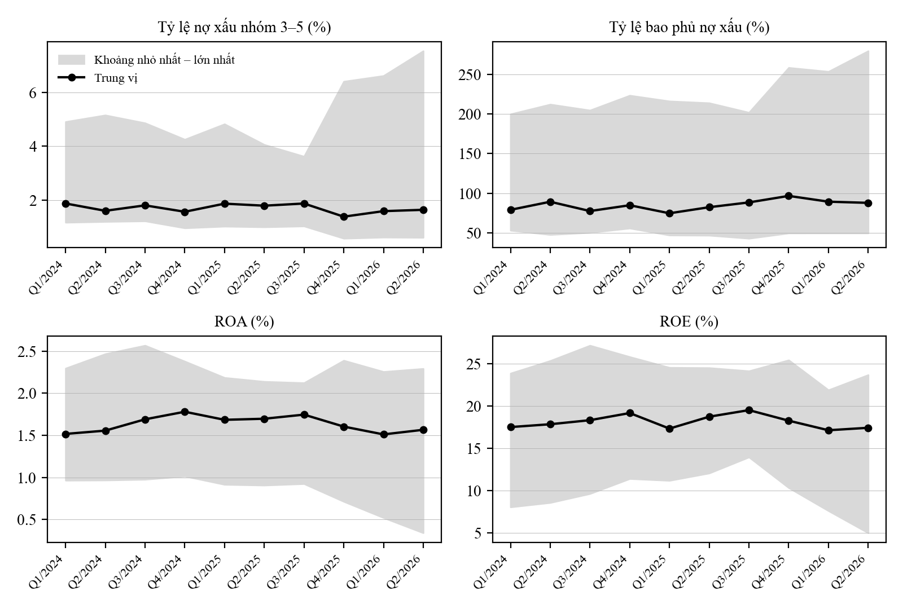

# Thiết kế và đánh giá hệ thống đa tác tử hỗ trợ tổng hợp thông tin và phân tích cơ bản các ngân hàng niêm yết tại Việt Nam

## CHƯƠNG 1. GIỚI THIỆU
### 1.1. Bối cảnh nghiên cứu
Phân tích tài chính là quá trình sử dụng dữ liệu và thông tin liên quan để đánh giá tình hình hoạt động, hiệu quả, vị thế cũng như triển vọng của doanh nghiệp nhằm hỗ trợ các quyết định kinh tế. Theo khung phân tích của Viện CFA, các báo cáo tài chính cần được đặt trong mối tương quan với mô hình kinh doanh, đặc thù ngành, đối thủ cạnh tranh và môi trường kinh tế để hình thành những nhận định phù hợp với mục tiêu của người phân tích (CFA Institute, 2026b).

Cũng theo các tài liệu hướng dẫn của tổ chức này, phạm vi thông tin cần huy động không cố định mà biến thiên theo từng yêu cầu cụ thể (CFA Institute, 2026a, 2026b). Một truy vấn đánh giá biến động tỷ suất sinh lời qua các quý chủ yếu đòi hỏi dữ liệu nội tại của doanh nghiệp; bài toán định vị vị thế tương đối cần mở rộng sang dữ liệu của nhóm so sánh; còn các vấn đề liên quan đến lãi suất hay chính sách tiền tệ lại đòi hỏi bối cảnh kinh tế vĩ mô. Việc sử dụng quá ít thông tin dẫn đến nguy cơ bỏ sót các yếu tố trọng yếu; ngược lại, đưa toàn bộ dữ liệu vào mọi trường hợp chỉ làm quá trình phân tích trở nên cồng kềnh mà không mang lại giá trị gia tăng tương xứng. Vì vậy, một hệ thống hỗ trợ phân tích hiệu quả cần xác định được phạm vi thông tin vừa đủ cho từng câu hỏi thay vì áp dụng một quy trình cứng nhắc cho mọi yêu cầu.

Dữ liệu tài chính còn nhạy với ngữ cảnh. Một giá trị chỉ có nghĩa khi gắn với doanh nghiệp, kỳ báo cáo, chỉ tiêu, đơn vị, phạm vi và phương pháp tính: hai giá trị cùng gọi là ROE có thể không tương đương nếu được tính trên các kỳ khác nhau hoặc với cách xác định vốn chủ sở hữu bình quân khác nhau; số liệu theo quý, lũy kế và cả năm cũng không dùng thay thế cho nhau được (CFA Institute, 2026b). Cùng với đó, kết luận chỉ đáng tin khi người dùng có thể kiểm tra lại giá trị gốc, kỳ, nguồn và cách tính đứng sau nó. Khi dữ liệu không tồn tại, trạng thái thiếu phải được nêu rõ thay vì bị thay bằng một giá trị giả định, vì giá trị lấp chỗ trống có thể lan sang các phép tính và kết luận tiếp theo.

Song song, mô hình ngôn ngữ lớn mở ra khả năng hỗ trợ nhiều nhiệm vụ tài chính, với cách triển khai phụ thuộc vào yêu cầu về dữ liệu, tài nguyên và chất lượng đầu ra của từng trường hợp (Li và cộng sự, 2023). Tuy nhiên, văn bản lưu loát không đồng nghĩa với thông tin chính xác: mô hình có thể tạo ra nội dung không được dữ liệu đầu vào hỗ trợ dù vẫn mạch lạc (Ji và cộng sự, 2023). Trong phân tích tài chính, điều này biểu hiện thành sai số liệu, thông tin không có trong nguồn hoặc kết luận vượt quá bằng chứng. Do đó, ứng dụng mô hình ngôn ngữ vào phân tích tài chính không đơn thuần là bài toán tạo lập văn bản tự động, mà còn là bài toán chọn đúng thông tin, kiểm soát dữ liệu và giữ cho các phát biểu quan trọng có thể kiểm tra lại.

### 1.2. Vấn đề nghiên cứu
Vấn đề thứ nhất là đưa dữ liệu từ trạng thái thô sang trạng thái dùng được cho phân tích. Dữ liệu đến từ báo cáo tài chính, báo cáo thường niên, dữ liệu ngành và các nguồn bên thứ ba (CFA Institute, 2026b), với cấu trúc, đơn vị và kỳ báo cáo khác nhau; nhiều báo cáo của ngân hàng Việt Nam còn là bản quét nên việc trích xuất có thể sai. Thu thập được một con số chưa đủ để coi đó là đầu vào đáng tin: dữ liệu cần được chuẩn hóa, kiểm tra và gắn với nguồn trước khi sử dụng.

Vấn đề thứ hai là xác định phạm vi phân tích phù hợp với từng yêu cầu (CFA Institute, 2026a). Nếu luôn dùng mọi nhóm thông tin, chi phí xử lý tăng và báo cáo chứa nội dung thừa; nếu phạm vi quá hẹp, câu trả lời thiếu thông tin cần thiết. Bài toán vì vậy nằm ở việc xác định đúng loại thông tin cần dùng trước khi phân tích bắt đầu.

Vấn đề thứ ba là độ tin cậy của đầu ra do AI tạo ra (Ji và cộng sự, 2023). Một báo cáo có thể có số liệu đúng nhưng so sánh không phù hợp, hoặc lập luận hợp lý nhưng dựa trên một giá trị sai. Hai nhóm lỗi này khác nhau: sai số liệu, tham chiếu không tồn tại hay dùng dữ liệu ngoài phạm vi có thể kiểm tra trực tiếp bằng quy tắc; còn mức độ được bằng chứng hỗ trợ và tính đầy đủ của câu trả lời cần được xem xét ở mức nội dung.

Để giải quyết đồng thời bài toán phạm vi thông tin và kiểm soát chất lượng đầu ra, các kiến trúc hệ thống dựa trên mô hình ngôn ngữ hiện nay thường hướng tới việc phân rã nhiệm vụ cho nhiều tác tử (agent) chuyên biệt, kết hợp với cơ chế tự phản biện và hiệu chỉnh. Tuy nhiên, trong miền phân tích tài chính, việc phức tạp hóa kiến trúc không mặc nhiên đồng nghĩa với hiệu quả thực tiễn. Sự gia tăng về số bước điều phối và các vòng lặp kiểm duyệt kéo theo chi phí tính toán lớn, độ trễ cao và nguy cơ sai lệch thông tin qua các bước trung gian. Trong phạm vi các tài liệu tác giả khảo sát (chưa phải một tổng quan hệ thống), khoảng trống nghiên cứu là thiếu các đánh giá định lượng có kiểm soát nhằm xác định xem đến mức độ phức tạp nào thì kiến trúc đa tác tử và cơ chế phản biện thực sự mang lại giá trị gia tăng về độ chính xác lẫn độ bao phủ thông tin so với một tác tử đơn lẻ. Trong khóa luận này, “tác tử” là cách gọi chung của agent; trong ngữ cảnh nghiệp vụ của hệ thống, các tác tử chuyên trách được gọi là “chuyên viên” (chuyên viên doanh nghiệp, chuyên viên ngành), còn người dùng hệ thống được gọi là “người phân tích”.

Từ đó, vấn đề nghiên cứu được xác định như sau: *làm thế nào xây dựng một hệ thống phân tích tài chính có thể xác định các thành phần phân tích cần thiết cho từng yêu cầu, sử dụng dữ liệu và bằng chứng có khả năng truy nguyên, phối hợp các thành phần phù hợp, đồng thời kiểm tra và sửa đổi kết quả trước khi tạo báo cáo cuối cùng?*

### 1.3. Mục tiêu và câu hỏi nghiên cứu
Mục tiêu tổng quát của khóa luận là thiết kế, triển khai và đánh giá một hệ thống hỗ trợ phân tích tài chính có khả năng lựa chọn các thành phần phân tích phù hợp với từng yêu cầu, sử dụng dữ liệu và bằng chứng có khả năng truy nguyên, đồng thời kiểm tra chất lượng đầu ra trước khi cung cấp báo cáo cho người sử dụng. Bốn mục tiêu cụ thể gồm:

1. Xây dựng quy trình tiếp nhận và chuẩn hóa dữ liệu, trong đó mỗi giá trị giữ thông tin về doanh nghiệp, kỳ, chỉ tiêu, đơn vị, nguồn và trạng thái kiểm chứng.
2. Thiết kế kiến trúc gồm các thành phần chuyên trách cho phân tích doanh nghiệp, phân tích ngành và nhóm so sánh và phân tích vĩ mô (nhánh này đã có dữ liệu vĩ mô theo quý nhưng chưa được đánh giá bằng thực nghiệm, xem mục 1.4), với bộ điều phối chỉ huy động thành phần mà câu hỏi và dữ liệu thực sự cần.
3. Xây dựng cơ chế kiểm soát chất lượng hai lớp: những gì kiểm tra được bằng quy tắc (số liệu, tham chiếu, phạm vi, dữ liệu thiếu) được kiểm tra trước; mức độ được bằng chứng hỗ trợ và tính đầy đủ được đánh giá ở bước riêng, và chỉ phần đầu ra có vấn đề được sửa.
4. Đánh giá các cách tổ chức hệ thống trong cùng điều kiện dữ liệu và câu hỏi, xét đồng thời chất lượng báo cáo và chi phí vận hành (thời gian, số lượt gọi mô hình, token, tỷ lệ hoàn thành).

Từ các mục tiêu trên, khóa luận này tập trung giải quyết ba câu hỏi nghiên cứu:

Câu hỏi nghiên cứu thứ nhất. Hệ thống đa tác tử phân cấp, thích ứng theo yêu cầu cần được thiết kế như thế nào để hỗ trợ tổng hợp thông tin và phân tích cơ bản ngân hàng, đồng thời duy trì khả năng truy nguyên từ nhận định tới dữ liệu và nguồn?

Câu hỏi nghiên cứu thứ hai. Trên cùng bộ câu hỏi, dữ liệu, mô hình và công cụ, cấu hình đa tác tử phân cấp B khác cấu hình một tác tử A như thế nào về độ chính xác của số liệu, độ phủ chỉ tiêu và tỷ lệ báo cáo hoàn thành, cũng như về thời gian, số lượt gọi mô hình và token?

Câu hỏi nghiên cứu thứ ba. Trong cùng điều kiện so sánh, việc bổ sung phản biện ngữ nghĩa và tối đa hai vòng sửa đổi có mục tiêu trong C làm thay đổi chất lượng báo cáo và chi phí vận hành so với B như thế nào, khi mỗi phiên bản sau sửa đổi đều phải qua bước kiểm tra số liệu theo quy tắc lần nữa?

Trong thực nghiệm, cấu hình A là một tác tử; B là hệ thống đa tác tử phân cấp, thích ứng theo yêu cầu nhưng không có vòng phản biện; C giữ nguyên B và bổ sung phản biện ngữ nghĩa cùng tối đa hai vòng sửa đổi, mỗi phiên bản sửa đều được kiểm tra số liệu lại. Câu hỏi nghiên cứu thứ hai đối chiếu A với B, câu hỏi nghiên cứu thứ ba đối chiếu B với C, và không giả định trước cấu hình nào tốt hơn.

### 1.4. Phạm vi và đóng góp của nghiên cứu
Nghiên cứu này lấy phân tích ngân hàng niêm yết Việt Nam làm trường hợp ứng dụng. Dữ liệu gồm mười ngân hàng niêm yết có tổng tài sản lớn nhất (ACB, BID, CTG, HDB, MBB, SHB, STB, TCB, VCB, VPB), mười quý từ quý 1/2024 đến quý 2/2026, với bốn chỉ tiêu: tỷ lệ nợ xấu, tỷ lệ bao phủ nợ xấu, ROA và ROE. Cả hệ thống triển khai và thực nghiệm ở Chương 5 dùng chung bộ dữ liệu này. Sản phẩm còn có thêm các chuỗi vĩ mô và ngành theo quý (mục 3.2.5); các chuỗi này không nằm trong thực nghiệm. Tên đề tài nói chung về các ngân hàng niêm yết, nhưng phạm vi thực tế hẹp hơn: mười ngân hàng, bốn chỉ tiêu về chất lượng tài sản và sinh lời, chưa có vốn, thanh khoản hay biên lãi. “Phân tích cơ bản” ở đây cũng hẹp: hệ thống thuật lại số liệu, xu hướng và vị thế so với nhóm, không giải thích nguyên nhân hay đưa ra triển vọng. Nhóm mười ngân hàng là phạm vi đối sánh có giới hạn, không đại diện thống kê cho toàn ngành; mọi thống kê nhóm nêu rõ số ngân hàng làm mẫu số. Phân tích vĩ mô chỉ được thực hiện khi bộ dữ liệu có quan sát vĩ mô đã kiểm chứng; bộ dữ liệu hiện tại chưa có nên hệ thống không tạo số liệu vĩ mô.

Về chức năng, nghiên cứu tập trung vào quá trình từ dữ liệu đã kiểm tra đến báo cáo phân tích. Hệ thống không thay thế người phân tích, không tư vấn đầu tư và không đánh giá quá trình suy nghĩ nội bộ của mô hình; đối tượng đánh giá là dữ liệu được dùng, phát biểu phân tích, bằng chứng, hành động sửa đổi, báo cáo cuối cùng và giao diện mà người phân tích dùng để đặt câu hỏi, theo dõi và đọc báo cáo. Về kiến trúc, lõi phân tích được tách khỏi cách lưu trữ dữ liệu và giao diện, để việc đổi nguồn dữ liệu hay môi trường triển khai hạn chế tối đa việc sửa logic phân tích, kiểm tra và báo cáo.

Công trình nghiên cứu này có ba nhóm đóng góp chính. Về ứng dụng, nghiên cứu xây dựng một sản phẩm đã triển khai, đi từ dữ liệu đã kiểm tra đến báo cáo có khả năng truy nguyên. Về thiết kế, nghiên cứu đề xuất kiến trúc kết hợp dữ liệu chuẩn hóa, lập kế hoạch theo câu hỏi, tác tử chuyên trách, kiểm tra theo quy tắc, phản biện có giới hạn và sửa đổi có mục tiêu, trong đó trọng tâm là chọn đúng thành phần và giữ khả năng kiểm tra lại, không phải số lượng tác tử. Về phân tích bài toán, nghiên cứu so sánh các công cụ phân tích tài chính hiện có theo tài liệu công bố (mục 1.6), mô tả người dùng và thị trường (mục 1.5), đối chiếu với một lần hỏi mô hình phổ thông không công cụ, và lập bảng yêu cầu truy vết từ người dùng tới thiết kế và kiểm chứng (mục 2.6). Về đánh giá, nghiên cứu so sánh kiến trúc một tác tử với các cấu hình đa tác tử trong cùng điều kiện, xét cả chất lượng lẫn chi phí, kèm một đối chiếu không dùng mô hình (cấu hình D) và phép chạy lại trên hai mô hình ngôn ngữ, và đo trực tiếp độ tin cậy của các cơ chế kiểm soát: độ nhạy của bộ kiểm tra câu theo từng loại lỗi trước và sau khi cải tiến, sự phụ thuộc của kết quả vào mô hình ngôn ngữ, khả năng chống chịu trước câu hỏi đối kháng, mức độ khó của bước số hóa từ báo cáo gốc, và tính khả thi về chi phí và điều kiện áp dụng (mục 5.15).

Bố cục của khóa luận gồm sáu chương: Chương 1 giới thiệu, gồm bối cảnh thị trường và người dùng, công cụ hiện có và khoảng trống; Chương 2 trình bày cơ sở lý luận, nguyên tắc thiết kế, tổng quan nghiên cứu và yêu cầu hệ thống; Chương 3 mô tả phương pháp, dữ liệu, thiết kế thực nghiệm và các thực nghiệm bổ sung; Chương 4 trình bày kiến trúc, triển khai và sản phẩm; Chương 5 trình bày kết quả và thảo luận; Chương 6 kết luận, nêu hạn chế và hướng phát triển.

### 1.5. Bối cảnh thị trường và đối tượng người dùng

**Quy mô thị trường và khối lượng thông tin.** Ngân hàng là nhóm niêm yết lớn và đông về số lượng. Theo Tin nhanh chứng khoán (2026), tại thời điểm 24/07/2026 có 24 ngân hàng niêm yết trên HOSE và HNX, ngoài ra ABBank, Saigonbank và PGBank giao dịch trên UPCoM và cổ phiếu PCB của PVcomBank vừa được chấp thuận đăng ký giao dịch tại sàn này. Riêng nhóm mười ngân hàng của khóa luận có tổng tài sản hợp nhất từ khoảng 13,3 triệu tỷ đồng (31/12/2024) lên khoảng 17,5 triệu tỷ đồng (30/6/2026), theo số liệu đã đối chiếu trong bộ dữ liệu của khóa luận (mục 3.2.3). Để có được bộ số liệu đó, tác giả phải đọc 101 báo cáo tài chính hợp nhất, trích 452 trang làm nguồn và đối soát 1.335 số liệu đầu vào, từ đó tính ra 400 giá trị chỉ tiêu, tổng cộng 1.735 quan sát (Phụ lục B), tức một người phân tích muốn tự dựng lại cùng chuỗi số phải xử lý khối lượng thông tin tương đương, trong đó phần lớn là bản quét.

*Bảng 1.1: Một số số liệu về thị trường và khối lượng thông tin.*

| Nội dung | Số liệu | Nguồn |
|---|---|---|
| Ngân hàng niêm yết trên HOSE và HNX (24/07/2026) | 24 | Tin nhanh chứng khoán (2026) |
| Ngân hàng giao dịch trên UPCoM (24/07/2026) | ABBank, Saigonbank, PGBank; PCB vừa được chấp thuận | Tin nhanh chứng khoán (2026) |
| Tổng tài sản mười ngân hàng của khóa luận | 13,3 triệu tỷ đồng (31/12/2024); 17,5 triệu tỷ đồng (30/6/2026) | Bộ dữ liệu của khóa luận |
| Số liệu đầu vào phải xử lý | 101 tài liệu; 452 trang nguồn; 1.335 số liệu đầu vào và 400 giá trị tính lại (1.735 quan sát) | Bộ dữ liệu của khóa luận |
| Tài khoản chứng khoán của nhà đầu tư trong nước (30/9/2026) | 14.079.655, trong đó 14.059.198 của cá nhân (khoảng 99,85%) | Báo Nhân Dân (2026), theo số liệu của VSDC |

Về người dùng, số liệu của Tổng công ty Lưu ký và Bù trừ chứng khoán Việt Nam (VSDC) do Báo Nhân Dân (2026) dẫn cho biết đến 30/9/2026 nhà đầu tư trong nước có 14.079.655 tài khoản chứng khoán, trong đó 14.059.198 tài khoản của cá nhân. Tỷ trọng khoảng 99,85% là do tác giả tính trên số tài khoản chứ không phải tỷ trọng giá trị giao dịch hay sở hữu, và một người có thể mở nhiều tài khoản, nên con số này chỉ cho thấy nhà đầu tư cá nhân là nhóm đông nhất, không cho biết họ đọc báo cáo tài chính như thế nào.

**Diễn biến bốn chỉ tiêu trong mười quý.** Phần lớn người dùng không đọc từng báo cáo mà đọc xu hướng và vị trí của một ngân hàng so với nhóm. Bảng 1.2 và Hình 1.1 cho thấy trung vị bốn chỉ tiêu của mười ngân hàng từ quý 1/2024 đến quý 2/2026, tính từ chính bộ dữ liệu của khóa luận. Trung vị tỷ lệ nợ xấu dao động trong khoảng 1,38% đến 1,87% và thấp nhất ở quý 4/2025, trong khi khoảng giữa ngân hàng thấp nhất và cao nhất mở rộng rõ rệt từ quý 4/2025 (đến mức 7,5% ở quý 2/2026). Trung vị tỷ lệ bao phủ nợ xấu từ 74,96% đến 96,83%. Trung vị ROA trong khoảng 1,51% đến 1,78% và trung vị ROE trong khoảng 17,13% đến 19,50%. Hàm ý cho hệ thống là chênh lệch giữa các ngân hàng lớn hơn nhiều so với biến động của trung vị, nên một nhận định chỉ đúng khi nêu rõ ngân hàng nào, kỳ nào và so với nhóm nào.

*Bảng 1.2: Trung vị bốn chỉ tiêu của mười ngân hàng theo quý.*

| Quý | Tỷ lệ nợ xấu nhóm 3–5 (%) | Tỷ lệ bao phủ nợ xấu (%) | ROA (%) | ROE (%) |
|---|:---:|:---:|:---:|:---:|
| Q1/2024 | 1,87 | 79,31 | 1,52 | 17,50 |
| Q2/2024 | 1,60 | 89,47 | 1,56 | 17,84 |
| Q3/2024 | 1,80 | 77,77 | 1,69 | 18,31 |
| Q4/2024 | 1,57 | 85,08 | 1,78 | 19,16 |
| Q1/2025 | 1,87 | 74,96 | 1,68 | 17,32 |
| Q2/2025 | 1,79 | 82,61 | 1,70 | 18,73 |
| Q3/2025 | 1,87 | 88,64 | 1,75 | 19,50 |
| Q4/2025 | 1,38 | 96,83 | 1,60 | 18,26 |
| Q1/2026 | 1,59 | 89,56 | 1,51 | 17,13 |
| Q2/2026 | 1,64 | 88,07 | 1,57 | 17,42 |

Hình 1.1: Trung vị và khoảng nhỏ nhất – lớn nhất của bốn chỉ tiêu qua mười quý

**Chân dung người dùng.** Bảng 1.3 mô tả ba nhóm người dùng tiềm năng. Đây là giả định của tác giả dựa trên các tài liệu đã dẫn ở mục 1.1 và 1.2 và kinh nghiệm học tập, chưa phải kết quả điều tra; mục 1.5.1 trình bày khảo sát thăm dò dùng để kiểm lại các giả định này.

*Bảng 1.3: Ba chân dung người dùng (giả định của tác giả).*

| Mục | Nhà phân tích (công ty chứng khoán, quỹ) | Nhà đầu tư cá nhân, sinh viên | Cán bộ tín dụng, quản trị rủi ro |
|---|---|---|---|
| Mục tiêu | Viết báo cáo cập nhật kết quả kinh doanh quý và so sánh ngân hàng trong nhóm | Hiểu một ngân hàng đang tốt hay xấu hơn nhóm để quyết định mua, giữ hoặc học tập | Đối sánh chất lượng tài sản và khả năng sinh lời của đối tác hoặc của chính ngân hàng mình với nhóm |
| Cách làm hiện tại | Tự nhập số từ báo cáo gốc vào bảng tính, hoặc lấy từ nền tảng dữ liệu rồi đối chiếu | Đọc tin, bản tin phân tích, tra trang dữ liệu miễn phí; đôi khi hỏi chatbot | Dùng báo cáo nội bộ và bảng tính; đọc báo cáo công bố của đối thủ |
| Nỗi đau | Tốn thời gian đối chiếu và dễ lệch định nghĩa chỉ tiêu giữa nguồn | Không biết nguồn nào đáng tin; số trên các trang khác nhau | Cần số có thể giải trình được trước cấp trên và thanh tra |
| Cần gì ở công cụ | Số đúng, có trang gốc để trích dẫn, xuất được số liệu | Câu trả lời ngắn, dễ hiểu, nói rõ giới hạn | Truy được từng con số về báo cáo gốc, lưu vết, nêu rõ phạm vi hợp nhất |
| Mức chấp nhận rủi ro khi dùng AI | Thấp: chỉ dùng nếu mỗi số kiểm tra lại được | Trung bình: chấp nhận câu trả lời nhanh nhưng cần cảnh báo rõ | Rất thấp: một số sai có hậu quả trong quyết định và giải trình |

Trọng tâm của khóa luận là nhóm thứ nhất và thứ ba, những người có yêu cầu cao nhất về truy nguồn và độ tin cậy; nhóm thứ hai có thể dùng chung kết quả nhưng không quyết định thiết kế. Đây cũng là lý do hệ thống ưu tiên truy nguồn từng con số và kiểm tra từng câu thay vì ưu tiên văn phong hay độ dài báo cáo (các yêu cầu hệ thống ở mục 2.6).

#### 1.5.1. Khảo sát thăm dò

[KHẢO SÁT: chờ số liệu. Phần này nêu cỡ mẫu, cách chọn mẫu thuận tiện, bảng và biểu đồ chính, những gì kết quả làm thay đổi trong chân dung người dùng và bảng yêu cầu, và hạn chế của khảo sát.]

### 1.6. Công cụ hiện có và khoảng trống

**Các công cụ người dùng đang dùng.** Bảng 1.4 so sánh các nhóm công cụ mà người phân tích và nhà đầu tư thường dùng: nền tảng dữ liệu tài chính Việt Nam trả phí và miễn phí, terminal quốc tế, chatbot AI phổ thông và bảng tính thủ công, cùng hệ thống của khóa luận. Mọi ô của các công cụ có sẵn chỉ được điền khi tác giả đã mở trang chính thức của nhà cung cấp (trang sản phẩm, bảng giá, trang hỗ trợ) ngày 21/10/2026 và thấy khẳng định trên đó; ô ghi "Không rõ" nghĩa là không tìm thấy khẳng định rõ ràng trên trang chính thức, không phải công cụ không có tính năng. Các trang đã đọc gồm Vietstock (2026), Simplize (2026), WiGroup (2026), CafeF (2026), SSI (2026), Bloomberg (2026), LSEG (2026), S&P Global Market Intelligence (2026), OpenAI (2026), Google (2026) và Anthropic (2026); đường dẫn ở phần Tài liệu tham khảo. Cột "Số liệu ngân hàng Việt Nam" chỉ ghi nhận nền tảng có số liệu hoặc bộ chỉ tiêu cho ngân hàng Việt Nam, không khẳng định phạm vi hợp nhất.

*Bảng 1.4: So sánh công cụ phân tích tài chính hiện có (theo tài liệu công bố ngày 21/10/2026).*

| Công cụ | Truy nguồn từng số về trang gốc | Kiểm tự động câu do AI viết | Tiếng Việt | Số liệu ngân hàng Việt Nam | Tự viết nhận định | Chi phí | Tải số liệu thô |
|---|:---:|:---:|:---:|:---:|:---:|:---:|:---:|
| VietstockFinance | Không rõ | Không rõ | Có | Có | Một phần | 149.000 đồng (gói Standard) | Có |
| Simplize | Không rõ | Không rõ | Có | Có | Không rõ | Miễn phí; 599.000 đồng/tháng (Professional) | Có |
| WiChart | Không rõ | Không rõ | Có | Có | Một phần | 3 đến 6 triệu đồng/năm | Có |
| CafeF | Không rõ | Không rõ | Có | Có | Không rõ | Miễn phí | Không rõ |
| SSI iBoard | Không rõ | Không rõ | Có | Có | Không rõ | Miễn phí | Không rõ |
| Bloomberg Terminal | Một phần | Không rõ | Không rõ | Có | Không rõ | Liên hệ báo giá | Có |
| LSEG Workspace | Một phần | Không rõ | Không rõ | Có | Không rõ | Liên hệ báo giá | Có |
| S&P Capital IQ Pro | Một phần | Không rõ | Không rõ | Có | Một phần | Liên hệ báo giá | Có |
| ChatGPT | Không rõ | Không rõ | Có | Không rõ | Có | Miễn phí; 20 USD/tháng (Plus) | Một phần |
| Gemini | Không rõ | Một phần (người dùng tự bấm kiểm tra lại) | Có | Không rõ | Có | Miễn phí; 19,99 USD/tháng | Một phần |
| Claude | Không rõ | Không rõ | Có | Không rõ | Có | Miễn phí; 20 USD/tháng (Pro) | Một phần |
| Bảng tính thủ công | Tự nhập, không có | Không | Có | Tự nhập | Không | Miễn phí đến khoảng 200.000 đồng/tháng | Có |
| Hệ thống của khóa luận | Có | Có | Có | Có (mười ngân hàng) | Có | Miễn phí (bản trình diễn); chi phí mô hình khoảng 413 đồng/báo cáo | Một phần (tải báo cáo dạng JSON) |

**Khoảng trống.** Theo các trang chính thức đã đọc, các nền tảng dữ liệu làm tốt việc chuẩn hóa báo cáo tài chính, cung cấp chuỗi số liệu nhiều năm và xuất ra Excel hoặc giao diện lập trình. Ba terminal quốc tế (Bloomberg, LSEG, S&P Capital IQ Pro) công bố khả năng đối chiếu số liệu với tài liệu gốc ở mức báo cáo hoặc dữ liệu công bố, trong đó S&P Capital IQ Pro nêu rõ việc bấm vào một điểm số liệu để xem tài liệu gốc. Các chatbot AI phổ thông mạnh ở hiểu tiếng Việt, viết văn bản phân tích và tóm tắt tài liệu. Điều tác giả không thấy công bố trên các trang đó là sự kết hợp của hai việc: truy từng con số trong một nhận định do AI viết về đúng trang báo cáo gốc, và kiểm tra tự động từng câu nhận định với số liệu bằng quy tắc cố định. Kết luận này chỉ giới hạn ở những gì được công bố trên trang chính thức vào ngày truy cập; các công cụ trả phí có thể có tính năng không được mô tả công khai.

**Thực nghiệm với mô hình ngôn ngữ phổ thông.** Để biến "nỗi đau" của người dùng thành số liệu, tác giả hỏi một mô hình phổ thông, không có công cụ, dữ liệu hay bộ kiểm chứng của hệ thống, đúng mười câu phân tích ở Bảng 3.4. Mô hình là `gpt-5.6-luna` của OpenAI, hỏi ngày 21/10/2026, không bật tìm kiếm web, mỗi câu một lần. Mỗi con số mô hình nêu được đối chiếu với bộ dữ liệu đã khóa: chấm đúng nếu giá trị đã khóa nằm trong khoảng mô hình nêu hoặc lệch không quá 5%, sai nếu ngoài khoảng đó, không kiểm được nếu nằm ngoài bộ dữ liệu (quy tắc chấm được đặt trước khi chấm, tệp `experiments/e6-pure-llm/RESULTS.md`).

*Bảng 1.5: Kết quả hỏi mô hình ngôn ngữ phổ thông không có công cụ (một lần chạy, một mô hình).*

| Chỉ số | Kết quả |
|---|:---:|
| Số câu trả lời có nêu con số | 5/10 |
| Số con số được nêu | 19 |
| Đúng | 8 (42,1%) |
| Sai | 10 (52,6%) |
| Không kiểm được | 1 (5,3%) |
| Câu xếp hạng đúng thứ hạng (T06, T07) | 0/2 |
| Câu trả lời nêu nguồn kiểm được | 0/10 |

Kết quả cho thấy mô hình không sai hết: một số con số khá chính xác, ví dụ ở câu xu hướng CTG mô hình nêu nợ xấu cuối năm 2024 khoảng 1,2% (bộ dữ liệu: 1,25%) và tỷ lệ bao phủ khoảng 170% (170,75%). Nhưng ở câu tra cứu T03, chỉ cần một con số,, mô hình nêu tỷ lệ bao phủ nợ xấu của HDB quý 1/2026 khoảng 70% trong khi giá trị đã khóa là 50,0%; ở câu ROE của SHB năm 2025, cả bốn con số mô hình nêu (21–24%) đều cao hơn giá trị đã khóa (16,1–19,1%) từ 4 đến 6 điểm phần trăm; ở câu hỏi ngân hàng có nợ xấu thấp nhất quý 2/2026, mô hình nêu Bac A Bank (khoảng 0,3%), một ngân hàng ngoài nhóm mười mà bộ dữ liệu không kiểm được, trong khi trong nhóm mười đó là VCB (0,61%). Điểm đáng nói nhất là người dùng không có cách nào phân biệt số đúng với số sai: không câu trả lời nào nêu tài liệu hay trang để kiểm. Đây là một lần chạy, một mô hình, không bật tìm kiếm web và do tác giả chấm, nên chỉ mang tính minh họa; một chatbot có tìm kiếm web hoặc tải tệp có thể tốt hơn. Nếu mô hình trả lời khá đúng thì lập luận vẫn giữ nguyên, vì dù đúng số, người dùng vẫn không kiểm được.

**Tính cấp thiết.** Tóm lại, người dùng có nhiều công cụ để lấy số liệu và có chatbot để viết nhận định, nhưng chưa thấy công cụ nào công bố việc nối nhận định của AI với trang báo cáo gốc và kiểm từng câu bằng quy tắc, trong khi một lần hỏi mô hình phổ thông cho thấy hơn một nửa số được nêu sai và không có nguồn để kiểm. Bài toán của khóa luận vì vậy là thiết kế và đánh giá một hệ thống đa tác tử giữ được truy nguồn và kiểm tra từng câu, rồi hỏi cách tổ chức tác tử nào đáng chi phí nhất; đó là nội dung các câu hỏi nghiên cứu ở mục 1.3.

## CHƯƠNG 2. CƠ SỞ LÝ LUẬN VÀ NGUYÊN TẮC THIẾT KẾ HỆ THỐNG
Chương này giải thích vì sao bài toán cần kiểm soát dữ liệu và phạm vi phân tích, khi nào chia việc cho nhiều tác tử có lợi, và vì sao đầu ra của mô hình ngôn ngữ cần được kiểm tra trước khi thành báo cáo. Từ đó, chương rút ra sáu nguyên tắc thiết kế cho hệ thống.

### 2.1. Đặc điểm của bài toán phân tích tài chính
Phân tích tài chính phục vụ một mục tiêu hoặc quyết định cụ thể; khung phân tích báo cáo tài chính của CFA Institute bắt đầu từ việc xác định mục đích và bối cảnh, rồi mới thu thập dữ liệu, xử lý và kết luận (CFA Institute, 2026b). Vì vậy, phạm vi thông tin không cố định: câu hỏi về biến động sinh lời cần dữ liệu doanh nghiệp, câu hỏi về vị thế tương đối cần dữ liệu nhóm so sánh, và chỉ khi câu hỏi liên quan tới lãi suất hay chính sách thì thông tin vĩ mô mới cần thiết. Phân tích ngành và phân tích nhóm so sánh cũng khác nhau: phân tích ngành xét đặc điểm chung của lĩnh vực, còn phân tích nhóm so sánh đặt doanh nghiệp cạnh một tập đối thủ cụ thể; kết luận phải phản ánh đúng loại dữ liệu đã dùng.

Dữ liệu tài chính còn phải được hiểu trong ngữ cảnh. Theo khung khái niệm của IFRS Foundation, thông tin tài chính hữu ích phải liên quan và phản ánh trung thực hiện tượng kinh tế, và được tăng cường bởi khả năng so sánh và khả năng kiểm chứng (IFRS Foundation, 2018). De Franco, Kothari và Verdi (2011) cho thấy báo cáo tài chính có khả năng so sánh cao hơn gắn với mức độ theo dõi của nhà phân tích và độ chính xác dự báo cao hơn. Với hệ thống tự động, điều này có nghĩa một con số không được xử lý như giá trị đứng độc lập: nó phải gắn với doanh nghiệp, kỳ, chỉ tiêu, đơn vị, nguồn và cách tính, và hai giá trị chỉ được so sánh khi có cơ sở để coi là tương thích.

Khả năng kiểm chứng có thể thực hiện gián tiếp, chẳng hạn bằng cách kiểm tra đầu vào và tính lại theo cùng phương pháp (IFRS Foundation, 2018). Với hệ thống phân tích, nguyên tắc này trở thành yêu cầu giữ liên kết giữa nhận định và dữ liệu làm căn cứ: một giá trị tính toán giữ được đầu vào và công thức đã dùng. Dữ liệu thiếu cũng phải giữ nguyên ý nghĩa: giá trị không có trong nguồn không đồng nghĩa với số không và không phải căn cứ để tự ước tính.

Từ đó rút ra hai nguyên tắc đầu tiên. **Nguyên tắc 1:** phạm vi phân tích được xác định từ câu hỏi, không dùng một chuỗi phân tích cố định cho mọi trường hợp. **Nguyên tắc 2:** dữ liệu được biểu diễn có cấu trúc và truy nguyên được, để mỗi giá trị được dùng đúng ngữ cảnh.

### 2.2. Cơ sở của việc sử dụng hệ thống đa tác tử
Khi một nhiệm vụ gồm nhiều phần việc cần thông tin hoặc công cụ khác nhau, có thể phân rã nhiệm vụ và giao cho các tác tử có trách nhiệm riêng, với một thành phần điều phối kết hợp kết quả. Chẳng hạn, MetaGPT chia việc phát triển phần mềm thành nhiều vai trò theo quy trình phối hợp chuẩn hóa (Hong và cộng sự, 2024), và tương tự, ChatDev tổ chức các tác tử chuyên trách cho thiết kế, lập trình và kiểm thử (Qian và cộng sự, 2024). Kết quả ở miền phần mềm không chứng minh trực tiếp hiệu quả trong phân tích tài chính, nhưng cho thấy cơ chế có ích: khi mỗi thành phần chỉ xử lý một phạm vi hẹp, trách nhiệm với kết quả trung gian rõ hơn và lỗi có thể được kiểm tra theo từng phần.

Đa tác tử cũng phát sinh chi phí phối hợp. MultiAgentBench coi chất lượng phối hợp là một khía cạnh đánh giá riêng và khảo sát nhiều cấu trúc như chuỗi, cây, sao và đồ thị (Zhu và cộng sự, 2025). Giao tiếp nhiều hơn không có nghĩa là phối hợp tốt hơn: cấu trúc giao tiếp thưa có thể đạt kết quả tương đương hoặc tốt hơn với chi phí thấp hơn đáng kể (Li và cộng sự, 2024). Choi, Zhu và Li (2025) còn cho thấy phần lớn mức cải thiện của tranh luận đa tác tử trên các bài kiểm tra họ khảo sát đến từ cơ chế bỏ phiếu, không phải từ việc tranh luận. Câu hỏi phù hợp vì vậy không phải "nhiều tác tử có tốt hơn một tác tử không", mà là trong loại nhiệm vụ nào chuyên môn hóa đem lại đủ lợi ích để bù chi phí.

Trong hệ thống đề xuất, bộ điều phối trước hết xác định câu hỏi cần loại phân tích nào: câu hỏi chỉ về một ngân hàng có thể chỉ cần tác tử doanh nghiệp; câu hỏi so sánh với nhóm thì thêm tác tử ngành; tác tử vĩ mô chỉ tham gia khi câu hỏi thực sự liên quan tới bối cảnh kinh tế. Từ đó rút ra **Nguyên tắc 3:** chỉ huy động tác tử khi nhiệm vụ tương ứng thực sự cần; và **Nguyên tắc 4:** trách nhiệm và phạm vi của từng tác tử được xác định rõ để giảm tương tác thừa và cho phép kiểm tra theo từng phần.

### 2.3. Cơ sở của việc kiểm tra và sửa đổi kết quả AI
Mô hình ngôn ngữ có thể tạo ra phát biểu sai trong khi câu trả lời vẫn lưu loát; SelfCheckGPT dùng sự thiếu nhất quán giữa các lần phản hồi để phát hiện một phần các phát biểu không có căn cứ (Manakul, Liusie và Gales, 2023). Trong phân tích tài chính, nhiều lỗi không cần mô hình khác đánh giá: một tỷ lệ có thể đối chiếu trực tiếp với dữ liệu đã kiểm chứng, một tham chiếu có thể được kiểm tra là có tồn tại hay không, và doanh nghiệp, kỳ, chỉ tiêu của phát biểu có thể so với yêu cầu ban đầu. Những điều kiện này phù hợp để kiểm tra bằng quy tắc. Nhưng một báo cáo đúng từng con số vẫn có thể dùng số đúng để hỗ trợ một kết luận không phù hợp, hoặc chưa trả lời đủ câu hỏi; đó là chất lượng diễn giải, khác với tính đúng của dữ kiện.

Để cải thiện độ tin cậy của đầu ra, nhiều nghiên cứu gần đây đề xuất tách bạch bước tạo nội dung và bước xác minh thành các pha độc lập. Chẳng hạn, phương pháp Chain-of-Verification của Dhuliawala và cộng sự (2024) yêu cầu mô hình tự lập và trả lời các câu hỏi kiểm chứng trước khi viết câu trả lời cuối, qua đó giảm đáng kể hiện tượng ảo giác (hallucination) trên nhiều dạng nhiệm vụ. Tương tự, Madaan và cộng sự (2023) với khung Self-Refine cho thấy vòng lặp tạo bản nháp, nhận xét và chỉnh sửa đạt chất lượng cao hơn so với việc tạo câu trả lời trong một lượt duy nhất. Tuy nhiên, việc phụ thuộc hoàn toàn vào khả năng tự phản biện của mô hình vẫn tiềm ẩn rủi ro: Liang và cộng sự (2024) chỉ ra hiện tượng suy thoái tư duy (Degeneration-of-Thought), xảy ra khi mô hình trở nên bảo thủ với nhận định ban đầu của chính nó và khó nghĩ theo hướng khác. Do đó, phản biện bằng mô hình ngôn ngữ không nên thay thế các bước đối chiếu dữ liệu có thể thực hiện trực tiếp bằng quy tắc.

Trong khuôn khổ đề tài này, hệ thống được thiết kế theo cách tiếp cận hai lớp: lớp thứ nhất kiểm tra bằng quy tắc độ chính xác số liệu, tham chiếu, phạm vi và dữ liệu thiếu; chỉ khi đạt, lớp thứ hai mới đánh giá mức độ được bằng chứng hỗ trợ, tính đầy đủ và giới hạn của suy luận. Một vấn đề được phát hiện chỉ có giá trị khi dẫn tới thay đổi cụ thể, như bổ sung bằng chứng, thu hẹp kết luận hoặc loại bỏ câu, và việc sửa nên tập trung vào đúng thành phần có lỗi. Từ đó rút ra **Nguyên tắc 5:** những gì kiểm tra được bằng dữ liệu và quy tắc phải được kiểm tra trước khi đánh giá nội dung; và **Nguyên tắc 6:** phản biện và sửa đổi có giới hạn và chỉ nhắm vào phần đầu ra có vấn đề.

### 2.4. Các nguyên tắc thiết kế rút ra cho hệ thống
Bảng 2.1 tóm tắt sáu nguyên tắc và hàm ý của chúng với hệ thống.

*Bảng 2.1: Nguyên tắc thiết kế và hàm ý đối với hệ thống.*

| Cơ sở của vấn đề | Nguyên tắc thiết kế | Hàm ý đối với hệ thống |
|---|---|---|
| Mỗi yêu cầu cần phạm vi thông tin khác nhau | 1. Xác định phạm vi từ câu hỏi | Lập kế hoạch và kiểm tra dữ liệu có hỗ trợ hay không trước khi phân tích. |
| Giá trị tài chính phụ thuộc kỳ, định nghĩa, đơn vị, nguồn | 2. Dữ liệu có cấu trúc, truy nguyên được | Mỗi giá trị giữ ngân hàng, kỳ, chỉ tiêu, đơn vị, phạm vi báo cáo, nguồn, vị trí trong nguồn và công thức nếu là chỉ tiêu tính ra. |
| Không phải yêu cầu nào cũng cần mọi tác tử | 3. Chỉ huy động tác tử cần thiết | Chọn tác tử doanh nghiệp, ngành hoặc vĩ mô theo câu hỏi và dữ liệu sẵn có. |
| Chuyên môn hóa tạo chi phí phối hợp | 4. Trách nhiệm từng tác tử rõ ràng | Bộ điều phối giao việc; mỗi tác tử chỉ trả kết quả thuộc phần việc được giao. |
| Mô hình có thể nêu sai số liệu; số đúng vẫn có thể đi kèm lập luận yếu | 5. Kiểm tra dữ kiện trước, đánh giá nội dung sau | Đối chiếu số liệu, nguồn, phạm vi bằng quy tắc; sau đó mới đánh giá bằng chứng, độ đầy đủ và logic. |
| Phản biện vô ích nếu đầu ra không đổi | 6. Sửa đổi có giới hạn, đúng chỗ | Mỗi vấn đề gắn với câu và tác tử cụ thể; chỉ sửa phần bị ảnh hưởng rồi kiểm tra lại. |

Các nguyên tắc này dẫn tới một quy trình bắt đầu từ câu hỏi: xác định phạm vi và kiểm tra dữ liệu, chọn tác tử, tổng hợp kết quả liên quan, đối chiếu các phát biểu với dữ liệu, rồi đánh giá nội dung và chỉ sửa phần có vấn đề. Cơ sở lý luận không cho phép khẳng định trước rằng kiến trúc đa tác tử hay cơ chế phản biện luôn tốt hơn, vì lợi ích đi kèm chi phí và phụ thuộc vào nhiệm vụ. Vì vậy, Chương 3 xây dựng phương pháp so sánh các cấu hình trong cùng điều kiện dữ liệu và câu hỏi.

### 2.5. Tổng quan nghiên cứu

Mục này khảo sát các công trình gần nhất với bài toán của khóa luận: dùng mô hình ngôn ngữ lớn cho tài chính, hỏi đáp trên báo cáo tài chính, hệ thống tác tử cho tài chính và kiểm tra tính đúng của số liệu. Tác giả tìm trên arXiv, ACL Anthology, Tạp chí Ngân hàng và hệ thống tạp chí khoa học Việt Nam trực tuyến (VJOL) ngày 21/10/2026 bằng các từ khóa "large language model financial analysis", "financial statement analysis LLM", "multi-agent financial", "financial question answering benchmark", "numeric hallucination finance" và các cụm tiếng Việt tương ứng. Nội dung dưới đây dựa trên phần tóm tắt và kết luận của từng công trình, với tác giả, năm và nơi đăng được đối chiếu trên trang chính thức; đây không phải một tổng quan hệ thống.

**Mô hình ngôn ngữ chuyên cho tài chính.** BloombergGPT là mô hình 50 tỷ tham số huấn luyện trên ngữ liệu kết hợp dữ liệu tài chính của Bloomberg và dữ liệu phổ thông, đạt kết quả tốt hơn các mô hình cùng cỡ trên các tác vụ xử lý ngôn ngữ tài chính (Wu và cộng sự, 2023). FinGPT đề xuất khung mã nguồn mở thu thập dữ liệu tài chính và tinh chỉnh mô hình bằng LoRA với chi phí thấp (Yang, Liu và Wang, 2023). Hai công trình mạnh ở năng lực ngôn ngữ chuyên ngành và khả năng tái lập, nhưng để mô hình tự sinh nội dung, không tách phép tính ra khỏi mô hình và không kiểm tra từng câu đầu ra bằng quy tắc, nên không giải quyết trực tiếp rủi ro sai số liệu mà mục 1.2 nêu.

**Hỏi đáp và phân tích báo cáo tài chính.** FinQA là bộ dữ liệu hỏi đáp về suy luận số học trên báo cáo tài chính, mỗi câu kèm chương trình tính chuẩn (Chen và cộng sự, 2021). TAT-QA đòi hỏi suy luận kết hợp giữa bảng và văn bản trong báo cáo tài chính (Zhu và cộng sự, 2021). FinanceBench gồm các câu hỏi mở về công ty đại chúng kèm bằng chứng, và cho thấy các cấu hình mô hình ngôn ngữ được thử có điểm yếu đáng kể, kể cả ảo giác (Islam và cộng sự, 2023). FinRule-Bench kiểm tra khả năng của mô hình khi đối chiếu bảng báo cáo tài chính với các nguyên tắc kế toán, và ghi nhận kết quả tốt ở việc kiểm tra một quy tắc nhưng suy giảm mạnh khi phải chẩn đoán đồng thời nhiều vi phạm (Malarkkan và cộng sự, 2026). Các công trình này đo độ chính xác của từng câu trả lời hoặc từng lần kiểm tra; chúng không xây dựng một hệ thống tạo ra báo cáo nhiều khối kèm trang nguồn và không so sánh chi phí giữa các cách tổ chức tác tử. Kết quả của FinanceBench và FinRule-Bench là lý do để khóa luận không để mô hình tự tính và tự kiểm tra, mà giao hai việc này cho mã nguồn và quy tắc cố định.

**Hệ thống tác tử cho tài chính.** FinRobot là nền tảng mã nguồn mở nhiều tác tử gồm bốn tầng, áp dụng chuỗi tư duy tài chính để chia các bài toán thành các bước (Yang và cộng sự, 2024). TradingAgents mô phỏng một tổ chức giao dịch với các tác tử phân tích cơ bản, kỹ thuật và cảm xúc cùng cơ chế tranh luận để đưa ra quyết định giao dịch (Xiao và cộng sự, 2024). Hai công trình gần với khóa luận ở việc chia vai cho nhiều tác tử, nhưng nhắm tới nền tảng chung hoặc quyết định giao dịch; theo phần tóm tắt, không thấy mô tả việc bắt buộc mọi số liệu do mã nguồn tính kèm nguồn trang, kiểm tra từng câu bằng quy tắc cố định, hay so sánh có kiểm soát với một tác tử đơn lẻ.

**Trong nước.** Tác giả tìm thấy các bài khảo sát về ứng dụng mô hình ngôn ngữ lớn trong ngân hàng. Nguyễn Văn Thủy (2024) tổng quan nền tảng, ứng dụng tiềm năng và thách thức của mô hình ngôn ngữ lớn trong tài chính ngân hàng, trong đó có nguy cơ thông tin sai lệch và bảo mật. Nguyễn Thị Yến (2026) khảo sát ứng dụng AI tạo sinh trong ngân hàng và đề xuất kết hợp truy xuất thông tin với giám sát của con người. Cả hai là bài tổng quan và khuyến nghị chính sách, không xây dựng hay đo lường một hệ thống cụ thể. Trong phạm vi tác giả khảo sát (Tạp chí Ngân hàng, VJOL, Tạp chí Công Thương, Tạp chí Thị trường Tài chính Tiền tệ; các từ khóa "mô hình ngôn ngữ lớn", "hệ thống đa tác tử", "kiểm tra số liệu báo cáo tài chính", "ngân hàng Việt Nam"), chưa thấy công trình trong nước xây dựng và đánh giá một hệ thống đa tác tử phân tích báo cáo tài chính ngân hàng niêm yết.

*Bảng 2.2: So sánh các công trình liên quan và khóa luận.*

| Công trình | Bài toán | Kiểm số liệu bằng quy tắc | Truy nguồn | Đánh giá chi phí |
|---|---|:---:|:---:|:---:|
| Wu và cộng sự (2023) | Mô hình ngôn ngữ chuyên cho tài chính | Không | Không | Không áp dụng |
| Yang, Liu và Wang (2023) | Khung tinh chỉnh mô hình tài chính mã nguồn mở | Không | Không | Không áp dụng |
| Chen và cộng sự (2021); Zhu và cộng sự (2021) | Bộ dữ liệu hỏi đáp số học trên báo cáo tài chính | Không áp dụng | Bằng chứng trong văn bản | Không áp dụng |
| Islam và cộng sự (2023) | Bộ dữ liệu hỏi đáp tài chính mở kèm bằng chứng | Không áp dụng | Bằng chứng kèm câu hỏi | Không rõ |
| Malarkkan và cộng sự (2026) | Kiểm tra báo cáo tài chính theo quy tắc kế toán | Có (quy tắc kế toán) | Không rõ | Không rõ |
| Yang và cộng sự (2024) | Nền tảng đa tác tử cho tài chính | Không rõ | Không rõ | Không rõ |
| Xiao và cộng sự (2024) | Đa tác tử ra quyết định giao dịch | Không rõ | Không rõ | Không rõ |
| Nguyễn Văn Thủy (2024); Nguyễn Thị Yến (2026) | Khảo sát ứng dụng trong ngân hàng Việt Nam | Không áp dụng | Không áp dụng | Không áp dụng |
| Khóa luận này | Báo cáo phân tích mười ngân hàng niêm yết | Có (từng câu) | Có (từng số, tới trang gốc) | Có (token, thời gian) |

Bảng 2.2 ghi "Không rõ" khi phần tóm tắt và kết luận đã đọc không cho biết, và "Không áp dụng" khi tiêu chí không thuộc loại công trình đó. Khác biệt của khóa luận nằm ở sự kết hợp bốn yếu tố trong cùng một hệ thống: số liệu do mã nguồn tính, từng con số truy được về trang báo cáo gốc, từng câu bị kiểm tra bằng quy tắc, và so sánh có kiểm soát các cấu hình tác tử về cả chất lượng lẫn chi phí. Tuyên bố này giới hạn ở những công trình đã khảo sát và ở những gì phần tóm tắt cho biết.

### 2.6. Yêu cầu đối với hệ thống

Từ khoảng trống ở mục 1.6, chân dung người dùng ở mục 1.5 và sáu nguyên tắc ở mục 2.4, khóa luận đặt ra năm yêu cầu chức năng (FR) và bốn yêu cầu phi chức năng (NFR). Bảng 2.3 nối từng yêu cầu với nguồn gốc của nó, thành phần thiết kế ở Chương 4 và phép kiểm ở Chương 5, đồng thời ghi rõ mức độ đã được kiểm. Bảng này cũng là sợi chỉ nối các chương: mỗi yêu cầu xuất hiện lại ở kết luận (mục 6.1) hoặc, nếu chưa được kiểm, ở phần hạn chế (mục 6.3).

*Bảng 2.3: Yêu cầu chức năng, phi chức năng và truy vết sang thiết kế, kiểm chứng.*

| Mã | Yêu cầu | Xuất phát từ | Thành phần (Chương 4) | Kiểm chứng (Chương 5) | Mức độ kiểm |
|---|---|---|---|---|---|
| FR1 | Nhận câu hỏi tiếng Việt tự nhiên | Chân dung người dùng (Bảng 1.3); khảo sát (1.5.1) | 4.2.1 | 5.2, 5.3, 5.9 | Một phần: mười hai câu của Bảng 3.4, chưa thử đa dạng cách diễn đạt |
| FR2 | Mỗi con số truy được tới trang báo cáo gốc | Nguyên tắc 2; khoảng trống ở 1.6; khảo sát (1.5.1) | 3.2, 4.2.2 | 5.3, 5.10 | Đã kiểm: 100% số được nêu truy được; số hóa đúng khoảng 93–96% |
| FR3 | Từ chối câu hỏi ngoài phạm vi hoặc chưa có dữ liệu | Khoảng trống ở 1.6 | 4.2.1, 4.3 | 5.3, 5.9 | Đã kiểm trên tập câu đã thử (R1, R2, mười lăm câu đối kháng) |
| FR4 | Báo cáo đổi hình dạng theo dạng câu hỏi | Chân dung người dùng (Bảng 1.3) | 4.2.6 | 5.6 | Một phần: có số liệu quan sát (xem dưới Bảng 2.3), chưa có thực nghiệm riêng về tính thích ứng |
| FR5 | Thêm ngân hàng mới có kiểm tra | Chân dung người dùng (nhóm cán bộ đối sánh, Bảng 1.3); khảo sát (1.5.1) | 3.2.4, Phụ lục A.2 | 5.1, 5.10 | Một phần: một ngân hàng mẫu (VIB), chưa đo tỷ lệ chấp nhận trên nhiều ngân hàng |
| NFR1 | Không con số nào do mô hình tự tính | Nguyên tắc 2 và 5; khoảng trống ở 1.6 | 3.2.2, 4.2.2 | 5.3, 5.7 | Đã kiểm: 100% số khớp ở bốn cấu hình và hai mô hình; khớp tên chỉ tiêu được kiểm bằng quy tắc đã đo ở 5.7 |
| NFR2 | Mỗi câu được kiểm tra theo quy tắc | Nguyên tắc 5 | 4.2.5 | 5.7 | Đã kiểm bằng đột biến; bắt 99,2% sau khi thêm quy tắc (loại lỗi yếu nhất trước đó là 79,2%) |
| NFR3 | Độ trễ chấp nhận được | Chân dung người dùng; khảo sát (1.5.1) | 4.4 | 5.3, 5.8 | Đã đo (17,5 đến 86,1 giây mỗi lượt tùy cấu hình và mô hình); chưa có ngưỡng chấp nhận từ người dùng |
| NFR4 | Chi phí mỗi báo cáo chấp nhận được | Tính khả thi (mục 5.15) | 4.4 | 5.3, 5.15 | Đã đo token; quy ra tiền ở 5.15 (từ 76 đến 1.220 đồng mỗi báo cáo) |

Hai điểm cần lưu ý khi đọc bảng. Thứ nhất, cột "Xuất phát từ" chỉ nêu những căn cứ có trong khóa luận: chân dung người dùng là giả định của tác giả và chỉ trở thành căn cứ vững hơn khi khảo sát ở mục 1.5.1 xác nhận. Thứ hai, FR4 chưa có thực nghiệm riêng, nhưng nhật ký của mười lượt phân tích ở cấu hình B cho thấy hệ thống chỉ huy động đúng phần việc câu hỏi cần (Bảng 2.4). Một quy trình cố định luôn gọi cả chuyên viên doanh nghiệp, chuyên viên ngành và đủ ba công cụ sẽ cần 20 lượt giao việc và 30 lần gọi công cụ cho mười câu; cấu hình B chỉ dùng 15 lượt giao việc (ít hơn 25%) và 18 lần gọi công cụ (ít hơn 40%). Đây là phép so với một quy trình cố định giả định, không phải số đo của một cấu hình đã chạy, nên chỉ có giá trị minh họa.

*Bảng 2.4: Việc được huy động theo dạng câu hỏi (cấu hình B, thực nghiệm chính).*

| Dạng câu hỏi | Câu | Công cụ gọi | Chuyên viên được giao việc |
|---|---|:---:|---|
| Tra cứu | T03 | 1 | Doanh nghiệp |
| Xếp hạng | T06, T07 | 1 | Ngành |
| So sánh trực diện | T09, T10 | 2 và 1 | Doanh nghiệp |
| Xu hướng | T04, T05, T08 | 2 | Doanh nghiệp và ngành |
| Hồ sơ doanh nghiệp | T01, T02 | 3 | Doanh nghiệp và ngành |

## TÀI LIỆU THAM KHẢO

Anthropic (2026), *Claude product overview and pricing*, trang chính thức của nhà cung cấp, truy cập ngày 21 tháng 10 năm 2026, <https://claude.com/pricing>.

Báo Chính phủ (2026), ‘NHNN: Tốc độ tăng lãi suất đang chậm lại’, *Cổng thông tin điện tử Chính phủ*, đăng ngày 7 tháng 10 năm 2026, truy cập ngày 21 tháng 10 năm 2026, <https://baochinhphu.vn/nhnn-toc-do-tang-lai-suat-dang-cham-lai-102261007182510571.htm>.

Báo Nhân Dân (2026), ‘Kết thúc quý III/2026, Việt Nam có hơn 14 triệu tài khoản chứng khoán’, *Báo Nhân Dân điện tử*, đăng ngày 12 tháng 10 năm 2026, truy cập ngày 21 tháng 10 năm 2026, <https://nhandan.vn/ket-thuc-quy-iii2026-viet-nam-co-hon-14-trieu-tai-khoan-chung-khoan-post994575.html>.

Bloomberg (2026), *Bloomberg Terminal: Company financials*, trang chính thức của nhà cung cấp, truy cập ngày 21 tháng 10 năm 2026, <https://www.bloomberg.com/professional/solution/company-financials/>.

CafeF (2026), *Báo cáo tài chính*, trang chính thức của nhà cung cấp, truy cập ngày 21 tháng 10 năm 2026, <https://cafef.vn>.

CFA Institute (2026a), *Company analysis: Past and present*, bài đọc ôn tập (refresher reading) thuộc chương trình CFA 2026, Cấp độ I, nhóm Equity Investments, CFA Institute, truy cập ngày 21 tháng 10 năm 2026, <https://www.cfainstitute.org/insights/professional-learning/refresher-readings/2026/company-analysis-past-and-present>.

CFA Institute (2026b), *Introduction to financial statement analysis*, bài đọc ôn tập (refresher reading) thuộc chương trình CFA 2026, Cấp độ I, nhóm Financial Statement Analysis, CFA Institute, truy cập ngày 21 tháng 10 năm 2026, <https://www.cfainstitute.org/insights/professional-learning/refresher-readings/2026/introduction-financial-statement-analysis>.

Chen, Z. và cộng sự (2021), ‘FinQA: A dataset of numerical reasoning over financial data’, *Proceedings of the 2021 Conference on Empirical Methods in Natural Language Processing*, Association for Computational Linguistics, Online và Punta Cana, tr. 3697–3711.

Choi, H. K., Zhu, X. và Li, S. (2025), *Debate or vote: Which yields better decisions in multi-agent large language models?*, bản thảo trên arXiv, truy cập ngày 21 tháng 10 năm 2026, <https://doi.org/10.48550/arXiv.2508.17536>.

Cục Thống kê (2022), *Báo cáo tình hình kinh tế - xã hội quý IV và năm 2022*, Cục Thống kê (trước đây là Tổng cục Thống kê), truy cập ngày 21 tháng 10 năm 2026, <https://www.nso.gov.vn/du-lieu-va-so-lieu-thong-ke/2022/12/bao-cao-tinh-hinh-kinh-te-xa-hoi-quy-iv-va-nam-2022/>.

De Franco, G., Kothari, S. P. và Verdi, R. S. (2011), “The benefits of financial statement comparability”, *Journal of Accounting Research*, tập 49, số 4, tr. 895–931.

DeepSeek (2026), *Models & pricing*, DeepSeek API Docs, truy cập ngày 21 tháng 10 năm 2026, <https://api-docs.deepseek.com/quick_start/pricing/>.

Dhuliawala, S. và cộng sự (2024), ‘Chain-of-verification reduces hallucination in large language models’, *Findings of the Association for Computational Linguistics: ACL 2024*, Association for Computational Linguistics, Bangkok, tr. 3563–3578.

Google (2026), *Gemini Apps Help*, trang chính thức của nhà cung cấp, truy cập ngày 21 tháng 10 năm 2026, <https://support.google.com/gemini/answer/13275745>.

Hevner, A. R. và cộng sự (2004), “Design science in information systems research”, *MIS Quarterly*, tập 28, số 1, tr. 75–105.

Hong, S. và cộng sự (2024), ‘MetaGPT: Meta programming for a multi-agent collaborative framework’, *International Conference on Learning Representations 2024 (ICLR 2024)*, ICLR, Vienna, tr. 23247–23275.

IFRS Foundation (2018), *Conceptual framework for financial reporting*, IFRS Foundation, truy cập ngày 21 tháng 10 năm 2026, <https://www.ifrs.org/issued-standards/list-of-standards/conceptual-framework/>.

Islam, P. và cộng sự (2023), *FinanceBench: A new benchmark for financial question answering*, bản thảo trên arXiv, truy cập ngày 21 tháng 10 năm 2026, <https://doi.org/10.48550/arXiv.2311.11944>.

Ji, Z. và cộng sự (2023), “Survey of hallucination in natural language generation”, *ACM Computing Surveys*, tập 55, số 12, bài số 248.

Li, Y. và cộng sự (2023), ‘Large language models in finance: A survey’, *Proceedings of the Fourth ACM International Conference on AI in Finance*, Association for Computing Machinery, New York, tr. 374–382.

Li, Y. và cộng sự (2024), ‘Improving multi-agent debate with sparse communication topology’, *Findings of the Association for Computational Linguistics: EMNLP 2024*, Association for Computational Linguistics, Miami, tr. 7281–7294.

Liang, T. và cộng sự (2024), ‘Encouraging divergent thinking in large language models through multi-agent debate’, *Proceedings of the 2024 Conference on Empirical Methods in Natural Language Processing*, Association for Computational Linguistics, Miami, tr. 17889–17904.

LSEG (2026), *LSEG Workspace*, trang chính thức của nhà cung cấp, truy cập ngày 21 tháng 10 năm 2026, <https://www.lseg.com/en/data-analytics/products/workspace>.

Madaan, A. và cộng sự (2023), ‘Self-Refine: Iterative refinement with self-feedback’, *Advances in Neural Information Processing Systems*, tập 36, Curran Associates, Red Hook, tr. 46534–46594.

Malarkkan, A. V. và cộng sự (2026), *FinRule-Bench: A benchmark for joint reasoning over financial tables and principles*, bản thảo trên arXiv, truy cập ngày 21 tháng 10 năm 2026, <https://doi.org/10.48550/arXiv.2603.11339>.

Manakul, P., Liusie, A. và Gales, M. (2023), ‘SelfCheckGPT: Zero-resource black-box hallucination detection for generative large language models’, *Proceedings of the 2023 Conference on Empirical Methods in Natural Language Processing*, Association for Computational Linguistics, Singapore, tr. 9004–9017.

Ngân hàng Nhà nước Việt Nam (2023), *Quyết định số 1123/QĐ-NHNN ngày 16 tháng 6 năm 2023 điều chỉnh các mức lãi suất điều hành*, Ngân hàng Nhà nước Việt Nam, nội dung được đăng lại trên *Xây dựng chính sách*, truy cập ngày 21 tháng 10 năm 2026, <https://xaydungchinhsach.chinhphu.vn/nhnn-tiep-tuc-dieu-chinh-lai-suat-dieu-hanh-119230616150218505.htm>.

Nguyễn Thị Yến (2026), ‘Trí tuệ nhân tạo tạo sinh trong lĩnh vực tài chính, ngân hàng: Cơ hội, ứng dụng, triển khai và thách thức’, *Tạp chí Ngân hàng*, đăng ngày 27 tháng 7 năm 2026, truy cập ngày 21 tháng 10 năm 2026, <https://tapchinganhang.gov.vn/tri-tue-nhan-tao-tao-sinh-trong-linh-vuc-tai-chinh-ngan-hang-co-hoi-ung-dung-trien-khai-va-thach-thuc-17551.html>.

Nguyễn Văn Thủy (2024), ‘Mô hình ngôn ngữ lớn: Ứng dụng, thách thức trong lĩnh vực tài chính - ngân hàng’, *Tạp chí Ngân hàng*, đăng ngày 20 tháng 6 năm 2024, truy cập ngày 21 tháng 10 năm 2026, <https://tapchinganhang.gov.vn/mo-hinh-ngon-ngu-lon-ung-dung-thach-thuc-trong-linh-vuc-tai-chinh-ngan-hang-9305.html>.

OpenAI (2026), *API pricing*, OpenAI Developers, truy cập ngày 21 tháng 10 năm 2026, <https://developers.openai.com/api/docs/pricing>.

OpenAI (ChatGPT) (2026), *ChatGPT*, trang chính thức của nhà cung cấp, truy cập ngày 21 tháng 10 năm 2026, <https://openai.com/chatgpt/pricing/>.

Peffers, K. và cộng sự (2007), “A design science research methodology for information systems research”, *Journal of Management Information Systems*, tập 24, số 3, tr. 45–77.

Qian, C. và cộng sự (2024), ‘ChatDev: Communicative agents for software development’, *Proceedings of the 62nd Annual Meeting of the Association for Computational Linguistics (Volume 1: Long Papers)*, Association for Computational Linguistics, Bangkok, tr. 15174–15186.

S&P Global Market Intelligence (2026), *S&P Capital IQ Pro*, trang chính thức của nhà cung cấp, truy cập ngày 21 tháng 10 năm 2026, <https://www.spglobal.com/marketintelligence/en/solutions/sp-capital-iq-pro>.

Simplize (2026), *Bảng giá Simplize*, trang chính thức của nhà cung cấp, truy cập ngày 21 tháng 10 năm 2026, <https://simplize.vn/pricing>.

SSI (2026), *SSI iBoard*, trang chính thức của nhà cung cấp, truy cập ngày 21 tháng 10 năm 2026, <https://iboard.ssi.com.vn>.

Thông tư số 11/2021/TT-NHNN quy định về phân loại tài sản có, mức trích lập dự phòng rủi ro và việc sử dụng dự phòng để xử lý rủi ro trong hoạt động của tổ chức tín dụng, chi nhánh ngân hàng nước ngoài, Ngân hàng Nhà nước Việt Nam ban hành ngày 30 tháng 7 năm 2021.

Tin nhanh chứng khoán (2026), ‘Làn sóng ngân hàng lên sàn nửa cuối năm’, *Tin nhanh chứng khoán*, đăng ngày 24 tháng 7 năm 2026, truy cập ngày 21 tháng 10 năm 2026, <https://www.tinnhanhchungkhoan.vn/lan-song-ngan-hang-len-san-nua-cuoi-nam-post394277.html>.

Vietstock (2026), *VietstockFinance*, trang chính thức của nhà cung cấp, truy cập ngày 21 tháng 10 năm 2026, <https://dichvu.vietstock.vn/san-pham/vietstockfinance>.

WiGroup (2026), *WiChart và WiData*, trang chính thức của nhà cung cấp, truy cập ngày 21 tháng 10 năm 2026, <https://wigroup.vn>.

Wu, S. và cộng sự (2023), *BloombergGPT: A large language model for finance*, bản thảo trên arXiv, truy cập ngày 21 tháng 10 năm 2026, <https://doi.org/10.48550/arXiv.2303.17564>.

Xiao, Y., Sun, E., Luo, D. và Wang, W. (2024), *TradingAgents: Multi-agents LLM financial trading framework*, bản thảo trên arXiv, truy cập ngày 21 tháng 10 năm 2026, <https://doi.org/10.48550/arXiv.2412.20138>.

Yang, H. và cộng sự (2024), *FinRobot: An open-source AI agent platform for financial applications using large language models*, bản thảo trên arXiv, truy cập ngày 21 tháng 10 năm 2026, <https://doi.org/10.48550/arXiv.2405.14767>.

Yang, H., Liu, X.-Y. và Wang, C. D. (2023), *FinGPT: Open-source financial large language models*, bản thảo trên arXiv, truy cập ngày 21 tháng 10 năm 2026, <https://doi.org/10.48550/arXiv.2306.06031>.

Zhu, F. và cộng sự (2021), ‘TAT-QA: A question answering benchmark on a hybrid of tabular and textual content in finance’, *Proceedings of the 59th Annual Meeting of the Association for Computational Linguistics and the 11th International Joint Conference on Natural Language Processing (Volume 1: Long Papers)*, Association for Computational Linguistics, Online, tr. 3277–3287.

Zhu, K. và cộng sự (2025), ‘MultiAgentBench: Evaluating the collaboration and competition of LLM agents’, *Proceedings of the 63rd Annual Meeting of the Association for Computational Linguistics (Volume 1: Long Papers)*, Association for Computational Linguistics, Vienna, tr. 8580–8622.
