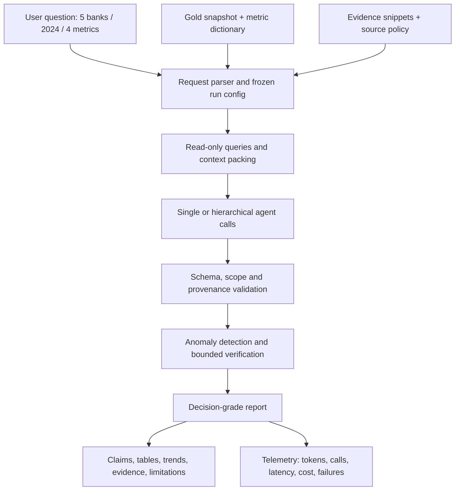

# Bản nháp khóa luận — Chương 1 đến Chương 7

Trạng thái: `DRAFT_WORKING_RESULTS_FROZEN_2026-09-09`

Đây là bản nháp làm việc xuyên suốt từ Chương 1 đến Chương 7. Phần kết quả sử
dụng snapshot và evaluation artifact đã đóng băng ngày 09/09/2026. Candidate,
pending validation và staging vẫn được tách khỏi kết luận; số liệu về chất lượng
multi-agent chỉ áp dụng cho workload và protocol đã chạy, không phải ưu thế phổ
quát.

Tên đề tài làm việc:

> Thiết kế và đánh giá prototype phân tích tài chính dựa trên nguồn dữ liệu có
> truy nguyên bằng kiến trúc single-agent và hierarchical multi-agent

Các quy tắc và định nghĩa nền được liên kết từ `docs/SPEC.md`,
`docs/METRIC-DICTIONARY.md`, `docs/DATA-CONTRACT.md`,
`docs/EVALUATION-PROTOCOL.md` và `docs/ARCHITECTURE.md`.

---

## Chương 1. Giới thiệu

### 1.1. Bối cảnh

Phân tích ngân hàng niêm yết cần kết hợp nhiều lớp thông tin. Ở lớp vĩ mô,
người phân tích quan tâm đến chính sách tiền tệ, tăng trưởng tín dụng và các
điều kiện chung của nền kinh tế. Ở lớp ngành, các chỉ số của một ngân hàng cần
được đặt trong tương quan với nhóm ngân hàng được chọn. Ở lớp doanh nghiệp, cần
đọc các chỉ số về chất lượng tài sản, khả năng sinh lời và hiệu quả hoạt động,
đồng thời giải thích các thay đổi theo từng kỳ.

Việc dùng mô hình ngôn ngữ cho công việc này tạo ra hai yêu cầu đồng thời. Thứ
nhất, hệ thống phải tổng hợp được thông tin ở nhiều cấp độ. Thứ hai, mỗi con số
và kết luận có ý nghĩa phải truy ngược được về nguồn, kỳ, đơn vị, định nghĩa và
vị trí trong tài liệu. Một câu trả lời trôi chảy nhưng dùng nhầm kỳ, nhầm giữa
số liệu hợp nhất và riêng lẻ, hoặc dùng một chỉ số chưa kiểm chứng vẫn có thể
dẫn đến phân tích sai.

### 1.2. Vấn đề nghiên cứu

Vấn đề của luận văn không chỉ là chọn một mô hình single-agent hay
multi-agent. Có hai lớp vấn đề cần được tách riêng:

1. **Vấn đề dữ liệu:** nguồn dữ liệu có thể khác định nghĩa, đơn vị, kỳ báo cáo,
   basis hợp nhất/riêng lẻ và mức độ truy xuất. Candidate từ vendor không mặc
   nhiên tương đương với số liệu chính thức.
2. **Vấn đề kiến trúc:** việc phân rã thành Macro, Sector và Company Agent có
   thực sự cải thiện tính đúng, bằng chứng và xử lý bất nhất đủ để bù số lần gọi,
   độ trễ và chi phí hay không.

Nếu không kiểm soát lớp dữ liệu trước, việc so sánh kiến trúc sẽ không còn công
bằng. Một hệ thống có nhiều agent có thể chỉ trông tốt hơn vì nhận được dữ liệu
khác hoặc vì baseline bị làm yếu. Vì vậy, luận văn sử dụng một snapshot dữ liệu
cố định, cùng bộ câu hỏi, cùng tools, cùng source policy và cùng output contract
cho tất cả các nhánh.

### 1.3. Mục tiêu

Mục tiêu tổng quát là xây dựng và đánh giá một prototype phân tích tài chính có
truy nguyên nguồn cho ngân hàng niêm yết Việt Nam.

Các mục tiêu cụ thể:

- chuẩn hóa quy trình từ raw source đến normalized observation và gold snapshot;
- tách phần tính toán tài chính xác định khỏi phần truy xuất, giải thích và tổng
  hợp bằng mô hình ngôn ngữ;
- xây dựng baseline single-agent và hai biến thể hierarchical có mức kiểm tra
  khác nhau;
- đánh giá factual correctness, calculation correctness, evidence completeness,
  citation correctness, xử lý anomaly, latency, số lần gọi và cost;
- ghi nhận cả trường hợp hierarchical không cải thiện hoặc không đáng với phần
  chi phí bổ sung.

### 1.4. Câu hỏi nghiên cứu

Trên cùng một snapshot đã kiểm chứng, cùng source policy, bộ câu hỏi, tools,
model configuration và output contract, hierarchical Macro/Sector/Company có
cải thiện độ đúng, độ đầy đủ bằng chứng và xử lý bất nhất so với single-agent đủ
để biện minh cho số lần gọi, độ trễ và chi phí tăng thêm hay không?

Câu hỏi phụ:

- Những loại lỗi nào được giảm hoặc phát sinh do việc phân rã tác vụ?
- Bounded critique có cải thiện việc phát hiện và giải thích bất nhất không?
- Mức cải thiện, nếu có, có còn hợp lý khi tính thêm latency, model calls và
  cost không?

### 1.5. Phạm vi

Phạm vi data-foundation ban đầu là pilot gồm ACB, TCB và VPB trong bốn quý năm
2024, với bốn metric lõi: NPL nhóm 3–5, loan-loss-reserve coverage, ROA và ROE.
Sau khi mở rộng và review, evaluation ladder đã sử dụng năm ngân hàng ACB, TCB,
VPB, MBB và VCB trong bốn quý năm 2024 với cùng bốn metric này. CIR và NIM vẫn
không thuộc benchmark vì định nghĩa, basis và source coverage chưa được đóng
băng tương đương.

Pilot 48 ô vẫn là cổng khả thi của data foundation. Evaluation hiện tại dùng
snapshot mở rộng 80 ô, trong đó 76 ô có giá trị hợp lệ và 4 ô được biểu diễn là
missing có lý do. Thiết kế 200 ô và mở rộng thêm tám quý vẫn là future work vì
chưa hoàn tất cùng mức review nguồn.

Trong đánh giá, bộ đầy đủ 14 câu được tách thành bank-core 13 câu và macro
extension 1 câu. Bank-core là aggregate chính của ba arm; macro-to-bank chỉ được
đánh giá riêng khi policy rate và credit growth của 2024_Q4 có source chính thức,
đúng kỳ và được kiểm tra độc lập. Việc tách track không loại Macro Agent khỏi
prototype, nhưng ngăn kết luận về bank/sector bị khóa bởi một macro observation
chưa đạt Gold.

Các non-goals gồm giao dịch đầu tư, tư vấn đầu tư production, realtime crawler,
coverage mọi công ty niêm yết, và tuyên bố ưu thế phổ quát của multi-agent.

### 1.6. Đóng góp dự kiến

Luận văn dự kiến đóng góp:

1. một pipeline source-grounded cho dữ liệu tài chính ngân hàng Việt Nam;
2. contract cho metric, period, unit, source, locator và quality status;
3. một thiết kế so sánh công bằng giữa single-agent, hierarchical không critique
   và hierarchical có critique giới hạn;
4. một quy trình ghi nhận missingness, conflict, provenance và chi phí vận hành;
5. một đánh giá có thể cho kết quả dương, không khác biệt hoặc âm.

### 1.7. Cấu trúc luận văn

Chương 2 trình bày metric, provenance và cơ sở lựa chọn các kiến trúc. Chương 3
trình bày thiết kế nghiên cứu, dữ liệu, validation và scoring. Chương 4 trình
bày kiến trúc prototype. Chương 5 mô tả triển khai thực tế và giao diện preview.
Chương 6 trình bày kết quả từ run manifest và blind review đã đóng băng. Chương
7 trả lời câu hỏi nghiên cứu, nêu trade-off, giới hạn và hướng phát triển.

---

## Chương 2. Cơ sở lý thuyết và bối cảnh

### 2.1. Các metric tài chính trong phạm vi nghiên cứu

Luận văn dùng các định nghĩa vận hành sau. Mỗi observation phải có đơn vị, kỳ,
period basis, source và locator; việc có một tên metric giống nhau không đủ để
chứng minh hai observation có thể so sánh.

#### 2.1.1. NPL nhóm 3–5

NPL được định nghĩa là tỷ lệ dư nợ thuộc nhóm 3, 4 và 5 trên tổng dư nợ phù hợp
với cùng bảng phân loại:

```text
NPL = (stage_3 + stage_4 + stage_5) / gross_loans × 100
```

Đây là metric point-in-time. Cần ghi rõ mẫu số có bao gồm các khoản cho vay
margin hoặc khoản mục liên quan hay không, cũng như basis hợp nhất hay riêng lẻ.

#### 2.1.2. Loan-loss-reserve coverage

Coverage được định nghĩa là tổng dự phòng cho phạm vi khoản vay tương ứng chia
cho số dư NPL nhóm 3–5:

```text
Coverage = loan_loss_provisions / NPL_balance × 100
```

Phạm vi của dự phòng phải khớp với tử số NPL. Không được biến một candidate âm
thành số dương bằng cách lấy giá trị tuyệt đối khi chưa biết đó là dấu kế toán,
quy ước vendor hay mapping sai.

#### 2.1.3. ROA và ROE

ROA và ROE đo lợi nhuận so với số dư tài sản hoặc vốn chủ sở hữu bình quân:

```text
ROA = net_profit / average_total_assets × 100
ROE = net_profit / average_equity × 100
```

Profit convention, mẫu số bình quân, basis hợp nhất/riêng lẻ và cách chuyển từ
YTD sang quarter-only phải được đóng băng trước khi đưa vào peer statistic. Một
con số ROA/ROE do issuer công bố có thể được giữ như source-disclosed variant,
nhưng không được trộn với derived quarter-only value nếu period basis khác nhau.

#### 2.1.4. Metric có điều kiện

CIR là tỷ lệ chi phí hoạt động trên tổng thu nhập hoạt động; NIM cần mapping
earning assets. Hai metric này có thể hữu ích về mặt phân tích, nhưng chỉ được
đưa vào core benchmark khi sign, denominator, source basis và period rules khớp
giữa các issuer.

### 2.2. Period basis và provenance

Số liệu bảng cân đối thường là point-in-time. Số liệu báo cáo kết quả hoạt động
giữa niên độ thường là YTD hoặc có đồng thời cột quarter-only và YTD. Do đó,
không được dùng số YTD như số của một quý đơn lẻ. Khi cần quarter-only, hệ thống
phải lưu input YTD và công thức chuyển đổi cùng formula version.

Provenance trong luận văn gồm source identity, URL hoặc local path, retrieval
time, file hash, publisher, page/table locator, ticker, period, unit, definition
mapping và quality status. Với derived metric, phải bổ sung input observation IDs
và formula version. Với missing hoặc conflict, phải giữ null hoặc nhiều variant
và reason thay vì ghi đè.

### 2.3. Source-grounded question answering

Source-grounded QA giới hạn câu trả lời vào các observation và evidence đã được
chuẩn bị. Trong prototype này, mô hình ngôn ngữ không phải là nguồn số học. Code
chịu trách nhiệm normalization, period conversion, ratio calculation, peer
median, percentile và anomaly trigger. Mô hình chỉ truy xuất context đã được
kiểm soát, giải thích ý nghĩa, nêu giới hạn và tổng hợp báo cáo.

Thiết kế này nhằm giảm hai loại lỗi: lỗi tính toán và lỗi phát biểu có vẻ chính
xác nhưng không có nguồn. Tuy vậy, source-grounding không tự bảo đảm rằng nguồn
đã đúng định nghĩa; bước reconciliation và checker vẫn là điều kiện cần.

### 2.4. Single-agent và hierarchical multi-agent

Single-agent là baseline chính. Agent này nhận cùng accepted facts, evidence
tools, output contract và model configuration với các nhánh còn lại. Nó không bị
cố ý làm yếu bằng cách bỏ đi dữ liệu mà hierarchical được sử dụng.

Hierarchical tách công việc theo ba góc nhìn:

- Macro Agent lấy context chính sách và tín dụng;
- Sector Agent lấy peer median, percentile và thay đổi theo kỳ;
- Company Agent lấy metric và evidence của doanh nghiệp;
- Master Orchestrator kiểm tra payload, phát hiện trigger và tổng hợp.

Critique không phải một vòng lặp vô hạn. Chỉ các trigger xác định mới tạo yêu
cầu verification; tối đa hai lần thử được phép. Một trigger không đồng nghĩa với
true contradiction: kết quả cuối phải phân biệt contradiction, explainable
divergence, data conflict và insufficient evidence.

### 2.5. Cơ sở của so sánh công bằng

Nếu các arm dùng dữ liệu hoặc tiêu chí khác nhau, chênh lệch kết quả không thể
quy cho kiến trúc. Vì vậy, biến độc lập chính là cách tổ chức và kiểm tra tác vụ;
snapshot, question set, source policy, model/configuration, output schema và
accepted tools phải được giữ cố định. Số lần gọi, latency, token và cost được
đo như trade-off chứ không bị che giấu.

---

## Chương 3. Phương pháp nghiên cứu

### 3.1. Thiết kế nghiên cứu theo cổng

Nghiên cứu sử dụng quy trình gated:

```text
research → specification → data foundation → gold snapshot
→ baseline → hierarchical system → evaluation
```

Nghiên cứu đã đi qua cổng provider-backed evaluation bằng một snapshot Gold mở
rộng và đã đóng blind review. Tuy nhiên, quy tắc gated vẫn được giữ cho các scope
mới: dữ liệu chưa Gold không được đưa vào benchmark, còn macro extension vẫn cần
nguồn period-aligned riêng trước khi gộp vào kết quả chính.

### 3.2. Chọn mẫu và quyết định scope

Pilot đầu tiên gồm 48 cell: ba issuer, bốn quý và bốn metric lõi. Mỗi target cell
phải có một quyết định reconciliation: `accepted`, `missing`, `conflicting` hoặc
`invalid`. Quyết định phải nêu source locator, definition, unit, period basis,
checker và reason.

Sau pilot, scope được chọn theo dữ liệu đo được:

- pilot đạt và review effort thấp: giữ 48 hoặc mở lên 80;
- pilot đạt nhưng nguồn chậm hoặc không đồng nhất: giữ 48, chưa mở rộng;
- pilot thất bại ở một metric: dùng fallback 36 ô nếu việc loại metric vẫn giữ
  được issuer/period diversity và được xác nhận, đồng thời ghi limitation;
- chỉ mở lên 200 khi các ô bổ sung vượt cùng gold gates.

Ma trận comparability theo 12 cặp issuer–metric được lưu tại
`data/reconciliation/gold-bank-2025-pilot-v1/metric-comparability-matrix.csv`.
Đây là bản đồ rủi ro để reviewer kiểm tra, không phải kết luận rằng các metric
đã comparable hoặc đã đủ điều kiện vào gold.

Pilot Gold ban đầu có 44 ô `valid` và 4 ô `missing`. Snapshot dùng cho evaluation
cuối là `gold-bank-2025-expanded-v5-evidence`: 80 target cells, 76 giá trị hợp
lệ, 4 missing có lý do, và 76/76 giá trị hợp lệ có evidence page-aware được
review. Thời gian checker chỉ là tín hiệu lập kế hoạch, không phải bằng chứng
về năng suất xử lý dữ liệu.

Question set chính cho aggregate là
`experiments/question-set-core-v1.json`, với plan 39 jobs tại
`experiments/runs/baseline-plan-core-v1.json`. Bộ 14 câu đầy đủ và plan 42 jobs
được giữ để chạy macro extension khi điều kiện dữ liệu được đáp ứng.

### 3.3. Source ladder

Thứ tự ưu tiên là:

1. issuer IR KPI table, earnings release hoặc presentation có period rõ;
2. consolidated filing có page/table locator, ưu tiên bản searchable;
3. performance-pack KPI chỉ khi reporting basis khớp với scope;
4. OCR hoặc manual labeling cho mẫu scan-only giới hạn và có đo workload;
5. vendor API làm accelerator/cross-check;
6. missing value có reason nếu không có bằng chứng đủ tốt.

Consolidated và standalone là các variant khác nhau. Không trộn hai basis trong
một cell hoặc peer statistic. Tất cả raw source được hash và giữ nguyên; staging
không bị ghi đè bởi gold.

### 3.4. Reconciliation và gold promotion

Quy trình reconciliation gồm:

1. đối chiếu ticker, kỳ và basis;
2. tìm dòng metric hoặc input component trong nguồn chính thức;
3. ghi raw facts, unit, page/table locator và formula;
4. tính derived value bằng code;
5. so sánh với vendor candidate nhưng không sửa vendor row;
6. ghi quyết định và checker;
7. chỉ promotion accepted observations sang snapshot gold versioned.

Gold promotion bị fail-closed nếu thiếu source accepted, thiếu evidence, sai period,
không đủ coverage, còn conflict quan trọng, thiếu manual labels hoặc bất kỳ
target cell nào chưa có `value_check` decision. Coverage được báo theo issuer ×
metric × period, không suy ra từ tổng số candidate rows.

### 3.5. Các nhánh thí nghiệm

**Arm A — single-agent:** một agent nhận câu hỏi và context từ cùng query/evidence
layer, sau đó tạo output contract.

**Arm B — hierarchical không critique:** Macro, Sector và Company chạy một lần;
orchestrator validate và tổng hợp nhưng không gửi verification follow-up.

**Arm C — hierarchical bounded critique:** giống Arm B, nhưng chạy deterministic
anomaly triggers và tối đa hai verification attempts tập trung.

Mục tiêu không phải ép Arm C thắng. Một kết quả hợp lệ có thể là decomposition
không cải thiện, critique tạo quá nhiều false positive, hoặc lợi ích không bù
latency và cost.

### 3.6. Câu hỏi và scoring

Bộ câu hỏi được version hóa trước khi chạy. Bank-core gồm company snapshot,
company trend, peer comparison, anomaly review và known conflict cho từng issuer
pilot; macro-to-bank được giữ thành extension riêng. Câu trả lời được chấm theo
atomic claim thay vì văn phong.

Các tiêu chí chính gồm:

- factual correctness;
- calculation correctness;
- evidence completeness;
- citation correctness;
- cross-level consistency;
- anomaly verification quality.

Tiêu chí phụ gồm latency, model-call count, token/cost, schema-validation rate,
retrieval failure và unresolved-conflict rate. Một missing value có reason hợp lệ
không bị chấm là factual error; một con số chính xác nhưng sai kỳ hoặc sai đơn vị
không được xem là hoàn toàn đúng.

Việc tổng hợp score được tách khỏi model runtime bằng contract deterministic trong
`src/thesis_data/evaluation.py` và CLI `scripts/summarize_claim_reviews.py`.
Contract này giữ lại các claim không thể chấm do
contract hoặc review failure, thay vì âm thầm quy chúng thành điểm 0. Nó chỉ nhận
review decision sau khi output đã được tạo và không thay thế GoldLabel promotion.
Mỗi `ClaimReview` cũng bind `run_id`, snapshot ID, question-set hash, rubric,
prompt version và model ID; scorer fail-closed nếu một file trộn các binding
khác nhau.

### 3.7. Blind review và threat to validity

Một tập output cố định được hai reviewer chấm blind với cùng rubric. Disagreement
được giữ lại và báo cáo agreement. Người tạo anomaly trigger không được một mình
định nghĩa luôn nhãn thành công cuối cùng.

Các mối đe dọa chính:

- source availability không đồng đều giữa issuer;
- metric definition không hoàn toàn tương thích;
- kích thước pilot nhỏ;
- reviewer subjectivity;
- model/provider thay đổi;
- câu hỏi có thể không đại diện cho toàn bộ use case;
- latency và cost phụ thuộc hạ tầng.

Luận văn giảm các rủi ro này bằng snapshot bất biến, manifest, question set cố
định, blind rubric, source locator, fail-closed gate và báo cáo missingness.

---

## Chương 4. Thiết kế hệ thống

### 4.1. Nguyên tắc thiết kế

Prototype có bốn nguyên tắc:

1. raw data bất biến;
2. code là nguồn sự thật cho tính toán;
3. mọi agent output đi qua contract validation;
4. dữ liệu không đủ hoặc không chắc chắn phải được biểu diễn công khai.

### 4.2. Luồng logic

```text
immutable raw inputs
  → source registry / coverage manifest
  → normalized observations
  → deterministic metrics / peer benchmarks
  → validated evidence
  → versioned gold snapshot
  → request parser / run config
  → single-agent hoặc Macro/Sector/Company agents
  → payload validation
  → deterministic anomaly triggers
  → bounded verification
  → final synthesis / quality report / run manifest
```

### 4.3. Data plane

Raw plane lưu file tải xuống và API response cùng hash, retrieval time và source
metadata. Staging plane giữ candidate và các kết quả chưa được kiểm chứng. Hai
loại này có thể phục vụ nghiên cứu hoặc cross-check nhưng không được query layer
đưa vào published facts.

Gold plane lưu source records được chấp nhận, normalized observations, derived
metrics, evidence snippets, gold labels, coverage summaries và snapshot metadata.
Mỗi derived metric giữ input observation IDs và formula version. Snapshot mới được
tạo riêng, không overwrite staging.

### 4.4. Quantitative plane và evidence plane

Quantitative plane xử lý date, unit, YTD-to-quarter conversion, formulas, peer
statistics và trigger rules bằng code. Nếu denominator bằng zero, kết quả là null
với reason, không phải zero.

Evidence plane xử lý PDF/document theo page và section. Evidence record chứa source
ID, document, page, ticker, period, quote, parser status và locator. Text layer
chỉ cho biết tài liệu dễ đọc; nó không tự chứng minh reporting basis hoặc metric
definition. Vector index nếu có chỉ là lớp truy hồi bổ sung, không thay thế trang
gốc.

### 4.5. Query và contract boundary

Read-only query layer chỉ trả về observation và source ở trạng thái valid/accepted.
Payload của agent phải có metric, value, unit, period, source/evidence và quality
flags tương ứng. Null và conflict được truyền qua boundary thay vì bị lấp bằng
văn bản phỏng đoán.

Run contract kiểm tra snapshot ID, question-set ID, scope, duplicate question,
quality gate và critique budget trước khi dispatch. Candidate SQLite bị từ chối
trước khi gọi adapter, giúp ngăn một lỗi dữ liệu biến thành kết quả thí nghiệm.

### 4.6. Agent plane

Single-agent là một adapter call với context đã chuẩn bị. Hierarchical arm dùng
các role Macro, Sector, Company và Orchestrator. Các role không tự tính ratio từ
prose; chúng dùng facts và derived metrics đã được query layer cung cấp.

Macro Agent không suy diễn causal claim chỉ từ một movement của policy rate.
Sector Agent chỉ tính peer median từ accepted observations. Company Agent phải
giải thích missing/conflict và gắn evidence. Orchestrator chỉ tổng hợp payload
đã qua validation.

### 4.7. Anomaly và bounded verification

Deterministic triggers có thể phát hiện chênh lệch giữa company và peer, hướng
thay đổi không khớp hoặc source variant khác nhau. Trigger chỉ mở một verification
request có phạm vi hẹp. Mỗi request được ghi attempt, evidence IDs, trạng thái
resolution và câu trả lời cuối.

Sau tối đa hai attempts, hệ thống dừng và đưa unresolved anomaly vào quality
section. Independent review sau đó mới quyết định đó là true contradiction,
explainable divergence, data conflict hay insufficient evidence.

### 4.8. Reproducibility và giới hạn triển khai

Mỗi run cần ghi snapshot ID, question-set hash, prompt version,
prompt fingerprint, model/configuration, source policy, input IDs, tool calls,
timestamps, latency, token/cost và validation result. Bản scaffold hiện ghi
`prompt-contract-v1` trong
manifest; offline fixture dùng version riêng để tránh nhầm với prompt provider.
Artifact offline v9 đã chạy qua persisted plan, full-batch preflight và
one-job boundary; đây chỉ là bằng chứng plumbing, không phải kết quả tài chính.
Prototype ưu tiên chạy local/offline từ cached fixture và gold snapshot. Preview
deployment chỉ là bước tùy chọn sau evaluation; production access, realtime feed
và hành động tài chính nằm ngoài phạm vi.

### 4.9. Trạng thái triển khai và kết quả cập nhật

Các thành phần deterministic query, schema, baseline gate, experiment input
contract, provider adapter, report renderer và reviewer queue đã có regression
tests. Suite hiện tại có **329 test pass**, bao gồm kiểm tra context nhiều kỳ,
provenance, fail-closed execution, schema validation, failure-aware aggregation
và report contract.
Provider-neutral `StructuredProviderAdapter` plumbing cũng đã được kiểm tra:
transport được inject, response typed/JSON được parse vào `AgentPayload`, và
telemetry được giữ hoặc đánh dấu unavailable.
Offline fixture vẫn dùng để kiểm tra integration mà không tạo provider call.
Ngoài ra, provider-backed `analysis-report-v2` đã chạy 75 manifest theo năm mức
issuer-count, ba arm và năm repetition. Có 61 report hoàn tất và 14 job fail.
Prompt renderer deterministic cũng canonicalize scope/context trước khi
transport nhận request, để provider-specific code không tự thay đổi prompt.
Đây là bằng chứng về tính đúng của boundary và call shape. Bằng chứng chất
lượng được tách riêng trong Chương 6 và dựa trên 244 dòng blind human scoring.
Model dùng trong run là `gpt-5.6-luna`; output và telemetry được giữ trong các
manifest versioned.

Phần còn lại không phải là mở provider-backed benchmark từ đầu mà là hoàn thiện
decision-grade report, robustness rerun có kiểm soát, viết cuối văn phong và
xin advisor xác nhận scope/cutoff. Mọi mở rộng sang 8 quý, 200 cells, realtime
hoặc securities sector vẫn phải đi qua data/evidence gate riêng.

---

## Ghi chú biên tập trước phần kết quả

Trước khi nộp bản cuối, cần thay các mô tả working bằng artifact cụ thể:

- scope manifest đã được advisor xác nhận;
- gold snapshot ID và immutable input manifest;
- metric comparability matrix;
- coverage, missingness và conflict report;
- run manifest của cả ba arm;
- blind-review labels và agreement;
- bảng quality–latency–cost;
- các kết quả null hoặc negative nếu có.

Không được dùng số lượng candidate, số file tải xuống hoặc số test code pass để
thay thế cho các bằng chứng trên.

---

## Chương 5. Triển khai hệ thống

### 5.1. Mục tiêu triển khai

Prototype được triển khai như một hệ thống phân tích chạy trên snapshot dữ liệu
đã đóng băng. Mục tiêu của implementation không phải là tạo một nền tảng tư vấn
đầu tư production, mà là tạo một đường chạy có thể kiểm tra và tái lập để trả lời
hai câu hỏi: hệ thống có tạo được một báo cáo tài chính có nguồn hay không, và
cách tổ chức multi-agent có tạo ra lợi ích đo được so với single-agent hay không.

Implementation vì vậy chia thành bốn lớp: data plane, evidence plane, agent plane
và output/evaluation plane. Mỗi lớp có một trách nhiệm riêng. Code quyết định
giá trị số và trạng thái dữ liệu; agent xử lý diễn giải, phản biện và tổng hợp;
report layer làm cho provenance và giới hạn hiển thị được với người dùng.

### 5.2. Kiến trúc triển khai

```mermaid
flowchart LR
    R[Immutable raw files / API captures] --> N[Registry + normalization]
    N --> Q[Deterministic metric and peer queries]
    Q --> G[Versioned Gold snapshot]
    G --> E[Evidence retrieval by ticker, period, locator]
    G --> P[Request-scoped context]
    E --> P
    P --> S[Single Agent]
    P --> H[Macro / Sector / Company agents]
    H --> O[Master Orchestrator]
    O --> V[Payload and provenance validation]
    S --> V
    V --> A[Deterministic anomaly triggers]
    A --> C[Bounded verification when enabled]
    C --> Y[analysis-report-v2 output]
    V --> Y
    Y --> U[Markdown / HTML report and read-only preview UI]
```



**Hình 5.1.** Luồng triển khai từ raw input đến report. Các mũi tên từ Gold và
evidence vào request-scoped context cho thấy các arm dùng cùng sự kiện đầu vào.
Sự khác biệt giữa các arm nằm ở cách chia vai trò và việc có bật verification
hay không.

Implementation giữ nguyên ranh giới read-only ở phía query. Agent không được
truy cập trực tiếp SQLite để tự suy luận thêm ngoài context đã chuẩn bị. Điều
này giúp kiểm soát fairness giữa các arm và ngăn một agent vô tình đọc candidate
data chưa được Gold promotion.

### 5.3. Data plane

Data plane chịu trách nhiệm đưa các nguồn thô thành những observation có thể
được truy vấn. Raw file và API response được giữ nguyên, có identity và hash.
Normalized observation bổ sung ticker chuẩn, kỳ, metric, unit, source ID,
locator, quality status và các input observation ID nếu là giá trị derived.

Snapshot dùng cho evaluation là
`data/processed/gold-bank-2025-expanded-v5-evidence.sqlite`. Snapshot này có 80
target cells tương ứng với năm ngân hàng ACB, TCB, VPB, MBB và VCB, bốn quý năm
2024 và bốn metric: NPL nhóm 3–5, LLR Coverage, ROA và ROE. Trong 80 target cells,
76 có giá trị hợp lệ và 4 cell là missing có reason. Database gốc v4 vẫn được
giữ nguyên; v5 là snapshot versioned bổ sung evidence, không phải thao tác
overwrite.

Các phép tính có period basis rõ ràng. Với flow metric, income statement YTD
được xử lý theo quy tắc quarter-only hoặc TTM đã khai báo. Với ROA và ROE, công
thức dùng lợi nhuận theo scope đã chốt chia cho average balance phù hợp. Giá trị
missing không bị đổi thành 0. Khi hai định nghĩa không thể gộp, hệ thống giữ
variant hoặc ghi missing/conflict thay vì chọn một số thuận tiện cho benchmark.

| Thành phần | Trách nhiệm | Dữ liệu đầu ra | Quy tắc an toàn |
|---|---|---|---|
| Raw plane | Giữ file/API nguyên bản | File, hash, retrieval metadata | Không sửa và không ghi đè |
| Normalized plane | Chuẩn hóa identity, period, unit | Observation có source và status | Reject sai period/unit/duplicate |
| Metric plane | Tính ROA, ROE, peer stats và trigger | Derived observation | Gắn input IDs và formula version |
| Gold plane | Chỉ nhận cell đã review | Snapshot versioned | Fail-closed nếu thiếu label/evidence |
| Coverage report | Đo đủ/thiếu theo cell | Coverage, missingness, conflict | Không suy ra coverage từ tổng row |

**Bảng 5.1.** Các thành phần của data plane và kiểm soát tương ứng.

### 5.4. Evidence plane

Evidence plane nối một kết luận với nguồn cụ thể. Evidence record bao gồm source
ID, ticker, period, metric hoặc claim liên quan, page/table locator, quote hoặc
derivation note, parser status và quality label. Query evidence lọc theo source
valid, ticker, period và source tier được phép. Do đó, một source có vẻ liên quan
nhưng chưa qua validation không thể tự động trở thành bằng chứng published.

Sau khi xây v5, 76/76 observation hợp lệ có evidence page-aware được review, với
tổng cộng 116 evidence snippets. Một giới hạn cần nói rõ là một phần evidence
là reviewed derivation notes chứ chưa phải verbatim quotation từ PDF. Ngoài ra,
một số PDF là scan hoặc mixed-text. Page-aware locator làm cho reviewer có thể
quay lại trang gốc, nhưng không biến hạn chế parser thành bằng chứng hoàn hảo.

Missing/evidence policy trong runtime được xử lý theo bảng sau:

| Trạng thái | Cách biểu diễn | Agent được phép làm gì | Report phải hiển thị |
|---|---|---|---|
| `valid` | value + unit + period + provenance | Giải thích và so sánh trong scope | Source/evidence locator |
| `missing` | `null` + reason | Nêu thiếu dữ liệu, không nội suy | Missing reason và ảnh hưởng |
| `conflicting` | Nhiều variant + conflict reason | Không tự chọn nếu chưa adjudicate | Conflict và trạng thái chưa kết luận |
| `pending_validation` | Candidate, chưa publish | Không dùng cho benchmark | Excluded khỏi published facts |
| `fallback/contextual` | Quality flag riêng | Chỉ dùng nếu policy cho phép | Nhãn fallback rõ ràng |

**Bảng 5.2.** Missing-data và evidence policy. Policy này làm cho “không biết”
trở thành một output có cấu trúc thay vì một khoảng trống dễ bị model lấp bằng
suy đoán.

### 5.5. Agent plane và isolated toolsets

Agent plane nhận một request đã có issuer, period, metric, snapshot và evidence
scope. Mỗi role có toolset read-only giới hạn theo nhiệm vụ:

- Company Agent truy vấn metric, trend và evidence của một issuer;
- Sector Agent truy vấn peer median, percentile và relative change từ peer set đã
  khai báo;
- Macro Agent truy vấn chỉ các macro indicator được request cho phép;
- Master Orchestrator kiểm tra payload, gắn kết các góc nhìn và tạo synthesis;
- Verification worker chỉ được đọc evidence IDs nằm trong anomaly request.

Single-agent dùng cùng query/evidence context nhưng tổng hợp trong một call. Arm
hierarchical-no-critique tách Macro/Sector/Company và để orchestrator tổng hợp
một lần. Arm hierarchical-bounded-critique thêm anomaly trigger và tối đa hai
verification attempts. Như vậy, isolated toolsets là một biến thiết kế có thể
kiểm tra, không chỉ là việc đặt tên nhiều agent trong prompt.

Mỗi call nhận một deep copy của context. Payload trả về phải giữ `agent_id`,
ticker và period đúng với request; numeric value phải mang observation/source/
evidence provenance. Payload sai schema, sai identity, sai scope hoặc thiếu
telemetry bị fail-closed. Orchestrator không được dùng một payload invalid để
điền vào report cuối.

### 5.6. Input, processing và output



**Hình 5.2.** Pipeline input → processing → output của prototype.

Input không phải toàn bộ thư mục data và cũng không phải prompt tự do chứa mọi
thứ. Input của một run gồm câu hỏi đã version hóa, scope issuer/period/metric,
Gold snapshot ID, source policy, evidence IDs được phép, prompt version và model
configuration. Processing gồm query deterministic, đóng gói context theo scope,
agent calls, validation và synthesis. Output gồm report có cấu trúc và run
manifest, không chỉ là một đoạn văn.

`analysis-report-v2` là output contract user-facing. Mỗi report có title, run
metadata, executive summary, comparison theo kỳ, issuer profiles, claims,
evidence IDs, limitation, quality status và telemetry. Một claim được phân biệt
giữa `evidence_backed`, `data_backed` và các trạng thái support khác. Nhờ đó UI
có thể hiển thị mức tin cậy theo provenance mà không tự tính lại metric.

### 5.7. Report renderer và preview UI

Script `scripts/render_analysis_report_v2.py` tạo JSON, Markdown và HTML từ run
manifest. `scripts/validate_analysis_report.py` kiểm tra output contract trước
khi report được đưa vào preview. `app/index.html` chỉ đọc
`app/data/analysis-report.json`, không gọi model, không truy cập SQLite và không
tự sửa value.

Màn hình preview được thiết kế cho một workflow duy nhất: người dùng mở report
phân tích năm ngân hàng trong bốn quý, đọc headline, so sánh Q4, xem trend từng
ngân hàng, mở claim/evidence detail và đọc limitations. Đây là vertical slice để
chứng minh output có giá trị sử dụng. Login, realtime, quản trị người dùng,
backend production và form query tổng quát nằm ngoài MVP.

### 5.8. Reproducibility, telemetry và kiểm thử

Mỗi run ghi snapshot ID, question-set ID/hash, prompt version và fingerprint,
model ID, arm, source policy, input IDs, tool calls, validation result, timestamps,
latency, input/output tokens và cost estimate. Run manifest giữ cả completed và
failed jobs để reliability không bị che bởi việc chỉ lưu output thành công.

Regression suite cuối kỳ có 329 test pass. Các test này xác nhận contract và
boundary, không được diễn giải thành bằng chứng rằng một model trả lời tốt hơn.
Bằng chứng chất lượng nằm ở blind human review trong Chương 6. Quy tắc này tách
“hệ thống chạy đúng hình thức” khỏi “kết quả có ích và đúng nội dung”.

---

## Chương 6. Kết quả đánh giá

### 6.1. Thiết kế thực nghiệm

Evaluation dùng `gpt-5.6-luna`, snapshot `gold-bank-2025-expanded-v5-evidence`,
source policy và output contract cố định. Complexity ladder thay đổi số issuer
từ 1 đến 5, giữ bốn quý năm 2024 và bốn metric. Với mỗi issuer-count, có ba
arms và tối đa năm repetitions, tạo 75 manifests theo kế hoạch.

Ba arms được so sánh là:

1. **Single-agent:** một agent đọc context đã chuẩn bị và sinh report.
2. **Hierarchical no-critique:** các role Macro/Sector/Company chạy theo phân rã,
   orchestrator tổng hợp, không gửi verification follow-up.
3. **Hierarchical bounded-critique:** phân rã như arm 2, thêm trigger deterministic
   và tối đa hai lần verification có phạm vi.

Blind reviewer chấm 61 output hoàn tất trên bốn dimension: correctness,
usefulness, evidence và limitation. Mỗi dimension dùng thang 0–4, sau đó chuẩn
hóa về 0–1. Tổng cộng có 244 dòng score. Score quality trong bảng là trung bình
của bốn dimension trên các repetition đã hoàn tất; completion-adjusted quality
điều chỉnh theo tỷ lệ job hoàn thành trong số job được planned.

### 6.2. Kết quả tổng hợp theo issuer-count

| Issuers | Arm | Quality | Completion-adjusted | Cost USD/job | Latency ms/job | Failure rate |
|---:|---|---:|---:|---:|---:|---:|
| 1 | Single-agent | 0.6875 | 0.6875 | 0.019124 | 55,284 | 0.0% |
| 1 | Hierarchical no-critique | 0.7000 | 0.7000 | 0.046326 | 115,044 | 0.0% |
| 1 | Hierarchical bounded-critique | 0.6875 | 0.6875 | 0.073262 | 187,359 | 0.0% |
| 2 | Single-agent | 0.9500 | 0.9500 | 0.021144 | 66,728 | 0.0% |
| 2 | Hierarchical no-critique | 0.9500 | 0.9500 | 0.053474 | 108,228 | 0.0% |
| 2 | Hierarchical bounded-critique | 0.9531 | 0.7625 | 0.083994 | 169,535 | 20.0% |
| 3 | Single-agent | 0.9375 | 0.9375 | 0.033053 | 85,209 | 0.0% |
| 3 | Hierarchical no-critique | 0.9875 | 0.9875 | 0.081015 | 135,784 | 0.0% |
| 3 | Hierarchical bounded-critique | 0.9688 | 0.3875 | 0.100389 | 190,781 | 60.0% |
| 4 | Single-agent | 0.9750 | 0.9750 | 0.032566 | 70,450 | 0.0% |
| 4 | Hierarchical no-critique | 0.9792 | 0.5875 | 0.081315 | 167,948 | 40.0% |
| 4 | Hierarchical bounded-critique | 1.0000 | 0.8000 | 0.112865 | 198,188 | 20.0% |
| 5 | Single-agent | 0.9063 | 0.7250 | 0.032220 | 64,106 | 20.0% |
| 5 | Hierarchical no-critique | 1.0000 | 0.6000 | 0.074543 | 145,755 | 40.0% |
| 5 | Hierarchical bounded-critique | 1.0000 | 0.2000 | 0.084881 | 134,328 | 80.0% |

**Bảng 6.1.** So sánh quality, operational quality, cost, latency và failure
rate của ba arms. Cost và latency là trung bình của các run hoàn tất; failure
rate tính trên số repetition planned, vì vậy cần đọc cùng cột
completion-adjusted.

Ở một issuer, hierarchical no-critique nhỉnh hơn rất nhỏ về quality nhưng chi
phí và latency cao hơn. Ở hai issuer, hai arm single-agent và hierarchical
no-critique có cùng quality 0.95. Điều này cho thấy decomposition tự thân chưa
tạo lợi ích rõ ràng ở workload nhỏ.

Ở ba issuer, hierarchical no-critique đạt quality 0.9875 so với 0.9375 của
single-agent. Chênh lệch trung bình là **+0.05**, có 3/5 repetitions dương,
failure rate của cả hai arm trong cặp so sánh là 0%. Chi phí trung bình là
2.622757 lần và latency là 1.698339 lần single-agent. Đây là điểm crossover đầu
tiên theo rule đã đăng ký trước.

Ở bốn và năm issuer, quality của những output sống sót của hierarchical arm cao,
nhưng failure rate lần lượt là 40% cho no-critique ở cả hai mức và 80% cho
bounded-critique ở năm issuer. Khi tính completion-adjusted quality, lợi ích này
không còn đủ để gọi là crossover operationally complete.

### 6.3. Crossover và ý nghĩa thực tế

| Điều kiện | Kết quả |
|---|---|
| 1 issuer | Không có quality gain có ý nghĩa; multi-agent tốn hơn |
| 2 issuers | No-critique hòa single-agent; bounded có failure |
| 3 issuers | Crossover đầu tiên của no-critique: quality gain +0.05, 3/5 positive, failure 0% trong cặp |
| 4 issuers | Output sống sót tốt nhưng failure 40% làm comparison incomplete |
| 5 issuers | Failure tăng; không đủ cơ sở kết luận multi-agent tốt hơn |
| Bounded critique | Không đạt crossover trong ladder này |

**Bảng 6.2.** Bảng crossover. Crossover được hiểu là một kết quả quan sát thỏa
đồng thời semantic gain và điều kiện vận hành của protocol, không phải điểm mà
multi-agent luôn thắng từ đó trở đi.

Kết quả 3 issuer phù hợp với giả thuyết chi phí điều phối cố định được phân bổ
trên workload lớn hơn. Tuy nhiên, dữ liệu chỉ có năm mức issuer-count trong một
scope bốn quý và một model. Vì vậy, không thể suy ra scaling law, không thể nói
multi-agent chắc chắn có lợi về dài hạn và cũng không thể suy ra lợi ích sẽ tăng
đều khi thêm database.

### 6.4. Token và chi phí xử lý

Tại workload ba issuer, single-agent dùng trung bình 91,014 input tokens và
12,375 output tokens. Hierarchical no-critique dùng 243,400 input và 26,946
output tokens. Bounded critique dùng 292,188 input và 34,960 output tokens.

| Arm tại 3 issuer | Input tokens | Output tokens | Tổng xấp xỉ | Cost USD | Latency ms |
|---|---:|---:|---:|---:|---:|
| Single-agent | 91,014 | 12,375 | 103,389 | 0.033053 | 85,209 |
| Hierarchical no-critique | 243,400 | 26,946 | 270,346 | 0.081015 | 135,784 |
| Hierarchical bounded-critique | 292,188 | 34,960 | 327,148 | 0.100389 | 190,781 |

**Bảng 6.3.** Token, cost và latency ở workload nơi crossover quan sát được.

Các số liệu này giải thích vì sao crossover quality không đồng nghĩa với
crossover kinh tế. Hệ thống hierarchical no-critique cải thiện điểm chất lượng
trong workload ba issuer nhưng dùng khoảng 2.6 lần cost theo paired comparison.
Đối với sản phẩm ứng dụng, multi-agent chỉ hợp lý khi quality/evidence gain có
giá trị lớn hơn chi phí và thời gian chờ, hoặc khi workload đủ phức tạp để một
agent không còn giữ được chất lượng ổn định.

### 6.5. Failure taxonomy

Trong 75 manifest planned, 61 hoàn tất và 14 fail, tương ứng failure rate tổng
18.7%. Các failure được lưu trong operational summary, không bị thay bằng output
giả lập.

| Nhóm lỗi | Số job | Diễn giải | Tác động |
|---|---:|---|---|
| Context budget | 9 | Context vượt giới hạn 180,000 ký tự hoặc bị `context_budget_exceeded` | Không gọi/sinh output hợp lệ; cần context packing và bounded fan-out |
| Schema/validation | 2 | Provider payload hoặc claim không đạt contract | Fail-closed; cần prompt/schema repair |
| API connection | 3 | `APIConnectionError` | Không phân biệt lỗi kiến trúc và hạ tầng; cần retry/transport policy |
| **Tổng** | **14** | 75 planned − 61 completed | Được tính vào reliability, không ẩn khỏi denominator |

**Bảng 6.4.** Failure taxonomy của full ladder.

Context budget là nhóm lỗi lớn nhất. Đây là tín hiệu trực tiếp rằng việc mở rộng
database và chia nhiều agent làm context hoặc fan-out tăng nhanh hơn khả năng
điều phối hiện tại. Vì vậy, sửa context budget, parallelism và retry là điều kiện
để kiểm tra lại giả thuyết multi-agent; không được dùng việc “retry cho đến khi
đủ output” để xóa dấu vết failure đầu tiên.

### 6.6. Kết quả data/evidence

Gold snapshot có 76 valid observations và 4 missing cells. Tất cả 76 valid
observations có ít nhất một evidence record page-aware được review, nên evidence
coverage trên valid observations là 100%. Điều đó làm cho benchmark có nền tảng
truy nguyên tốt hơn candidate data, nhưng không loại bỏ rủi ro định nghĩa. Một
reviewed derivation note chứng minh reviewer đã kiểm tra mapping và locator; nó
không nhất thiết tương đương một đoạn quotation nguyên văn trong tài liệu.

Bốn missing cells của ACB 2024_Q1 được giữ là missing. Report và agent phải nêu
missing reason thay vì đưa số 0 hoặc nội suy từ quý sau. Đây là một phần của
quality: câu trả lời đúng đôi khi là “chưa đủ evidence để kết luận”.

### 6.7. Threats to validity

Thứ nhất, sample chỉ có năm ngân hàng, bốn quý và bốn metric. Kết quả không đại
diện cho mọi ngân hàng Việt Nam, securities company hay macro question.

Thứ hai, quality score dựa trên 61 output hoàn tất. Failure-aware aggregation đã
đưa failure vào completion-adjusted quality, nhưng số output semantic ở các mức
4–5 không đều. Do đó, các điểm sống sót cao không được đọc như bằng chứng
superiority chắc chắn.

Thứ ba, cost và latency phụ thuộc provider, model và thời điểm API. Chúng là
telemetry của run `gpt-5.6-luna`, không phải giá cố định cho mọi deployment.

Thứ tư, blind review giảm bias nhưng reviewer vẫn có subjectivity. Bốn dimension
correctness, usefulness, evidence và limitation đo chất lượng report ở mức ứng
dụng, không đo toàn bộ utility tài chính của một nhà phân tích.

Thứ năm, source evidence v5 đã được review nhưng một phần locator là derivation
note và PDF scan/mixed-text còn hạn chế. Kết luận về architecture không được
đánh đồng với kết luận rằng toàn bộ nguồn thị trường đã được thu thập hoàn hảo.

### 6.8. Trả lời câu hỏi ứng dụng

Trong workload đơn giản, single-agent là lựa chọn hợp lý vì cho chất lượng tương
đương với ít cost và latency hơn. Trong workload từ khoảng ba issuer trở lên,
hierarchical no-critique cho một tín hiệu lợi ích về usefulness/evidence và đạt
crossover quan sát được trong protocol này. Tuy nhiên, bounded critique hiện
không đáng bật mặc định vì cost, latency và failure tăng mà không tạo crossover.

Kết luận ứng dụng phù hợp nhất là một policy thích ứng: route câu hỏi nhỏ đến
single-agent; route workload nhiều issuer hoặc cần peer/company perspectives đến
hierarchical no-critique; chỉ mở critique khi anomaly trigger có bằng chứng và
budget còn đủ. Policy này biến kết quả nghiên cứu thành quyết định sản phẩm có
điều kiện thay vì quảng bá multi-agent như một mặc định.

---

## Chương 7. Kết luận và hướng phát triển

### 7.1. Kết luận chính

Khóa luận xây dựng một prototype source-driven cho phân tích ngân hàng niêm yết,
trong đó data, evidence và agent được tách thành các plane có contract. Snapshot
Gold mở rộng chứa 80 target cells, 76 valid observations, 4 missing cells và
evidence cho 100% valid observations. Ba arms được chạy trên cùng model, scope,
question ladder và output contract; output được chấm blind trên 244 dòng.

Câu trả lời cho câu hỏi nghiên cứu là có điều kiện. Trong ladder đã kiểm tra,
hierarchical no-critique lần đầu tạo quality gain so với single-agent ở workload
ba issuer: +0.05 normalized quality, 3/5 repetitions dương, cost ratio
2.622757 và latency ratio 1.698339. Đây là crossover quan sát được, cho thấy
decomposition có thể đáng dùng khi request đủ nhiều issuer và cần nhiều góc nhìn
độc lập.

Nhưng kết quả không ủng hộ tuyên bố multi-agent luôn tốt hơn. Ở workload nhỏ,
single-agent rẻ và nhanh hơn với chất lượng tương đương. Ở workload lớn hơn,
hierarchical vẫn gặp context/schema/API failure. Bounded critique không đạt
crossover trong phạm vi đo. Vì vậy, thesis nên kết luận “multi-agent có lợi
trong điều kiện workload và reliability phù hợp”, không kết luận “multi-agent
luôn vượt single-agent”.

### 7.2. Đóng góp

Đóng góp thứ nhất là data foundation có provenance. Gold promotion, missing
policy, source locator và formula version ngăn database chưa kiểm tra biến thành
evidence giả.

Đóng góp thứ hai là thiết kế agentic engineering có thể kiểm thử. Isolated
toolsets, request-scoped context, payload validation, deterministic anomaly
trigger và bounded verification biến multi-agent từ một prompt nhiều vai thành
một workflow có boundary.

Đóng góp thứ ba là evaluation công bằng. Single-agent không bị cắt dữ liệu;
snapshot, source policy, model, question set, output contract và rubric được giữ
cố định. Human review tách khỏi model runtime, còn failure được giữ trong
denominator.

Đóng góp thứ tư là kết quả âm và trade-off được báo cáo cùng kết quả dương. Đây
là điều quan trọng với một prototype ứng dụng: sản phẩm cần biết khi nào không
nên gọi thêm agent, không chỉ biết cách gọi nhiều agent hơn.

### 7.3. Khuyến nghị triển khai

Với câu hỏi một ngân hàng, một quý hoặc một vài metric, single-agent phù hợp hơn
về latency và cost. Với câu hỏi so sánh nhiều ngân hàng cần company view và peer
view, hierarchical no-critique là ứng viên tốt hơn, nhưng phải có context budget,
retry và monitoring đủ chặt. Critique nên là một capability có điều kiện, không
phải một bước bắt buộc cho mọi request.

Report user-facing phải ưu tiên headline có thể kiểm tra, bảng so sánh, trend,
risk/watch points, evidence detail và limitations. Đây là lý do preview UI được
giữ mỏng: UI chỉ làm rõ output contract và giúp người dùng đọc provenance, không
được tự sinh insight ngoài pipeline.

### 7.4. Giới hạn

Prototype chưa chứng minh lợi ích dài hạn theo nghĩa production throughput.
Issuer-count sweep mới là tín hiệu amortization trong workload cố định. Database
200 cells, tám quý, macro context đầy đủ, securities sector và realtime feed
chưa đủ evidence để đưa vào kết luận chính.

Ngoài ra, report hiện dùng quality dimension tương đối nhỏ và có thể chịu ảnh
hưởng bởi reviewer judgment. Cost estimate phụ thuộc giá model tại thời điểm
chạy. Evidence page-aware đã tăng traceability nhưng scan/mixed-text và
derivation-note vẫn là rủi ro cần giảm.

### 7.5. Hướng phát triển

Bước tiếp theo nên là robustness rerun có kiểm soát: giữ nguyên Gold snapshot,
câu hỏi, model và rubric, chỉ thay SOP context-bounded, parallel issuer workers,
retry policy và payload repair. Mục tiêu là đo failure recovery và throughput,
không làm lại experiment theo cách làm mất tính so sánh.

Sau khi nguồn được review độc lập, có thể mở rộng lên tám quý hoặc 200 target
cells. Mỗi expansion phải có source coverage, formula comparability, evidence
review và Gold promotion riêng. Macro Agent và securities sector có thể trở thành
extension nếu đạt cùng gate; không dùng candidate/vendor-only data để tạo thêm
một apparent multi-agent gain.

### 7.6. Kết luận cuối

Prototype hiện chứng minh được một điểm thực dụng: multi-agent không tự động tạo
giá trị, nhưng có thể đáng dùng khi bài toán phân tích tăng số issuer, số kỳ,
số metric và số góc nhìn cần kiểm tra. Giá trị xuất hiện khi decomposition gắn
với data/evidence contract và được đo cùng cost, latency và failure. Kết quả
hiện tại đủ để bảo vệ hướng khóa luận ứng dụng, miễn là phần trình bày giữ đúng
ranh giới giữa crossover quan sát được và tuyên bố dài hạn chưa được chứng minh.
