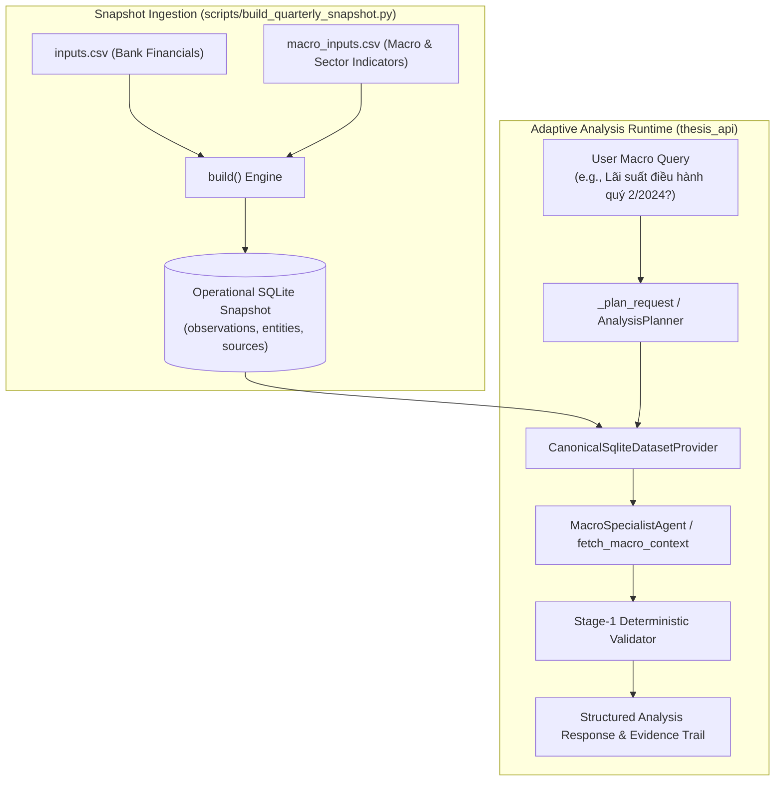
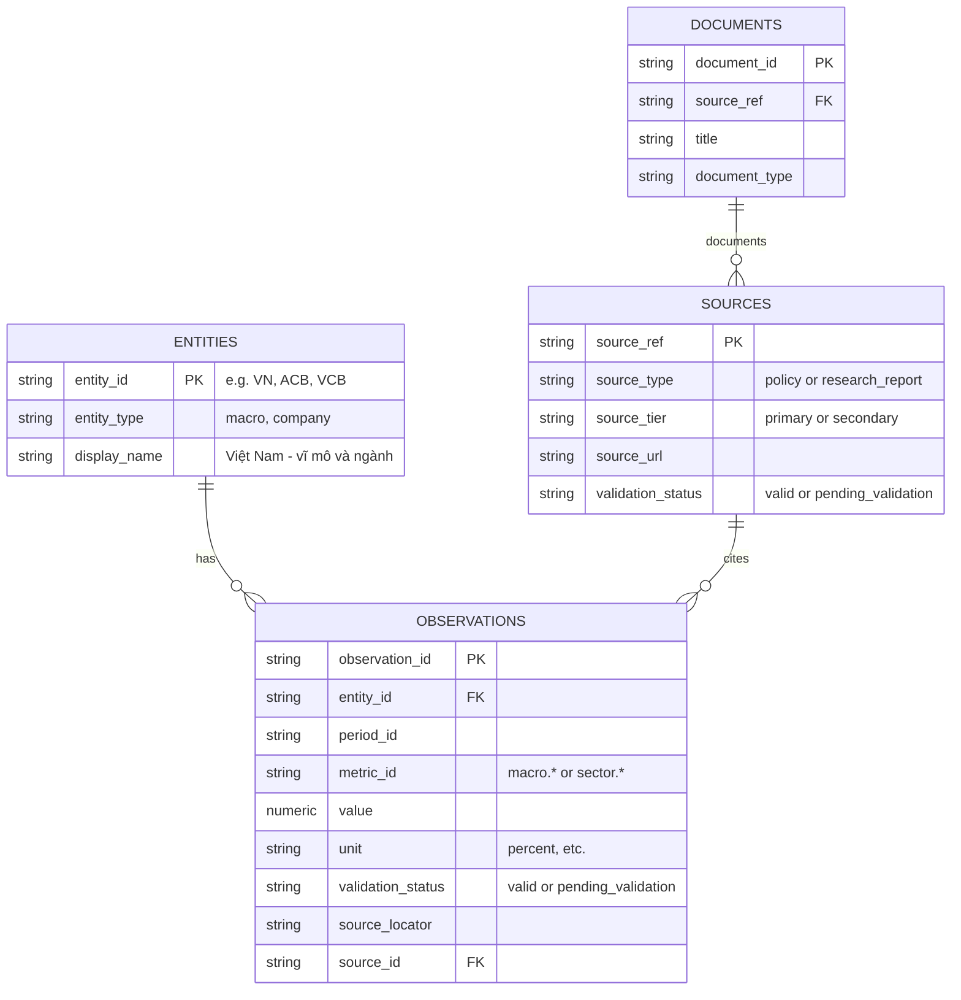

# Macro and Sector Ingestion Architecture

## Overview

The `MACRO-INGEST` feature enables ingesting macroeconomic indicators (e.g. `macro.policy_rate`, `macro.credit_growth`, `macro.gdp_growth`, `macro.cpi_yoy`, `macro.usd_vnd`) and system-wide banking sector indicators (e.g. `sector.system_npl_ratio`, `sector.system_nim`, `sector.system_credit_outstanding`) into operational SQLite snapshots via `scripts/build_quarterly_snapshot.py --macro-inputs <csv>`.

Observations are bound to entity `VN` (`entity_type=MACRO`), with quality verification (`QualityStatus.VALID` for primary sources, `QualityStatus.PENDING_VALIDATION` for secondary sources). The API runtime connects `MacroSpecialistAgent` and `fetch_macro_context` directly to accepted SQLite observations, enabling queries regarding macroeconomic conditions and monetary policy transmission to retrieve real, cited metrics rather than encountering `unsupported_macro_scope` rejection.

## System Architecture Flow

## Entity Relationship Diagram (ERD)

## Component Roles and Module Ownership

1. **`scripts/build_quarterly_snapshot.py`**:
   - Accepts `--macro-inputs <csv>` with columns `entity_id` (`VN`), `metric_id`, `period_id`, `value`, `unit`, `period_basis`, `source_locator`, `source_url`, `source_sha256`, `source_tier`, and `scope`.
   - Inserts macro and sector metrics into `observations`, registering entity `VN` (`DatasetEntityType.MACRO`) in `entities`.
   - Primary tier records (`source_tier == "primary"`) become `QualityStatus.VALID` with signed review metadata; secondary tier records become `QualityStatus.PENDING_VALIDATION` (unaccepted for numeric claims).
   - Missing cells are skipped without zero-filling or interpolation.
   - When `--macro-inputs` is omitted, snapshot generation is backward-compatible and identical to baseline.

2. **`src/thesis_api/service.py`**:
   - `fetch_macro_context(conn, period)` queries accepted observations (`entity_id = 'VN'`, `validation_status = 'valid'`) from the operational SQLite store and maps indicators (`macro.policy_rate` -> `sbv_policy_rate`, `macro.credit_growth` -> `system_credit_growth`) and citation locators to `MacroContextDTO`.
   - `_MACRO_TERMS` incorporates key Vietnamese policy and credit terms.

3. **`src/thesis_api/agents.py`**:
   - `MacroSpecialistAgent`: Formulates findings using verified values from `fetch_macro_context` (`sbv_policy_rate`, `system_credit_growth`) when running offline or grounded without LLM.

4. **`src/thesis_api/adaptive_runtime.py`**:
   - `_query_declared_periods` and `_check_single_period` recognize Vietnamese quarter notations (`quý [1-4]/YYYY`, `quy [1-4] YYYY`, `Q[1-4]/YYYY`).
   - `_plan_request` routes macro inquiries directly to macro indicator requirements when catalog declares macro capabilities (`_provider_macro_available(catalog)`).
   - In `_AdaptiveRun.execute`, macro claims are created with explicit source locators and verified against Stage-1 deterministic gates.
