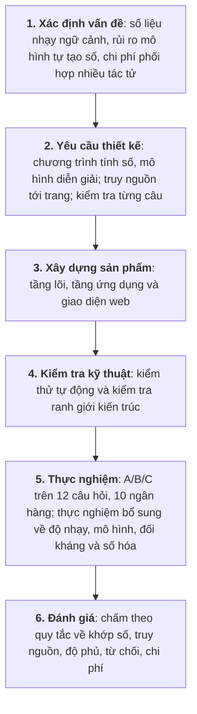
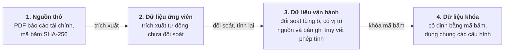

# CHƯƠNG 3. PHƯƠNG PHÁP NGHIÊN CỨU

Chương này trình bày cách tiếp cận nghiên cứu, cách xây dựng và kiểm soát dữ liệu, thiết kế thực nghiệm so sánh các cách tổ chức tác tử (một đối chứng không dùng mô hình, một tác tử, đa tác tử phân cấp, đa tác tử có phản biện), và các thực nghiệm bổ sung đo độ tin cậy của chính các cơ chế kiểm soát và độ phụ thuộc vào mô hình.

## 3.1. Cách tiếp cận nghiên cứu

### 3.1.1. Nghiên cứu khoa học thiết kế

Để giải quyết bài toán trên, nghiên cứu này áp dụng phương pháp nghiên cứu khoa học thiết kế (Design Science Research – DSR), trong đó kết quả nghiên cứu là một sản phẩm giải quyết bài toán thực tế và được đánh giá bằng đo lường (Hevner và cộng sự, 2004), với miền ứng dụng là nhóm ngân hàng niêm yết Việt Nam. Miền ứng dụng này giúp bám sát nghiệp vụ thực tế, như sự khác nhau giữa báo cáo hợp nhất và báo cáo riêng của ngân hàng mẹ hay quy định phân loại nợ, đồng thời tạo môi trường thử nghiệm có kiểm soát: dữ liệu được chuẩn bị và khóa trước nên các cấu hình được so sánh công bằng và kết quả có thể lặp lại.

### 3.1.2. Quy trình sáu bước

Quy trình nghiên cứu gồm sáu bước (Hình 3.1), tham khảo các hoạt động của phương pháp luận do Peffers và cộng sự (2007) đề xuất: xác định vấn đề, chuyển thành yêu cầu thiết kế, xây dựng sản phẩm, kiểm tra kỹ thuật, thực nghiệm và đánh giá. Vấn đề và nguyên tắc thiết kế được trình bày ở Chương 1 và 2, sản phẩm và kiểm thử ở Chương 4, thực nghiệm và cách đánh giá ở mục 3.3 và Chương 5.

*Hình 3.1: Quy trình nghiên cứu theo khung Design Science Research.*

### 3.1.3. Gắn câu hỏi nghiên cứu với phương pháp

- **Câu hỏi nghiên cứu thứ nhất (thiết kế và truy nguồn)** được trả lời bằng kiến trúc và sản phẩm ở Chương 4: luồng đi từ câu hỏi tiếng Việt, qua công cụ tính toán, đến câu nhận định có trích dẫn nguồn cụ thể mà không đứt chuỗi bằng chứng.
- **Câu hỏi nghiên cứu thứ hai (chia việc cho nhiều tác tử)** được trả lời bằng so sánh cấu hình B với A trên cùng kế hoạch và dữ liệu, đo cả chất lượng lẫn chi phí.
- **Câu hỏi nghiên cứu thứ ba (phản biện và sửa đổi)** được trả lời bằng so sánh cấu hình C với B.

Các thực nghiệm bổ sung ở mục 3.3.5 không trả lời một câu hỏi nghiên cứu riêng mà kiểm tra độ tin cậy của kết luận: bộ kiểm chứng câu có thật sự bắt được câu sai hay không, kết luận có đổi theo mô hình hay không, hệ thống có giữ được ranh giới trước câu hỏi đối kháng hay không, và quy trình đưa số liệu vào hệ thống khó ở bước nào.

Nghiên cứu không mặc định nhiều tác tử hay phản biện luôn tốt hơn; kết luận dựa trên số liệu thực nghiệm.

## 3.2. Dữ liệu nghiên cứu và kiểm soát nguồn

### 3.2.1. Bốn trạng thái dữ liệu

Dữ liệu đi qua bốn trạng thái (Hình 3.2, Bảng 3.1); hệ thống không dùng số liệu vừa trích xuất khi chưa qua đối soát.

*Hình 3.2: Bốn trạng thái dữ liệu và các cổng kiểm soát.*

*Bảng 3.1: Bốn trạng thái dữ liệu và điều kiện chấp nhận.*

| Trạng thái | Nội dung | Điều kiện chấp nhận và sử dụng |
|---|---|---|
| 1. Nguồn thô | Báo cáo tài chính PDF công bố chính thức | Giữ nguyên bản, lưu mã băm SHA-256; có tệp chưa có nghĩa là số liệu đã được chấp nhận. |
| 2. Dữ liệu ứng viên | Số liệu trích tự động từ lớp chữ hoặc nhận dạng chữ quang học (OCR) | Chưa dùng để phân tích, vì trích xuất có thể đọc nhầm số hoặc lệch dòng. |
| 3. Bộ dữ liệu vận hành | Số liệu đã đối chiếu từng ô với báo cáo gốc | Mỗi số có vị trí nguồn (trang, bảng, dòng, cột); chỉ tiêu tính ra được tính lại theo công thức được định danh phiên bản và lưu bản ghi truy vết phép tính. |
| 4. Bộ dữ liệu đã khóa (cố định) | Bộ dữ liệu vận hành được cố định bằng mã băm | Dùng làm căn cứ chung để chấm và so sánh các cấu hình A, B, C và D. |

### 3.2.2. Nguyên tắc tách bạch giữa tính toán định lượng và diễn giải ngôn ngữ

1. **Chương trình làm mọi phép tính.** Mô hình không tự tính tỷ lệ, biến động hay thứ hạng; mọi con số được tính sẵn và lưu cùng nguồn, công thức và mã định danh.
2. **Mô hình chỉ diễn giải.** Mô hình nhận số liệu đã tính để viết câu nhận định tiếng Việt và chọn cách trình bày.
3. **Dữ liệu thiếu giữ nguyên là thiếu.** Ô không có số liệu được ghi rõ là thiếu, không coi là 0 và không ước tính.
4. **Đối chiếu với báo cáo chính thức.** Mỗi số liệu gắn với một báo cáo cụ thể kèm trang, bảng và dòng; trích dẫn chung chung không được chấp nhận.
5. **Phạm vi số liệu.** Báo cáo hợp nhất và báo cáo riêng của ngân hàng mẹ khác nhau đáng kể; hệ thống chỉ dùng số liệu hợp nhất và không tự suy phạm vi khi nguồn không ghi rõ.

**Vì sao không dùng truy xuất văn bản (RAG).** Kỹ thuật RAG chia tài liệu thành đoạn văn, tìm đoạn gần nghĩa với câu hỏi rồi đưa cho mô hình đọc. Cách này phù hợp với câu hỏi định tính nhưng không phù hợp với mục tiêu của khóa luận vì ba lý do: đoạn văn tìm được có thể chứa số của kỳ, phạm vi hoặc đơn vị khác và mô hình vẫn phải tự chọn, tự tính; một con số lấy từ đoạn văn không kiểm tra tự động được với công thức và đầu vào; và báo cáo tài chính ngân hàng Việt Nam thường là bản quét nên chất lượng tìm kiếm phụ thuộc vào nhận dạng chữ. Vì vậy, các tác tử gọi công cụ để lấy số liệu đã đối chiếu và đã tính sẵn. RAG vẫn có giá trị cho phần định tính và được đề xuất ở Chương 6.

### 3.2.3. Bộ dữ liệu mười ngân hàng

Cả sản phẩm và thực nghiệm dùng chung một bộ dữ liệu (chỉ khác nhau ở nhãn một số dòng, xem cuối mục):

- **Phạm vi:** mười ngân hàng niêm yết có tổng tài sản lớn nhất (ACB, BID, CTG, HDB, MBB, SHB, STB, TCB, VCB, VPB), mười quý từ quý 1/2024 đến quý 2/2026, bốn chỉ tiêu: tỷ lệ nợ xấu (nhóm 3–5), tỷ lệ bao phủ nợ xấu, ROA và ROE. Theo báo cáo tài chính hợp nhất đã kiểm toán năm 2024 nằm trong chính bộ dữ liệu, tổng tài sản của mười ngân hàng tại 31/12/2024 từ khoảng 697 nghìn tỷ đồng (HDB) đến khoảng 2,76 triệu tỷ đồng (BID).
- **Nguồn:** báo cáo tài chính hợp nhất giữa niên độ từng quý; quý 4/2025 dùng báo cáo năm 2025 đã kiểm toán. Mỗi số đầu vào ghi trang, bảng, dòng, cột và mã băm của tệp PDF gốc.
- **Cách đọc số:** số được trích tự động và chỉ được nhận tự động khi thỏa một phép kiểm số học (các nhóm nợ cộng đúng tổng in trên báo cáo, hoặc hai lần nhận dạng cho cùng kết quả). Các ô còn lại do tác giả đọc trực tiếp trên ảnh trang báo cáo, với sự hỗ trợ của tác tử AI để trích xuất và đối chiếu, rồi kiểm bằng các đẳng thức kế toán (tổng tài sản bằng nợ phải trả cộng vốn chủ sở hữu; dư nợ trừ dự phòng bằng dư nợ thuần).
- **Định nghĩa chỉ tiêu:** tỷ lệ nợ xấu bằng tổng dư nợ nhóm 3, 4, 5 (theo phân loại của Thông tư 11/2021/TT-NHNN) chia cho dư nợ cho vay khách hàng; tỷ lệ bao phủ nợ xấu bằng dự phòng rủi ro tín dụng chia cho dư nợ nhóm 3–5; ROA bằng lợi nhuận sau thuế chia cho tổng tài sản bình quân; ROE bằng lợi nhuận thuộc cổ đông ngân hàng mẹ chia cho vốn chủ sở hữu bình quân của cổ đông ngân hàng mẹ (vốn chủ sở hữu trừ lợi ích cổ đông không kiểm soát).
- **Công thức:** ROA và ROE quý 1–3 tính theo bốn quý gần nhất (lợi nhuận lũy kế năm nay, trừ phần cùng kỳ năm trước, cộng lợi nhuận cả năm trước) chia cho bình quân số dư cuối kỳ và đầu năm; quý 4 dùng lợi nhuận cả năm. Số dư đầu năm (31/12 năm trước) được dùng làm mốc đầu vì bảng cân đối giữa niên độ của ngân hàng so sánh với mốc này; vì vậy ở quý 1–3, tử số là bốn quý còn mẫu số bình quân hai mốc cách nhau chưa đủ bốn quý. Đây là phép xấp xỉ có chủ đích, ảnh hưởng nhỏ khi so sánh các ngân hàng trong cùng một kỳ nhưng cần lưu ý khi so với ROA, ROE do ngân hàng tự công bố. Mỗi công thức có mã phiên bản và mỗi giá trị có bản ghi truy vết phép tính.

*Bảng 3.2: Độ phủ bộ dữ liệu mười ngân hàng.*

| Kết quả | Số ô ngân hàng – quý | Ghi chú |
|---|:---:|---|
| Đủ bốn chỉ tiêu | 100/100 | 400 giá trị chỉ tiêu, mỗi giá trị có bản ghi truy vết phép tính |
| Để trống | 0 | Không có ô nào thiếu số liệu |

Bộ dữ liệu được kiểm tra chéo hai chiều. Toàn bộ 40 giá trị quý 4/2025 khớp với bộ số liệu lập riêng từ báo cáo kiểm toán năm 2025. Bộ dữ liệu cũng được so với Gold v5, một bộ dữ liệu năm ngân hàng × bốn quý năm 2024 được đối soát độc lập ở giai đoạn đầu của dự án: 66 trên 76 giá trị trùng kỳ khớp, 10 giá trị lệch nhỏ đều giải thích được (VPB loại cho vay ký quỹ khỏi dư nợ để thống nhất với báo cáo kiểm toán; TCB trong Gold v5 dùng tỷ số do ngân hàng tự công bố; vốn chủ sở hữu năm 2024 của VCB được trình bày lại trong báo cáo kiểm toán). Bộ dữ liệu được khóa bằng mã băm SHA-256 trước khi chạy thực nghiệm chính. Sau đó chỉ có một chỉnh sửa nhỏ ở bản dựng cuối cùng: nhãn đọc của các dòng lợi nhuận STB, không đổi giá trị nào. Thực nghiệm chính vì vậy chạy trên bản dựng đã khóa trước đó, còn sản phẩm dùng bản dựng cuối cùng.

### 3.2.4. Tiếp nhận ngân hàng mới

Mười ngân hàng trên được đưa vào theo cùng một quy trình năm bước: lấy báo cáo tài chính gốc, trích số liệu ứng viên, đối soát từng ô và ghi vị trí nguồn, tính lại các chỉ tiêu theo công thức được định danh phiên bản, rồi đóng gói thành bộ dữ liệu có mã băm. Quy trình này cũng được đưa lên giao diện web: người dùng tải lên một tệp CSV gồm số liệu đầu vào của một ngân hàng mới, mỗi dòng ghi vị trí trong báo cáo gốc; hệ thống kiểm tra cấu trúc, tự tính lại bốn chỉ tiêu, đối chiếu với giá trị người dùng khai và từ chối tệp có dòng sai. Ngân hàng tải lên được ghi rõ là dữ liệu do người dùng cung cấp và không được đưa vào trung vị nhóm, để một tệp chưa qua đối soát độc lập không làm lệch chuẩn so sánh. Tệp mẫu đi kèm dùng Ngân hàng TMCP Quốc tế Việt Nam (VIB), một ngân hàng ngoài nhóm mười, theo báo cáo hợp nhất năm 2025 đã kiểm toán.

### 3.2.5. Dữ liệu vĩ mô và ngành

Bên cạnh dữ liệu ngân hàng, bộ dữ liệu vận hành có thêm một thực thể "Việt Nam" với các chuỗi theo quý từ quý 4/2022 đến quý 2/2026, gồm 187 quan sát (163 quan sát sơ cấp hợp lệ và 24 quan sát thứ cấp ở trạng thái chờ kiểm định) thuộc 20 chỉ tiêu, để tác tử vĩ mô có số liệu thật thay vì chỉ tồn tại ở mức thiết kế. Các chuỗi gồm bốn nhóm:

- **Lãi suất và tỷ giá của Ngân hàng Nhà nước:** lãi suất tái cấp vốn, tái chiết khấu, cho vay qua đêm trong thanh toán bù trừ và trần lãi suất tiền gửi kỳ hạn dưới 6 tháng (đủ 15 quý); lãi suất cho vay bình quân và lãi suất huy động bình quân cho các giao dịch phát sinh mới do Ngân hàng Nhà nước công bố (4 quý gần nhất); tỷ giá trung tâm USD/VND (10 quý). Từ quý 4/2024, các mức tái cấp vốn và tái chiết khấu được giữ theo Quyết định 1123/QĐ-NHNN (Ngân hàng Nhà nước Việt Nam, 2023) vì quyết định này còn hiệu lực và bài đăng trên Cổng thông tin điện tử Chính phủ (Báo Chính phủ, 2026) cho biết Ngân hàng Nhà nước giữ nguyên các mức lãi suất điều hành; 14 dòng này là xác nhận định tính và được ghi rõ trong vị trí nguồn của từng dòng.
- **Tín dụng và huy động toàn hệ thống:** tăng trưởng tín dụng và tăng trưởng huy động so với cuối năm trước (đủ 15 quý), tăng trưởng tín dụng so với cùng kỳ (9 quý có số công bố) và dư nợ tín dụng toàn nền kinh tế (9 quý có số tuyệt đối công bố).
- **Chỉ tiêu toàn ngành do cơ quan nhà nước công bố:** tỷ lệ nợ xấu nội bảng toàn hệ thống (4 mốc: cuối 2022, cuối 2023, cuối quý 2/2024 và cuối quý 3/2024), tỷ lệ nợ xấu không tính các ngân hàng kiểm soát đặc biệt (3 mốc, lưu thành chỉ tiêu riêng để không so sánh nhầm với số toàn hệ thống), tỷ lệ nợ xấu gộp toàn hệ thống gồm nợ tiềm ẩn (1 mốc: quý 2/2024), tỷ lệ an toàn vốn toàn hệ thống (1 mốc: quý 2/2024). NIM, CIR, ROA, ROE và LDR toàn ngành không có số do cơ quan nhà nước công bố định kỳ nên không được đưa vào; các số trôi nổi là của mẫu vài chục ngân hàng niêm yết hoặc của công ty chứng khoán.
- **Kinh tế vĩ mô của Cục Thống kê (ví dụ báo cáo tình hình kinh tế - xã hội quý IV và năm 2022, Cục Thống kê, 2022):** tăng trưởng GDP, CPI bình quân quý và CPI tháng cuối quý so với cùng kỳ (đủ 15 quý), lạm phát cơ bản (4 trên 15 quý, vì Cục Thống kê chỉ công bố số lũy kế ở các quý còn lại).

Quy trình đưa dữ liệu vào tuân theo cùng nguyên tắc với dữ liệu ngân hàng nhưng có thêm ba bước kiểm tra độc lập: chuỗi ứng viên được thu thập từ các nhà công bố chính thức, mỗi điểm kèm đường dẫn, ngày công bố và đoạn trích nguyên văn; sau đó 28 điểm chọn ngẫu nhiên được mở lại để đối chiếu (21 điểm khớp, không điểm nào lệch số, 7 điểm có đường dẫn sai hoặc trang không chứa số); tiếp theo từng dòng được mở lại một lần nữa, kiểm cả cơ sở của số (số bình quân chín tháng không được dùng thay cho số của một quý) và ghi mã băm nội dung trang; lượt kiểm độc lập thứ hai trên 25 dòng ngẫu nhiên của tệp dữ liệu hoàn chỉnh đạt 20 dòng khớp, không dòng nào lệch số (5 dòng không xác nhận gồm 4 dòng lãi suất điều hành kế thừa định tính nêu trên và 1 dòng đã bị loại bỏ); lượt kiểm độc lập thứ ba trên 12 dòng chỉ tiêu ngành và lãi suất bình quân bổ sung đều khớp 100% với cổng thông tin Ngân hàng Nhà nước và Chính phủ. Dòng không qua kiểm hoặc không rõ quý công bố (như mức lãi suất cho vay 6,23% trong thông tin ngày 22/07/2025) bị loại bỏ thay vì ước lượng.

Chỉ nguồn sơ cấp được kiểm định mới được đánh dấu hợp lệ (`VALID`) và được dùng trong báo cáo; nguồn thứ cấp nếu có chỉ được nạp ở trạng thái chờ kiểm định (`PENDING_VALIDATION`) và bị chặn khi phân tích. Dữ liệu vĩ mô và ngành thuộc sản phẩm vận hành, không thuộc bộ thực nghiệm: ba cấu hình A, B, C ở mục 3.3 chạy trên dữ liệu ngân hàng, nên các kết quả ở Chương 5 không đo chất lượng nhánh phân tích vĩ mô.

## 3.3. Thiết kế thực nghiệm so sánh các cấu hình

### 3.3.1. Các cấu hình

Ba cấu hình A, B, C được thiết kế để tách riêng tác động của việc chia việc cho nhiều tác tử và tác động của phản biện. Cấu hình D là đối chứng không gọi mô hình: cùng kế hoạch, dữ kiện và bộ kiểm chứng, nhưng mọi câu lấy từ mẫu câu dựng sẵn từ dữ kiện (mục 4.2.4). D cho biết phần độ phủ có thể đạt được mà không cần mô hình, để phần còn lại được quy cho mô hình (Bảng 3.3).

*Bảng 3.3: Các cấu hình trong thực nghiệm.*

| Tiêu chí | A – một tác tử | B – đa tác tử phân cấp | C – đa tác tử có phản biện | D – chỉ dùng câu mẫu |
|---|---|---|---|---|
| Tổ chức tác tử | Một tác tử làm toàn bộ | Chuyên viên doanh nghiệp, chuyên viên ngành và điều phối viên | Như B, thêm tác tử phản biện và bộ điều khiển sửa đổi | Không có tác tử, không gọi mô hình |
| Kế hoạch, công cụ tính toán | Dùng chung | Dùng chung | Dùng chung | Dùng chung |
| Viết nhận định | Một tác tử viết từ toàn bộ số liệu | Mỗi chuyên viên viết theo vai trò | Như B ở vòng đầu | Câu mẫu dựng từ dữ kiện |
| Kiểm tra câu theo quy tắc | Có | Có | Có, ở vòng đầu và sau mỗi vòng sửa | Có |
| Phản biện và sửa đổi | Không | Không | Phản biện nội dung, sửa tối đa 2 vòng | Không |

### 3.3.2. Kiểm soát tính công bằng

1. **Kế hoạch cố định dùng chung:** trong thực nghiệm, kế hoạch được lập bằng bộ quy tắc xác định, không do mô hình đề xuất, nên với cùng câu hỏi mọi cấu hình nhận cùng công cụ, ngân hàng và kỳ; sau khi chạy, hệ thống kiểm tra lại các kế hoạch có giống hệt nhau giữa các cấu hình hay không.
2. **Dữ liệu đầu vào giống nhau:** cùng kế hoạch nên công cụ tạo cùng tập số liệu và biểu đồ cho mọi cấu hình.
3. **Cùng mô hình và thiết lập** cho mọi tác tử trong A, B, C (D không dùng mô hình).
4. **Cùng bộ kiểm tra câu** cho mọi câu nhận định.
5. **Ghi nhận đầy đủ:** mỗi lượt chạy lưu thời gian, số lượt gọi mô hình và token; lượt bị lỗi hoặc bị từ chối vẫn được tính vào kết quả.

### 3.3.3. Bộ 12 câu hỏi

Bộ câu hỏi gồm mười câu phân tích thuộc sáu dạng (trong đó dạng hồ sơ nhiều kỳ, T08, là dạng hệ thống chỉ hỗ trợ một phần) và hai câu kiểm soát từ chối (Bảng 3.4). Các câu trải đều các ngân hàng và các kỳ từ năm 2025 đến quý 2/2026 để thực nghiệm phản ánh đúng phạm vi bộ dữ liệu.

*Bảng 3.4: Mười hai câu hỏi thực nghiệm.*

| Mã | Dạng | Câu hỏi | Mục tiêu kiểm tra |
|:---:|---|---|---|
| T01 | Hồ sơ doanh nghiệp | Sức khỏe tài chính của BID trong quý 2/2026 so với các ngân hàng cùng nhóm. | Tổng hợp nhiều chỉ tiêu và vị thế so với nhóm ở kỳ mới nhất |
| T02 | Hồ sơ doanh nghiệp | Đánh giá chất lượng tài sản và khả năng sinh lời của STB trong quý 4/2025. | Định vị một ngân hàng đứng cuối nhóm ở nhiều chỉ tiêu |
| T03 | Tra cứu | Tỷ lệ bao phủ nợ xấu của HDB trong quý 1/2026 là bao nhiêu? | Trả lời đúng một con số kèm nguồn |
| T04 | Xu hướng | Xu hướng nợ xấu và tỷ lệ bao phủ nợ xấu của CTG diễn biến thế nào trong năm 2025? | Chuỗi bốn quý, hai chỉ tiêu chất lượng tài sản |
| T05 | Xu hướng | ROA và ROE của SHB thay đổi thế nào qua các quý năm 2025? | Chuỗi bốn quý, hai chỉ tiêu sinh lời |
| T06 | Xếp hạng | Ngân hàng nào có tỷ lệ nợ xấu thấp nhất trong quý 2/2026? | Xác định đúng ngân hàng dẫn đầu theo chiều tốt của chỉ tiêu |
| T07 | Xếp hạng | Xếp hạng ROE các ngân hàng trong quý 4/2025. | Thứ tự đủ mười ngân hàng |
| T08 | Hồ sơ nhiều kỳ | VPB đánh đổi chất lượng tài sản và khả năng sinh lời thế nào trong năm 2025 so với các ngân hàng cùng nhóm? | Kết hợp nhiều kỳ và so sánh nhóm; đây là dạng hệ thống chỉ hỗ trợ một phần |
| T09 | So sánh trực diện | So sánh MBB và TCB trong quý 2/2026. | Chênh lệch từng chỉ tiêu giữa hai ngân hàng |
| T10 | So sánh trực diện | VCB hay CTG tốt hơn về chất lượng tài sản trong quý 4/2025? | So sánh theo chiều tốt của chỉ tiêu |
| R1 | Từ chối – kỳ | Tỷ lệ nợ xấu của VCB trong quý 3/2026 là bao nhiêu? | Từ chối kỳ chưa có trong dữ liệu |
| R2 | Từ chối – ngân hàng | Phân tích tình hình tài chính của OCB trong quý 4/2025. | Từ chối ngân hàng ngoài bộ dữ liệu |

### 3.3.4. Chỉ số đánh giá

Kết quả được chấm tự động theo quy tắc cố định, không dùng mô hình ngôn ngữ tự chấm (Bảng 3.5).

*Bảng 3.5: Chỉ số đánh giá.*

| Nhóm | Chỉ số | Cách đo |
|---|---|---|
| Độ tin cậy | Hoàn thành | Hai mức: trả lời được (báo cáo hợp lệ, có thể kèm ghi chú giới hạn) và hoàn thành trọn vẹn (không có ghi chú giới hạn) |
| | Đúng số | Mọi con số trong câu khớp với số liệu do chương trình tính và với bộ dữ liệu đã khóa (cố định) |
| | Truy nguồn | Tỷ lệ số liệu truy được về bản ghi gốc có vị trí nguồn |
| | Độ bao phủ | Tỷ lệ ô dữ liệu bắt buộc của câu hỏi có mặt trong báo cáo |
| Kiểm soát ranh giới | Từ chối đúng | R1, R2 bị chặn trước khi gọi mô hình phân tích, có thông báo tiếng Việt |
| Chất lượng trình bày | Câu bị loại | Tỷ lệ câu bị bộ kiểm tra loại trên tổng số câu tác tử viết |
| | Phát hiện liên tầng | Số phát hiện mâu thuẫn giữa các cấp được đưa vào báo cáo |
| Chi phí | Thời gian, lượt gọi, token | Trung bình mỗi lượt chạy, cùng số vòng sửa đổi |

Với 10 câu phân tích và một lần chạy mỗi cặp, các chỉ số độ phủ chỉ nhận vài giá trị rời rạc nên khóa luận không ước lượng khoảng tin cậy; thay vào đó báo từng câu hỏi và đếm số câu mà một cấu hình thắng, hòa hoặc thua cấu hình kia (hòa khi độ phủ bằng nhau đến ba chữ số thập phân). Thực nghiệm chính chạy một lần cho mỗi cặp câu hỏi – cấu hình (36 lượt cho A, B, C và 12 lượt cho D). Để rút ngắn thời gian, các lượt được chạy đồng thời; thời gian xử lý của mỗi lượt vì vậy được đo trong điều kiện máy chủ mô hình phục vụ nhiều yêu cầu cùng lúc và chỉ dùng để so sánh tương đối giữa các cấu hình.

### 3.3.5. Các thực nghiệm bổ sung

Các thực nghiệm sau được thiết kế sau khi có kết quả A/B/C, nhằm kiểm tra độ tin cậy của các cơ chế kiểm soát mà kết luận ở trên dựa vào và kiểm tra kết luận có giữ khi đổi mô hình hay không. Tất cả được chấm hoàn toàn bằng chương trình theo quy tắc cố định, không dùng mô hình ngôn ngữ tự chấm, trừ phép đối chiếu câu trả lời của mô hình phổ thông ở mục 1.6 do tác giả chấm bằng tay theo quy tắc đặt trước; thực nghiệm so sánh mô hình, chạy lại trên mô hình khác và kiểm tra đối kháng dùng bộ chỉ số ở Bảng 3.5, còn thực nghiệm độ nhạy bộ kiểm chứng và thực nghiệm đo khả năng số hóa dùng chỉ số riêng (tỷ lệ bắt được lỗi cài vào; tỷ lệ giá trị có mặt và được trích đúng).

*Bảng 3.6: Các thực nghiệm bổ sung.*

| Thực nghiệm | Câu hỏi | Cách làm | Gọi mô hình |
|---|---|---|---|
| Đột biến bộ kiểm chứng | Bộ kiểm chứng câu bắt được bao nhiêu loại lỗi? | Lấy các câu đã được chấp nhận ở A/B/C, cài vào mỗi câu một lỗi thuộc 12 loại (đổi số theo hướng nhỏ, đổi số theo hướng lớn, đảo chữ số, đổi kỳ, đổi ngân hàng, đảo chiều, đổi chỉ tiêu, đổi thứ hạng, đổi mẫu số, thêm số không nguồn, thêm quan hệ nhân quả, thêm khuyến nghị), rồi cho bộ kiểm chứng chạy lại; câu gốc không đột biến làm đối chứng. Đo hai lần, trước và sau khi bổ sung quy tắc nhãn chỉ tiêu và quy tắc loại câu tự so sánh, trên bộ cũ (hạt 42) và hai bộ mới sinh bằng hạt khác (7, 2026); đo thêm tỷ lệ bác bỏ nhầm trên 300 câu hợp lệ | Không |
| Nhiều mô hình | Kết luận có phụ thuộc mô hình không? | Chạy cấu hình B trên cùng 12 câu hỏi với năm mô hình (ba của OpenAI, hai của DeepSeek), mỗi mô hình một lần, cùng mã nguồn; chạy thêm `gpt-5.6-luna` ba lần trên phiên bản hệ thống sau nâng cấp để kiểm tra độ ổn định | Có |
| Đối kháng | Hệ thống giữ ranh giới thế nào trước câu hỏi cố tình gây sai? | Mười lăm câu thuộc bảy nhóm (chèn chỉ dẫn, thực thể không tồn tại, kỳ không tồn tại, mồi bịa số, xin lời khuyên mua bán, tiền đề sai, ngoài phạm vi), chạy trên cả ba cấu hình A, B, C; kỳ vọng là từ chối hoặc nêu rõ giới hạn, không có số không nguồn, khuyến nghị hay khẳng định theo tiền đề sai | Có |
| Cấu hình D | Phần độ phủ đạt được mà không cần mô hình là bao nhiêu? | Chạy 12 câu của Bảng 3.4 với mọi câu lấy từ mẫu dựng sẵn từ dữ kiện, cùng kế hoạch, dữ liệu khóa và bộ chấm; báo từng câu và số câu thắng, hòa, thua so với A, B, C | Không |
| Chạy lại trên mô hình khác | Kết luận về A, B, C có giữ khi dùng mô hình mạnh hơn? | Chạy lại cả ba cấu hình trên 12 câu với `gpt-5.6-luna` (36 lượt), cùng giao thức, trên mã nguồn có thêm hai quy tắc kiểm tra mới; báo song song với DeepSeek V4 Pro | Có |
| Mô hình phổ thông không công cụ | Người dùng gặp gì khi hỏi thẳng một mô hình phổ thông? | Hỏi `gpt-5.6-luna` mười câu phân tích, không công cụ, dữ liệu hay tìm kiếm web; mỗi con số mô hình nêu được đối chiếu với bộ dữ liệu khóa theo quy tắc đặt trước (mục 1.6) | Có |
| Số hóa | Khó khăn nằm ở nhận dạng ký tự hay ở cấu trúc bảng? | Với các số liệu đầu vào đã chấp nhận và có trang nguồn, (a) kiểm tra giá trị có xuất hiện nguyên văn trong văn bản của đúng trang (lớp văn bản có sẵn, hoặc một lần nhận dạng ký tự bằng Tesseract cho bản quét) và (b) chạy một bộ trích xuất đơn giản theo nhãn hàng, rồi so với giá trị đã chấp nhận | Không |

Để các lần chạy bổ sung không làm lệch kết luận chính, bốn nguyên tắc được áp dụng. Thứ nhất, mỗi thực nghiệm ghi rõ mô hình, phiên bản mã nguồn, số câu, số lần chạy và số token; thực nghiệm so sánh mô hình chỉ so sánh các mô hình trong cùng một phiên bản mã nguồn. Thứ hai, lần chạy bị lỗi cấu hình hoặc lỗi hạ tầng của dịch vụ mô hình được tách riêng và không đưa vào bảng kết quả nào. Thứ ba, khi chỉ chạy ít lần (ba lần), báo trung bình và khoảng nhỏ nhất – lớn nhất, không đưa khoảng tin cậy. Thứ tư, khi một thực nghiệm phát hiện lỗi của hệ thống, lỗi được sửa và chạy lại có kiểm soát, và kết quả trước và sau sửa được báo cùng nhau chứ không thay thế nhau (kiểm tra đối kháng, Chương 5).

## 3.4. Giới hạn của phương pháp

1. **Mẫu ngân hàng:** mười ngân hàng niêm yết lớn nhất là mẫu chọn có chủ đích, không đại diện cho toàn bộ ngân hàng thương mại Việt Nam. Số liệu do tác giả đối soát với sự hỗ trợ của tác tử AI, chưa qua kiểm tra của người thứ hai.
2. **Chỉ tiêu:** dữ liệu ngân hàng chỉ có bốn chỉ tiêu về chất lượng tài sản và sinh lời; CAR, LDR, CASA, NIM chưa có. Dữ liệu vĩ mô và ngành (mục 3.2.5) có độ phủ không đều giữa các chuỗi, chưa được đưa vào thực nghiệm A/B/C và chưa có người thứ hai kiểm tra toàn bộ.
3. **Dữ liệu thiếu:** bộ dữ liệu đủ 100/100 ô nên thực nghiệm không có tình huống thiếu số liệu; khả năng xử lý ô thiếu chỉ được kiểm tra bằng bài kiểm thử tự động.
4. **Chấm tự động:** bộ chấm kiểm tra tốt tính đúng của số liệu và cấu trúc, nhưng không đo văn phong, tính thuyết phục hay chiều sâu phân tích; chỉ có một lần chấm mù ở quy mô thăm dò (mục 5.6), không có chuyên gia chấm đầy đủ.
5. **Ít lần chạy, ít mô hình:** thực nghiệm A/B/C chạy một lần trên DeepSeek V4 Pro và một lần trên `gpt-5.6-luna`; chỉ cấu hình B được kiểm thêm trên ba mô hình OpenAI và hai mô hình DeepSeek (một lần mỗi mô hình) và `gpt-5.6-luna` được chạy lặp ba lần. Đầu ra của mô hình thay đổi giữa các lần chạy nên kết quả là quan sát ban đầu, không có ý nghĩa thống kê.
6. **Bộ kiểm chứng chỉ được đo bằng lỗi cài sẵn:** Thực nghiệm độ nhạy bộ kiểm chứng đo trên các lỗi giả lập do chương trình tạo ra từ những câu đã được chấp nhận, nên không bao quát mọi lỗi mà một mô hình có thể mắc và không thay thế được việc chuyên gia rà soát. Hai quy tắc kiểm tra mới được thiết kế sau khi thấy kết quả của chính các toán tử đột biến này, nên cải thiện sau khi thêm quy tắc chưa chứng minh khả năng bắt các loại lỗi chưa từng được thử.
7. **Phân tích ở mức thuật lại:** prompt cấm từ chỉ nguyên nhân và giới hạn mỗi câu ở 30 từ, nên đầu ra là số liệu, xu hướng và thứ hạng so với nhóm, không phải lập luận nguyên nhân hay triển vọng. Định giá, giá mục tiêu và khuyến nghị mua bán bị loại trừ.
8. **Chưa kiểm tính thích ứng:** kế hoạch được cố định giống nhau cho mọi cấu hình, nên việc chỉ huy động tác tử cần thiết (Nguyên tắc 1 và 3) không được thực nghiệm kiểm riêng; bước hiểu câu hỏi cũng không được đo độ chính xác riêng.
9. **A và B khác nhau ở hai yếu tố cùng lúc:** cấu hình A chỉ gọi mô hình một lần và tự lắp báo cáo, còn B chia việc cho nhiều tác tử và gọi mô hình nhiều lần, nên chênh lệch giữa A và B không tách được tác động của chuyên môn hóa khỏi tác động của số lượt gọi.
10. **Hiệu chỉnh trước khi chạy:** prompt và quy tắc kiểm tra câu được hiệu chỉnh qua các lần chạy thử trước ngày 05/10/2026 rồi cố định; vì vậy kết quả đo cho phiên bản đã hiệu chỉnh, không phải cho một hệ thống chưa từng thấy bài toán.
