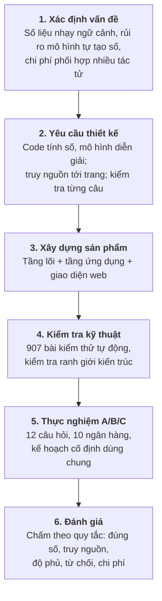
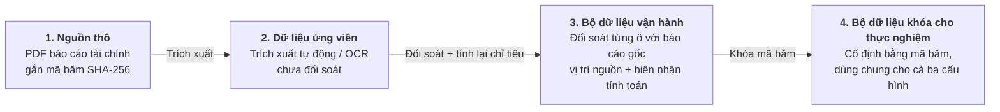

# CHƯƠNG 3. PHƯƠNG PHÁP NGHIÊN CỨU

Chương này trình bày cách tiếp cận nghiên cứu, cách xây dựng và kiểm soát dữ liệu, và thiết kế thực nghiệm so sánh ba cách tổ chức tác tử.

## 3.1. Cách tiếp cận nghiên cứu

### 3.1.1. Nghiên cứu khoa học thiết kế kết hợp nghiên cứu tình huống

Khóa luận dùng phương pháp nghiên cứu khoa học thiết kế (Design Science Research – DSR), trong đó kết quả nghiên cứu là một sản phẩm giải quyết bài toán thực tế và được đánh giá bằng đo lường (Hevner và cộng sự, 2004), kết hợp với nghiên cứu tình huống trên nhóm ngân hàng niêm yết Việt Nam. Tình huống ngân hàng giúp bám sát nghiệp vụ thực tế, như sự khác nhau giữa báo cáo hợp nhất và báo cáo riêng của ngân hàng mẹ hay quy định phân loại nợ, đồng thời tạo môi trường thử nghiệm có kiểm soát: dữ liệu được chuẩn bị và khóa trước nên các cấu hình được so sánh công bằng và kết quả có thể lặp lại.

### 3.1.2. Quy trình sáu bước

Quy trình nghiên cứu gồm sáu bước (Hình 3.1):

1. **Xác định vấn đề:** số liệu ngân hàng cần chính xác, rõ nguồn và đúng phạm vi báo cáo; mô hình ngôn ngữ có thể tự tạo thông tin, và nhiều tác tử làm tăng chi phí phối hợp.
2. **Chuyển thành yêu cầu thiết kế:** chương trình tính mọi con số, mô hình ngôn ngữ chỉ diễn giải; mỗi số liệu truy được về trang báo cáo gốc; mọi câu nhận định qua bộ kiểm tra theo quy tắc; phản biện có giới hạn.
3. **Xây dựng sản phẩm:** tầng lõi (tính chỉ tiêu, kiểm tra câu, kiểm tra cấu trúc báo cáo) và tầng ứng dụng (hiểu câu hỏi, lập kế hoạch, điều phối tác tử, giao diện web).
4. **Kiểm tra kỹ thuật:** 907 bài kiểm thử tự động, kiểm tra ranh giới kiến trúc và hợp đồng giao diện trước mỗi lần hợp nhất mã nguồn.
5. **Thực nghiệm:** ba cấu hình A, B, C chạy 12 câu hỏi trên bộ dữ liệu mười ngân hàng, với kế hoạch phân tích được cố định trước.
6. **Đánh giá:** chấm tự động theo quy tắc về độ chính xác số liệu, khả năng truy nguồn, độ bao phủ, khả năng từ chối câu hỏi ngoài phạm vi và chi phí (thời gian, lượt gọi mô hình, token).

*Hình 3.1: Quy trình nghiên cứu theo khung Design Science Research.*

### 3.1.3. Gắn câu hỏi nghiên cứu với phương pháp

- **RQ1 (thiết kế và truy nguồn)** được trả lời bằng kiến trúc và sản phẩm ở Chương 4: luồng đi từ câu hỏi tiếng Việt, qua công cụ tính toán, đến câu nhận định có trích dẫn nguồn cụ thể mà không đứt chuỗi bằng chứng.
- **RQ2 (chia việc cho nhiều tác tử)** được trả lời bằng so sánh cấu hình B với A trên cùng kế hoạch và dữ liệu, đo cả chất lượng lẫn chi phí.
- **RQ3 (phản biện và sửa đổi)** được trả lời bằng so sánh cấu hình C với B.

Nghiên cứu không mặc định nhiều tác tử hay phản biện luôn tốt hơn; kết luận dựa trên số liệu thực nghiệm.

## 3.2. Dữ liệu nghiên cứu và kiểm soát nguồn

### 3.2.1. Bốn trạng thái dữ liệu

Dữ liệu đi qua bốn trạng thái (Hình 3.2, Bảng 3.1); hệ thống không dùng số liệu vừa trích xuất khi chưa qua đối soát.

*Hình 3.2: Bốn trạng thái dữ liệu và các cổng kiểm soát.*

*Bảng 3.1: Bốn trạng thái dữ liệu và điều kiện chấp nhận.*

| Trạng thái | Nội dung | Điều kiện chấp nhận và sử dụng |
|---|---|---|
| 1. Nguồn thô | Báo cáo tài chính PDF công bố chính thức | Giữ nguyên bản, lưu mã băm SHA-256; có tệp chưa có nghĩa là số liệu đã được chấp nhận. |
| 2. Dữ liệu ứng viên | Số liệu trích tự động từ lớp chữ hoặc nhận dạng chữ quang học (OCR) | Chưa dùng để phân tích, vì trích xuất có thể đọc nhầm số hoặc lệch dòng. |
| 3. Bộ dữ liệu vận hành | Số liệu đã đối chiếu từng ô với báo cáo gốc | Mỗi số có vị trí nguồn (trang, bảng, dòng, cột); chỉ tiêu tính ra được tính lại bằng công thức có phiên bản và lưu biên nhận tính toán. |
| 4. Bộ dữ liệu khóa | Bộ dữ liệu vận hành được cố định bằng mã băm | Dùng làm căn cứ chung để chấm và so sánh ba cấu hình A, B, C. |

### 3.2.2. Nguyên tắc "code tính số, mô hình ngôn ngữ diễn giải"

1. **Chương trình làm mọi phép tính.** Mô hình không tự tính tỷ lệ, biến động hay thứ hạng; mọi con số được tính sẵn và lưu cùng nguồn, công thức và mã định danh.
2. **Mô hình chỉ diễn giải.** Mô hình nhận số liệu đã tính để viết câu nhận định tiếng Việt và chọn cách trình bày.
3. **Dữ liệu thiếu giữ nguyên là thiếu.** Ô không có số liệu được ghi rõ là thiếu, không coi là 0 và không ước tính.
4. **Đối chiếu với báo cáo chính thức.** Mỗi số liệu gắn với một báo cáo cụ thể kèm trang, bảng và dòng; trích dẫn chung chung không được chấp nhận.
5. **Phạm vi số liệu.** Báo cáo hợp nhất và báo cáo riêng của ngân hàng mẹ khác nhau đáng kể; hệ thống chỉ dùng số liệu hợp nhất và không tự suy phạm vi khi nguồn không ghi rõ.

**Vì sao không dùng truy xuất văn bản (RAG).** Kỹ thuật RAG chia tài liệu thành đoạn văn, tìm đoạn gần nghĩa với câu hỏi rồi đưa cho mô hình đọc. Cách này phù hợp với câu hỏi định tính nhưng không phù hợp với mục tiêu của khóa luận vì ba lý do: đoạn văn tìm được có thể chứa số của kỳ, phạm vi hoặc đơn vị khác và mô hình vẫn phải tự chọn, tự tính; một con số lấy từ đoạn văn không kiểm tra tự động được với công thức và đầu vào; và báo cáo tài chính ngân hàng Việt Nam thường là bản quét nên chất lượng tìm kiếm phụ thuộc vào nhận dạng chữ. Vì vậy, các tác tử gọi công cụ để lấy số liệu đã đối chiếu và đã tính sẵn. RAG vẫn có giá trị cho phần định tính và được đề xuất ở Chương 6.

### 3.2.3. Bộ dữ liệu mười ngân hàng

Cả sản phẩm và thực nghiệm dùng chung một bộ dữ liệu:

- **Phạm vi:** mười ngân hàng niêm yết có tổng tài sản lớn nhất (ACB, BID, CTG, HDB, MBB, SHB, STB, TCB, VCB, VPB), mười quý từ quý 1/2024 đến quý 2/2026, bốn chỉ tiêu: tỷ lệ nợ xấu (nhóm 3–5), tỷ lệ bao phủ nợ xấu, ROA và ROE.
- **Nguồn:** báo cáo tài chính hợp nhất giữa niên độ từng quý; quý 4/2025 dùng báo cáo năm 2025 đã kiểm toán. Mỗi số đầu vào ghi trang, bảng, dòng, cột và mã băm của tệp PDF gốc.
- **Cách đọc số:** số được trích tự động và chỉ được nhận tự động khi thỏa một phép kiểm số học (các nhóm nợ cộng đúng tổng in trên báo cáo, hoặc hai lần nhận dạng cho cùng kết quả). Các ô còn lại được đọc trực tiếp trên ảnh trang và đối chiếu bằng các đẳng thức kế toán (tổng tài sản bằng nợ phải trả cộng vốn chủ sở hữu; dư nợ trừ dự phòng bằng dư nợ thuần).
- **Công thức:** ROA và ROE quý 1–3 tính theo bốn quý gần nhất (lợi nhuận lũy kế năm nay, trừ phần cùng kỳ năm trước, cộng lợi nhuận cả năm trước) chia cho bình quân số dư cuối kỳ và đầu năm; quý 4 dùng lợi nhuận cả năm. Mỗi công thức có mã phiên bản và mỗi giá trị có biên nhận tính toán.

*Bảng 3.2: Độ phủ bộ dữ liệu mười ngân hàng.*

| Kết quả | Số ô ngân hàng – quý | Ghi chú |
|---|:---:|---|
| Đủ bốn chỉ tiêu | 100/100 | 400 giá trị chỉ tiêu, mỗi giá trị có biên nhận tính toán |
| Để trống | 0 | Tám báo cáo không có ở nguồn tổng hợp được lấy từ trang quan hệ nhà đầu tư của ngân hàng hoặc nguồn công bố khác |

Bộ dữ liệu được kiểm tra chéo hai chiều. Toàn bộ 40 giá trị quý 4/2025 khớp với bộ số liệu lập riêng từ báo cáo kiểm toán năm 2025. Bộ dữ liệu cũng được so với Gold v5, một bộ dữ liệu năm ngân hàng × bốn quý năm 2024 được đối soát độc lập ở giai đoạn đầu của dự án: 66 trên 76 giá trị trùng kỳ khớp, 10 giá trị lệch nhỏ đều giải thích được (VPB loại cho vay ký quỹ khỏi dư nợ để thống nhất với báo cáo kiểm toán; TCB trong Gold v5 dùng tỷ số do ngân hàng tự công bố; vốn chủ sở hữu năm 2024 của VCB được trình bày lại trong báo cáo kiểm toán). Bộ dữ liệu được khóa bằng mã băm SHA-256 trước khi chạy thực nghiệm.

### 3.2.4. Tiếp nhận ngân hàng mới

Mười ngân hàng trên được đưa vào theo cùng một quy trình năm bước: lấy báo cáo tài chính gốc, trích số liệu ứng viên, đối soát từng ô và ghi vị trí nguồn, tính lại các chỉ tiêu bằng công thức có phiên bản, rồi đóng gói thành bộ dữ liệu có mã băm. Quy trình này cũng được đưa lên giao diện web: người dùng tải lên một tệp CSV gồm số liệu đầu vào của một ngân hàng mới, mỗi dòng ghi vị trí trong báo cáo gốc; hệ thống kiểm tra cấu trúc, tự tính lại bốn chỉ tiêu, đối chiếu với giá trị người dùng khai và từ chối tệp có dòng sai. Ngân hàng tải lên được ghi rõ là dữ liệu do người dùng cung cấp và không được đưa vào trung vị nhóm, để một tệp chưa qua đối soát độc lập không làm lệch chuẩn so sánh. Tệp mẫu đi kèm dùng Ngân hàng TMCP Quốc tế Việt Nam (VIB), một ngân hàng ngoài nhóm mười, theo báo cáo hợp nhất năm 2025 đã kiểm toán.

## 3.3. Thiết kế thực nghiệm so sánh A/B/C

### 3.3.1. Ba cấu hình

Ba cấu hình được thiết kế để tách riêng tác động của việc chia việc cho nhiều tác tử và tác động của phản biện (Bảng 3.3).

*Bảng 3.3: Ba cấu hình trong thực nghiệm.*

| Tiêu chí | A – một tác tử | B – đa tác tử phân cấp | C – đa tác tử có phản biện |
|---|---|---|---|
| Tổ chức tác tử | Một tác tử làm toàn bộ | Chuyên viên doanh nghiệp, chuyên viên ngành và điều phối viên | Như B, thêm tác tử phản biện và bộ điều khiển sửa đổi |
| Kế hoạch, công cụ tính toán | Dùng chung | Dùng chung | Dùng chung |
| Viết nhận định | Một tác tử viết từ toàn bộ số liệu | Mỗi chuyên viên viết theo vai trò | Như B ở vòng đầu |
| Kiểm tra câu theo quy tắc | Có | Có | Có, ở vòng đầu và sau mỗi vòng sửa |
| Phản biện và sửa đổi | Không | Không | Phản biện nội dung, sửa tối đa 2 vòng |

### 3.3.2. Kiểm soát tính công bằng

1. **Kế hoạch cố định dùng chung:** kế hoạch được lập theo quy tắc, không do mô hình đề xuất, nên với cùng câu hỏi cả ba cấu hình nhận cùng công cụ, ngân hàng và kỳ; sau khi chạy, hệ thống kiểm tra lại các kế hoạch có giống hệt nhau giữa ba cấu hình hay không.
2. **Dữ liệu đầu vào giống nhau:** cùng kế hoạch nên công cụ tạo cùng tập số liệu và biểu đồ cho cả ba cấu hình.
3. **Cùng mô hình và thiết lập** cho mọi tác tử trong cả ba cấu hình.
4. **Cùng bộ kiểm tra câu** cho mọi câu nhận định.
5. **Ghi nhận đầy đủ:** mỗi lượt chạy lưu thời gian, số lượt gọi mô hình và token; lượt bị lỗi hoặc bị từ chối vẫn được tính vào kết quả.

### 3.3.3. Bộ 12 câu hỏi

Bộ câu hỏi gồm mười câu phân tích thuộc năm dạng và hai câu kiểm soát từ chối (Bảng 3.4). Các câu trải đều các ngân hàng và các kỳ từ năm 2025 đến quý 2/2026 để thực nghiệm phản ánh đúng phạm vi bộ dữ liệu.

*Bảng 3.4: Mười hai câu hỏi thực nghiệm.*

| Mã | Dạng | Câu hỏi | Mục tiêu kiểm tra |
|:---:|---|---|---|
| T01 | Hồ sơ doanh nghiệp | Sức khỏe tài chính của BID trong quý 2/2026 so với các ngân hàng cùng nhóm. | Tổng hợp nhiều chỉ tiêu và vị thế so với nhóm ở kỳ mới nhất |
| T02 | Hồ sơ doanh nghiệp | Đánh giá chất lượng tài sản và khả năng sinh lời của STB trong quý 4/2025. | Định vị một ngân hàng đứng cuối nhóm ở nhiều chỉ tiêu |
| T03 | Tra cứu | Tỷ lệ bao phủ nợ xấu của HDB trong quý 1/2026 là bao nhiêu? | Trả lời đúng một con số kèm nguồn |
| T04 | Xu hướng | Xu hướng nợ xấu và tỷ lệ bao phủ nợ xấu của CTG diễn biến thế nào trong năm 2025? | Chuỗi bốn quý, hai chỉ tiêu chất lượng tài sản |
| T05 | Xu hướng | ROA và ROE của SHB thay đổi thế nào qua các quý năm 2025? | Chuỗi bốn quý, hai chỉ tiêu sinh lời |
| T06 | Xếp hạng | Ngân hàng nào có tỷ lệ nợ xấu thấp nhất trong quý 2/2026? | Xác định đúng ngân hàng dẫn đầu theo chiều tốt của chỉ tiêu |
| T07 | Xếp hạng | Xếp hạng ROE các ngân hàng trong quý 4/2025. | Thứ tự đủ mười ngân hàng |
| T08 | Hồ sơ nhiều kỳ | VPB đánh đổi chất lượng tài sản và khả năng sinh lời thế nào trong năm 2025 so với các ngân hàng cùng nhóm? | Kết hợp nhiều kỳ và so sánh nhóm; đây là dạng hệ thống chỉ hỗ trợ một phần |
| T09 | So sánh trực diện | So sánh MBB và TCB trong quý 2/2026. | Chênh lệch từng chỉ tiêu giữa hai ngân hàng |
| T10 | So sánh trực diện | VCB hay CTG tốt hơn về chất lượng tài sản trong quý 4/2025? | So sánh theo chiều tốt của chỉ tiêu |
| R1 | Từ chối – kỳ | Tỷ lệ nợ xấu của VCB trong quý 3/2026 là bao nhiêu? | Từ chối kỳ chưa có trong dữ liệu |
| R2 | Từ chối – ngân hàng | Phân tích tình hình tài chính của OCB trong quý 4/2025. | Từ chối ngân hàng ngoài bộ dữ liệu |

### 3.3.4. Chỉ số đánh giá

Kết quả được chấm tự động theo quy tắc cố định, không dùng mô hình ngôn ngữ tự chấm (Bảng 3.5).

*Bảng 3.5: Chỉ số đánh giá.*

| Nhóm | Chỉ số | Cách đo |
|---|---|---|
| Độ tin cậy | Hoàn thành | Hai mức: trả lời được (báo cáo hợp lệ, có thể kèm ghi chú giới hạn) và hoàn thành trọn vẹn (không có ghi chú giới hạn) |
| | Đúng số | Mọi con số trong câu khớp với số liệu do chương trình tính và với bộ dữ liệu khóa |
| | Truy nguồn | Tỷ lệ số liệu truy được về bản ghi gốc có vị trí nguồn |
| | Độ bao phủ | Tỷ lệ ô dữ liệu bắt buộc của câu hỏi có mặt trong báo cáo |
| Kiểm soát ranh giới | Từ chối đúng | R1, R2 bị chặn trước khi gọi mô hình phân tích, có thông báo tiếng Việt |
| Chất lượng trình bày | Câu bị loại | Tỷ lệ câu bị bộ kiểm tra loại trên tổng số câu tác tử viết |
| | Phát hiện liên tầng | Số phát hiện mâu thuẫn giữa các cấp được đưa vào báo cáo |
| Chi phí | Thời gian, lượt gọi, token | Trung bình mỗi lượt chạy, cùng số vòng sửa đổi |

Thực nghiệm chạy một lần cho mỗi cặp câu hỏi – cấu hình (36 lượt). Để rút ngắn thời gian, các lượt được chạy đồng thời; thời gian xử lý của mỗi lượt vì vậy được đo trong điều kiện máy chủ mô hình phục vụ nhiều yêu cầu cùng lúc và chỉ dùng để so sánh tương đối giữa các cấu hình.

## 3.4. Giới hạn của phương pháp

1. **Mẫu ngân hàng:** mười ngân hàng niêm yết lớn nhất là mẫu chọn có chủ đích, không đại diện cho toàn bộ ngân hàng thương mại Việt Nam. Số liệu do tác giả đối soát với sự hỗ trợ của công cụ, chưa qua kiểm tra của người thứ hai.
2. **Chỉ tiêu:** chỉ có bốn chỉ tiêu về chất lượng tài sản và sinh lời; CAR, LDR, CASA, NIM chưa có trong dữ liệu.
3. **Dữ liệu thiếu:** bộ dữ liệu đủ 100/100 ô nên thực nghiệm không có tình huống thiếu số liệu; khả năng xử lý ô thiếu chỉ được kiểm tra bằng bài kiểm thử tự động.
4. **Chấm tự động:** bộ chấm kiểm tra tốt tính đúng của số liệu và cấu trúc, nhưng không đo văn phong, tính thuyết phục hay chiều sâu phân tích; không có chuyên gia chấm.
5. **Một lần chạy, một mô hình:** đầu ra của mô hình thay đổi giữa các lần chạy nên kết quả là quan sát ban đầu, không có ý nghĩa thống kê.
6. **Không khuyến nghị đầu tư:** hệ thống chỉ tổng hợp thông tin và phân tích cơ bản; định giá, giá mục tiêu và khuyến nghị mua bán bị loại trừ.
