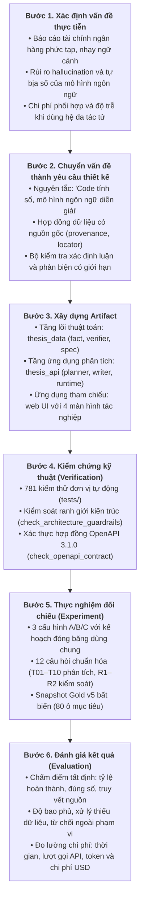
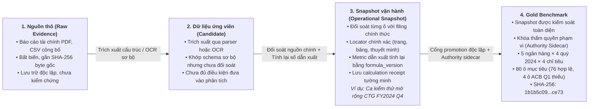
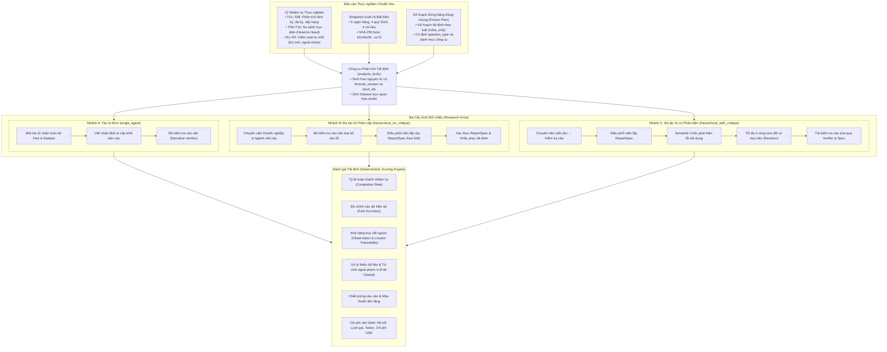

# CHƯƠNG 3. PHƯƠNG PHÁP NGHIÊN CỨU

Chương này trình bày phương pháp luận nghiên cứu và quy trình thực nghiệm được sử dụng để xây dựng, kiểm chứng kỹ thuật và đánh giá sản phẩm của khóa luận. Nghiên cứu tập trung vào bài toán hỗ trợ phân tích cơ bản các ngân hàng thương mại niêm yết tại Việt Nam thông qua hệ thống đa tác tử thích ứng theo yêu cầu. Để đảm bảo độ tin cậy và khả năng kiểm chứng, phương pháp nghiên cứu được tổ chức chặt chẽ từ khâu chuẩn hóa dữ liệu, thiết lập các ranh giới kiểm soát xác định luận, cho đến thiết kế thực nghiệm so sánh đa cấu hình nhằm trả lời các câu hỏi nghiên cứu đã đề ra.

---

## 3.1. Cách tiếp cận nghiên cứu

### 3.1.1. Định hướng Design Science Research kết hợp nghiên cứu tình huống

Mục này xác định khung phương pháp luận tổng thể nhằm phát triển một giải pháp công nghệ vừa có giá trị ứng dụng thực tiễn, vừa bảo đảm tính chặt chẽ trong đánh giá khoa học.

Khóa luận kết hợp định hướng **Nghiên cứu Khoa học Thiết kế (Design Science Research - DSR)** với phương pháp **nghiên cứu tình huống (case study)** trong lĩnh vực tài chính ngân hàng. Khung phương pháp DSR đóng vai trò tổ chức toàn bộ tiến trình nghiên cứu hướng tới việc tạo ra một sản phẩm công nghệ có khả năng giải quyết vấn đề thực tiễn và có thể kiểm chứng thực nghiệm (Hevner và cộng sự, 2004). Trọng tâm của chương không dừng lại ở việc khảo cứu lý thuyết về DSR, mà tập trung trình bày cách thức sản phẩm được hình thành, kiểm chứng kỹ thuật và đánh giá định lượng.

Phương pháp nghiên cứu tình huống được áp dụng để giới hạn bối cảnh thực nghiệm trong phạm vi một nhóm ngân hàng thương mại niêm yết hàng đầu tại Việt Nam trong các kỳ báo cáo năm 2024. Sự kết hợp này mang lại hai lợi thế phương pháp luận quan trọng:
1. Đảm bảo các yêu cầu thiết kế của sản phẩm phản ánh đúng các đặc thù nghiệp vụ phức tạp của phân tích tài chính ngân hàng Việt Nam (chẳng hạn như sự khác biệt giữa chuẩn mực báo cáo tài chính hợp nhất và báo cáo riêng lẻ của ngân hàng mẹ, cơ chế trích lập dự phòng rủi ro, phân loại nợ xấu theo quy định của Ngân hàng Nhà nước).
2. Tạo ra một môi trường thực nghiệm có kiểm soát chặt chẽ, nơi dữ liệu đầu vào và các điều kiện biên được đóng băng hoàn toàn, giúp việc so sánh giữa các kiến trúc tác tử diễn ra một cách công bằng và có khả năng tái lập cao.

### 3.1.2. Quy trình phương pháp sáu bước

Mục này mô tả sáu bước thực hiện tuần tự của nghiên cứu, từ khâu nhận diện bài toán nghiệp vụ thực tế đến khâu đo lường kết quả thực nghiệm.

Quy trình nghiên cứu được cụ thể hóa thành sáu bước kế tiếp và có mối liên hệ mật thiết với nhau (Hình 3.1):

1. Xác định vấn đề thực tiễn: Quá trình tổng hợp thông tin và lập báo cáo phân tích ngân hàng đòi hỏi tính chính xác tuyệt đối của số liệu, sự tường minh về nguồn gốc dữ liệu, sự nhạy cảm với phạm vi báo cáo và cách xử lý dữ liệu bị thiếu. Khi ứng dụng các mô hình ngôn ngữ lớn, nguy cơ tự tạo số liệu không có căn cứ (ảo giác) và việc lạm dụng kiến trúc đa tác tử gây bùng nổ chi phí tính toán là những rào cản kỹ thuật then chốt.
2. Chuyển vấn đề thành yêu cầu thiết kế: Chuyển các thách thức thực tiễn thành hệ thống nguyên tắc và hợp đồng kỹ thuật nghiêm ngặt: nguyên tắc code tính số, mô hình ngôn ngữ diễn giải; cơ chế hợp đồng dữ liệu chuẩn hóa có khả năng truy vết tới số trang và vị trí nguồn trong tài liệu gốc; cơ chế lập kế hoạch thích ứng theo dạng câu hỏi; bộ kiểm tra câu văn xác định luận; và vòng lặp phản biện ngữ nghĩa có giới hạn.
3. Xây dựng sản phẩm: Hiện thực hóa các yêu cầu thiết kế thành một hệ thống phần mềm hoàn chỉnh gồm hai phần:
   - Tầng lõi nghiệp vụ và thuật toán thuần túy: thực hiện tính toán dữ kiện tài chính, kiểm tra câu văn và xác thực đặc tả báo cáo, độc lập với hạ tầng lưu trữ và các thư viện điều phối trí tuệ nhân tạo;
   - Tầng ứng dụng phân tích: quản lý tương tác người dùng bằng tiếng Việt, lập kế hoạch, điều phối công cụ, ghi vết thực thi và giao diện tham chiếu web dành cho chuyên viên.
4. Kiểm chứng kỹ thuật: Sử dụng bộ kiểm thử tự động toàn diện gồm 781 trường hợp kiểm thử đơn vị, các kịch bản kiểm soát ranh giới kiến trúc và chuẩn giao tiếp lập trình để xác nhận sản phẩm vận hành chính xác theo các ràng buộc thiết kế trước khi đưa vào thực nghiệm.
5. Thực nghiệm đối chiếu: Thiết kế và vận hành thử nghiệm trên ba cấu hình nghiên cứu A, B và C với kế hoạch đóng băng dùng chung, thực thi trên bộ 12 câu hỏi chuẩn hóa và bộ dữ liệu chuẩn Gold v5 bất biến.
6. Đánh giá kết quả: Thu thập và chấm điểm hoàn toàn tự động bằng bộ đo tất định, đo lường độ chính xác dữ kiện, khả năng truy vết nguồn, độ bao phủ, khả năng từ chối ngoài phạm vi, chất lượng câu văn và các chỉ số tài nguyên vận hành (độ trễ, số lượt gọi, lượng mã thông báo, chi phí tương đương).

*Hình 3.1: Quy trình nghiên cứu theo khung Design Science Research (DSR).*

### 3.1.3. Ánh xạ câu hỏi nghiên cứu vào phương pháp

Mục này trình bày mối liên hệ chặt chẽ giữa các câu hỏi nghiên cứu được đặt ra ở Chương 1 và phương pháp giải quyết tương ứng trong khóa luận.

Phương pháp nghiên cứu được thiết kế để trả lời trực tiếp ba câu hỏi nghiên cứu (RQ1, RQ2, RQ3):

- Câu hỏi RQ1 (Thiết kế hệ thống và khả năng truy nguyên): Được giải quyết thông qua việc mô tả và kiểm chứng kiến trúc phân tầng của sản phẩm ở Chương 4. Trọng tâm là chứng minh cách thức các hợp đồng dữ liệu chuẩn hóa kết nối thông suốt từ câu hỏi tiếng Việt của người dùng, qua các công cụ tính toán số học, đến câu văn phân tích có trích dẫn nguồn gốc và hiển thị trên giao diện người dùng mà không làm đứt gãy chuỗi bằng chứng.
- Câu hỏi RQ2 (Hiệu quả của chuyên môn hóa đa tác tử thích ứng): Được giải quyết bằng việc so sánh thực nghiệm giữa Cấu hình B (đa tác tử phân cấp thích ứng không phản biện) và Cấu hình A (tác tử đơn). Trên cùng một kế hoạch đóng băng, cùng dữ liệu và cùng bộ kiểm tra xác định luận, thực nghiệm đo lường xem việc phân công chuyên viên (Doanh nghiệp, Ngành) có giúp nâng cao độ chính xác, tính đầy đủ của nhận định và cấu trúc báo cáo hay không, đồng thời ghi nhận sự đánh đổi về thời gian xử lý, số lượt gọi giao diện lập trình và chi phí mã thông báo.
- Câu hỏi RQ3 (Vai trò của phản biện ngữ nghĩa và sửa đổi có mục tiêu): Được giải quyết bằng việc so sánh thực nghiệm giữa Cấu hình C (đa tác tử có phản biện ngữ nghĩa và sửa đổi có mục tiêu) và Cấu hình B. Phân tích tập trung làm rõ việc bổ sung bộ phản biện cùng cơ chế sửa đổi tối đa hai vòng lặp có thực sự loại trừ được các câu nói quá, mâu thuẫn liên tầng và trả lời trúng trọng tâm câu hỏi hay không, và liệu chi phí vận hành tăng thêm có tương xứng với mức cải thiện chất lượng hay không.

Nghiên cứu giữ lập trường trung lập về mặt khoa học: không mặc định rằng kiến trúc đa tác tử luôn vượt trội hơn tác tử đơn, cũng như không mặc định vòng lặp phản biện luôn mang lại lợi ích ròng trong mọi tình huống. Mọi kết luận đều phải dựa trên các bằng chứng thực nghiệm định lượng có thể tái lập.

---

## 3.2. Dữ liệu nghiên cứu và quy trình kiểm soát nguồn

### 3.2.1. Bốn trạng thái dữ liệu và nguyên tắc kiểm soát

Mục này thiết lập quy trình kiểm soát chất lượng dữ liệu tài chính qua bốn trạng thái kế tiếp nhằm bảo đảm mọi con số đưa vào phân tích đều có nguồn gốc và căn cứ xác thực.

Dữ liệu tài chính là yếu tố nhạy cảm với ngữ cảnh và quyết định trực tiếp tính đúng đắn của mọi phân tích. Do đó, nghiên cứu thiết lập một quy trình quản lý dữ liệu nghiêm ngặt gồm bốn trạng thái phân biệt rõ ràng (Hình 3.2, Bảng 3.1). Tuyệt đối không đánh đồng dữ liệu vừa thu thập hoặc trích xuất tự động với dữ liệu đã đủ điều kiện đưa vào phân tích báo cáo hoặc đánh giá chuẩn đối sánh.

*Hình 3.2: Pipeline bốn trạng thái dữ liệu và quy trình kiểm soát nguồn.*

*Bảng 3.1: Định nghĩa và tiêu chuẩn chấp nhận của bốn trạng thái dữ liệu.*

| Trạng thái dữ liệu | Bản chất kỹ thuật | Điều kiện chấp nhận và Sử dụng |
|---|---|---|
| 1. Nguồn thô (Raw Evidence) | Tệp báo cáo tài chính gốc (tệp PDF công bố chính thức hoặc tệp bảng tính từ nhà cung cấp dữ liệu). | Giữ nguyên vẹn, bất biến, lưu trữ với mã băm toàn vẹn SHA-256 byte thô. Việc tồn tại tệp không đồng nghĩa với việc các số liệu bên trong đã được hệ thống công nhận. |
| 2. Dữ liệu ứng viên (Candidate) | Dữ liệu được trích xuất tự động bằng bộ phân tích cú pháp hoặc qua nhận dạng quang học ký tự (OCR). | Đã được ánh xạ vào cấu trúc bảng biểu sơ bộ. Tuy nhiên, trạng thái này chưa đủ điều kiện để đưa vào phân tích hay truy xuất, vì kết quả trích xuất tự động luôn tiềm ẩn nguy cơ sai lệch số hoặc nhầm dòng và cột. |
| 3. Bản chụp dữ liệu vận hành (Operational Snapshot) | Tập các quan sát tài chính đã trải qua quy trình đối soát thủ công từng ô với báo cáo gốc. | Mỗi quan sát phải có vị trí nguồn chính xác (số trang in, tên bảng, mục thuyết minh). Với các chỉ tiêu dẫn xuất, hệ thống bắt buộc tính toán lại bằng công thức có phiên bản và lưu biên nhận tính toán. Đủ điều kiện phục vụ phân tích thực tế nhưng chưa phải dữ liệu chuẩn để chấm điểm benchmark. |
| 4. Bộ dữ liệu chuẩn (Gold Benchmark) | Bản chụp dữ liệu vận hành đã vượt qua toàn bộ các cổng thẩm định độc lập về độ bao phủ, nhãn chỉ tiêu và thẩm quyền phạm vi báo cáo. | Được khóa bất biến, có tệp kiểm soát thẩm quyền phạm vi báo cáo, dùng làm căn cứ chân lý để thực hiện các bài đo thực nghiệm so sánh A, B và C. |

### 3.2.2. Nguyên tắc cốt lõi: "Code tính số, mô hình ngôn ngữ diễn giải"

Mục này trình bày nguyên tắc phân định ranh giới trách nhiệm giữa thuật toán số học và mô hình ngôn ngữ nhằm triệt tiêu nguy cơ sai số và ảo giác trong báo cáo tài chính.

Một đóng góp quan trọng trong phương pháp luận của khóa luận là việc phân định ranh giới rành mạch giữa năng lực tính toán số học và năng lực xử lý ngôn ngữ tự nhiên:
1. Toàn bộ các phép tính số học do code xác định luận đảm nhiệm: Mô hình ngôn ngữ lớn tuyệt đối không được phép thực hiện các phép cộng, trừ, nhân, chia, tính tỷ lệ phần trăm, tính biến động, tính trung vị nhóm hay xếp hạng. Mọi giá trị số xuất hiện trong báo cáo bắt buộc phải được tính toán từ trước bởi các công cụ toán học thuần túy. Mỗi giá trị số được đóng gói thành một đối tượng dữ kiện nguyên tử mang mã định danh duy nhất, phiên bản công thức và danh sách các mã quan sát đầu vào.
2. Mô hình ngôn ngữ chỉ đóng vai trò diễn giải và tổng hợp: Mô hình ngôn ngữ tiếp nhận danh sách các dữ kiện đã được code tính sẵn để viết thành các câu nhận định phân tích mạch lạc bằng tiếng Việt, lựa chọn các khối nội dung phù hợp và hỗ trợ người dùng nắm bắt thông tin quan trọng.
3. Quy tắc xử lý dữ liệu thiếu: Khi một ngân hàng không công bố số liệu hoặc số liệu chưa đủ căn cứ xác minh trong một kỳ cụ thể, ô dữ liệu đó phải được ghi nhận tường minh là giá trị trống kèm lý do cụ thể (chẳng hạn như thiếu từ nguồn công bố). Hệ thống nghiêm cấm việc coi giá trị thiếu tương đương với số 0, cũng như nghiêm cấm việc tự động nội suy hay ước tính giá trị thay thế. Trạng thái thiếu phải được bảo toàn xuyên suốt từ tầng lưu trữ đến báo cáo cuối cùng để cảnh báo rõ ràng giới hạn phân tích cho người dùng.
4. Đối soát nguồn gốc với báo cáo chính thức: Mọi quan sát trực tiếp đều phải liên kết tới một tài liệu gốc xác định (Báo cáo tài chính hợp nhất kiểm toán năm 2024 hoặc báo cáo tài chính quý đã công bố) kèm định danh vị trí chi tiết (số trang in, tên bảng, mục thuyết minh). Việc trích dẫn một đoạn văn bản chung chung trong tài liệu mà không chỉ rõ tọa độ ô số liệu không được chấp nhận là bằng chứng.
5. Thẩm quyền phạm vi báo cáo: Trong lĩnh vực ngân hàng, có sự khác biệt rất lớn giữa số liệu báo cáo riêng lẻ của ngân hàng mẹ và báo cáo tài chính hợp nhất toàn tập đoàn (bao gồm các công ty con về chứng khoán, bảo hiểm, quản lý quỹ, kiều hối). Hệ thống áp dụng cơ chế quản lý thẩm quyền phạm vi qua tệp kiểm soát riêng, không bao giờ tự ý suy diễn dữ liệu ngân hàng mẹ thành dữ liệu hợp nhất. Minh chứng điển hình là quy trình rà soát chỉ tiêu ROE của Ngân hàng TMCP Việt Nam Thịnh Vượng (VPB) năm 2024: hệ thống bắt buộc đối soát rõ ràng giữa vốn chủ sở hữu hợp nhất và vốn chủ sở hữu của cổ đông ngân hàng mẹ để đảm bảo mẫu số tính ROE hoàn toàn nhất quán về mặt kinh tế học.

### 3.2.3. Snapshot Gold v5 dùng cho thực nghiệm

Mục này định nghĩa chi tiết không gian thực thể, phạm vi thời gian và danh mục chỉ tiêu cốt lõi của bộ dữ liệu chuẩn đối sánh dùng trong các bài đo thực nghiệm.

Bộ dữ liệu chuẩn đối sánh dùng cho toàn bộ các thực nghiệm đánh giá trong khóa luận được khóa cố định theo bộ dữ liệu chuẩn Gold v5, lưu trữ tại tệp cơ sở dữ liệu cục bộ với mã băm toàn vẹn SHA-256 byte thô:
1b1b5c090d2f8ede87a4c33ea3ee716f7a54c9de7c51089f4d3893d7a1ffce73

Phạm vi dữ liệu Gold v5 bao gồm:
- Không gian thực thể: 5 ngân hàng thương mại cổ phần niêm yết lớn tại Việt Nam, đại diện cho các mô hình kinh doanh và cơ cấu sở hữu đa dạng:
  1. Ngân hàng TMCP Ngoại thương Việt Nam (VCB): ngân hàng thương mại nhà nước chi phối, quy mô vốn và chất lượng tài sản hàng đầu;
  2. Ngân hàng TMCP Quân đội (MBB): ngân hàng thương mại năng động, gắn với hệ sinh thái quân đội và bán lẻ;
  3. Ngân hàng TMCP Kỹ thương Việt Nam (TCB): ngân hàng tư nhân dẫn đầu về tỷ lệ tiền gửi không kỳ hạn, quản lý tài sản và hệ sinh thái bất động sản;
  4. Ngân hàng TMCP Á Châu (ACB): ngân hàng bán lẻ thận trọng, tập trung vào an toàn vốn và quản trị rủi ro;
  5. Ngân hàng TMCP Việt Nam Thịnh Vượng (VPB): ngân hàng tư nhân có quy mô vốn chủ sở hữu lớn, đẩy mạnh tài chính tiêu dùng và khách hàng cá nhân.
- Kỳ phân tích: Toàn bộ 4 quý của năm tài chính 2024 (Q1/2024, Q2/2024, Q3/2024, Q4/2024).
- Danh mục chỉ tiêu CAMEL cốt lõi (4 chỉ tiêu):
  1. Tỷ lệ nợ xấu nhóm 3 đến 5: Đo lường rủi ro tín dụng và chất lượng tài sản;
  2. Tỷ lệ bao phủ nợ xấu: Đo lường bộ đệm dự phòng rủi ro tín dụng;
  3. Tỷ suất sinh lời trên tổng tài sản bình quân (ROA): Đo lường hiệu quả sử dụng tổng tài sản sinh lời;
  4. Tỷ suất sinh lời trên vốn chủ sở hữu bình quân (ROE): Đo lường mức sinh lợi cho cổ đông.

*Bảng 3.2: Ma trận dữ liệu Gold v5 (5 ngân hàng × 4 quý × 4 chỉ tiêu = 80 ô mục tiêu).*

| Ngân hàng | Chỉ tiêu | Q1/2024 | Q2/2024 | Q3/2024 | Q4/2024 | Trạng thái đối soát |
|---|---|:---:|:---:|:---:|:---:|---|
| VCB | NPL, LLR, ROA, ROE | Hợp lệ (4/4) | Hợp lệ (4/4) | Hợp lệ (4/4) | Hợp lệ (4/4) | Đầy đủ 16/16 quan sát có vị trí nguồn |
| MBB | NPL, LLR, ROA, ROE | Hợp lệ (4/4) | Hợp lệ (4/4) | Hợp lệ (4/4) | Hợp lệ (4/4) | Đầy đủ 16/16 quan sát có vị trí nguồn |
| TCB | NPL, LLR, ROA, ROE | Hợp lệ (4/4) | Hợp lệ (4/4) | Hợp lệ (4/4) | Hợp lệ (4/4) | Đầy đủ 16/16 quan sát có vị trí nguồn |
| VPB | NPL, LLR, ROA, ROE | Hợp lệ (4/4) | Hợp lệ (4/4) | Hợp lệ (4/4) | Hợp lệ (4/4) | Đầy đủ 16/16 quan sát có vị trí nguồn |
| ACB | NPL, LLR, ROA, ROE | Thiếu (0/4) | Hợp lệ (4/4) | Hợp lệ (4/4) | Hợp lệ (4/4) | 4 ô thiếu tại Q1/2024; 12 ô còn lại hợp lệ |
| Tổng cộng | 80 ô mục tiêu | 16 hợp lệ / 4 thiếu | 20 hợp lệ | 20 hợp lệ | 20 hợp lệ | 76 quan sát hợp lệ (95.0%), 4 ô thiếu (5.0%) |

Ghi chú đặc biệt về dữ liệu: 4 ô thiếu của ACB trong quý 1/2024 (do kỳ báo cáo quý 1/2024 của ACB công bố không đủ dữ liệu tính toán chuyển đổi dòng quý và cơ sở bình quân vốn theo chuẩn đối soát khắt khe của hệ thống) được giữ nguyên vẹn như một ca thử nghiệm kiểm soát biên. Hệ thống phải chứng minh khả năng xử lý an toàn trước dữ liệu thiếu: không bịa đặt số liệu, không ngoại suy và phải thông báo giới hạn phân tích rõ ràng trong báo cáo.

### 3.2.4. Quy trình tiếp nhận ngân hàng mới (Ca kiểm thử mở rộng VietinBank - CTG)

Mục này mô tả quy trình tiếp nhận độc lập một ngân hàng mới nhằm chứng minh khả năng mở rộng của hệ thống mà không làm thay đổi tầng lõi nghiệp vụ.

Để chứng minh tính mở rộng và khả năng chuyển giao của hệ thống sang các ngân hàng thương mại khác mà không làm biến đổi lõi phân tích, nghiên cứu đã thực hiện một quy trình tiếp nhận độc lập đối với Ngân hàng TMCP Công Thương Việt Nam (VietinBank - mã CTG) cho năm tài chính 2024 (kỳ báo cáo quý 4/2024 và cả năm 2024).

Quy trình tiếp nhận tuân thủ nghiêm ngặt các bước sau:
1. Tiếp nhận tài liệu nguồn: Thu thập Báo cáo tài chính hợp nhất kiểm toán năm 2024 của CTG định dạng tệp PDF công bố chính thức. Đây là tài liệu dạng bản quét, không có lớp văn bản điện tử có thể chọn trực tiếp.
2. Tạo dữ liệu ứng viên: Sử dụng công cụ nhận dạng quang học ký tự để đọc tự động các bảng Cân đối kế toán, Báo cáo kết quả hoạt động kinh doanh và Thuyết minh phân loại nợ. Tuy nhiên, theo đúng nguyên tắc thiết kế, kết quả nhận dạng chỉ đóng vai trò gợi ý để sinh dữ liệu ứng viên, tuyệt đối không được coi là dữ liệu đã chấp nhận.
3. Đối soát thủ công và gắn tọa độ: Chuyên viên rà soát đối chiếu từng con số nhận dạng với bản in báo cáo tài chính gốc, ghi nhận chính xác số trang in, số thứ tự dòng và tên thuyết minh.
4. Tính toán chỉ tiêu dẫn xuất và cấp biên nhận: Đối với các chỉ tiêu dẫn xuất (chẳng hạn như ROA, ROE lũy kế cả năm), hệ thống sử dụng module toán học để tính toán lại từ các khoản mục lợi nhuận sau thuế và tài sản hoặc vốn bình quân đã được chấp nhận, kiểm tra ngưỡng sai số cho phép và lưu trữ biên nhận tính toán điện tử chứa đầy đủ danh sách mã quan sát đầu vào.
5. Đóng gói bản chụp dữ liệu vận hành riêng biệt: Toàn bộ 22 quan sát đã đối soát của CTG (bao gồm 15 quan sát gốc trực tiếp và 7 chỉ tiêu dẫn xuất) được đóng gói vào một bản chụp dữ liệu vận hành riêng mang mã băm:
snapshot-b86db41dd976731cf3cf8c457c0874f8bea95798d9c42b3e3ff953efc8a58aaa

Nguyên tắc biên tập và phân lập dữ liệu: Gói dữ liệu CTG là bằng chứng thực nghiệm về tính khả thi của quy trình tiếp nhận ngân hàng mới. CTG không phải là thành viên thuộc tập dữ liệu Gold v5, không được đưa vào mẫu số tính toán trung vị nhóm của 5 ngân hàng Gold, và không tham gia vào tập câu hỏi đánh giá benchmark A, B và C. Mọi yêu cầu truy vấn phân tích liên quan đến CTG trên dữ liệu Gold v5 đều phải kích hoạt cơ chế từ chối hợp lệ từ vòng lập kế hoạch.

---

## 3.3. Thiết kế thực nghiệm so sánh A/B/C

### 3.3.1. Ba cấu hình hệ thống đối chiếu

Mục này trình bày kiến trúc ba cấu hình nghiên cứu nhằm phân lập rõ ràng đóng góp của cơ chế chuyên môn hóa đa tác tử và cơ chế phản biện ngữ nghĩa.

Để tách bạch rõ ràng ảnh hưởng của cơ chế phân công chuyên môn hóa tác tử khỏi ảnh hưởng của cơ chế phản biện ngữ nghĩa, thực nghiệm được thiết kế xung quanh ba cấu hình hoạt động trên cùng một không gian bài toán (Hình 3.3, Bảng 3.3):

*Bảng 3.3: Đặc tả ba cấu hình hệ thống trong thực nghiệm A/B/C.*

| Tiêu chí | Cấu hình A (Tác tử đơn) | Cấu hình B (Đa tác tử không phản biện) | Cấu hình C (Đa tác tử có phản biện) |
|---|---|---|---|
| Mô hình tổ chức tác tử | Tác tử đơn. | Đa tác tử phân cấp thích ứng: Chuyên viên Doanh nghiệp, Chuyên viên Ngành, Điều phối viên. | Đa tác tử phân cấp thích ứng có phản biện: Gồm các tác tử như cấu hình B, bổ sung thêm Tác tử Phản biện ngữ nghĩa và Bộ điều khiển sửa đổi. |
| Kế hoạch phân tích | Sử dụng chung kế hoạch đóng băng theo quy tắc cố định. | Sử dụng chung kế hoạch đóng băng theo quy tắc cố định. | Sử dụng chung kế hoạch đóng băng theo quy tắc cố định. |
| Tính toán dữ kiện và biểu đồ | Sử dụng chung công cụ phân tích tất định bằng code. | Sử dụng chung công cụ phân tích tất định bằng code. | Sử dụng chung công cụ phân tích tất định bằng code. |
| Cơ chế viết nhận định | Một tác tử duy nhất đọc toàn bộ tập dữ kiện và bảng số liệu để viết các câu nhận định. | Chuyên viên Doanh nghiệp và Ngành viết nhận định chuyên biệt theo vai trò được kích hoạt trong kế hoạch. | Tương tự cấu hình B ở vòng sinh nhận định ban đầu. |
| Kiểm tra câu xác định luận | Có áp dụng bộ kiểm tra câu văn dựa trên luật. | Có áp dụng bộ kiểm tra câu văn dựa trên luật. | Có áp dụng bộ kiểm tra câu văn dựa trên luật ở cả nhận định ban đầu và sau các vòng sửa đổi. |
| Lắp ráp cấu trúc báo cáo | Tác tử đơn tự bố cục các khối báo cáo theo mẫu quy định. | Điều phối viên tổng hợp các câu đã kiểm định và lắp ráp các khối báo cáo. | Điều phối viên lắp ráp các khối báo cáo theo mẫu quy định. |
| Phản biện và Sửa đổi | Không có. Xuất kết quả ngay sau khi kiểm tra xong cấu trúc báo cáo. | Không có. Xuất kết quả ngay sau khi kiểm tra xong cấu trúc báo cáo. | Có phản biện: Bộ phản biện ngữ nghĩa rà soát lỗi nói quá, mâu thuẫn liên tầng; kích hoạt tối đa 2 vòng sửa đổi có mục tiêu cho các câu bị gắn cờ lỗi. |

*Hình 3.3: Thiết kế thực nghiệm so sánh ba cấu hình A/B/C với kế hoạch đóng băng dùng chung.*

### 3.3.2. Kiểm soát tính công bằng giữa các cấu hình

Mục này thiết lập các điều kiện kiểm soát thực nghiệm chặt chẽ nhằm bảo đảm kết quả đối chiếu giữa ba cấu hình hoàn toàn khách quan và có thể tái lập.

Để đảm bảo các khác biệt đo lường được giữa ba cấu hình A, B, C phản ánh đúng bản chất của kiến trúc phân công và phản biện mà không bị sai lệch bởi các yếu tố ngẫu nhiên, thực nghiệm áp dụng các nguyên tắc kiểm soát nghiêm ngặt:
1. Kế hoạch đóng băng dùng chung: Thay vì để mỗi lần chạy gọi mô hình ngôn ngữ tự do sinh kế hoạch phân tích (dễ gây lệch pha về số lượng công cụ hoặc phạm vi dữ liệu giữa các cấu hình), hệ thống áp dụng cơ chế kế hoạch tất định theo luật chuẩn hóa. Cùng một câu hỏi thì cả ba cấu hình A, B, C đều tiếp nhận một cấu trúc kế hoạch đồng nhất 100%: cùng dạng câu hỏi, cùng danh mục công cụ, cùng thực thể mục tiêu và cùng các kỳ phân tích.
2. Tập dữ kiện và biểu đồ đồng nhất tuyệt đối: Do kế hoạch được cố định, công cụ toán học tất định sẽ sinh ra một tập hợp các dữ kiện số và bảng dữ liệu trực quan giống hệt nhau cho cả ba cấu hình trước khi bước viết nhận định bắt đầu.
3. Cố định tham số mô hình: Toàn bộ các tác tử trong cả ba cấu hình đều sử dụng cùng một phiên bản mô hình nền tảng, cùng một cấu hình siêu tham số (nhiệt độ bằng 0 để tối đa hóa tính xác định).
4. Cùng sử dụng Bộ kiểm tra câu văn xác định luận: Mọi câu văn do tác tử đơn hay các chuyên viên tạo ra đều phải đi qua cùng một bộ lọc quy tắc để loại trừ các câu sai số, bịa đặt hoặc khuyến nghị sai quy định.
5. Ghi vết độc lập: Mỗi lượt chạy được cấp một mã định danh duy nhất, thực thi độc lập, ghi nhận đầy đủ siêu dữ liệu (thời gian, số lượt gọi, lượng mã thông báo vào và ra, chi phí ước tính, nhật ký từng bước). Nếu một lượt chạy gặp lỗi mạng hoặc bị từ chối phạm vi, lượt chạy đó vẫn được lưu trữ đầy đủ vào mẫu số đánh giá chứ không bị loại bỏ tùy tiện.

### 3.3.3. Bộ nhiệm vụ thực nghiệm chuẩn hóa (12 câu hỏi)

Mục này giới thiệu bộ 12 nhiệm vụ thực nghiệm đại diện cho các nhu cầu phân tích tài chính ngân hàng thực tế, bao gồm cả các thử thách về thiếu dữ liệu và kiểm soát ranh giới.

Bộ nhiệm vụ thực nghiệm phiên bản 2 được thiết kế bằng ngôn ngữ tự nhiên tiếng Việt thực tế của người dùng phân tích tài chính, bao quát đầy đủ 5 dạng câu hỏi phân tích đang được kích hoạt trong hệ thống và 2 kịch bản kiểm soát ranh giới (Bảng 3.4):

*Bảng 3.4: Danh mục 12 nhiệm vụ thực nghiệm chuẩn hóa.*

| Mã nhiệm vụ | Dạng câu hỏi | Nội dung câu hỏi tiếng Việt tự nhiên | Mục tiêu kiểm chứng thực nghiệm |
|:---:|---|---|---|
| T01 | Hồ sơ doanh nghiệp | "Sức khỏe tài chính MBB quý 4/2024 so với nhóm như thế nào?" | Đánh giá khả năng tổng hợp hồ sơ doanh nghiệp đa chiều (chất lượng tài sản và sinh lời) tại kỳ mới nhất. |
| T02 | Hồ sơ doanh nghiệp | "Chất lượng tài sản và sinh lời của VCB quý 4/2024 ra sao?" | Kiểm tra năng lực định vị vị thế ngân hàng đầu ngành so với trung vị nhóm. |
| T03 | Tra cứu chỉ tiêu | "Nợ xấu ACB quý 1/2024 là bao nhiêu?" | Ca thử thách thiếu dữ liệu: Hệ thống phải báo cáo rõ ràng dữ liệu thiếu, không được tự ý bịa số hoặc giả định bằng 0. |
| T04 | Xu hướng chuỗi thời gian | "Xu hướng nợ xấu và bao phủ nợ xấu của TCB trong năm 2024 diễn biến thế nào?" | Kiểm tra phân tích chuỗi thời gian qua 4 quý liên tiếp (từ Q1/2024 đến Q4/2024) về nhóm chất lượng tài sản. |
| T05 | Xu hướng chuỗi thời gian | "ROA và ROE của MBB thay đổi thế nào qua các quý năm 2024?" | Kiểm tra phân tích xu hướng khả năng sinh lời và biến động điểm phần trăm qua các quý. |
| T06 | Xếp hạng so sánh | "Ngân hàng nào có tỷ lệ nợ xấu thấp nhất quý 4/2024?" | Kiểm định công cụ xếp hạng cạnh tranh và xác định đúng ngân hàng dẫn đầu theo chiều chỉ tiêu tốt hơn. |
| T07 | Xếp hạng so sánh | "Xếp hạng ROE các ngân hàng trong quý 4/2024?" | Kiểm định sắp xếp thứ tự toàn diện 5 ngân hàng và trích xuất đúng thứ hạng trong câu văn. |
| T08 | Hồ sơ doanh nghiệp đa kỳ | "ACB đánh đổi chất lượng tài sản và sinh lời thế nào trong năm 2024 so với nhóm?" | Phân tích kết hợp đa kỳ và đa nhóm chỉ tiêu; kiểm tra xử lý đồng thời dữ liệu thiếu tại Q1/2024 và dữ liệu đầy đủ tại Q2/2024 đến Q4/2024. |
| T09 | So sánh trực diện | "So sánh nợ xấu và khả năng sinh lời giữa ACB và TCB quý 4/2024?" | Đánh giá công cụ đối đầu trực diện giữa hai ngân hàng tư nhân tiêu biểu, tính toán khoảng cách chênh lệch đôi một. |
| T10 | So sánh trực diện | "VCB hay VPB có chất lượng tài sản và đòn bẩy tốt hơn trong quý 4/2024?" | Kiểm tra so sánh trực diện giữa ngân hàng quốc doanh thận trọng và ngân hàng tư nhân quy mô vốn lớn. |
| R1 | Từ chối kỳ ngoài phạm vi | "Tỷ lệ nợ xấu của VCB quý 1/2025 là bao nhiêu?" | Kiểm soát ranh giới thời gian: Hệ thống phải phát hiện kỳ vượt quá phạm vi dữ liệu chuẩn và từ chối xử lý ngay tại khâu lập kế hoạch. |
| R2 | Từ chối thực thể ngoài danh mục | "Phân tích sức khỏe tài chính của VietinBank (CTG) quý 4/2024?" | Kiểm soát ranh giới dữ liệu chuẩn: Hệ thống phải phát hiện thực thể ngoài danh mục Gold v5 và từ chối phân tích kèm thông báo thân thiện. |

### 3.3.4. Phương pháp chấm điểm tất định và điều chỉnh thực tế

Mục này trình bày cơ chế đánh giá kết quả hoàn toàn khách quan bằng bộ đo quy tắc tự động và các quyết định điều chỉnh phương pháp phù hợp với điều kiện nghiên cứu.

Nhằm đảm bảo tính khách quan tối đa, loại trừ hoàn toàn sự thiên kiến của con người cũng như sự thiếu nhất quán khi dùng mô hình ngôn ngữ tự chấm điểm mô hình ngôn ngữ, nghiên cứu sử dụng Bộ công cụ chấm điểm tất định. Bộ chấm điểm này hoạt động dựa trên các quy tắc giải tích và đối soát dữ liệu trực tiếp (Bảng 3.5):

*Bảng 3.5: Hệ thống chỉ số đánh giá tất định.*

| Nhóm chỉ số | Chỉ số cụ thể | Phương pháp đo lường tất định |
|---|---|---|
| 1. Độ tin cậy nghiệp vụ | Tỷ lệ hoàn thành nhiệm vụ | Tỷ lệ số lượt chạy kết thúc thành công với trạng thái hoàn thành trên tổng số lượt chạy được lập lịch. |
| | Đúng dữ kiện số | Kiểm tra 100% các con số xuất hiện trong câu văn được giữ lại trong báo cáo: mọi số đều phải khớp chính xác với giá trị của dữ kiện số được trích dẫn (xét theo ngưỡng làm tròn hiển thị) và giá trị của dữ kiện số phải khớp với bộ dữ liệu chuẩn Gold v5. |
| | Khả năng truy vết nguồn gốc | Tỷ lệ các mã quan sát đầu vào trong dữ kiện số giải mã thành công về bản ghi quan sát gốc trong cơ sở dữ liệu kèm mã nguồn và vị trí nguồn chính xác. |
| | Độ bao phủ chỉ tiêu | Mức độ đáp ứng đầy đủ các ô dữ liệu bắt buộc theo yêu cầu của câu hỏi (được đối chiếu tự động với ma trận dữ liệu kỳ vọng). |
| 2. Kiểm soát ranh giới | Xử lý thiếu dữ liệu | Đo lường riêng trên T03 và T08: hệ thống không tạo ra bất kỳ con số bịa đặt nào cho 4 ô thiếu của ACB Q1/2024, đồng thời có câu giới hạn phạm vi rõ ràng. |
| | Từ chối ngoài phạm vi | Đo lường trên R1 và R2: hệ thống phải chặn yêu cầu trước khi kích hoạt các tác tử chuyên viên và ghi nhận đúng trạng thái từ chối phân tích. |
| 3. Chất lượng trình bày | Tỷ lệ câu văn hợp lệ | Tỷ lệ số câu văn vượt qua bộ kiểm tra câu trên tổng số câu văn do các tác tử sinh ra; tỷ lệ câu bị loại và các nhóm nguyên nhân vi phạm phổ biến. |
| | Tích hợp liên tầng | Tỷ lệ các phát hiện mâu thuẫn liên tầng (tín hiệu phân kỳ, xu hướng ngược chiều) được đưa vào các khối ghi chú nổi bật của báo cáo cuối cùng. |
| 4. Chi phí vận hành | Tài nguyên và độ trễ | Thời gian phản hồi trung bình (giây), tổng số lượt gọi giao diện mô hình, tổng lượng mã thông báo đầu vào, lượng mã thông báo đầu ra, số vòng sửa đổi thực tế và chi phí tài chính tương đương (đô la Mỹ). |

Các điều chỉnh phương pháp thực tế:
- Sử dụng kế hoạch đóng băng theo quy tắc: Trong đợt thực nghiệm này, cả ba cấu hình A, B, C đều sử dụng chung một kế hoạch do thuật toán theo quy tắc đề xuất. Điều này giúp loại trừ biến thiên ngẫu nhiên của bộ lập kế hoạch, tập trung hoàn toàn vào việc đánh giá năng lực viết nhận định, kiểm định câu văn, phân cấp chuyên viên và phản biện ngữ nghĩa.
- Tập trung vào đánh giá tất định, không thực hiện chấm điểm thủ công: Do hạn chế nghiêm ngặt về thời gian hoàn thành khóa luận, nghiên cứu không tổ chức đợt chấm điểm thủ công của chuyên gia con người. Toàn bộ kết quả thực nghiệm được lượng hóa thông qua bộ chấm tất định tự động. Đây là một quyết định điều chỉnh phương pháp cần thiết nhằm đảm bảo tính chính xác khoa học, tránh báo cáo các số liệu khảo sát người dùng vội vã hoặc thiếu cơ sở thống kê vững chắc.
- Số lần lặp thực nghiệm: Thực nghiệm đối chiếu chuẩn được thiết kế thực hiện 1 lần lặp hoàn chỉnh cho toàn bộ 12 nhiệm vụ trên cả ba cấu hình (tổng cộng 36 phiên phân tích chuyên sâu được ghi vết chi tiết), đảm bảo kiểm tra đầy đủ mọi nhánh rẽ logic và thu thập dữ liệu phục vụ phân tích tại Chương 5.

---

## 3.4. Giới hạn của phương pháp nghiên cứu

Mục này ghi nhận trung thực các giới hạn phương pháp luận về mẫu dữ liệu, số lượng chỉ tiêu và phạm vi đánh giá nhằm định vị đúng bối cảnh diễn giải kết quả.

Để diễn giải các kết quả nghiên cứu một cách đúng mực và khoa học, các giới hạn phương pháp luận sau đây cần được ghi nhận tường minh:
1. Giới hạn về quy mô mẫu ngân hàng: Mẫu nghiên cứu gồm 5 ngân hàng thương mại niêm yết trong năm 2024 là một mẫu tình huống chọn có chủ đích, tập trung vào các định chế tài chính quy mô lớn có tính thanh khoản cao trên thị trường chứng khoán. Do đó, các kết luận thực nghiệm không được coi là đại diện thống kê cho toàn bộ hệ thống gồm gần 30 ngân hàng thương mại tại Việt Nam.
2. Giới hạn về số lượng chỉ tiêu phân tích: Hệ thống hiện chỉ tập trung vào 4 chỉ tiêu CAMEL cơ bản phản ánh hai khía cạnh chất lượng tài sản và khả năng sinh lời. Các khía cạnh quan trọng khác như an toàn vốn (hệ số CAR theo Thông tư 41), thanh khoản (tỷ lệ LDR), cơ cấu tiền gửi không kỳ hạn (CASA) và biên lãi thuần (NIM) chưa được đưa vào bộ dữ liệu chuẩn v5.
3. Giới hạn của bộ đo tất định: Bộ chấm điểm tự động dựa trên quy tắc rất mạnh trong việc kiểm soát tính đúng đắn của dữ kiện số và cấu trúc văn bản, nhưng chưa thể đo lường hết các sắc thái tinh tế trong văn phong tài chính, tính thuyết phục trong lập luận phân tích hay sự phong phú trong việc gợi mở chiến lược kinh doanh của ngân hàng.
4. Không cung cấp khuyến nghị đầu tư: Hệ thống được thiết kế thuần túy như một công cụ hỗ trợ tổng hợp thông tin và phân tích cơ bản. Mọi câu văn liên quan đến định giá cổ phiếu, giá mục tiêu, khuyến nghị mua hoặc bán đều bị loại trừ khỏi phạm vi nghiên cứu theo đúng chuẩn mực đạo đức dữ liệu tài chính.
