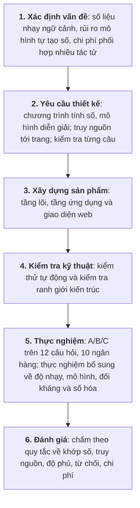
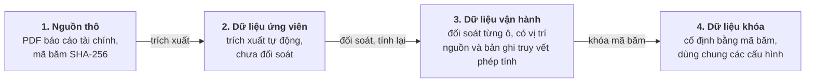

# CHƯƠNG 3. PHƯƠNG PHÁP NGHIÊN CỨU

Chương này trình bày cách tiếp cận nghiên cứu, cách xây dựng và kiểm soát dữ liệu, thiết kế thực nghiệm so sánh các cách tổ chức tác tử (một đối chứng không dùng mô hình, một tác tử, đa tác tử phân cấp, đa tác tử có phản biện), và các thực nghiệm bổ sung đo độ tin cậy của chính các cơ chế kiểm soát và độ phụ thuộc vào mô hình.

## 3.1. Cách tiếp cận nghiên cứu

### 3.1.1. Nghiên cứu khoa học thiết kế

Để giải quyết bài toán trên, nghiên cứu này áp dụng phương pháp nghiên cứu khoa học thiết kế (Design Science Research – DSR), trong đó kết quả nghiên cứu là một sản phẩm giải quyết bài toán thực tế và được đánh giá bằng các phép đo (Hevner và cộng sự, 2004), với lĩnh vực ứng dụng là nhóm ngân hàng niêm yết Việt Nam. Lĩnh vực ứng dụng này giúp bám sát nghiệp vụ thực tế, như sự khác nhau giữa báo cáo hợp nhất và báo cáo riêng của ngân hàng mẹ hay quy định phân loại nợ, đồng thời tạo môi trường thử nghiệm có kiểm soát: dữ liệu được chuẩn bị và khóa trước nên các cấu hình được so sánh công bằng và kết quả có thể lặp lại.

### 3.1.2. Quy trình sáu bước

Quy trình nghiên cứu gồm sáu bước (Hình 3.1), tham khảo các hoạt động của phương pháp luận do Peffers và cộng sự (2007) đề xuất: xác định vấn đề, chuyển thành yêu cầu thiết kế, xây dựng sản phẩm, kiểm tra kỹ thuật, thực nghiệm và đánh giá. Vấn đề và nguyên tắc thiết kế được trình bày ở Chương 1 và 2, sản phẩm và kiểm thử ở Chương 4, thực nghiệm và cách đánh giá ở mục 3.3 và Chương 5.

*Hình 3.1: Quy trình nghiên cứu theo khung Design Science Research.*

### 3.1.3. Gắn câu hỏi nghiên cứu với phương pháp

- **Câu hỏi nghiên cứu thứ nhất (thiết kế và truy nguồn)** được trả lời bằng kiến trúc và sản phẩm ở Chương 4: luồng đi từ câu hỏi tiếng Việt, qua công cụ tính toán, đến câu nhận định có trích dẫn nguồn cụ thể mà không đứt chuỗi bằng chứng.
- **Câu hỏi nghiên cứu thứ hai (chia việc cho nhiều tác tử)** được trả lời bằng so sánh cấu hình B với A trên cùng kế hoạch và dữ liệu, đo cả chất lượng lẫn chi phí.
- **Câu hỏi nghiên cứu thứ ba (phản biện và sửa đổi)** được trả lời bằng so sánh cấu hình C với B.

Các thực nghiệm bổ sung ở mục 3.3.5 không trả lời một câu hỏi nghiên cứu riêng mà kiểm tra độ tin cậy của kết luận: bộ kiểm chứng câu có thật sự phát hiện được câu sai hay không, kết luận có đổi theo mô hình hay không, hệ thống có giữ được ranh giới trước câu hỏi đối kháng hay không, và quy trình đưa số liệu vào hệ thống khó ở bước nào.

Nghiên cứu không mặc định nhiều tác tử hay phản biện luôn tốt hơn; kết luận dựa trên số liệu thực nghiệm.

## 3.2. Dữ liệu nghiên cứu và kiểm soát nguồn

### 3.2.1. Bốn trạng thái dữ liệu

Dữ liệu đi qua bốn trạng thái (Hình 3.2, Bảng 3.1); hệ thống không dùng số liệu vừa trích xuất khi chưa qua đối soát.

*Hình 3.2: Bốn trạng thái dữ liệu và các cổng kiểm soát.*

*Bảng 3.1: Bốn trạng thái dữ liệu và điều kiện chấp nhận.*

| Trạng thái | Nội dung | Điều kiện chấp nhận và sử dụng |
|---|---|---|
| 1. Nguồn thô | Báo cáo tài chính PDF công bố chính thức | Giữ nguyên bản, lưu mã băm SHA-256; có tệp chưa có nghĩa là số liệu đã được chấp nhận. |
| 2. Dữ liệu ứng viên | Số liệu trích tự động từ lớp chữ hoặc nhận dạng chữ quang học (OCR) | Chưa dùng để phân tích, vì trích xuất có thể đọc nhầm số hoặc lệch dòng. |
| 3. Bộ dữ liệu vận hành | Số liệu đã đối chiếu từng ô với báo cáo gốc | Mỗi số có vị trí nguồn (trang, bảng, dòng, cột); chỉ tiêu tính ra được tính lại theo công thức được định danh phiên bản và lưu bản ghi truy vết phép tính. |
| 4. Bộ dữ liệu đã khóa (cố định) | Bộ dữ liệu vận hành được cố định bằng mã băm | Dùng làm căn cứ chung để chấm và so sánh các cấu hình A, B, C và D. |

### 3.2.2. Nguyên tắc tách bạch giữa tính toán định lượng và diễn giải ngôn ngữ

1. **Chương trình làm mọi phép tính.** Mô hình không tự tính tỷ lệ, biến động hay thứ hạng; mọi con số được tính sẵn và lưu cùng nguồn, công thức và mã định danh.
2. **Mô hình chỉ diễn giải.** Mô hình nhận số liệu đã tính để viết câu nhận định tiếng Việt và chọn cách trình bày.
3. **Dữ liệu thiếu giữ nguyên là thiếu.** Ô không có số liệu được ghi rõ là thiếu, không coi là 0 và không ước tính.
4. **Đối chiếu với báo cáo chính thức.** Mỗi số liệu gắn với một báo cáo cụ thể kèm trang, bảng và dòng; trích dẫn chung chung không được chấp nhận.
5. **Phạm vi số liệu.** Báo cáo hợp nhất và báo cáo riêng của ngân hàng mẹ khác nhau đáng kể; hệ thống chỉ dùng số liệu hợp nhất và không tự suy phạm vi khi nguồn không ghi rõ.

**Vì sao không dùng truy xuất văn bản (RAG).** RAG tìm đoạn văn gần nghĩa với câu hỏi rồi đưa cho mô hình đọc. Cách này không phù hợp với mục tiêu của khóa luận vì đoạn tìm được có thể chứa số của kỳ, phạm vi hoặc đơn vị khác nên mô hình vẫn phải tự chọn và tự tính, số lấy từ đoạn văn không kiểm tra tự động được với công thức, và báo cáo của ngân hàng Việt Nam thường là bản quét. Vì vậy các tác tử gọi công cụ để lấy số liệu đã đối chiếu và tính sẵn; RAG chỉ được đề xuất cho phần định tính ở Chương 6.

### 3.2.3. Bộ dữ liệu mười ngân hàng

Cả sản phẩm và thực nghiệm dùng chung một bộ dữ liệu (chỉ khác nhau ở nhãn một số dòng, xem cuối mục):

- **Phạm vi:** mười ngân hàng niêm yết có tổng tài sản lớn nhất (ACB, BID, CTG, HDB, MBB, SHB, STB, TCB, VCB, VPB), mười quý từ quý 1/2024 đến quý 2/2026, bốn chỉ tiêu: tỷ lệ nợ xấu (nhóm 3–5), tỷ lệ bao phủ nợ xấu, ROA và ROE. Theo báo cáo tài chính hợp nhất đã kiểm toán năm 2024 nằm trong chính bộ dữ liệu, tổng tài sản của mười ngân hàng tại 31/12/2024 từ khoảng 697 nghìn tỷ đồng (HDB) đến khoảng 2,76 triệu tỷ đồng (BID).
- **Nguồn:** báo cáo tài chính hợp nhất giữa niên độ từng quý; quý 4/2025 dùng báo cáo năm 2025 đã kiểm toán. Mỗi số đầu vào ghi trang, bảng, dòng, cột và mã băm của tệp PDF gốc.
- **Cách đọc số:** số được trích tự động và chỉ được nhận tự động khi thỏa mãn một phép kiểm số học (các nhóm nợ cộng đúng tổng in trên báo cáo, hoặc hai lần nhận dạng cho cùng kết quả). Các ô còn lại do tác giả đọc trực tiếp trên ảnh trang báo cáo, với sự hỗ trợ của tác tử AI để trích xuất và đối chiếu, rồi kiểm bằng các đẳng thức kế toán (tổng tài sản bằng nợ phải trả cộng vốn chủ sở hữu; dư nợ trừ dự phòng bằng dư nợ thuần).
- **Định nghĩa chỉ tiêu:** tỷ lệ nợ xấu bằng tổng dư nợ nhóm 3, 4, 5 (theo phân loại của Thông tư 11/2021/TT-NHNN) chia cho dư nợ cho vay khách hàng; tỷ lệ bao phủ nợ xấu bằng dự phòng rủi ro tín dụng chia cho dư nợ nhóm 3–5; ROA bằng lợi nhuận sau thuế chia cho tổng tài sản bình quân; ROE bằng lợi nhuận thuộc cổ đông ngân hàng mẹ chia cho vốn chủ sở hữu bình quân của cổ đông ngân hàng mẹ (vốn chủ sở hữu trừ lợi ích cổ đông không kiểm soát).
- **Công thức:** ROA và ROE quý 1–3 tính theo bốn quý gần nhất (lợi nhuận lũy kế năm nay, trừ phần cùng kỳ năm trước, cộng lợi nhuận cả năm trước) chia cho bình quân số dư cuối kỳ và đầu năm; quý 4 dùng lợi nhuận cả năm. Số dư đầu năm (31/12 năm trước) được dùng làm mốc đầu vì bảng cân đối giữa niên độ của ngân hàng so sánh với mốc này; vì vậy ở quý 1–3, tử số là bốn quý còn mẫu số bình quân hai mốc cách nhau chưa đủ bốn quý. Đây là phép xấp xỉ có chủ đích, ảnh hưởng nhỏ khi so sánh các ngân hàng trong cùng một kỳ nhưng cần lưu ý khi so với ROA, ROE do ngân hàng tự công bố. Mỗi công thức có mã phiên bản và mỗi giá trị có bản ghi truy vết phép tính.

*Bảng 3.2: Độ phủ bộ dữ liệu mười ngân hàng.*

| Kết quả | Số ô ngân hàng – quý | Ghi chú |
|---|:---:|---|
| Đủ bốn chỉ tiêu | 100/100 | 400 giá trị chỉ tiêu, mỗi giá trị có bản ghi truy vết phép tính |
| Để trống | 0 | Không có ô nào thiếu số liệu |

Bộ dữ liệu được kiểm tra chéo: toàn bộ 40 giá trị quý 4/2025 khớp với bộ số liệu lập riêng từ báo cáo kiểm toán năm 2025, và 66/76 giá trị trùng kỳ khớp với Gold v5 (năm ngân hàng × bốn quý năm 2024, đối soát độc lập ở giai đoạn đầu dự án), 10 giá trị lệch nhỏ đều giải thích được (khác cách loại cho vay ký quỹ của VPB, tỷ số tự công bố của TCB, vốn chủ sở hữu 2024 của VCB được trình bày lại). Bộ dữ liệu được khóa bằng mã băm SHA-256 trước thực nghiệm chính; sau đó chỉ có một chỉnh sửa nhãn đọc của các dòng lợi nhuận STB ở bản dựng cuối, không đổi giá trị nào, nên thực nghiệm chính chạy trên bản đã khóa còn sản phẩm dùng bản cuối.

### 3.2.4. Tiếp nhận ngân hàng mới

Mười ngân hàng trên được đưa vào theo một quy trình năm bước: lấy báo cáo gốc, trích số liệu ứng viên, đối soát từng ô và ghi vị trí nguồn, tính lại chỉ tiêu theo công thức được định danh phiên bản, rồi đóng gói có mã băm. Quy trình này cũng có trên giao diện web: người dùng tải lên tệp CSV số liệu đầu vào của một ngân hàng mới, hệ thống kiểm tra cấu trúc, tự tính lại bốn chỉ tiêu, đối chiếu với giá trị người dùng khai và từ chối tệp có dòng sai. Ngân hàng tải lên được ghi rõ là dữ liệu do người dùng cung cấp và không vào trung vị nhóm; tệp mẫu dùng VIB, ngoài nhóm mười, theo báo cáo hợp nhất năm 2025 đã kiểm toán.

### 3.2.5. Dữ liệu vĩ mô và ngành

Bên cạnh dữ liệu ngân hàng, bộ dữ liệu vận hành có thêm một thực thể "Việt Nam" với các chuỗi theo quý từ quý 4/2022 đến quý 2/2026, gồm 187 quan sát (163 sơ cấp hợp lệ và 24 thứ cấp chờ kiểm định) thuộc 20 chỉ tiêu, để tác tử vĩ mô có số liệu thật. Các chuỗi gồm bốn nhóm: (1) lãi suất và tỷ giá của Ngân hàng Nhà nước (lãi suất tái cấp vốn, tái chiết khấu, cho vay qua đêm, trần lãi suất tiền gửi, tỷ giá trung tâm; từ quý 4/2024 các mức điều hành được giữ theo Quyết định 1123/QĐ-NHNN (Ngân hàng Nhà nước Việt Nam, 2023) vì quyết định còn hiệu lực và bài đăng trên Cổng thông tin điện tử Chính phủ (Báo Chính phủ, 2026) cho biết các mức này được giữ nguyên, nên 14 dòng này chỉ là xác nhận định tính và được ghi rõ trong vị trí nguồn); (2) tín dụng và huy động toàn hệ thống (tăng trưởng so với cuối năm trước, so với cùng kỳ, dư nợ toàn nền kinh tế); (3) chỉ tiêu toàn ngành do cơ quan nhà nước công bố (nợ xấu nội bảng toàn hệ thống, nợ xấu không tính ngân hàng kiểm soát đặc biệt, nợ xấu gộp, an toàn vốn, chỉ có vài mốc; NIM, CIR, ROA, ROE, LDR toàn ngành không có số công bố định kỳ nên không đưa vào); (4) kinh tế vĩ mô của Cục Thống kê (tăng trưởng GDP, CPI bình quân quý và tháng cuối quý, lạm phát cơ bản chỉ có 4/15 quý; Cục Thống kê, 2022).

Quy trình đưa dữ liệu vào theo cùng nguyên tắc với dữ liệu ngân hàng và có thêm ba bước kiểm tra độc lập: mỗi điểm kèm đường dẫn, ngày công bố và đoạn trích nguyên văn; 28 điểm chọn ngẫu nhiên được mở lại (21 khớp, không điểm nào lệch số, 7 điểm có đường dẫn sai); rồi từng dòng được mở lại một lần nữa, kiểm cả cơ sở của số và ghi mã băm nội dung trang. Hai lượt kiểm độc lập sau đó trên 25 dòng và 12 dòng đạt 20 dòng khớp (không dòng nào lệch số) và 12 dòng khớp. Dòng không qua kiểm hoặc không rõ quý công bố bị loại bỏ thay vì ước lượng. Chỉ nguồn sơ cấp đã kiểm định mới được đánh dấu hợp lệ (`VALID`) và được dùng trong báo cáo; nguồn thứ cấp chỉ được nạp ở trạng thái chờ kiểm định (`PENDING_VALIDATION`) và bị chặn khi phân tích. Dữ liệu vĩ mô và ngành thuộc sản phẩm vận hành, không thuộc bộ thực nghiệm, nên các kết quả ở Chương 5 không đo chất lượng nhánh phân tích vĩ mô.

## 3.3. Thiết kế thực nghiệm so sánh các cấu hình

### 3.3.1. Các cấu hình

Ba cấu hình A, B, C được thiết kế để tách riêng tác động của việc chia việc cho nhiều tác tử và tác động của phản biện. Cấu hình D là đối chứng không gọi mô hình: cùng kế hoạch, dữ kiện và bộ kiểm chứng, nhưng mọi câu lấy từ mẫu câu dựng sẵn từ dữ kiện (mục 4.2.4). D cho biết phần độ phủ có thể đạt được mà không cần mô hình, để phần còn lại được quy cho mô hình (Bảng 3.3).

*Bảng 3.3: Các cấu hình trong thực nghiệm.*

| Tiêu chí | A – một tác tử | B – đa tác tử phân cấp | C – đa tác tử có phản biện | D – chỉ dùng câu mẫu |
|---|---|---|---|---|
| Tổ chức tác tử | Một tác tử làm toàn bộ | Chuyên viên doanh nghiệp, chuyên viên ngành và điều phối viên | Như B, thêm tác tử phản biện và bộ điều khiển sửa đổi | Không có tác tử, không gọi mô hình |
| Kế hoạch, công cụ tính toán | Dùng chung | Dùng chung | Dùng chung | Dùng chung |
| Viết nhận định | Một tác tử viết từ toàn bộ số liệu | Mỗi chuyên viên viết theo vai trò | Như B ở vòng đầu | Câu mẫu dựng từ dữ kiện |
| Kiểm tra câu theo quy tắc | Có | Có | Có, ở vòng đầu và sau mỗi vòng sửa | Có |
| Phản biện và sửa đổi | Không | Không | Phản biện nội dung, sửa tối đa 2 vòng | Không |

### 3.3.2. Kiểm soát tính công bằng

1. **Kế hoạch cố định dùng chung:** trong thực nghiệm, kế hoạch được lập bằng bộ quy tắc xác định, không do mô hình đề xuất, nên với cùng câu hỏi mọi cấu hình nhận cùng công cụ, ngân hàng và kỳ; sau khi chạy, hệ thống kiểm tra lại các kế hoạch có giống hệt nhau giữa các cấu hình hay không.
2. **Dữ liệu đầu vào giống nhau:** cùng kế hoạch nên công cụ tạo cùng tập số liệu và biểu đồ cho mọi cấu hình.
3. **Cùng mô hình và thiết lập** cho mọi tác tử trong A, B, C (D không dùng mô hình).
4. **Cùng bộ kiểm chứng câu** cho mọi câu nhận định.
5. **Ghi nhận đầy đủ:** mỗi lượt chạy lưu thời gian, số lượt gọi mô hình và token; lượt bị lỗi hoặc bị từ chối vẫn được tính vào kết quả.

### 3.3.3. Bộ 12 câu hỏi

Bộ câu hỏi gồm mười câu phân tích thuộc sáu dạng (trong đó dạng hồ sơ nhiều kỳ, T08, là dạng hệ thống chỉ hỗ trợ một phần) và hai câu kiểm soát từ chối (Bảng 3.4). Các câu trải đều các ngân hàng và các kỳ từ năm 2025 đến quý 2/2026 để thực nghiệm phản ánh đúng phạm vi bộ dữ liệu. Các câu hỏi, prompt và quy tắc kiểm tra được hiệu chỉnh qua các lần chạy thử trước ngày 05/10/2026 rồi cố định. Bộ 12 câu vì vậy vừa dùng để hiệu chỉnh vừa dùng để đánh giá, và kết quả phản ánh phiên bản đã hiệu chỉnh, không phải một hệ thống chưa từng thấy bài toán.

*Bảng 3.4: Mười hai câu hỏi thực nghiệm.*

| Mã | Dạng | Câu hỏi |
|:---:|---|---|
| T01 | Hồ sơ doanh nghiệp | Sức khỏe tài chính của BID trong quý 2/2026 so với các ngân hàng cùng nhóm. |
| T02 | Hồ sơ doanh nghiệp | Đánh giá chất lượng tài sản và khả năng sinh lời của STB trong quý 4/2025. |
| T03 | Tra cứu | Tỷ lệ bao phủ nợ xấu của HDB trong quý 1/2026 là bao nhiêu? |
| T04 | Xu hướng | Xu hướng nợ xấu và tỷ lệ bao phủ nợ xấu của CTG diễn biến thế nào trong năm 2025? |
| T05 | Xu hướng | ROA và ROE của SHB thay đổi thế nào qua các quý năm 2025? |
| T06 | Xếp hạng | Ngân hàng nào có tỷ lệ nợ xấu thấp nhất trong quý 2/2026? |
| T07 | Xếp hạng | Xếp hạng ROE các ngân hàng trong quý 4/2025. |
| T08 | Hồ sơ nhiều kỳ | VPB đánh đổi chất lượng tài sản và khả năng sinh lời thế nào trong năm 2025 so với các ngân hàng cùng nhóm? |
| T09 | So sánh trực diện | So sánh MBB và TCB trong quý 2/2026. |
| T10 | So sánh trực diện | VCB hay CTG tốt hơn về chất lượng tài sản trong quý 4/2025? |
| R1 | Từ chối – kỳ | Tỷ lệ nợ xấu của VCB trong quý 3/2026 là bao nhiêu? |
| R2 | Từ chối – ngân hàng | Phân tích tình hình tài chính của OCB trong quý 4/2025. |

### 3.3.4. Chỉ số đánh giá

Kết quả được chấm tự động theo quy tắc cố định, không dùng mô hình ngôn ngữ tự chấm (Bảng 3.5).

*Bảng 3.5: Chỉ số đánh giá.*

| Nhóm | Chỉ số | Cách đo |
|---|---|---|
| Độ tin cậy | Hoàn thành | Hai mức: trả lời được (báo cáo hợp lệ, có thể kèm ghi chú giới hạn) và hoàn thành trọn vẹn (không có ghi chú giới hạn) |
| | Đúng số | Mọi con số trong câu khớp với số liệu do chương trình tính và với bộ dữ liệu đã khóa (cố định) |
| | Truy nguồn | Tỷ lệ số liệu truy được về bản ghi gốc có vị trí nguồn |
| | Độ bao phủ | Tỷ lệ ô dữ liệu bắt buộc của câu hỏi có mặt trong báo cáo |
| Kiểm soát ranh giới | Từ chối đúng | R1, R2 bị chặn trước khi gọi mô hình phân tích, có thông báo tiếng Việt |
| Chất lượng trình bày | Câu bị loại | Tỷ lệ câu bị bộ kiểm chứng loại trên tổng số câu tác tử viết |
| | Phát hiện chéo | Số phát hiện mâu thuẫn giữa các cấp được đưa vào báo cáo |
| Chi phí | Thời gian, lượt gọi, token | Trung bình mỗi lượt chạy, cùng số vòng sửa đổi |

Với 10 câu phân tích và một lần chạy mỗi cặp, các chỉ số độ phủ chỉ nhận vài giá trị rời rạc nên khóa luận không ước lượng khoảng tin cậy; thay vào đó báo từng câu hỏi và đếm số câu mà một cấu hình thắng, hòa hoặc thua cấu hình kia (hòa khi độ phủ bằng nhau đến ba chữ số thập phân). Thực nghiệm chính chạy một lần cho mỗi cặp câu hỏi – cấu hình (36 lượt cho A, B, C và 12 lượt cho D). Để rút ngắn thời gian, các lượt được chạy đồng thời; thời gian xử lý của mỗi lượt vì vậy được đo trong điều kiện máy chủ mô hình phục vụ nhiều yêu cầu cùng lúc và chỉ dùng để so sánh tương đối giữa các cấu hình.

### 3.3.5. Các thực nghiệm bổ sung

Các thực nghiệm sau được thiết kế sau khi có kết quả A/B/C, nhằm kiểm tra độ tin cậy của các cơ chế kiểm soát mà kết luận ở trên dựa vào và kiểm tra kết luận có giữ khi đổi mô hình hay không. Tất cả được chấm hoàn toàn bằng chương trình theo quy tắc cố định, không dùng mô hình ngôn ngữ tự chấm, trừ phép đối chiếu câu trả lời của mô hình phổ thông ở mục 1.3 do tác giả chấm bằng tay theo quy tắc đặt trước; thực nghiệm so sánh mô hình, chạy lại trên mô hình khác và kiểm tra đối kháng dùng bộ chỉ số ở Bảng 3.5, còn thực nghiệm độ nhạy bộ kiểm chứng và thực nghiệm đo khả năng số hóa dùng chỉ số riêng (tỷ lệ phát hiện được lỗi cài vào; tỷ lệ giá trị có mặt và được trích đúng).

*Bảng 3.6: Các thực nghiệm bổ sung.*

| Thực nghiệm | Câu hỏi | Cách làm | Gọi mô hình |
|---|---|---|---|
| Đột biến bộ kiểm chứng | Bộ kiểm chứng phát hiện được bao nhiêu loại lỗi? | Cài vào mỗi câu đã chấp nhận ở A/B/C một lỗi thuộc 12 loại (số, kỳ, ngân hàng, chiều, chỉ tiêu, thứ hạng, mẫu số, số không nguồn, nhân quả, khuyến nghị), chạy lại bộ kiểm chứng; đo trước và sau hai quy tắc mới, trên ba bộ seed (giá trị khởi tạo ngẫu nhiên: 42, 7, 2026), kèm tỷ lệ loại nhầm trên 300 câu hợp lệ | Không |
| Nhiều mô hình | Kết luận có phụ thuộc mô hình không? | Cấu hình B trên 12 câu với năm mô hình, mỗi mô hình một lần; `gpt-5.6-luna` chạy thêm ba lần để kiểm tra ổn định | Có |
| Đối kháng | Hệ thống giữ ranh giới thế nào trước câu hỏi gây sai? | 15 câu thuộc bảy nhóm, chạy trên A, B, C; kỳ vọng là từ chối hoặc nêu rõ giới hạn, không có số không nguồn hay khuyến nghị | Có |
| Cấu hình D | Độ phủ đạt được khi không dùng mô hình? | 12 câu của Bảng 3.4, mọi câu lấy từ mẫu dựng sẵn; báo từng câu và số câu thắng, hòa, thua so với A, B, C | Không |
| Chạy lại trên mô hình khác | Kết luận về A, B, C có giữ trên mô hình mạnh hơn? | A, B, C trên 12 câu với `gpt-5.6-luna` (36 lượt), mã nguồn có thêm hai quy tắc mới | Có |
| Mô hình phổ thông không công cụ | Người dùng gặp gì khi hỏi thẳng một mô hình phổ thông? | Hỏi `gpt-5.6-luna` mười câu, không công cụ, không tìm web; đối chiếu từng con số với bộ dữ liệu khóa (mục 1.3) | Có |
| Số hóa | Khó ở nhận dạng ký tự hay ở cấu trúc bảng? | Với số liệu đã chấp nhận có trang nguồn: (a) giá trị có nguyên văn trên đúng trang không; (b) bộ trích xuất đơn giản theo nhãn hàng lấy đúng không | Không |

Để các lần chạy bổ sung không làm lệch kết luận chính, mỗi thực nghiệm ghi rõ mô hình, phiên bản mã nguồn, số câu, số lần chạy và số token; lần chạy lỗi cấu hình hoặc hạ tầng được tách riêng và không vào bảng nào; khi chỉ chạy ba lần thì báo trung bình và khoảng nhỏ nhất – lớn nhất; và khi phát hiện lỗi hệ thống, kết quả trước và sau sửa được báo cùng nhau.

## 3.4. Giới hạn của phương pháp

**Dữ liệu.** Mười ngân hàng niêm yết lớn nhất là mẫu chọn có chủ đích, không đại diện cho toàn bộ ngân hàng thương mại Việt Nam. Số liệu do tác giả đối soát với sự hỗ trợ của tác tử AI, chưa qua kiểm tra của người thứ hai. Dữ liệu chỉ có bốn chỉ tiêu về chất lượng tài sản và sinh lời (chưa có CAR, LDR, CASA, NIM); dữ liệu vĩ mô và ngành (mục 3.2.5) có độ phủ không đều và không nằm trong thực nghiệm. Bộ dữ liệu đủ 100/100 ô nên khả năng xử lý ô thiếu chỉ được kiểm tra bằng kiểm thử tự động.

**Thiết kế thực nghiệm.** Mỗi cặp câu hỏi – cấu hình chạy một lần trên mỗi mô hình, và đầu ra của mô hình thay đổi giữa các lần chạy, nên kết quả là quan sát ban đầu, không có ý nghĩa thống kê. A và B khác nhau ở hai yếu tố cùng lúc (chuyên môn hóa và số lượt gọi mô hình), nên không tách được tác động từng yếu tố. Kế hoạch được cố định giống nhau cho mọi cấu hình, nên việc chỉ huy động tác tử cần thiết (NT1 và NT3) không được thực nghiệm kiểm riêng. Bộ 12 câu vừa dùng để hiệu chỉnh vừa dùng để đánh giá (mục 3.3.3). Bộ câu hỏi cũng chưa đủ khó để phân biệt các cấu hình: trên `gpt-5.6-luna`, độ phủ của A, B và C bằng nhau ở 7/10 câu vì đa số câu chỉ cần một đến hai chỉ tiêu (mục 5.8), nên kết quả "không khác biệt" chưa chắc là các cấu hình tương đương.

**Chấm điểm.** Bộ chấm kiểm tra tốt tính đúng của số liệu và cấu trúc nhưng không đo văn phong, tính thuyết phục hay chiều sâu phân tích, và không có chuyên gia chấm. Thực nghiệm độ nhạy bộ kiểm chứng chỉ đo trên các lỗi giả lập do chương trình tạo ra, nên không bao quát mọi lỗi mô hình có thể mắc; hai quy tắc kiểm tra mới được thiết kế sau khi thấy kết quả của chính các toán tử đó, nên cải thiện sau khi thêm quy tắc chưa chứng minh khả năng phát hiện loại lỗi chưa từng thử.
