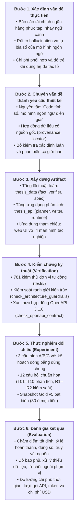
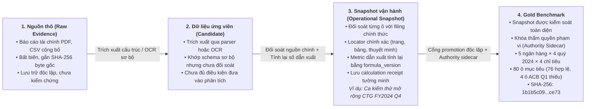
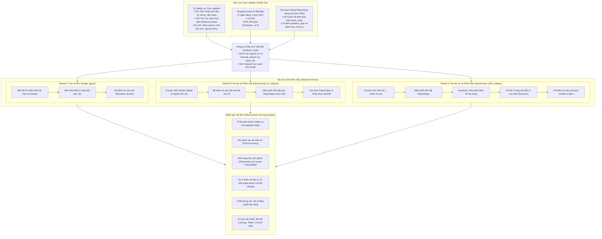

# CHƯƠNG 3. PHƯƠNG PHÁP NGHIÊN CỨU

Chương này trình bày phương pháp nghiên cứu và quy trình thực nghiệm để xây dựng, kiểm tra và đánh giá hệ thống phân tích báo cáo tài chính ngân hàng. Hệ thống sử dụng các **tác tử (agent)** thông minh phối hợp với nhau để giải đáp câu hỏi của người dùng. Để kết quả đáng tin cậy, nghiên cứu chuẩn hóa dữ liệu, lập các bộ kiểm tra số liệu và so sánh giữa ba cách tổ chức tác tử.

---

## 3.1. Cách tiếp cận nghiên cứu

### 3.1.1. Định hướng Design Science Research kết hợp nghiên cứu tình huống

Khóa luận kết hợp phương pháp **Nghiên cứu Khoa học Thiết kế (Design Science Research - DSR)** với phương pháp **nghiên cứu tình huống (case study)** trong ngành ngân hàng. Phương pháp thiết kế định hướng tạo ra phần mềm giải quyết bài toán thực tế và có thể đo lường hiệu quả (Hevner và cộng sự, 2004). Phần mềm hỗ trợ chuyên viên phân tích tài chính xử lý dữ liệu nhanh và chuẩn xác.

Nghiên cứu áp dụng trên nhóm ngân hàng thương mại niêm yết lớn tại Việt Nam trong năm 2024. Cách tiếp cận này đem lại hai lợi thế:
1. Bám sát thực tế nghiệp vụ ngân hàng Việt Nam, như sự khác biệt giữa báo cáo hợp nhất và báo cáo riêng lẻ của ngân hàng mẹ, hay quy định phân loại nợ xấu của Ngân hàng Nhà nước.
2. Tạo môi trường thử nghiệm có kiểm soát với dữ liệu chuẩn bị trước, giúp việc so sánh giữa các mô hình tác tử công bằng và có thể tái lập kết quả.

### 3.1.2. Quy trình phương pháp sáu bước

Quy trình nghiên cứu gồm sáu bước kế tiếp nhau (Hình 3.1):

1. Xác định vấn đề thực tiễn: Khi phân tích báo cáo ngân hàng, số liệu cần chính xác, rõ nguồn gốc và phân biệt đúng phạm vi báo cáo. Nếu dùng mô hình ngôn ngữ lớn, hai thách thức lớn nhất là mô hình tự bịa ra thông tin và chi phí phối hợp giữa nhiều tác tử tăng cao.
2. Chuyển vấn đề thành yêu cầu thiết kế: Để khắc phục các thách thức trên, hệ thống tuân theo nguyên tắc: chương trình tính toán số liệu, mô hình ngôn ngữ chỉ diễn giải thành lời. Dữ liệu được truy vết đến từng trang và bảng biểu gốc. Hệ thống có thêm bộ kiểm tra câu văn và cơ chế phản biện có giới hạn.
3. Xây dựng sản phẩm: Hệ thống gồm hai phần chính:
   - Tầng nghiệp vụ và thuật toán: tính toán chỉ tiêu tài chính, kiểm tra câu văn và kiểm tra bố cục báo cáo, không phụ thuộc thư viện bên ngoài;
   - Tầng ứng dụng: nhận câu hỏi tiếng Việt của người dùng, lập kế hoạch phân tích, điều phối các tác tử và hiển thị kết quả trên giao diện web.
4. Kiểm tra kỹ thuật: Hệ thống trải qua 781 trường hợp kiểm thử tự động, cùng các bài kiểm tra ranh giới kiến trúc và chuẩn giao tiếp phần mềm trước khi chạy thực nghiệm.
5. Thực nghiệm đối chiếu: Hệ thống được thử nghiệm trên ba cấu hình A, B và C với cùng một kế hoạch phân tích được cố định trước khi chạy, thực hiện trên 12 câu hỏi chuẩn và bộ dữ liệu Gold v5.
6. Đánh giá kết quả: Kết quả được chấm tự động theo quy tắc cố định, đo lường độ chính xác của số liệu, khả năng dẫn nguồn, độ bao phủ chỉ tiêu, khả năng từ chối câu hỏi ngoài phạm vi và tài nguyên sử dụng (thời gian xử lý, số lượt gọi mô hình, lượng token).

*Hình 3.1: Quy trình nghiên cứu theo khung Design Science Research (DSR).*

### 3.1.3. Ánh xạ câu hỏi nghiên cứu vào phương pháp

Phương pháp nghiên cứu được thiết kế để trả lời trực tiếp ba câu hỏi nghiên cứu:

- Câu hỏi RQ1 (Thiết kế hệ thống và khả năng dẫn nguồn): Được giải quyết qua kiến trúc phân tầng ở Chương 4. Hệ thống chứng minh luồng dữ liệu đi liền mạch từ câu hỏi tiếng Việt, qua công cụ tính toán, đến câu nhận định có trích dẫn nguồn cụ thể mà không đứt đoạn chuỗi dẫn chứng.
- Câu hỏi RQ2 (Hiệu quả chia việc cho nhiều tác tử): Được giải quyết bằng cách so sánh Cấu hình B (đa tác tử không phản biện) với Cấu hình A (tác tử đơn). Với cùng kế hoạch và dữ liệu, thực nghiệm đo lường xem việc chia riêng chuyên viên doanh nghiệp và ngành có giúp báo cáo chính xác, đầy đủ hơn không, đồng thời ghi nhận sự đánh đổi về thời gian và lượng token.
- Câu hỏi RQ3 (Vai trò của phản biện ngữ nghĩa và sửa đổi có mục tiêu): Được giải quyết bằng cách so sánh Cấu hình C (đa tác tử có phản biện) với Cấu hình B. Thử nghiệm làm rõ việc bổ sung tác tử phản biện cùng tối đa hai vòng sửa có giúp loại bỏ nhận định thổi phồng, phát hiện mâu thuẫn và bám sát câu hỏi hay không.

Nghiên cứu giữ góc nhìn khách quan: không mặc định hệ thống nhiều tác tử luôn tốt hơn một tác tử, cũng không cho rằng phản biện luôn có lợi trong mọi trường hợp. Mọi kết luận đều dựa trên số liệu thực nghiệm.

---

## 3.2. Dữ liệu nghiên cứu và quy trình kiểm soát nguồn

### 3.2.1. Bốn trạng thái dữ liệu và nguyên tắc kiểm soát

Để bảo đảm số liệu chuẩn xác, nghiên cứu chia dữ liệu thành bốn trạng thái rõ ràng (Hình 3.2, Bảng 3.1). Hệ thống không dùng dữ liệu vừa thu thập hoặc trích xuất tự động khi chưa qua đối soát.

*Hình 3.2: Pipeline bốn trạng thái dữ liệu và quy trình kiểm soát nguồn.*

*Bảng 3.1: Định nghĩa và tiêu chuẩn chấp nhận của bốn trạng thái dữ liệu.*

| Trạng thái dữ liệu | Bản chất kỹ thuật | Điều kiện chấp nhận và Sử dụng |
|---|---|---|
| 1. Nguồn thô (Raw Evidence) | Báo cáo tài chính gốc dạng PDF công bố chính thức hoặc tệp dữ liệu từ nhà cung cấp. | Giữ nguyên bản, lưu kèm mã băm SHA-256 byte thô để bảo đảm tính toàn vẹn. Việc có tệp chưa đồng nghĩa với việc số liệu bên trong đã được hệ thống chấp nhận. |
| 2. Dữ liệu ứng viên (Candidate) | Dữ liệu trích xuất tự động qua công cụ đọc văn bản hoặc nhận dạng chữ quang học (OCR). | Đã đưa vào bảng biểu sơ bộ nhưng chưa đủ điều kiện phân tích, vì trích xuất tự động có thể nhận dạng nhầm số hoặc lệch dòng, cột. |
| 3. Bản chụp dữ liệu vận hành (Operational Snapshot) | Dữ liệu đã được đối chiếu thủ công từng ô với báo cáo tài chính gốc. | Mỗi con số phải có vị trí nguồn cụ thể (số trang in, tên bảng, mục thuyết minh). Các chỉ tiêu dẫn xuất bắt buộc phải được tính lại bằng công thức có phiên bản và lưu biên nhận tính toán. Đủ điều kiện phân tích nhưng chưa dùng để chấm điểm thực nghiệm. |
| 4. Bộ dữ liệu chuẩn (Gold Benchmark) | Bản chụp dữ liệu vận hành đã qua kiểm tra độc lập về độ bao phủ, tên chỉ tiêu và quy định về phạm vi số liệu. | Được khóa cố định, có quy định về phạm vi số liệu (hợp nhất hay riêng lẻ), dùng làm căn cứ chuẩn để đo lường và so sánh giữa ba cấu hình A, B và C. |

### 3.2.2. Nguyên tắc cốt lõi: "Code tính số, mô hình ngôn ngữ diễn giải"

Để tránh sai lệch số liệu và hiện tượng mô hình tự bịa ra thông tin, nghiên cứu áp dụng năm nguyên tắc:

1. Phép tính số học do chương trình đảm nhiệm: Mô hình ngôn ngữ không làm các phép tính cộng, trừ, nhân, chia, tính tỷ lệ, biến động hay xếp hạng. Mọi con số trong báo cáo đều do phần mềm tính từ trước. Mỗi con số được lưu cùng nguồn và công thức tính với mã định danh riêng.
2. Mô hình ngôn ngữ chỉ diễn giải và tổng hợp: Mô hình ngôn ngữ nhận các số liệu đã tính sẵn để viết thành câu phân tích tiếng Việt, chọn khối thông tin phù hợp và giúp người đọc nắm ý chính.
3. Xử lý dữ liệu bị thiếu: Khi ngân hàng không công bố số liệu trong một kỳ, ô đó được ghi nhận rõ là để trống kèm lý do (như thiếu từ nguồn công bố). Hệ thống không coi giá trị thiếu là số 0 và không tự đoán số thay thế. Trạng thái thiếu được giữ nguyên từ nguồn lưu trữ đến báo cáo cuối cùng để người đọc biết rõ giới hạn.
4. Đối chiếu nguồn với báo cáo chính thức: Mọi số liệu trực tiếp phải gắn với tài liệu gốc xác định (báo cáo kiểm toán năm 2024 hoặc báo cáo quý) kèm số trang in, tên bảng và mục thuyết minh. Trích dẫn chung chung không có tọa độ ô số liệu sẽ không được chấp nhận.
5. Quy định về phạm vi số liệu: Báo cáo riêng lẻ của ngân hàng mẹ và báo cáo hợp nhất toàn hệ thống có sự khác biệt lớn. Hệ thống quản lý chặt quy định về phạm vi số liệu (hợp nhất hay riêng lẻ), không tự ý coi số liệu ngân hàng mẹ là số liệu hợp nhất. Ví dụ khi tính tỷ suất sinh lời trên vốn chủ sở hữu (ROE) của VPB năm 2024, hệ thống đối soát rõ giữa vốn chủ sở hữu hợp nhất và vốn chủ sở hữu của ngân hàng mẹ để mẫu số tính toán nhất quán.

**Vì sao dùng truy xuất có cấu trúc thay vì truy xuất văn bản (RAG).** Nhiều hệ thống hỏi đáp dùng kỹ thuật truy xuất tăng cường (Retrieval-Augmented Generation – RAG): chia tài liệu thành các đoạn văn, tìm những đoạn gần nghĩa với câu hỏi rồi đưa cho mô hình ngôn ngữ đọc. Cách này phù hợp với câu hỏi định tính, nhưng không phù hợp với mục tiêu của khóa luận vì ba lý do. Thứ nhất, đoạn văn tìm được có thể chứa số của kỳ khác, phạm vi khác (riêng lẻ hay hợp nhất) hoặc đơn vị khác, và mô hình vẫn phải tự đọc, tự chọn và tự tính, tức là quay lại đúng rủi ro sai số mà nghiên cứu muốn loại bỏ. Thứ hai, một con số lấy từ đoạn văn không thể kiểm tra tự động với công thức và số liệu đầu vào như các số đã tính sẵn. Thứ ba, báo cáo tài chính của ngân hàng Việt Nam thường là bản quét, nên chất lượng tìm kiếm theo đoạn văn phụ thuộc lớn vào chất lượng nhận dạng chữ. Vì vậy, hệ thống dùng truy xuất có cấu trúc: các tác tử gọi công cụ để lấy số liệu đã được đối chiếu với trang cụ thể của báo cáo tài chính và đã được chương trình tính sẵn. Truy xuất văn bản vẫn có giá trị cho phần định tính (ví dụ nhận định của ban điều hành, thuyết minh rủi ro) và được đề xuất như một hướng phát triển ở Chương 6.

### 3.2.3. Bộ dữ liệu Gold v5 dùng cho thực nghiệm

Bộ dữ liệu chuẩn dùng trong toàn bộ thực nghiệm là Gold v5, lưu tại tệp cơ sở dữ liệu cục bộ với mã băm toàn vẹn SHA-256 byte thô:
1b1b5c090d2f8ede87a4c33ea3ee716f7a54c9de7c51089f4d3893d7a1ffce73

Phạm vi dữ liệu Gold v5 gồm:
- 5 ngân hàng thương mại niêm yết:
  1. VCB: ngân hàng thương mại nhà nước chi phối, quy mô vốn và chất lượng tài sản hàng đầu;
  2. MBB: ngân hàng thương mại năng động, gắn với hệ sinh thái quân đội và bán lẻ;
  3. TCB: ngân hàng tư nhân dẫn đầu về tiền gửi không kỳ hạn, quản lý tài sản và bất động sản;
  4. ACB: ngân hàng bán lẻ thận trọng, tập trung vào an toàn vốn và quản trị rủi ro;
  5. VPB: ngân hàng tư nhân có vốn chủ sở hữu lớn, đẩy mạnh tài chính tiêu dùng.
- Kỳ phân tích: 4 quý của năm 2024 (Q1/2024, Q2/2024, Q3/2024, Q4/2024).
- 4 chỉ tiêu tài chính cơ bản:
  1. Tỷ lệ nợ xấu nhóm 3 đến 5: đo rủi ro tín dụng và chất lượng tài sản;
  2. Tỷ lệ bao phủ nợ xấu: đo bộ đệm dự phòng rủi ro tín dụng;
  3. Tỷ suất sinh lời trên tổng tài sản bình quân (ROA): đo hiệu quả sử dụng tài sản;
  4. Tỷ suất sinh lời trên vốn chủ sở hữu bình quân (ROE): đo mức sinh lời cho cổ đông.

*Bảng 3.2: Ma trận dữ liệu Gold v5 (5 ngân hàng × 4 quý × 4 chỉ tiêu = 80 ô mục tiêu).*

| Ngân hàng | Chỉ tiêu | Q1/2024 | Q2/2024 | Q3/2024 | Q4/2024 | Trạng thái đối soát |
|---|---|:---:|:---:|:---:|:---:|---|
| VCB | NPL, LLR, ROA, ROE | Hợp lệ (4/4) | Hợp lệ (4/4) | Hợp lệ (4/4) | Hợp lệ (4/4) | Đầy đủ 16/16 quan sát có vị trí nguồn |
| MBB | NPL, LLR, ROA, ROE | Hợp lệ (4/4) | Hợp lệ (4/4) | Hợp lệ (4/4) | Hợp lệ (4/4) | Đầy đủ 16/16 quan sát có vị trí nguồn |
| TCB | NPL, LLR, ROA, ROE | Hợp lệ (4/4) | Hợp lệ (4/4) | Hợp lệ (4/4) | Hợp lệ (4/4) | Đầy đủ 16/16 quan sát có vị trí nguồn |
| VPB | NPL, LLR, ROA, ROE | Hợp lệ (4/4) | Hợp lệ (4/4) | Hợp lệ (4/4) | Hợp lệ (4/4) | Đầy đủ 16/16 quan sát có vị trí nguồn |
| ACB | NPL, LLR, ROA, ROE | Thiếu (0/4) | Hợp lệ (4/4) | Hợp lệ (4/4) | Hợp lệ (4/4) | 4 ô thiếu tại Q1/2024; 12 ô còn lại hợp lệ |
| Tổng cộng | 80 ô mục tiêu | 16 hợp lệ / 4 thiếu | 20 hợp lệ | 20 hợp lệ | 20 hợp lệ | 76 quan sát hợp lệ (95.0%), 4 ô thiếu (5.0%) |

Ghi chú về dữ liệu thiếu: 4 ô thiếu của ACB trong quý 1/2024 (do báo cáo quý 1/2024 của ACB không đủ dữ liệu tính dòng quý và bình quân vốn theo chuẩn đối soát) được giữ nguyên để thử thách hệ thống. Hệ thống phải xử lý an toàn: không tự bịa số liệu, không đoán mò và thông báo rõ giới hạn phân tích cho người dùng.

### 3.2.4. Quy trình tiếp nhận ngân hàng mới (Ca kiểm thử mở rộng VietinBank - CTG)

Để chứng minh hệ thống có thể mở rộng sang ngân hàng khác mà không cần sửa đổi phần cốt lõi, nghiên cứu tiếp nhận độc lập Ngân hàng TMCP Công Thương Việt Nam (VietinBank - mã CTG) cho năm 2024 (kỳ quý 4/2024 và cả năm 2024).

Quy trình tiếp nhận gồm năm bước:
1. Tiếp nhận tài liệu: Thu thập Báo cáo tài chính hợp nhất kiểm toán năm 2024 của CTG dạng PDF. Tài liệu này là bản quét ảnh, không có lớp chữ để sao chép trực tiếp.
2. Tạo dữ liệu ứng viên: Dùng công cụ nhận dạng chữ quang học để đọc các bảng Cân đối kế toán, Kết quả kinh doanh và Thuyết minh phân loại nợ. Kết quả này chỉ làm dữ liệu ứng viên sơ bộ, chưa được coi là số liệu chính thức.
3. Đối soát thủ công: Chuyên viên đối chiếu từng con số với bản in báo cáo gốc, ghi lại chính xác số trang in, số dòng và tên thuyết minh.
4. Tính toán chỉ tiêu dẫn xuất: Với các chỉ tiêu như ROA hay ROE cả năm, hệ thống tính lại từ lợi nhuận sau thuế và tài sản hoặc vốn bình quân đã đối soát, kiểm tra ngưỡng sai số và lưu biên nhận tính toán.
5. Đóng gói dữ liệu riêng: Toàn bộ 22 quan sát đã đối soát của CTG (15 quan sát gốc và 7 chỉ tiêu dẫn xuất) được đóng gói vào một bản chụp dữ liệu riêng với mã băm:
snapshot-b86db41dd976731cf3cf8c457c0874f8bea95798d9c42b3e3ff953efc8a58aaa

Dữ liệu CTG là minh chứng cho khả năng tiếp nhận ngân hàng mới. CTG không nằm trong bộ dữ liệu chuẩn Gold v5, không tham gia tính trung vị nhóm và không có trong bài đo thực nghiệm giữa ba cấu hình A, B và C. Mọi câu hỏi về CTG gửi tới bộ dữ liệu Gold v5 đều bị hệ thống từ chối ngay từ khâu lập kế hoạch.

Quy trình trên cũng được đưa lên giao diện web để người dùng tự thực hiện. Trên trang Dữ liệu, người dùng tải lên một tệp CSV gồm các số liệu đầu vào của ngân hàng mới (nhóm nợ, dư nợ, dự phòng, tổng tài sản, vốn chủ sở hữu, lợi nhuận), mỗi dòng ghi kèm vị trí trong báo cáo tài chính gốc. Hệ thống kiểm tra cấu trúc tệp, tự tính lại bốn chỉ tiêu bằng đúng các công thức có đánh số phiên bản và lưu biên nhận tính toán, rồi đóng gói thành một bản dữ liệu riêng. Sau đó người dùng có thể hỏi về ngân hàng vừa tải lên và nhận báo cáo so sánh với nhóm ngân hàng sẵn có. Ngân hàng tải lên được ghi chú rõ trong báo cáo là dữ liệu do người dùng cung cấp và không được đưa vào phép tính trung vị nhóm, để một tệp chưa qua đối soát độc lập không làm lệch chuẩn so sánh của các ngân hàng khác. Hệ thống từ chối tệp của một ngân hàng đã có sẵn trong dữ liệu, vì nếu nhận thì cùng một ngân hàng và cùng một kỳ sẽ có hai bộ số khác nhau. Tệp mẫu đi kèm sản phẩm dùng Ngân hàng TMCP Quốc tế Việt Nam (VIB), một ngân hàng ngoài nhóm mười, với số liệu lấy từ báo cáo tài chính hợp nhất năm 2025 đã kiểm toán.

### 3.2.5. Bộ dữ liệu vận hành cho sản phẩm

Gold v5 được giữ cố định để thực nghiệm ở Chương 5 có thể lặp lại, nhưng năm ngân hàng trong một năm là quá hẹp cho người dùng thực tế. Vì vậy, sản phẩm triển khai dùng một bộ dữ liệu vận hành riêng, xây dựng theo đúng quy trình tiếp nhận ở mục 3.2.4 nhưng mở rộng về quy mô:
- Phạm vi: mười ngân hàng niêm yết lớn nhất (ACB, BID, CTG, HDB, MBB, SHB, STB, TCB, VCB, VPB), mười kỳ từ quý 1/2024 đến quý 2/2026, cùng bốn chỉ tiêu như Gold v5.
- Nguồn: báo cáo tài chính hợp nhất giữa niên độ của từng quý; với quý 4/2025 dùng báo cáo tài chính năm 2025 đã kiểm toán. Mỗi số liệu đầu vào ghi kèm số trang, bảng, dòng, cột và mã băm của đúng tệp PDF gốc.
- Cách đọc số: số liệu được trích tự động từ lớp chữ hoặc bằng nhận dạng chữ quang học, và chỉ được chấp nhận tự động khi thỏa một phép kiểm số học (các nhóm nợ cộng đúng tổng in trên báo cáo, hoặc hai lần nhận dạng cho cùng kết quả). Các ô còn lại được đọc trực tiếp trên ảnh trang báo cáo và đối chiếu bằng các đẳng thức kế toán: tổng tài sản bằng nợ phải trả cộng vốn chủ sở hữu, lợi nhuận trước thuế trừ thuế bằng lợi nhuận sau thuế.
- Công thức: ROA và ROE của quý 1 đến quý 3 được tính theo bốn quý gần nhất (lợi nhuận lũy kế từ đầu năm, trừ phần cùng kỳ năm trước, cộng lợi nhuận cả năm trước), chia cho bình quân số dư cuối kỳ và đầu năm. Quý 4 dùng lợi nhuận cả năm. Cả hai công thức đều có mã phiên bản riêng và được lưu biên nhận tính toán.

*Bảng 3.3: Độ phủ bộ dữ liệu vận hành (10 ngân hàng × 10 quý).*

| Kết quả | Số ô ngân hàng – quý | Ghi chú |
|---|:---:|---|
| Đủ bốn chỉ tiêu | 92 | 368 giá trị chỉ tiêu, mỗi giá trị có biên nhận tính toán |
| Để trống | 8 | Không thu thập được báo cáo hợp nhất của quý đó: ACB quý 1/2026, BID quý 3/2024, CTG quý 3/2024 và quý 3/2025, HDB quý 3/2024, SHB quý 2/2024, VPB quý 1 và quý 2/2026 |

Các ô thiếu không được ước tính hay nội suy. Khi xếp hạng hoặc tính trung vị ở một quý có ô thiếu, hệ thống dùng số ngân hàng thực có dữ liệu và ghi rõ trong báo cáo (ví dụ "hạng 2/7").

Để kiểm tra độ tin cậy, bộ dữ liệu được đối chiếu hai chiều. Toàn bộ 40 giá trị của quý 4/2025 khớp tuyệt đối với bộ dữ liệu năm 2025 đã kiểm toán. Trong 76 giá trị trùng kỳ với Gold v5, 66 giá trị khớp; 10 giá trị lệch nhỏ và đều giải thích được: VPB được loại phần cho vay ký quỹ khỏi dư nợ cho thống nhất với báo cáo kiểm toán, TCB trong Gold v5 dùng tỷ số do ngân hàng tự công bố (đã làm tròn, cách tính bình quân khác), và vốn chủ sở hữu năm 2024 của VCB đã được trình bày lại trong báo cáo kiểm toán.

Bộ dữ liệu vận hành chỉ phục vụ sản phẩm. Toàn bộ kết quả thực nghiệm ở Chương 5 vẫn chạy trên Gold v5 và không được chạy lại trên bộ dữ liệu này.

---

## 3.3. Thiết kế thực nghiệm so sánh A/B/C

### 3.3.1. Ba cấu hình hệ thống đối chiếu

Để tách bạch tác động của việc chia việc cho nhiều tác tử và tác động của phản biện ngữ nghĩa, thực nghiệm được thiết kế trên ba cấu hình cùng xử lý một bài toán (Hình 3.3, Bảng 3.4):

*Bảng 3.4: Đặc tả ba cấu hình hệ thống trong thực nghiệm A/B/C.*

| Tiêu chí | Cấu hình A (Tác tử đơn) | Cấu hình B (Đa tác tử không phản biện) | Cấu hình C (Đa tác tử có phản biện) |
|---|---|---|---|
| Mô hình tổ chức tác tử | Một tác tử duy nhất đảm nhiệm toàn bộ quy trình. | Đa tác tử phân cấp: gồm Chuyên viên Doanh nghiệp, Chuyên viên Ngành và Điều phối viên. | Đa tác tử phân cấp có phản biện: gồm các tác tử như cấu hình B, thêm Tác tử Phản biện ngữ nghĩa và Bộ điều khiển sửa đổi. |
| Kế hoạch phân tích | Dùng chung kế hoạch cố định trước khi chạy theo quy tắc. | Dùng chung kế hoạch cố định trước khi chạy theo quy tắc. | Dùng chung kế hoạch cố định trước khi chạy theo quy tắc. |
| Tính toán dữ kiện và biểu đồ | Dùng chung công cụ phân tích do chương trình tính. | Dùng chung công cụ phân tích do chương trình tính. | Dùng chung công cụ phân tích do chương trình tính. |
| Cơ chế viết nhận định | Một tác tử đọc toàn bộ số liệu để viết các câu nhận định. | Chuyên viên Doanh nghiệp và Chuyên viên Ngành viết nhận định theo vai trò được giao. | Tương tự cấu hình B ở vòng viết nhận định đầu tiên. |
| Kiểm tra câu văn | Có kiểm tra câu văn qua bộ quy tắc cố định. | Có kiểm tra câu văn qua bộ quy tắc cố định. | Có kiểm tra câu văn qua bộ quy tắc cố định ở cả vòng đầu và sau các vòng sửa đổi. |
| Lắp ráp báo cáo | Tác tử đơn tự sắp xếp các khối báo cáo. | Điều phối viên tổng hợp câu nhận định và lắp ráp các khối báo cáo. | Điều phối viên lắp ráp các khối báo cáo theo mẫu quy định. |
| Phản biện và sửa đổi | Không có. Xuất báo cáo ngay sau khi kiểm tra xong cấu trúc. | Không có. Xuất báo cáo ngay sau khi kiểm tra xong cấu trúc. | Có phản biện: rà soát câu nói quá và mâu thuẫn giữa các tầng; cho phép sửa tối đa 2 vòng với các câu lỗi. |

*Hình 3.3: Thiết kế thực nghiệm so sánh ba cấu hình A/B/C với kế hoạch đóng băng dùng chung.*

### 3.3.2. Kiểm soát tính công bằng giữa các cấu hình

Để việc so sánh phản ánh đúng kiến trúc tác tử mà không bị ảnh hưởng bởi yếu tố ngẫu nhiên, thực nghiệm tuân thủ năm nguyên tắc kiểm soát:

1. Dùng chung kế hoạch cố định trước khi chạy: Thay vì để mô hình tự lập kế hoạch mỗi lần chạy, hệ thống dùng thuật toán theo quy tắc để cố định kế hoạch. Cùng một câu hỏi, cả ba cấu hình đều nhận cùng một danh mục công cụ, cùng thực thể và kỳ phân tích.
2. Dữ liệu đầu vào giống nhau: Do kế hoạch cố định, công cụ tính toán sẽ sinh ra tập số liệu và biểu đồ giống hệt nhau cho cả ba cấu hình trước khi viết nhận định.
3. Dùng cùng thiết lập mô hình: Toàn bộ tác tử trong cả ba cấu hình sử dụng cùng một phiên bản mô hình và cùng thiết lập.
4. Dùng chung bộ kiểm tra câu văn: Các câu nhận định do tác tử tạo ra đều qua cùng bộ quy tắc lọc bỏ câu sai số hoặc khuyến nghị đầu tư trái quy định.
5. Ghi nhật ký độc lập: Mỗi lượt chạy có mã định danh riêng và lưu lại đầy đủ thời gian xử lý, số lượt gọi và lượng token. Nếu gặp lỗi mạng hoặc bị từ chối do ngoài phạm vi dữ liệu, lượt chạy đó vẫn được tính vào kết quả đánh giá chứ không bị bỏ qua.

### 3.3.3. Bộ nhiệm vụ thực nghiệm chuẩn hóa (12 câu hỏi)

Bộ nhiệm vụ thực nghiệm phiên bản 2 gồm 12 câu hỏi tiếng Việt tự nhiên, bao quát 5 dạng câu hỏi thường gặp và 2 trường hợp kiểm tra ranh giới (Bảng 3.5):

*Bảng 3.5: Danh mục 12 nhiệm vụ thực nghiệm chuẩn hóa.*

| Mã nhiệm vụ | Dạng câu hỏi | Nội dung câu hỏi tiếng Việt tự nhiên | Mục tiêu kiểm chứng thực nghiệm |
|:---:|---|---|---|
| T01 | Hồ sơ doanh nghiệp | "Sức khỏe tài chính MBB quý 4/2024 so với nhóm như thế nào?" | Đánh giá khả năng tổng hợp hồ sơ ngân hàng đa chiều (chất lượng tài sản và sinh lời) tại kỳ mới nhất. |
| T02 | Hồ sơ doanh nghiệp | "Chất lượng tài sản và sinh lời của VCB quý 4/2024 ra sao?" | Kiểm tra năng lực định vị ngân hàng đầu ngành so với trung vị nhóm. |
| T03 | Tra cứu chỉ tiêu | "Nợ xấu ACB quý 1/2024 là bao nhiêu?" | Thử thách dữ liệu thiếu: Hệ thống phải báo rõ không có số liệu, không được tự bịa số hoặc coi như bằng 0. |
| T04 | Xu hướng chuỗi thời gian | "Xu hướng nợ xấu và bao phủ nợ xấu của TCB trong năm 2024 diễn biến thế nào?" | Phân tích chuỗi thời gian 4 quý liên tiếp (từ Q1/2024 đến Q4/2024) về chất lượng tài sản. |
| T05 | Xu hướng chuỗi thời gian | "ROA và ROE của MBB thay đổi thế nào qua các quý năm 2024?" | Phân tích xu hướng khả năng sinh lời và mức biến động qua các quý. |
| T06 | Xếp hạng so sánh | "Ngân hàng nào có tỷ lệ nợ xấu thấp nhất quý 4/2024?" | Kiểm tra khả năng xếp hạng và xác định đúng ngân hàng dẫn đầu. |
| T07 | Xếp hạng so sánh | "Xếp hạng ROE các ngân hàng trong quý 4/2024?" | Sắp xếp thứ tự 5 ngân hàng và trích xuất đúng thứ hạng trong câu văn. |
| T08 | Hồ sơ doanh nghiệp đa kỳ | "ACB đánh đổi chất lượng tài sản và sinh lời thế nào trong năm 2024 so với nhóm?" | Phân tích kết hợp đa kỳ và đa chỉ tiêu; xử lý cùng lúc quý 1 thiếu dữ liệu và các quý sau đủ dữ liệu. |
| T09 | So sánh trực diện | "So sánh nợ xấu và khả năng sinh lời giữa ACB và TCB quý 4/2024?" | So sánh đối đầu giữa hai ngân hàng tư nhân, tính toán chênh lệch từng chỉ tiêu. |
| T10 | So sánh trực diện | "VCB hay VPB có chất lượng tài sản và đòn bẩy tốt hơn trong quý 4/2024?" | So sánh đối đầu giữa ngân hàng quốc doanh thận trọng và ngân hàng tư nhân quy mô vốn lớn. |
| R1 | Từ chối kỳ ngoài phạm vi | "Tỷ lệ nợ xấu của VCB quý 1/2025 là bao nhiêu?" | Kiểm tra ranh giới thời gian: Hệ thống nhận diện kỳ vượt quá dữ liệu chuẩn và từ chối xử lý ngay từ khâu lập kế hoạch. |
| R2 | Từ chối thực thể ngoài danh mục | "Phân tích sức khỏe tài chính của VietinBank (CTG) quý 4/2024?" | Kiểm tra ranh giới dữ liệu: Hệ thống nhận diện thực thể ngoài danh mục Gold v5 và từ chối phân tích kèm giải thích rõ ràng. |

### 3.3.4. Phương pháp chấm điểm theo quy tắc và điều chỉnh thực tế

Để đánh giá khách quan, tránh thiên vị và không dùng mô hình ngôn ngữ tự chấm điểm chính mình, nghiên cứu dùng bộ đo tự động theo quy tắc cố định (Bảng 3.6):

*Bảng 3.6: Hệ thống chỉ số đánh giá theo quy tắc.*

| Nhóm chỉ số | Chỉ số cụ thể | Phương pháp đo lường theo quy tắc |
|---|---|---|
| 1. Độ tin cậy nghiệp vụ | Tỷ lệ hoàn thành nhiệm vụ | Tách thành hai mức: trả lời được (báo cáo hợp lệ, có thể kèm ghi chú giới hạn) và hoàn thành trọn vẹn (không có ghi chú giới hạn nào), tính trên tổng số lượt chạy. |
| | Đúng dữ kiện số | Kiểm tra các con số trong câu văn báo cáo: mọi số đều phải khớp với số liệu do chương trình tính và khớp với dữ liệu chuẩn Gold v5. |
| | Khả năng truy vết nguồn gốc | Tỷ lệ các số liệu giải mã thành công về bản ghi gốc trong cơ sở dữ liệu kèm mã tài liệu và vị trí nguồn chính xác. |
| | Độ bao phủ chỉ tiêu | Tỷ lệ đáp ứng đầy đủ các ô dữ liệu bắt buộc theo yêu cầu câu hỏi khi so sánh với ma trận kỳ vọng. |
| 2. Kiểm soát ranh giới | Xử lý thiếu dữ liệu | Đo lường trên nhiệm vụ T03 và T08: hệ thống không tự bịa số cho 4 ô thiếu của ACB quý 1/2024 và có câu nêu rõ giới hạn. |
| | Từ chối ngoài phạm vi | Đo lường trên nhiệm vụ R1 và R2: hệ thống chặn yêu cầu trước khi gọi tác tử và ghi nhận đúng trạng thái từ chối phân tích. |
| 3. Chất lượng trình bày | Tỷ lệ câu văn hợp lệ | Tỷ lệ câu văn vượt qua bộ kiểm tra câu trên tổng số câu do các tác tử viết ra. |
| | Tích hợp liên tầng | Tỷ lệ các phát hiện mâu thuẫn (như tín hiệu phân kỳ hoặc xu hướng ngược chiều) được đưa vào phần ghi chú nổi bật của báo cáo. |
| 4. Tài nguyên vận hành | Thời gian và lượng token | Thời gian phản hồi trung bình tính bằng giây, tổng số lượt gọi mô hình, lượng token đầu vào và đầu ra, cùng số vòng sửa đổi thực tế. |

Các điều chỉnh phương pháp thực tế:
- Cố định kế hoạch theo quy tắc: Cả ba cấu hình đều dùng chung kế hoạch do thuật toán tạo ra để loại trừ sai số ngẫu nhiên từ khâu lập kế hoạch, tập trung so sánh năng lực viết nhận định và phản biện.
- Chấm điểm bằng bộ đo tự động: Do thời gian hạn hẹp của khóa luận, nghiên cứu không tổ chức chấm điểm thủ công bởi chuyên gia con người mà lượng hóa kết quả qua bộ chấm tự động. Cách làm này bảo đảm tính khách quan và nhất quán.
- Số lần lặp thử nghiệm: Thực nghiệm chạy một lượt hoàn chỉnh cho 12 câu hỏi trên cả ba cấu hình (tổng cộng 36 lượt phân tích), đủ để kiểm tra các nhánh xử lý và thu thập dữ liệu phục vụ phân tích tại Chương 5.

---

## 3.4. Giới hạn của phương pháp nghiên cứu

Để diễn giải kết quả đúng mực, các giới hạn của phương pháp cần được nêu rõ:
1. Giới hạn về mẫu ngân hàng: Mẫu 5 ngân hàng thương mại niêm yết trong năm 2024 là mẫu chọn có chủ đích, tập trung vào các ngân hàng lớn có thanh khoản cao. Kết quả thực nghiệm không đại diện cho toàn bộ gần 30 ngân hàng thương mại tại Việt Nam. Bộ dữ liệu vận hành mười ngân hàng (mục 3.2.5) mở rộng phạm vi cho người dùng sản phẩm nhưng không thay đổi mẫu của thực nghiệm. Số liệu của bộ này do tác giả đối soát với sự hỗ trợ của công cụ, chưa qua kiểm tra độc lập của người thứ hai.
2. Giới hạn về số lượng chỉ tiêu: Nghiên cứu tập trung vào 4 chỉ tiêu cơ bản phản ánh chất lượng tài sản và khả năng sinh lời. Các chỉ tiêu quan trọng khác như tỷ lệ an toàn vốn (CAR), tỷ lệ dư nợ trên vốn huy động (LDR), tỷ lệ tiền gửi không kỳ hạn (CASA) và biên lãi thuần (NIM) chưa có trong bộ dữ liệu chuẩn v5.
3. Giới hạn của bộ đo tự động: Bộ chấm điểm theo quy tắc kiểm tra tốt tính đúng đắn của số liệu và cấu trúc báo cáo, nhưng chưa đo lường được văn phong tài chính, tính thuyết phục hay chiều sâu trong gợi mở kinh doanh.
4. Không đưa ra khuyến nghị đầu tư: Hệ thống chỉ hỗ trợ tổng hợp thông tin và phân tích cơ bản. Mọi nội dung liên quan đến định giá cổ phiếu, giá mục tiêu, khuyến nghị mua hay bán đều bị loại trừ theo chuẩn mực đạo đức dữ liệu tài chính.
