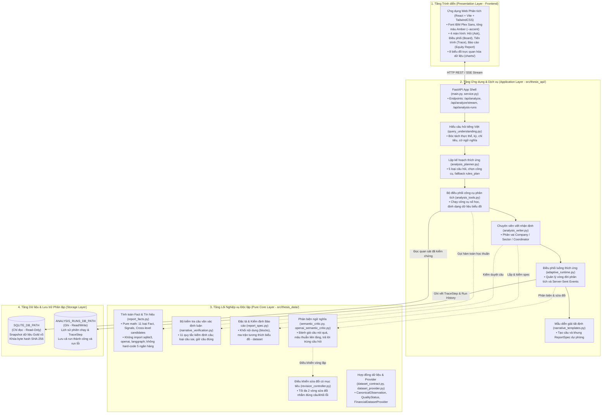
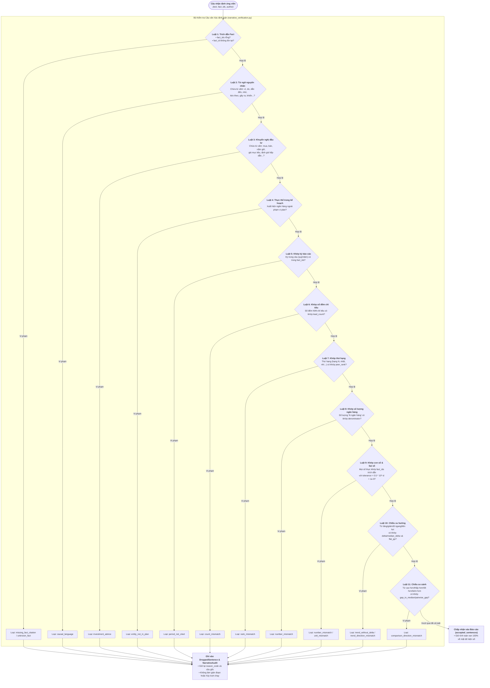
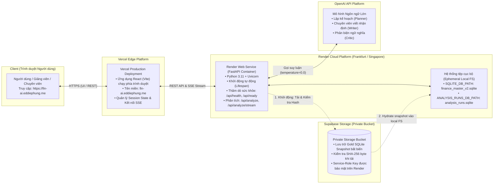

# CHƯƠNG 4. THIẾT KẾ VÀ TRIỂN KHAI HỆ THỐNG

Chương này trình bày chi tiết về kiến trúc phần mềm, các nguyên tắc phân định ranh giới, quy trình xử lý một lượt phân tích thích ứng theo câu hỏi của người dùng, giải pháp thuật toán kiểm tra tính xác thực của nhận định, giao diện tác nghiệp và hạ tầng triển khai thực tế. Toàn bộ thiết kế bám sát các quyết định kiến trúc từ D-063 đến D-075 và các ranh giới bảo vệ hệ thống đã cam kết, nhằm bảo đảm kết quả phân tích có độ tin cậy cao, giải thích minh bạch và truy vết trọn vẹn nguồn gốc dữ liệu.

---

## 4.1. Kiến trúc phân tầng và nguyên tắc ranh giới hệ thống

### 4.1.1. Phân tách rành mạch giữa Tầng Lõi (Core) và Tầng Ứng dụng (Application)

Hệ thống phân lập hoàn toàn giữa logic nghiệp vụ tài chính cốt lõi và hạ tầng ứng dụng tham chiếu. Thiết kế này bảo đảm việc thay đổi giao diện hay công nghệ máy chủ bên ngoài không làm ảnh hưởng đến tính đúng đắn của các phép tính kinh tế cốt lõi (Hình 4.1):

1. Tầng lõi nghiệp vụ và thuật toán thuần túy:
- Được thiết kế dưới dạng một thư viện thuật toán độc lập, hoàn toàn không phụ thuộc vào các khung phát triển giao diện web, cơ sở dữ liệu vật lý hay dịch vụ trí tuệ nhân tạo bên ngoài.
- Ràng buộc cấm: mã nguồn tầng lõi không được kết nối trực tiếp đến cơ sở dữ liệu hay thư viện của các mô hình ngôn ngữ lớn.
- Tính độc lập với dữ liệu cụ thể: không chứa bất kỳ định danh cố định nào của năm ngân hàng trong tập dữ liệu thử nghiệm gồm VCB, MBB, TCB, ACB, VPB. Bất kỳ sự xuất hiện nào của các định danh này trong tầng lõi đều bị hệ thống kiểm tra tự động từ chối.
- Trách nhiệm cốt lõi: định nghĩa hợp đồng dữ liệu chuẩn, tính toán dữ kiện tài chính nguyên tử và tín hiệu kinh tế, vận hành bộ kiểm tra câu văn xác định luận, thẩm định tính hợp lệ của báo cáo, định nghĩa giao thức phản biện ngữ nghĩa và điều khiển sửa đổi có mục tiêu.

2. Tầng ứng dụng và dịch vụ phân tích:
- Đóng vai trò là lớp vỏ điều phối, hiện thực hóa các tương tác với người dùng và quản lý vòng đời của một phiên phân tích.
- Trách nhiệm cốt lõi: cung cấp dịch vụ phân tích qua giao diện lập trình ứng dụng (Application Programming Interface - API), giải mã câu hỏi tiếng Việt tự nhiên, lập kế hoạch phân tích kết hợp giữa mô hình ngôn ngữ và quy tắc cố định, điều phối công cụ phân tích, phân công chuyên viên viết nhận định, duy trì các mẫu câu diễn giải dự phòng và truyền dòng sự kiện thời gian thực đến trình duyệt người dùng.

*Hình 4.1: Kiến trúc phân tầng và ranh giới hệ thống.*

### 4.1.2. Phân lập lưu trữ giữa Dữ liệu Phân tích và Lịch sử Thực thi

Mục này giải quyết nguy cơ dữ liệu gốc bị chỉnh sửa hoặc làm sai lệch trong quá trình hệ thống ghi lại lịch sử phân tích của người dùng. Hệ thống phân tách vật lý triệt để giữa hai cơ sở dữ liệu:

- Cơ sở dữ liệu phân tích chỉ đọc: chứa toàn bộ các bảng chỉ tiêu tài chính đã được đối soát. Tệp dữ liệu này được thiết lập ở chế độ chỉ đọc và vận hành theo cơ chế nhật ký ghi trước. Trong suốt quá trình vận hành, hệ thống cấm mọi thao tác ghi hoặc cập nhật dữ liệu nhằm bảo toàn tuyệt đối mã băm bảo mật SHA-256 của tập dữ liệu chuẩn.
- Cơ sở dữ liệu lịch sử phiên chạy: chuyên dùng để lưu trữ trạng thái của từng phiên phân tích và nhật ký vết từng bước. Đây là cơ sở dữ liệu có quyền ghi và hoàn toàn độc lập với tệp dữ liệu phân tích.
- Cơ chế chống trùng lặp định danh tệp: hệ thống chủ động từ chối khởi động nếu phát hiện hai đường dẫn lưu trữ trên trỏ về cùng một tệp vật lý hay liên kết phần cứng, triệt tiêu nguy cơ làm biến tính dữ liệu chuẩn trong quá trình lưu trữ lịch sử phân tích.

---

## 4.2. Luồng xử lý một lượt phân tích (End-to-End Analysis Workflow)

Quy trình xử lý một yêu cầu phân tích bắt đầu từ khi người dùng nhập câu hỏi bằng tiếng Việt tự nhiên và kết thúc khi hệ thống tạo ra một báo cáo phân tích tài chính hoàn chỉnh theo định dạng báo cáo phân tích cổ phiếu (Equity Research Report). Toàn bộ quy trình diễn ra qua tám bước tuần tự có kiểm soát chặt chẽ (Hình 4.2).

*Hình 4.2: Luồng một lượt phân tích thích ứng (End-to-End Analysis Workflow).*

### 4.2.1. Bước 1: Hiểu câu hỏi tiếng Việt tự nhiên

Bước này chuyển hóa câu hỏi tự do của người dùng thành cấu trúc thông tin rõ ràng gồm ngân hàng mục tiêu, kỳ phân tích, chỉ tiêu tài chính và ý định phân tích:

- Chuẩn hóa văn bản: đưa chuỗi ký tự về bảng mã chuẩn Unicode NFC, chuyển toàn bộ về chữ thường, hợp nhất dấu gạch nối và loại bỏ khoảng trắng thừa.
- Nhận diện ngân hàng: đối chiếu với danh mục các ngân hàng được hỗ trợ. Hệ thống nhận diện linh hoạt mã cổ phiếu như VCB, ACB và tên gọi thông dụng bằng tiếng Việt như Vietcombank, Á Châu, Kỹ thương, Quân đội, Thịnh Vượng. Nếu câu hỏi nhắc tới ngân hàng chưa được hỗ trợ như BID hay CTG, hệ thống ghi nhận vào danh sách từ khóa chưa hỗ trợ để kích hoạt phản hồi từ chối hợp lệ.
- Xác định kỳ báo cáo: nhận diện linh hoạt các cách biểu đạt thời gian trong tiếng Việt:
  - Cụ thể theo quý và năm: "quý 4/2024", "quý 4 năm 2024", "Q4/2024" được quy về kỳ quý 4 năm 2024.
  - Toàn bộ năm: "năm 2024", "cả năm 2024" được tự động mở rộng thành chuỗi bốn quý liên tiếp từ quý 1 đến quý 4 năm 2024, lấy quý 4 làm mốc so sánh.
  - Mặc định: nếu người dùng không nêu mốc thời gian, hệ thống tự động chọn kỳ dữ liệu hoàn chỉnh mới nhất là quý 4 năm 2024.
- Nhận diện chỉ tiêu tài chính: bóc tách các cụm từ chỉ tiêu tiếng Việt và tên viết tắt quốc tế như nợ xấu, tỷ lệ nợ xấu (NPL), tỷ lệ bao phủ nợ xấu (LLR), tỷ suất sinh lời trên tổng tài sản (ROA), tỷ suất sinh lời trên vốn chủ sở hữu (ROE). Hệ thống cũng hỗ trợ các nhóm chủ đề như nhóm chất lượng tài sản gồm NPL và LLR, hoặc nhóm khả năng sinh lời gồm ROA và ROE.
- Phát hiện cờ ý định phân tích: nhận diện các từ khóa chuyên biệt để xác định ý định:
  - Ý định tra cứu: qua các từ "bao nhiêu", "là mấy", "giá trị", "con số";
  - Ý định xếp hạng: qua các từ "nào", "nhất", "top", "xếp hạng", "đứng thứ", "dẫn đầu";
  - Ý định so sánh: qua các từ "so sánh", "so với", "cùng nhóm", "ngành", "trung vị", "đối thủ";
  - Ý định xu hướng: qua các từ "diễn biến", "xu hướng", "thay đổi", "qua các quý";
  - Ý định tìm nguyên nhân: qua các từ "vì sao", "tại sao", "nguyên nhân";
  - Ý định kinh tế vĩ mô: qua các từ "vĩ mô", "lãi suất điều hành", "chính sách tiền tệ", "Ngân hàng Nhà nước", "lạm phát".

### 4.2.2. Bước 2: Phân loại câu hỏi và Đóng băng Kế hoạch

Bước này xác định đúng nhu cầu phân tích của người dùng, lựa chọn các công cụ tính toán cần thiết và khóa cố định kế hoạch trước khi truy xuất dữ liệu. Hệ thống phân loại yêu cầu vào một trong năm dạng phân tích chính:

1. Tra cứu số liệu đơn lẻ (lookup): tra cứu một giá trị số học của một ngân hàng tại một kỳ cụ thể, ví dụ: "Tỷ lệ nợ xấu của ACB trong quý 4 năm 2024 là bao nhiêu?".
2. Hồ sơ doanh nghiệp (company profile): phân tích tổng thể hồ sơ tài chính của một ngân hàng, kết hợp đánh giá nội tại và so sánh vị thế tương đối với nhóm đồng đẳng tại kỳ phân tích, ví dụ: "Đánh giá chất lượng tài sản và sinh lời của VCB quý 4 năm 2024 so với nhóm".
3. Xếp hạng nhóm ngành (ranking): xếp hạng toàn diện tất cả các ngân hàng theo một hoặc nhiều chỉ tiêu tại một kỳ cụ thể, ví dụ: "Xếp hạng ROE các ngân hàng trong quý 4 năm 2024".
4. Xu hướng chuỗi thời gian (trend): phân tích biến động chuỗi thời gian của một ngân hàng qua hai đến bốn quý liên tiếp, ví dụ: "Xu hướng nợ xấu của TCB qua các quý năm 2024".
5. So sánh đối đầu trực diện (head to head): so sánh trực diện giữa đúng hai ngân hàng mục tiêu trên các chỉ tiêu tài chính, ví dụ: "So sánh ACB và TCB trong quý 4 năm 2024".
Hai dạng câu hỏi về chủ đề ngành và tương quan chỉ tiêu đã được thiết kế sẵn trong khung lý thuyết nhưng tạm thời đóng trong đợt triển khai này.

Cơ chế lập kế hoạch hai tầng:
- Đề xuất từ mô hình ngôn ngữ lớn: mô hình đề xuất dạng câu hỏi và danh mục tối đa năm lệnh gọi công cụ phân tích kèm tham số chi tiết cùng một câu lý giải ngắn gọn bằng tiếng Việt.
- Thẩm định quy tắc tất định: toàn bộ đề xuất của mô hình được đối soát nghiêm ngặt với danh mục năng lực của hệ thống, chỉ chấp nhận các thực thể, chỉ tiêu và kỳ thời gian có thật trong dữ liệu chuẩn.
- Cơ chế dự phòng theo luật: nếu mô hình ngôn ngữ gặp sự cố hoặc đề xuất không hợp lệ, hệ thống tự động kích hoạt kế hoạch phân tích theo luật có sẵn, ánh xạ trực tiếp từ các cờ ý định sang lộ trình tính toán chuẩn mực.
- Đóng băng kế hoạch phân tích: kế hoạch sau khi được thẩm định sẽ được khóa cố định. Mọi tác tử chuyên viên ở các bước sau chỉ được phép hoạt động trong phạm vi các công cụ và thực thể đã được phê duyệt trong kế hoạch này.

### 4.2.3. Bước 3: Hộp công cụ phân tích tất định sinh dữ kiện và tập dữ liệu

Bước này bảo đảm mọi phép tính toán số học tài chính đều được thực thi bằng mã lập trình xác định, loại bỏ hoàn toàn hiện tượng mô hình ngôn ngữ tự ý nhẩm tính hay bịa đặt con số:

- Kích hoạt các công cụ phân tích số học trong danh mục:
  - Công cụ tra cứu: trích xuất giá trị quan sát trực tiếp tại kỳ phân tích;
  - Công cụ vị thế ngành: tính toán giá trị trung vị của nhóm, xếp hạng cạnh tranh, khoảng cách tới trung vị, tỷ số so với trung vị và biên độ phân tán giữa ngân hàng cao nhất và thấp nhất;
  - Công cụ xếp hạng: sắp xếp toàn bộ các ngân hàng theo thứ tự giảm dần và thứ tự chất lượng tốt hơn;
  - Công cụ xu hướng thời gian: tính toán biến động điểm phần trăm liên tiếp giữa các quý của ngân hàng và biến động trung vị của toàn nhóm;
  - Công cụ so sánh đối đầu: so sánh trực diện đôi một giữa hai ngân hàng, tính chênh lệch trực tiếp và số lượng chỉ tiêu mà một ngân hàng vượt trội hơn;
  - Công cụ phân rã chỉ tiêu: phân rã mối quan hệ giữa các chỉ tiêu dẫn xuất, ví dụ tỷ lệ đòn bẩy tài chính thông qua tỷ số giữa ROE và ROA.

Tính tất định và khả năng truy vết của dữ kiện:
Mỗi công cụ tính toán tạo ra các dữ kiện tài chính có gắn kèm mã phiên bản công thức tính toán và danh sách mã định danh quan sát đầu vào, cho phép truy ngược nguồn gốc về từng dòng số liệu trong cơ sở dữ liệu. Đồng thời, công cụ chuẩn bị sẵn các cấu trúc tập dữ liệu chuẩn hóa hình dạng để phục vụ trực quan hóa ở bước sau.

*Bảng 4.1: Danh mục 11 loại Fact nguyên tử và phiên bản công thức toán học.*

| Loại dữ kiện | Mã phiên bản công thức | Ý nghĩa kinh tế và Công thức tính toán |
|---|---|---|
| Giá trị quan sát | fact-value-v1 | Giá trị chỉ tiêu quan sát được tại kỳ phân tích ($V(e,m,p)$). |
| Trung vị nhóm | peer-median-v1 | Trung vị thống kê của nhóm so sánh trên các quan sát hợp lệ ($M(m,p) = \text{median}(V(i,m,p))$). |
| Thứ hạng cạnh tranh | peer-rank-competition-v1 | Thứ hạng của ngân hàng theo chiều chất lượng tốt hơn ($R(\text{tốt})$) và theo giá trị giảm dần ($R(\text{giảm})$) trên tổng số thành viên hợp lệ $D$. |
| Chênh lệch so với trung vị | gap-to-median-pp-v1 | Mức chênh lệch điểm phần trăm so với trung vị nhóm ($\Delta(\text{trung vị}) = V(e,m,p) - M(m,p)$). |
| Biến động chuỗi thời gian | delta-pp-v1 | Mức thay đổi điểm phần trăm qua các quý liên tiếp ($\Delta(p1 \to p2) = V(e,m,p2) - V(e,m,p1)$). |
| Biến động trung vị nhóm | median-delta-pp-v1 | Mức thay đổi điểm phần trăm của trung vị nhóm qua thời gian ($\Delta M = M(m,p2) - M(m,p1)$). |
| Chênh lệch đối đầu | pairwise-gap-pp-v1 | Khoảng cách chênh lệch điểm phần trăm giữa hai ngân hàng ($\Delta(e1 - e2) = V(e1) - V(e2)$). |
| Biên độ phân tán | spread-pp-v1 | Biên độ chênh lệch tuyệt đối giữa ngân hàng cao nhất và thấp nhất trong nhóm. |
| Tỷ số so với trung vị | ratio-to-median-v1 | Tỷ số tương đối giữa giá trị của ngân hàng và trung vị nhóm ($V / M$, đơn vị: lần). |
| Tỷ số dẫn xuất | derived-ratio-v1 | Tỷ số nội tại giữa hai chỉ tiêu, ví dụ tỷ số giữa ROE và ROA phản ánh hệ số nhân đòn bẩy tài chính. |
| Số lượng dẫn trước | lead-count-v1 | Số lượng chỉ tiêu mà ngân hàng vượt trội so với đối thủ ($N/M$ chỉ tiêu). |

### 4.2.4. Bước 4: Tín hiệu và Ứng viên mâu thuẫn liên tầng

Bước này tổng hợp các con số tính toán rời rạc thành nhận định vị thế có ý nghĩa kinh tế, đồng thời tự động phát hiện các hiện tượng tài chính bất thường để làm nổi bật trong báo cáo:

1. Phân loại tín hiệu: phân nhóm các chỉ tiêu thành từng mảng nghiệp vụ (ví dụ nhóm chất lượng tài sản gồm nợ xấu và bao phủ nợ xấu) và xác định phán quyết vị thế:
- Vị thế vượt trội: kết quả tốt hơn rõ rệt so với nhóm đồng đẳng;
- Vị thế kém hơn: kết quả thấp hơn rõ rệt so với nhóm;
- Vị thế tương đương: chênh lệch nằm trong biên độ đi ngang quanh mức trung vị nhóm;
- Tín hiệu hỗn hợp: các chỉ tiêu trong cùng mảng phát tín hiệu trái chiều (chẳng hạn tỷ lệ nợ xấu thấp nhưng tỷ lệ bao phủ nợ xấu cũng ở mức mỏng);
- Thiếu dữ liệu: không đủ dữ liệu đối chuẩn.

2. Nhận diện ứng viên mâu thuẫn liên tầng: thuật toán tự động tìm kiếm các hiện tượng tài chính phức tạp:
- Tín hiệu phân kỳ nội tại: mâu thuẫn giữa hai chỉ tiêu trong cùng mảng (ví dụ ROE thuộc nhóm dẫn đầu nhưng ROA lại thấp hơn trung vị);
- Xu hướng ngược chiều ngành: xu hướng của ngân hàng đi ngược chiều với xu hướng chung của nhóm ngành (ví dụ nợ xấu của ngân hàng tăng mạnh trong khi trung vị toàn nhóm lại giảm);
- Cực trị trái chiều: một ngân hàng đồng thời giữ vị trí dẫn đầu ở một chỉ tiêu nhưng lại đứng cuối bảng ở một chỉ tiêu khác.

Các phát hiện này được gắn mã định danh và cung cấp cho các tác tử ở bước tiếp theo để đưa vào báo cáo dưới dạng các hộp lưu ý chuyên sâu.

### 4.2.5. Bước 5: Chuyên viên phân tích viết câu nhận định trích dẫn dữ kiện

Bước này kết hợp khả năng hành văn tự nhiên của mô hình ngôn ngữ với tính chính xác của dữ liệu, yêu cầu mọi câu nhận định phải gắn chặt với bằng chứng số học cụ thể. Thay vì cấm đoán cực đoan, hệ thống áp dụng nguyên tắc kiểm soát bằng chứng:

- Phân vai chuyên môn: Chuyên viên Doanh nghiệp phụ trách phân tích ngân hàng mục tiêu và Chuyên viên Ngành phụ trách đánh giá bối cảnh toàn nhóm. Mỗi câu nhận định được yêu cầu viết súc tích, không quá 30 từ.
- Bắt buộc trích dẫn bằng chứng: mỗi câu nhận định bắt buộc phải khai báo danh sách mã định danh dữ kiện làm căn cứ lập luận.
- Ràng buộc con số: khi nhắc tới số liệu, câu văn bắt buộc phải chép đúng chuỗi ký tự hiển thị đã được định dạng sẵn từ dữ kiện gốc, không được tự ý làm tròn khác đi hoặc tự tính nhẩm các con số mới ngoài hệ thống.
- Kiểm soát ngôn từ: cấm sử dụng các từ ngữ chỉ nguyên nhân chủ quan như "do", "vì", "nhờ vào", "dẫn đến". Hệ thống chỉ cho phép dùng từ "hàm ý" đối với các mối quan hệ phân rã cấu trúc toán học đã được xác nhận (như quan hệ đòn bẩy tài chính giữa ROE và ROA). Đồng thời, cấm tuyệt đối mọi hình thức tư vấn đầu tư hoặc khuyến nghị mua bán cổ phiếu.

Hệ thống tích hợp sẵn kho mẫu câu diễn giải dự phòng. Khi mô hình ngôn ngữ gặp sự cố hoặc câu văn sinh ra bị loại bỏ ở bước kiểm tra, các câu mẫu chuẩn tắc sẽ được kích hoạt thay thế an toàn, bảo đảm báo cáo luôn có nội dung diễn giải chính xác.

### 4.2.6. Bước 6: Bộ kiểm tra câu văn xác định luận

Bước này đóng vai trò như một chốt chặn kiểm duyệt tự động, quét từng câu nhận định bằng các thuật toán toán học thuần túy để loại bỏ triệt để các nhận định sai lệch hoặc số liệu bịa đặt (Hình 4.3). Toàn bộ các câu nhận định đều phải trải qua mười một quy tắc kiểm định nghiêm ngặt, dừng lại ngay tại vi phạm đầu tiên được phát hiện:

1. Quy tắc 1 - Kiểm tra trích dẫn dữ kiện: câu văn không khai báo mã dữ kiện hoặc trích dẫn mã dữ kiện không tồn tại sẽ bị loại ngay lập tức.
2. Quy tắc 2 - Cấm từ ngữ chỉ nguyên nhân chủ quan: rà soát danh mục từ cấm chỉ nguyên nhân trong tiếng Việt (như "bởi vì", "xuất phát từ", "dẫn đến", "kéo theo", "gây ra", "nhờ vào", "khiến", "do", "vì"), trừ các từ ngoại lệ hợp lệ như "lý do", "tự do", "do dự".
3. Quy tắc 3 - Cấm khuyến nghị đầu tư: rà soát các từ ngữ mang tính tư vấn tài chính trái phép (như "định giá hấp dẫn", "giá mục tiêu", "nên đầu tư", "khuyến nghị", "nắm giữ", "mua", "bán"), trừ các thuật ngữ nghiệp vụ ngân hàng hợp lệ như "bán lẻ", "bán buôn", "mua bán nợ".
4. Quy tắc 4 - Kiểm tra thực thể trong kế hoạch: câu văn không được phép nhắc đến tên bất kỳ ngân hàng nào nằm ngoài phạm vi đã được phê duyệt trong kế hoạch phân tích.
5. Quy tắc 5 - Kiểm tra kỳ báo cáo: mọi kỳ thời gian xuất hiện trong câu văn (như quý 4 năm 2024 hay cả năm 2024) bắt buộc phải thuộc danh mục các kỳ của các dữ kiện được trích dẫn.
6. Quy tắc 6 - Kiểm tra số đếm chỉ tiêu: cụm từ đếm số lượng chỉ tiêu (ví dụ: "2 trên 4 chỉ tiêu") bắt buộc phải khớp chính xác với dữ kiện đếm số lượng dẫn trước.
7. Quy tắc 7 - Kiểm tra thứ hạng cạnh tranh: các từ ngữ chỉ thứ bậc (như "hạng nhất", "dẫn đầu", "đứng thứ hai", "thấp nhất") bắt buộc phải có dữ kiện xếp hạng cạnh tranh đi kèm và khớp chính xác với chiều đánh giá.
8. Quy tắc 8 - Kiểm tra quy mô nhóm thực thể: cụm từ nêu số lượng ngân hàng (ví dụ: "5 ngân hàng") bắt buộc phải khớp chính xác với tổng số thành viên hợp lệ trong nhóm so sánh.
9. Quy tắc 9 - Kiểm tra độ chính xác của con số và sai số hiển thị: mọi số thực xuất hiện trong câu văn kèm đơn vị đo lường (như phần trăm, điểm phần trăm, lần) đều được đối chiếu chặt chẽ với dữ kiện gốc. Dung sai chấp nhận được tính theo công thức:
$$\text{Dung sai} = 0{,}5 \times 10^{-d} + 10^{-9}$$
trong đó $d$ là số chữ số thập phân hiển thị. Đồng thời, hệ thống kiểm tra sự gắn kết ngữ cảnh giữa con số với tên chỉ tiêu và tên ngân hàng xuất hiện trong phạm vi sáu từ lân cận.
10. Quy tắc 10 - Kiểm tra chiều xu hướng thời gian: các từ chỉ xu hướng (như "tăng", "giảm", "đi ngang", "cải thiện", "xấu đi") bắt buộc phải có dữ kiện biến động chuỗi thời gian chứng minh, và giá trị biến động phải vượt ngưỡng đi ngang mặc định là 0,05 điểm phần trăm.
11. Quy tắc 11 - Kiểm tra chiều so sánh tương đối: các từ so sánh (như "cao hơn", "thấp hơn", "vượt", "dưới trung vị", "tốt hơn", "kém hơn", "ngang nhóm") bắt buộc phải có dữ kiện chênh lệch chứng minh, và dấu của chênh lệch phải khớp với chiều tốt xấu của chỉ tiêu.

*Hình 4.3: Quy trình kiểm tra câu văn xác định luận.*

Cơ chế xử lý câu lỗi theo nguyên tắc kiểm soát linh hoạt:
Nếu một câu nhận định vi phạm bất kỳ quy tắc nào trong mười một quy tắc trên, câu văn đó sẽ bị loại bỏ riêng lẻ và chuyển vào danh sách lưu vết kèm mã lý do cụ thể trong hồ sơ kiểm định. Hệ thống tuyệt đối không hủy bỏ toàn bộ lượt phân tích chỉ vì một câu văn sai sót. Các câu văn hợp lệ còn lại tiếp tục được chuyển sang bước lắp ráp báo cáo.

### 4.2.7. Bước 7: Lắp ráp báo cáo theo khối và Kiểm định đặc tả báo cáo

Bước này ghép các câu nhận định và biểu đồ thành một báo cáo phân tích hoàn chỉnh có cấu trúc khối phân tầng, kiểm tra tính tương thích giữa dữ liệu với biểu đồ và khống chế độ dài hợp lý. Báo cáo được phân thành hai dạng chính:

- Thẻ trả lời nhanh: dành cho câu hỏi tra cứu đơn lẻ, gồm đúng một khối câu trả lời và tối đa một hình minh họa;
- Báo cáo phân tích chuyên sâu: dành cho bốn dạng câu hỏi còn lại, bắt đầu bằng khối tiêu đề chính (tối đa 16 từ, mở đầu bằng mã ngân hàng và dấu hai chấm) và các khối nội dung tiếp theo.

*Bảng 4.2: Danh mục các khối nội dung và giới hạn ngân sách trong đặc tả báo cáo.*

| Loại khối nội dung | Chức năng nghiệp vụ trong báo cáo | Giới hạn ngân sách tối đa |
|---|---|:---:|
| Khối trả lời trực tiếp | Hiển thị giá trị trả lời câu hỏi tra cứu kèm nhận định ngắn gọn. | Đúng 1 khối (chỉ áp dụng cho thẻ trả lời nhanh) |
| Tiêu đề chính | Tiêu đề nêu nhận định bao quát của toàn bộ báo cáo phân tích. | Đúng 1 khối (bắt buộc cho báo cáo chuyên sâu, không quá 16 từ) |
| Điểm nhấn then chốt | Danh sách các phát hiện và luận điểm cốt lõi nhất của báo cáo. | Tối đa 5 ý |
| Mục phân tích chuyên sâu | Phân tích chi tiết theo từng chủ đề như chất lượng tài sản hoặc khả năng sinh lời. | Tối đa 3 mục |
| Hình trực quan hóa | Khối hình ảnh biểu đồ tài chính kèm tiêu đề và câu thông điệp rút ra. | Tối đa 4 hình |
| Hộp lưu ý đặc biệt | Hộp nổi bật làm rõ các phát hiện mâu thuẫn liên tầng quan trọng. | Tối đa 3 hộp |
| Bảng số liệu chi tiết | Bảng tổng hợp các chỉ tiêu đối chuẩn giữa các ngân hàng. | Không giới hạn riêng |
| Tổng ngân sách toàn bài | Tổng số lượng tất cả các khối trong một báo cáo phân tích | Tối đa 12 khối |

Thẩm định tính tương thích giữa biểu đồ và cấu trúc dữ liệu:
Mỗi khối hình yêu cầu một loại biểu đồ cụ thể. Hệ thống kiểm tra tính tương thích toán học theo ma trận quy chuẩn:
- Dải thẻ chỉ số nhanh: chỉ chấp nhận dữ liệu có từ một đến sáu chỉ số;
- Biểu đồ thanh ngang xếp hạng: yêu cầu dữ liệu danh sách xếp hạng có từ ba ngân hàng hợp lệ trở lên;
- Biểu đồ đường xu hướng: yêu cầu dữ liệu chuỗi thời gian có từ hai kỳ trở lên;
- Lưới biểu đồ đường thu nhỏ: yêu cầu dữ liệu đa chuỗi có từ hai chỉ tiêu và hai kỳ trở lên;
- Biểu đồ phân tán hai chiều: yêu cầu dữ liệu cặp có tối thiểu ba ngân hàng có đầy đủ cả hai chỉ tiêu đối xứng;
- Bản đồ nhiệt thứ hạng: yêu cầu bảng dữ liệu nhóm có từ ba ngân hàng và hai chỉ tiêu trở lên;
- Biểu đồ cột nhóm và bảng so sánh trực diện: yêu cầu có từ hai đến năm ngân hàng so sánh.

Nếu loại biểu đồ do mô hình đề xuất không tương thích với cấu trúc tập dữ liệu thực tế, hệ thống sẽ tự động hạ cấp xuống loại biểu đồ thay thế an toàn trong danh mục cho phép hoặc chuyển sang hiển thị bảng dữ liệu chi tiết, bảo đảm giao diện người dùng không bao giờ gặp lỗi hiển thị.

### 4.2.8. Bước 8: Phản biện ngữ nghĩa và Sửa đổi có mục tiêu

Bước này rà soát các vấn đề về lập luận kinh tế, tính trúng trọng tâm câu hỏi và tính nhất quán ngữ nghĩa mà bộ kiểm tra quy tắc số học chưa phát hiện được. Đối với Cấu hình C, sau khi cấu trúc báo cáo ban đầu được lắp ráp, hệ thống kích hoạt tác tử phản biện ngữ nghĩa để rà soát theo các tiêu chí chất lượng tài chính:

1. Phát hiện các nhận định nói quá bằng chứng hoặc suy diễn vượt quá phạm vi số liệu của các dữ kiện được trích dẫn;
2. Phát hiện báo cáo chưa trả lời trực diện vào trọng tâm câu hỏi của người dùng;
3. Phát hiện các hình minh họa thừa thãi, không hỗ trợ trực tiếp cho luận điểm nào;
4. Phát hiện sự mâu thuẫn giữa nhận định của chuyên viên doanh nghiệp và bức tranh chung của ngành.

Quy trình sửa đổi có mục tiêu:
Mỗi vấn đề được phát hiện sẽ được định danh cụ thể: câu nhận định bị lỗi, chuyên viên chịu trách nhiệm, mô tả khuyết tật và yêu cầu sửa đổi cụ thể. Bộ điều khiển sửa đổi tiếp nhận các vấn đề này và chỉ gửi yêu cầu viết lại cho đúng chuyên viên và đúng câu nhận định bị gắn cờ lỗi. Quá trình này không chạy lại toàn bộ hệ thống, giúp tiết kiệm đáng kể thời gian và chi phí tính toán.

Giới hạn vòng lặp và tái kiểm tra:
Quy trình sửa đổi được giới hạn tối đa hai vòng lặp để ngăn chặn hiện tượng trôi dạt ngữ nghĩa hoặc lặp vô tận. Mọi câu nhận định sau khi được viết lại bắt buộc phải trải qua lại bộ kiểm tra câu văn xác định luận. Nếu câu sửa đổi vẫn không đạt yêu cầu, nó sẽ bị loại bỏ hoàn toàn và thay thế bằng câu diễn giải an toàn từ kho mẫu câu dự phòng.

---

## 4.3. Cơ chế giám sát, Lưu vết và Xử lý lỗi

### 4.3.1. Lưu vết tuần tự từng bước

Mục này ghi lại toàn bộ hành động và trạng thái của từng tác tử trong suốt phiên phân tích, bảo đảm tính minh bạch và khả năng kiểm toán hoạt động của hệ thống. Mọi sự kiện trong suốt quá trình xử lý đều được ghi vết thành các bản ghi tuần tự theo thời gian:

- Mỗi bản ghi bao gồm: chỉ số bước, thời điểm phát sinh, tác tử thực hiện (điều phối viên, chuyên viên doanh nghiệp, chuyên viên ngành, bộ kiểm tra câu, tác tử phản biện, hoặc hệ thống), tác tử tiếp nhận, phân loại hành động (lập kế hoạch, gọi công cụ, viết bản thảo, kiểm tra câu, lắp ráp báo cáo, phản biện, sửa đổi, hoàn thành, hoặc báo lỗi), tiêu đề tóm tắt bằng tiếng Việt và đối tượng dữ liệu chi tiết kèm theo.
- Tính tinh gọn và bảo mật: các bản ghi vết tuyệt đối không lưu trữ các đoạn chỉ dẫn thô của hệ thống hay chuỗi suy nghĩ nội bộ của mô hình, bảo đảm tuân thủ nguyên tắc bảo mật và tối ưu hóa dung lượng lưu trữ.

### 4.3.2. Lưu trữ bền vững phiên chạy

Mục này bảo đảm toàn bộ kết quả phân tích và nhật ký vết được lưu trữ an toàn vào cơ sở dữ liệu trên đĩa, hỗ trợ tra cứu lịch sử và phân tích thực nghiệm sau này:

- Bản ghi phiên phân tích lưu giữ mã phiên, câu hỏi gốc của người dùng, kế hoạch phân tích đóng băng, đặc tả báo cáo hoàn chỉnh, hồ sơ kiểm định câu văn, danh sách phát hiện mâu thuẫn liên tầng, số vòng phản biện đã thực hiện, trạng thái kết thúc (hoàn thành, bị chặn, hoặc thất bại), tổng thời gian thực thi tính bằng giây, tổng số token sử dụng và toàn bộ chuỗi sự kiện lưu vết từng bước.
- Lưu trữ cả phiên thất bại: ngay cả khi một yêu cầu bị từ chối do vượt phạm vi dữ liệu hoặc gặp sự cố mạng, hệ thống vẫn ghi nhận phiên chạy vào cơ sở dữ liệu với đầy đủ lý do lỗi. Điều này giúp các nhà nghiên cứu và quản trị viên có thể kiểm toán đầy đủ mẫu số thực nghiệm mà không bỏ sót các trường hợp biên.

### 4.3.3. Xử lý lỗi thân thiện bằng tiếng Việt

Mục này giải quyết tình trạng người dùng gặp các mã lỗi kỹ thuật khó hiểu khi đặt câu hỏi ngoài phạm vi, thay bằng những thông báo giải thích nghiệp vụ rõ ràng bằng tiếng Việt. Khi một yêu cầu phân tích không thể thực hiện, hệ thống đưa ra thông điệp giải thích rõ ràng bằng tiếng Việt:

- Khi người dùng hỏi về ngân hàng ngoài danh mục: "Ngân hàng [Mã] hiện chưa có dữ liệu kiểm định trong hệ thống. Vui lòng chọn một trong các ngân hàng: VCB, MBB, TCB, ACB, VPB."
- Khi người dùng hỏi về kỳ thời gian ngoài phạm vi: "Kỳ phân tích [Kỳ] vượt quá phạm vi dữ liệu đã kiểm định (năm 2024)."
- Khi người dùng hỏi về vĩ mô nhưng chưa có dữ liệu: "Dữ liệu kinh tế vĩ mô chưa được tích hợp trong snapshot hiện tại. Hệ thống tập trung phân tích số liệu tài chính doanh nghiệp và nhóm so sánh."
- Khi phát hiện ô dữ liệu thiếu: "Chỉ tiêu [Tên chỉ tiêu] của [Ngân hàng] trong [Kỳ] không được công bố đầy đủ trong báo cáo tài chính gốc, hệ thống ghi nhận trạng thái thiếu dữ liệu có kiểm soát."

---

## 4.4. Thiết kế giao diện tác nghiệp tham chiếu

Giao diện người dùng được xây dựng dưới dạng một ứng dụng trang đơn hiện đại bằng React, Vite và TailwindCSS, tuân thủ các quy chuẩn thiết kế nghiêm túc cho phân tích tài chính: sử dụng kiểu chữ phi chân phương chuẩn mực (IBM Plex Sans), tông màu nhấn hổ phách cho ngân hàng mục tiêu, các tông màu xám trung tính cho nhóm so sánh, bố cục trang tập trung tối đa vào khả năng đọc hiểu số liệu tài chính. Giao diện bao gồm bốn màn hình tác nghiệp chính:

### 4.4.1. Màn hình Đặt câu hỏi
- Cung cấp ô nhập liệu câu hỏi tự nhiên bằng tiếng Việt với trải nghiệm tìm kiếm tối giản.
- Tích hợp sẵn danh mục các câu hỏi gợi ý mẫu chia theo năm dạng phân tích chính (tra cứu, hồ sơ doanh nghiệp, xếp hạng, xu hướng bốn quý, so sánh đối đầu), giúp người dùng dễ dàng khám phá năng lực của hệ thống.

### 4.4.2. Màn hình Bàn điều phối tác tử
- Hiển thị trực quan cấu trúc của hệ thống đa tác tử thích ứng theo từng câu hỏi cụ thể.
- Tuân thủ quy tắc chỉ hiển thị tác tử thực sự hoạt động: hệ thống chỉ hiển thị thẻ tác tử cho những chuyên viên thực sự được huy động trong kế hoạch phân tích. Ví dụ, nếu câu hỏi chỉ liên quan đến một ngân hàng đơn lẻ, thẻ Chuyên viên Ngành sẽ không xuất hiện; các tác tử chưa được hỗ trợ dữ liệu sẽ không vẽ biểu tượng chờ nhằm tránh gây hiểu lầm cho người dùng.
- Hiển thị tóm tắt kế hoạch phân tích, các chỉ tiêu liên quan và câu lý giải lựa chọn của điều phối viên.

### 4.4.3. Màn hình Dòng thời gian tiến trình
- Nhận dữ liệu truyền dòng theo thời gian thực từ máy chủ phân tích thông qua cơ chế truyền sự kiện từ máy chủ (Server-Sent Events - SSE).
- Hiển thị dòng thời gian trực quan của từng bước thực thi: Lập kế hoạch $\to$ Tính toán công cụ $\to$ Nhận định chuyên viên $\to$ Kiểm định câu văn xác định luận $\to$ Lắp ráp báo cáo $\to$ Phản biện ngữ nghĩa và sửa đổi.
- Cho phép chuyên viên mở rộng từng bước để kiểm tra chi tiết: xem danh sách các dữ kiện được tính, các câu văn bị bộ kiểm tra loại bỏ kèm mã lý do, và nội dung phản biện của tác tử phản biện.

### 4.4.4. Màn hình Báo cáo phân tích chuyên sâu
- Báo cáo tự động điều chỉnh hình thái hiển thị linh hoạt theo dạng câu hỏi:
  - Với câu hỏi tra cứu đơn lẻ: hiển thị dạng thẻ trả lời nổi bật với con số kết quả ở vị trí trung tâm, nhãn chỉ tiêu, kỳ báo cáo và liên kết mở nhanh nguồn trích dẫn gốc;
  - Với các câu hỏi còn lại: hiển thị dạng báo cáo nghiên cứu hoàn chỉnh gồm khối tiêu đề nhận định lớn, danh sách các phát hiện then chốt, các mục nội dung chuyên sâu và các hộp lưu ý.
- Thư viện tám loại biểu đồ tài chính trực quan:
  1. Dải thẻ chỉ số nhanh: hiển thị các chỉ số đo lường hiệu suất tài chính nhanh tại kỳ phân tích;
  2. Biểu đồ thanh ngang xếp hạng: xếp hạng các ngân hàng từ cao xuống thấp;
  3. Biểu đồ đường xu hướng: thể hiện biến động chỉ tiêu qua các quý;
  4. Lưới biểu đồ đường thu nhỏ: so sánh xu hướng đồng thời của nhiều chỉ tiêu tài chính;
  5. Biểu đồ phân tán hai chiều: thể hiện mối tương quan giữa hai chỉ tiêu (chẳng hạn tương quan giữa tỷ lệ nợ xấu và khả năng sinh lời ROE);
  6. Bản đồ nhiệt thứ hạng: hiển thị ma trận vị thế thứ hạng của toàn bộ các ngân hàng trên tất cả các chỉ tiêu;
  7. Biểu đồ cột nhóm: so sánh nhiều chỉ tiêu giữa hai đến ba ngân hàng;
  8. Bảng so sánh trực diện: đối chuẩn tài chính trực tiếp đôi một, tô màu tương phản làm nổi bật khoảng cách chênh lệch.
- Bảng số liệu đối soát: cho phép người dùng chuyển đổi xem bảng dữ liệu chi tiết kèm số trang và dòng trích dẫn của từng con số trong báo cáo tài chính gốc đã kiểm toán.

---

## 4.5. Kiến trúc triển khai đám mây và Vận hành thực tế

Hệ thống được đóng gói và triển khai trên hạ tầng đám mây phân tán hiện đại, đảm bảo tính sẵn sàng cao và khả năng phục vụ trực tiếp cho người dùng qua mạng Internet (Hình 4.4):

*Hình 4.4: Sơ đồ kiến trúc triển khai hệ thống trên đám mây.*

1. Ứng dụng giao diện người dùng:
- Triển khai trên nền tảng phân phối biên đám mây, tối ưu hóa phân phối nội dung tĩnh toàn cầu qua mạng phân phối nội dung (Content Delivery Network - CDN).
- Hoạt động chính thức tại tên miền sản xuất: https://fin-ai.eddiephung.me.
- Kết nối với máy chủ phân tích thông qua giao thức truyền dữ liệu bảo mật và thiết lập kênh truyền dòng sự kiện thời gian thực.

2. Dịch vụ máy chủ phân tích:
- Đóng gói trong môi trường vùng chứa tiêu chuẩn và triển khai trên dịch vụ máy chủ đám mây với môi trường thực thi ngôn ngữ hiện đại.
- Tích hợp cơ chế cấu hình linh hoạt thông qua các biến môi trường, hỗ trợ chia sẻ tài nguyên an toàn giữa các nguồn gốc khác nhau, chỉ cho phép tên miền giao diện chính thức kết nối.

3. Cơ chế tự động nạp dữ liệu chuẩn:
- Do máy chủ miễn phí có đặc tính tệp tạm thời (dữ liệu cục bộ bị xóa sạch mỗi khi máy chủ khởi động lại), tệp cơ sở dữ liệu tài chính chuẩn hóa được lưu trữ cố định trên một kho lưu trữ đám mây riêng tư.
- Trong quá trình khởi động máy chủ dịch vụ, hệ thống tự động tải tệp dữ liệu chuẩn từ kho lưu trữ đám mây về bộ nhớ máy chủ cục bộ.
- Xác thực toàn vẹn hai lớp bắt buộc:
  1. Tính toán mã băm SHA-256 trên chuỗi byte của tệp vừa tải và đối chiếu với mã băm kỳ vọng đã được công bố;
  2. Thực thi lệnh kiểm tra tính toàn vẹn cấu trúc vật lý của cơ sở dữ liệu.
  Nếu phát hiện bất kỳ sự sai khác nào về mã băm hoặc lỗi cấu trúc bảng, ứng dụng sẽ lập tức dừng khởi động và từ chối phục vụ.

4. Hệ thống thăm dò trạng thái hoạt động:
- Cổng thăm dò sự sống: phản hồi trạng thái hoạt động bình thường cho các bộ cân bằng tải của dịch vụ đám mây biết tiến trình máy chủ đang vận hành.
- Cổng thăm dò mức độ sẵn sàng: chỉ khi cơ sở dữ liệu tài chính chuẩn đã được tải thành công, xác thực mã băm chính xác và kết nối sẵn sàng, cổng này mới xác nhận trạng thái sẵn sàng phục vụ. Ngược lại, hệ thống trả về mã báo dịch vụ chưa sẵn sàng, ngăn chặn việc phục vụ các yêu cầu phân tích khi dữ liệu chưa được kiểm chứng.
- Cổng thông tin phiên bản và năng lực: cung cấp thông tin phiên bản hệ thống và danh mục các chỉ tiêu cùng ngân hàng đang có dữ liệu sẵn sàng phục vụ.

---

## 4.6. Chiến lược kiểm thử và Cổng nghiệm thu kỹ thuật

Chất lượng và độ tin cậy của hệ thống được bảo chứng thông qua một hệ thống kiểm thử đa tầng và tự động hóa hoàn toàn:

1. Bộ kiểm thử đơn vị toàn diện:
Bao gồm 781 bài kiểm thử tự động đạt kết quả hoàn toàn thành công, bao phủ toàn bộ các thành phần từ tầng thuật toán lõi đến tầng dịch vụ ứng dụng:
- Kiểm thử hợp đồng dữ liệu chuẩn, tính toàn vẹn của dữ liệu và cơ chế nạp dữ liệu tự động từ kho lưu trữ đám mây;
- Kiểm thử các công cụ tính toán số học xác định, tính toán dữ kiện tài chính và chuẩn bị dữ liệu biểu đồ;
- Kiểm thử bộ giải mã ngôn ngữ tự nhiên tiếng Việt và bộ lập kế hoạch phân tích thích ứng;
- Kiểm thử mười một quy tắc của bộ kiểm tra câu văn xác định luận;
- Kiểm thử tính tương thích của đặc tả báo cáo và cấu trúc biểu đồ trực quan;
- Kiểm thử bộ điều khiển sửa đổi có mục tiêu và cơ chế phản biện ngữ nghĩa;
- Kiểm thử luồng tích hợp toàn trình từ đầu đến cuối, ghi nhận vết từng bước và truyền dòng dữ liệu thời gian thực.

2. Kiểm soát ranh giới kiến trúc tự động:
Công cụ tự động quét toàn bộ cây mã nguồn để đảm bảo không có bất kỳ sự vi phạm nào đối với các nguyên tắc kiến trúc:
- Đảm bảo tầng thuật toán lõi hoàn toàn độc lập, không phụ thuộc vào cơ sở dữ liệu vật lý hay thư viện của các mô hình ngôn ngữ lớn, và không chứa định danh cố định của năm ngân hàng thử nghiệm;
- Đảm bảo các mô hình dữ liệu của tầng giao tiếp không bị rò rỉ vào tầng thuật toán lõi;
- Đảm bảo ranh giới lưu trữ giữa cơ sở dữ liệu phân tích chỉ đọc và cơ sở dữ liệu lịch sử chạy luôn được phân tách rành mạch.

3. Kiểm tra tính tương thích hợp đồng giao diện:
Hệ thống tự động đối chiếu lược đồ giao diện lập trình ứng dụng được xuất ra từ mã nguồn với bản đặc tả hợp đồng chuẩn. Quy trình này ngăn chặn mọi sự thay đổi tùy tiện làm phá vỡ tính tương thích ngược với ứng dụng giao diện người dùng trên nền tảng đám mây.

4. Quy trình tích hợp liên tục tự động:
Mọi thay đổi mã nguồn trước khi được tích hợp vào nhánh chính đều phải vượt qua toàn bộ chuỗi kiểm định trên hệ thống tích hợp liên tục: kiểm tra quy chuẩn định dạng mã nguồn, kiểm tra kiểu dữ liệu tĩnh, xác thực ranh giới kiến trúc, kiểm tra hợp đồng giao diện và vượt qua 100% bộ kiểm thử tự động gồm 781 bài kiểm thử. Nguyên tắc bàn giao không lỗi bảo đảm nhánh chính luôn ở trạng thái ổn định và sẵn sàng triển khai phục vụ người dùng.
