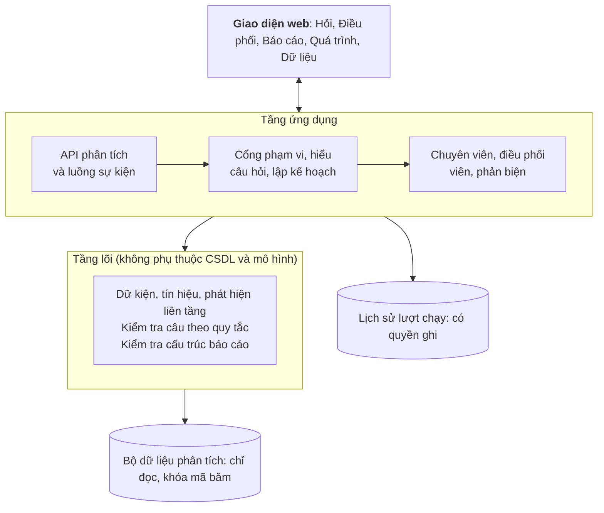
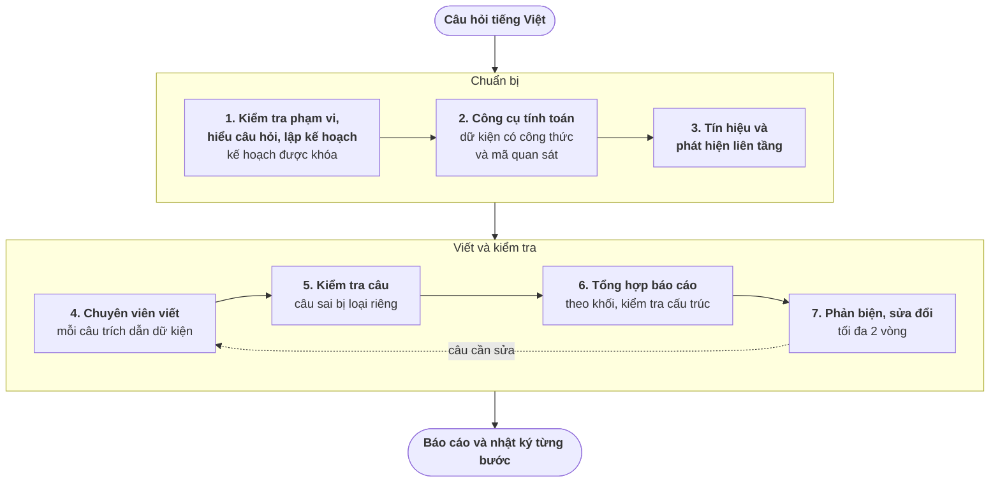
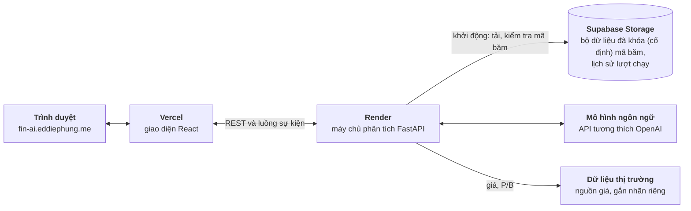

# CHƯƠNG 4. THIẾT KẾ VÀ TRIỂN KHAI HỆ THỐNG

Chương này trình bày kiến trúc phần mềm, luồng xử lý một lượt phân tích, cơ chế kiểm tra nhận định, hạ tầng triển khai và sản phẩm theo luồng sử dụng. Chương mô tả phiên bản hiện hành; các thành phần thêm sau thực nghiệm chính (cổng phạm vi, dữ liệu thị trường, khung trượt tra cứu nguồn) được đánh dấu “thêm sau đánh giá” và liệt kê ở mục 5.12. Chương mô tả phiên bản hiện hành; các thành phần thêm sau thực nghiệm chính (cổng phạm vi, dữ liệu thị trường, khung trượt tra cứu nguồn) được đánh dấu “thêm sau đánh giá” và liệt kê ở mục 5.12.

## 4.1. Kiến trúc phân tầng

Hệ thống tách logic tính toán và kiểm tra khỏi hạ tầng ứng dụng (Hình 4.1), để việc đổi giao diện, máy chủ hay nguồn dữ liệu không làm thay đổi các phép tính.

- **Tầng lõi** là thư viện thuần: định nghĩa đặc tả ràng buộc dữ liệu, tính các dữ kiện và tín hiệu tài chính, kiểm tra câu nhận định, kiểm tra cấu trúc báo cáo, và định nghĩa quy trình phản biện – sửa đổi. Tầng lõi không kết nối cơ sở dữ liệu, không gọi mô hình ngôn ngữ và không chứa mã ngân hàng cố định, nên dùng lại được cho ngân hàng khác. Các ràng buộc này được một công cụ kiểm tra tự động trên mỗi lần thay đổi mã nguồn.
- **Tầng ứng dụng** điều phối một lượt phân tích: nhận câu hỏi qua giao diện lập trình (API), hiểu câu hỏi tiếng Việt, lập kế hoạch, gọi công cụ, giao việc cho các chuyên viên, tổng hợp báo cáo và truyền tiến trình tới trình duyệt theo thời gian thực.
- **Tầng lưu trữ** gồm hai tệp tách biệt: bộ dữ liệu phân tích được mở ở chế độ chỉ đọc để giữ nguyên mã băm, và kho lịch sử các lượt chạy có quyền ghi. Khi khởi động, hệ thống từ chối chạy nếu hai đường dẫn trỏ về cùng một tệp.

*Hình 4.1: Kiến trúc phân tầng của hệ thống.*

## 4.2. Luồng xử lý một lượt phân tích

Một lượt phân tích đi từ câu hỏi tiếng Việt đến báo cáo qua các bước trong Hình 4.2.

*Hình 4.2: Luồng một lượt phân tích.*

### 4.2.1. Hiểu câu hỏi và lập kế hoạch

Câu hỏi được chuẩn hóa (bảng mã Unicode, chữ thường, khoảng trắng) rồi bóc tách bốn thông tin:

- **Ngân hàng:** nhận cả mã cổ phiếu (VCB, BID) và tên thường gọi (Vietcombank, BIDV, ngân hàng Á Châu), kể cả khi gõ không dấu; các cụm dễ nhầm như "Công Thương" chỉ được nhận khi có chữ "ngân hàng" đứng trước. Ngân hàng ngoài bộ dữ liệu được ghi lại để từ chối kèm giải thích.
- **Kỳ:** "quý 4/2025", "Q4/2025", "quý 4 năm 2025"; "năm 2025" được mở thành bốn quý của năm. Nếu câu hỏi không nêu kỳ, hệ thống dùng kỳ mới nhất có dữ liệu và ghi nhận việc áp dụng mặc định này.
- **Chỉ tiêu:** tên tiếng Việt và viết tắt (nợ xấu, NPL, bao phủ nợ xấu, ROA, ROE) hoặc nhóm chủ đề (chất lượng tài sản, khả năng sinh lời).
- **Ý định:** các từ khóa tra cứu ("bao nhiêu"), xếp hạng ("nhất", "xếp hạng"), so sánh ("so với", "cùng nhóm"), xu hướng ("diễn biến", "qua các quý").

Trước khi lập kế hoạch (thành phần thêm sau đánh giá), một cổng phạm vi theo dấu hiệu từ khóa kiểm tra câu hỏi có thực thể ngân hàng, chỉ tiêu hoặc ý định phân tích hợp lệ hay không. Câu hỏi sáng tác, dịch thuật hay dự báo giá tài sản ngoài danh mục bị từ chối ngay, không gọi mô hình; đây là bộ lọc theo từ khóa chứ không phải bộ phân loại ý định, nên câu diễn đạt lạ có thể bị chặn nhầm hoặc lọt qua.

Từ đó, câu hỏi được xếp vào một trong năm dạng: **tra cứu** một con số, **hồ sơ doanh nghiệp** so với nhóm, **xếp hạng** các ngân hàng, **xu hướng** qua hai đến bốn quý, và **so sánh trực diện** hai ngân hàng. Kế hoạch gồm dạng câu hỏi và tối đa năm lệnh gọi công cụ. Hệ thống hỗ trợ hai chế độ lập kế hoạch: bằng bộ quy tắc xác định, hoặc bằng mô hình ngôn ngữ kèm quy tắc dự phòng (chế độ mặc định khi vận hành). Trong cả hai chế độ, chương trình chỉ chấp nhận ngân hàng, kỳ và chỉ tiêu có thật trong dữ liệu; nếu đề xuất sai hoặc mô hình lỗi, hệ thống dùng kế hoạch theo quy tắc. Trong thực nghiệm đánh giá (Chương 5), kế hoạch luôn được lập bằng bộ quy tắc xác định để ba cấu hình dùng cùng một kế hoạch. Kế hoạch được khóa trước khi truy xuất dữ liệu, và các bước sau chỉ làm việc trong phạm vi đã duyệt.

### 4.2.2. Công cụ tính toán và dữ kiện

Mọi phép tính do chương trình thực hiện bằng công thức cố định. Các công cụ gồm: tra cứu giá trị; vị thế so với nhóm (trung vị, thứ hạng, chênh lệch so với trung vị); xếp hạng; xu hướng (biến động qua các quý của ngân hàng và của trung vị nhóm); so sánh trực diện (chênh lệch từng chỉ tiêu, số chỉ tiêu dẫn trước); và phân rã chỉ tiêu (ví dụ ROE chia ROA cho biết mức đòn bẩy). Kết quả là các **dữ kiện** nguyên tử (Bảng 4.1), mỗi dữ kiện mang mã riêng, phiên bản công thức và mã các quan sát đầu vào, nên truy ngược được tới dòng trong báo cáo tài chính gốc. Công cụ cũng chuẩn bị sẵn dữ liệu cho biểu đồ.

*Bảng 4.1: Các loại dữ kiện do chương trình tính.*

| Loại dữ kiện | Ý nghĩa |
|---|---|
| Giá trị quan sát | Giá trị chỉ tiêu của một ngân hàng tại một kỳ |
| Trung vị nhóm, biến động trung vị | Mức giữa của nhóm và thay đổi của nó giữa hai kỳ |
| Thứ hạng | Vị trí trong nhóm theo chiều tốt của chỉ tiêu (với nợ xấu, thấp hơn là tốt hơn) |
| Chênh lệch so với trung vị, tỷ số so với trung vị | Ngân hàng cao hay thấp hơn mức giữa của nhóm, và gấp bao nhiêu lần |
| Biến động theo kỳ | Thay đổi của chỉ tiêu giữa hai kỳ |
| Chênh lệch giữa hai ngân hàng, số chỉ tiêu dẫn trước | Dùng cho so sánh trực diện |
| Biên độ phân tán | Khoảng cách giữa ngân hàng cao nhất và thấp nhất |
| Tỷ số giữa hai chỉ tiêu | Ví dụ ROE/ROA |

### 4.2.3. Tín hiệu và phát hiện liên tầng

Từ các dữ kiện, hệ thống xếp vị thế của ngân hàng theo từng khía cạnh (chất lượng tài sản, khả năng sinh lời) thành trên nhóm, ngang nhóm, dưới nhóm, tín hiệu hỗn hợp hoặc thiếu dữ liệu. Hệ thống cũng tự tìm ba loại **phát hiện liên tầng**: hai chỉ tiêu cùng khía cạnh trái chiều nhau (ví dụ ROE trên nhóm nhưng ROA dưới nhóm), ngân hàng đi ngược xu hướng của nhóm (nợ xấu tăng khi trung vị giảm), và ngân hàng đứng đầu ở chỉ tiêu này nhưng đứng cuối ở chỉ tiêu khác. Các phát hiện này được chuyển cho các bước sau để đưa vào khối lưu ý của báo cáo.

### 4.2.4. Chuyên viên viết nhận định

Chuyên viên doanh nghiệp viết về ngân hàng mục tiêu, chuyên viên ngành viết về vị thế trong nhóm; với câu hỏi chỉ về một ngân hàng, chuyên viên ngành không được huy động. Prompt yêu cầu mỗi câu không quá 30 từ; câu phải khai báo các dữ kiện làm căn cứ, chép đúng chuỗi số đã định dạng sẵn thay vì tự tính hay tự làm tròn, không dùng từ chỉ nguyên nhân ("do", "vì", "dẫn đến") và không khuyến nghị mua bán. Prompt của chuyên viên nêu rõ các quy tắc mà bộ kiểm tra áp dụng, như trích dữ kiện cho mọi con số, thứ hạng và kỳ nhắc tới, và mỗi câu chỉ nói về một chỉ tiêu theo một chiều. Khi mô hình lỗi hoặc câu bị loại, hệ thống dùng câu mẫu dựng sẵn từ dữ kiện để báo cáo không bị gián đoạn.

Khi câu hỏi nhắc tới bối cảnh vĩ mô (lãi suất điều hành, tăng trưởng tín dụng, GDP, lạm phát) và bộ dữ liệu có khai báo thực thể vĩ mô với quan sát hợp lệ, bộ điều phối huy động thêm chuyên viên vĩ mô. Chuyên viên này đọc số từ chính bộ dữ liệu qua một công cụ, không có số cố định trong mã, và số vĩ mô đi qua cùng đường kiểm tra như số ngân hàng: mỗi khẳng định gắn với một quan sát và vị trí nguồn của nó. Nếu bộ dữ liệu không khai báo dữ liệu vĩ mô thì câu hỏi vĩ mô vẫn bị từ chối như trước. Hành vi này được kiểm bằng kiểm thử tự động với bộ dữ liệu có và không có dữ liệu vĩ mô; đánh giá chất lượng nhận định vĩ mô bằng thực nghiệm nằm ngoài phạm vi khóa luận.

### 4.2.5. Kiểm tra câu theo quy tắc

Mọi câu đều qua bộ kiểm tra trước khi vào báo cáo. Bộ kiểm tra không dùng mô hình ngôn ngữ; nó lần lượt áp dụng các quy tắc trong Bảng 4.2 và dừng ở vi phạm đầu tiên. Câu vi phạm bị loại riêng và được ghi vào hồ sơ kiểm tra kèm lý do và các dữ kiện câu đã trích; lượt phân tích vẫn tiếp tục với các câu hợp lệ.

*Bảng 4.2: Các quy tắc kiểm tra câu.*

| Quy tắc | Câu bị loại khi |
|---|---|
| Trích dẫn | Không khai báo dữ kiện, hoặc dẫn mã dữ kiện không tồn tại |
| Ngôn từ nguyên nhân | Chứa từ chỉ nguyên nhân chủ quan ("do", "vì", "dẫn đến", "khiến"…) |
| Khuyến nghị đầu tư | Chứa từ tư vấn ("nên mua", "giá mục tiêu", "khuyến nghị"…), trừ thuật ngữ như "bán lẻ" |
| Ngân hàng trong kế hoạch | Nhắc tới ngân hàng ngoài phạm vi kế hoạch |
| Kỳ | Nêu một kỳ không thuộc các dữ kiện được trích |
| Số đếm, số ngân hàng | "2/4 chỉ tiêu", "10 ngân hàng" không khớp dữ kiện |
| Thứ hạng | "Hạng 2/10", "thấp nhất", "dẫn đầu" không có dữ kiện thứ hạng tương ứng |
| Con số và đơn vị | Số không khớp dữ kiện trong phạm vi làm tròn hiển thị (viết "1,5%" thì giá trị gốc phải từ 1,45% đến 1,55%), hoặc sai đơn vị |
| Chiều xu hướng | "Tăng", "giảm", "đi ngang" không khớp biến động và ngưỡng đi ngang của chỉ tiêu |
| Chiều so sánh | "Cao hơn", "tốt hơn" không khớp dấu của chênh lệch và chiều tốt của chỉ tiêu |

### 4.2.6. Tổng hợp báo cáo theo khối

Báo cáo được ghép từ các khối theo một bản đặc tả thống nhất. Câu hỏi tra cứu nhận một **thẻ trả lời** gồm con số, nhận định ngắn và nguồn. Các dạng khác nhận một **báo cáo phân tích** gồm tiêu đề ngắn nêu kết luận, tối đa 5 điểm chính, 3 mục phân tích, 4 hình, 3 khối lưu ý và bảng số liệu, không quá 12 khối. Mỗi hình chỉ dùng loại biểu đồ phù hợp với dữ liệu: biểu đồ thanh xếp hạng cần ít nhất ba ngân hàng, biểu đồ đường cần từ hai kỳ, bản đồ nhiệt thứ hạng cần từ ba ngân hàng và hai chỉ tiêu, bảng đối chiếu dùng cho hai ngân hàng. Nếu điều phối viên chọn biểu đồ không phù hợp hoặc trả về cấu trúc sai, hệ thống tự đổi sang biểu đồ an toàn hoặc dùng khối dựng sẵn đã kiểm chứng.

### 4.2.7. Phản biện và sửa đổi có mục tiêu

Ở cấu hình đầy đủ, tác tử phản biện đọc báo cáo đã tổng hợp và tìm bốn loại vấn đề: nhận định nói quá bằng chứng, báo cáo chưa trả lời trúng câu hỏi, hình không phục vụ luận điểm nào, và mâu thuẫn giữa nhận định về ngân hàng với bối cảnh nhóm. Mỗi vấn đề nêu rõ câu, chuyên viên phụ trách và việc cần sửa. Bộ điều khiển sửa đổi chỉ gửi yêu cầu viết lại cho đúng chuyên viên và đúng câu đó, tối đa hai vòng. Câu viết lại phải qua bộ kiểm tra câu một lần nữa; nếu vẫn không đạt, câu bị loại. Lưu ý còn lại sau hai vòng được hiện cho người đọc dưới dạng ghi chú giới hạn.

## 4.3. Lưu vết và xử lý lỗi

Mỗi bước của mỗi tác tử được ghi lại theo thứ tự thời gian: ai làm, giao cho ai, loại hành động (lập kế hoạch, gọi công cụ, viết, kiểm tra, tổng hợp báo cáo, phản biện, sửa), tóm tắt tiếng Việt và dữ liệu chi tiết. Nhật ký không lưu prompt thô hay chuỗi suy nghĩ của mô hình. Mỗi lượt chạy được lưu với câu hỏi, kế hoạch, báo cáo, hồ sơ kiểm tra câu, số vòng phản biện, trạng thái kết thúc, thời gian và token, kể cả lượt bị từ chối hoặc lỗi. Khi không thể phân tích, hệ thống trả lời bằng tiếng Việt kèm dữ liệu đang có, ví dụ: "Ngân hàng yêu cầu không có trong danh sách hỗ trợ. Các ngân hàng hiện có: …" hoặc "Kỳ phân tích yêu cầu không có trong dữ liệu đã kiểm định. Các kỳ hiện có: …".

## 4.4. Triển khai và kiểm thử

Hệ thống được triển khai trực tuyến tại https://fin-ai.eddiephung.me (Hình 4.3): giao diện web chạy riêng, máy chủ phân tích gọi mô hình ngôn ngữ qua giao diện tương thích OpenAI. Vì máy chủ miễn phí mất dữ liệu cục bộ mỗi lần khởi động, bộ dữ liệu và lịch sử lượt chạy được lưu trong kho riêng tư và tải về khi khởi động; trước khi nhận yêu cầu, máy chủ kiểm tra mã băm của tệp, tính toàn vẹn cơ sở dữ liệu và mã phiên bản bộ dữ liệu, và từ chối phục vụ nếu một trong ba không khớp. Máy chủ cũng lấy giá cổ phiếu và hệ số P/B từ một nguồn bên ngoài làm bối cảnh có nhãn riêng, không trộn với số liệu báo cáo tài chính (thành phần thêm sau đánh giá).

*Hình 4.3: Kiến trúc triển khai.*

Chất lượng được kiểm soát bằng kiểm thử tự động: kiểm thử phía máy chủ (đặc tả ràng buộc dữ liệu, công cụ tính toán, hiểu câu hỏi, lập kế hoạch, từng quy tắc kiểm tra câu, đặc tả báo cáo, phản biện – sửa đổi và luồng toàn trình) và phía giao diện; số bài kiểm thử nêu ở mục 5.1. Mỗi thay đổi mã nguồn chỉ được hợp nhất vào nhánh chính khi chuỗi kiểm tra tự động đạt: toàn bộ kiểm thử, kiểm tra ranh giới kiến trúc (tầng lõi không phụ thuộc cơ sở dữ liệu, mô hình hay mã ngân hàng cố định) và đối chiếu đặc tả API (OpenAPI) với giao diện. Mỗi lần nhánh chính thay đổi, cả máy chủ và giao diện tự triển khai lại.
