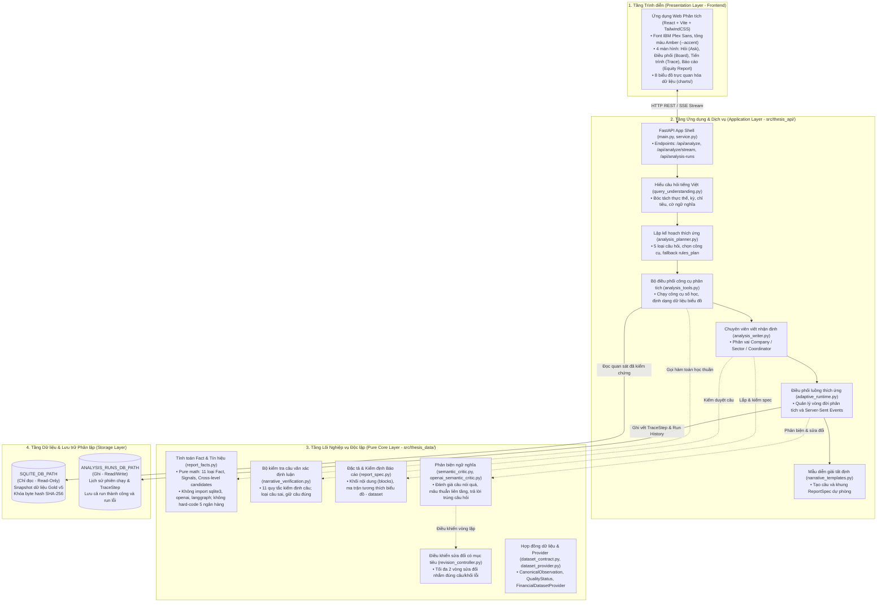
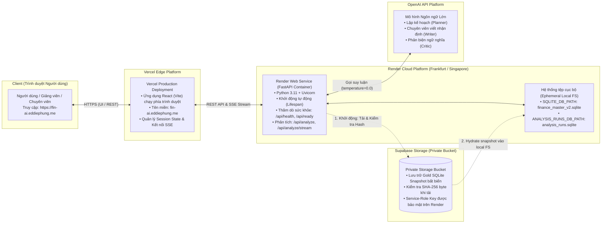

# CHƯƠNG 4. THIẾT KẾ VÀ TRIỂN KHAI HỆ THỐNG

Chương này trình bày chi tiết về kiến trúc phần mềm, nguyên tắc phân ranh giới, quy trình xử lý một lượt phân tích thích ứng (query-adaptive analysis flow), các giải pháp thuật toán xác định luận, hệ thống giao diện tác nghiệp và hạ tầng triển khai trên thực tế của hệ thống. Toàn bộ thiết kế được xây dựng dựa trên các quyết định kiến trúc đã được kiểm chứng (đặc biệt từ D-063 đến D-075 trong `docs/DECISIONS.md`), tuân thủ nghiêm ngặt các ranh giới bảo vệ kiến trúc (`docs/ARCHITECTURAL-GUARDRAILS.md`), nhằm đảm bảo hệ thống có độ tin cậy cao, khả năng giải thích minh bạch và khả năng truy vết nguồn gốc dữ kiện tuyệt đối.

---

## 4.1. Kiến trúc phân tầng và nguyên tắc ranh giới hệ thống

### 4.1.1. Phân tách rành mạch giữa Tầng Lõi (Core) và Tầng Ứng dụng (Application)

Một trong những nguyên tắc kiến trúc cốt tử của hệ thống là **phân lập hoàn toàn giữa logic nghiệp vụ tài chính cốt lõi và hạ tầng ứng dụng tham chiếu** (Hình 4.1). Ranh giới này được kiểm soát tự động thông qua công cụ kiểm thử ranh giới kiến trúc (`scripts/check_architecture_guardrails.py`):

1. **Tầng lõi nghiệp vụ và thuật toán thuần túy (`src/thesis_data/`):**
   - Được thiết kế dưới dạng thư viện Python thuần túy (pure Python logic), hoàn toàn độc lập với các framework web, các cơ sở dữ liệu vật lý hay các dịch vụ trí tuệ nhân tạo bên ngoài.
   - **Ràng buộc cấm kỵ (Negative Constraints):** Mã nguồn trong `src/thesis_data/` tuyệt đối không được phép `import sqlite3`, `import openai`, `import langchain` hay `import langgraph`.
   - **Tính độc lập với dữ liệu cụ thể (Transferability Invariant):** Không chứa bất kỳ định danh cụ thể nào của 5 ngân hàng trong tập dữ liệu thử nghiệm (không có các chuỗi ký tự cố định `VCB`, `MBB`, `TCB`, `ACB`, `VPB`). Bất kỳ sự xuất hiện nào của các định danh này trong tầng lõi đều khiến pipeline CI tự động từ chối.
   - **Trách nhiệm cốt lõi:** Định nghĩa các hợp đồng dữ liệu chuẩn (`dataset_contract.py`), thuật toán tính toán dữ kiện nguyên tử và tín hiệu tài chính (`report_facts.py`), bộ động cơ kiểm tra câu văn xác định luận (`narrative_verification.py`), bộ đặc tả và kiểm định tính hợp lệ của báo cáo (`report_spec.py`), giao thức phản biện ngữ nghĩa trừu tượng (`semantic_critic.py`) và bộ điều khiển sửa đổi có giới hạn (`revision_controller.py`).

2. **Tầng ứng dụng và dịch vụ phân tích (`src/thesis_api/`):**
   - Đóng vai trò là lớp vỏ ứng dụng (application shell), hiện thực hóa các tương tác người dùng, tích hợp các bộ chuyển đổi (adapters) và điều phối vòng đời của một phiên phân tích.
   - **Trách nhiệm cốt lõi:** Khung máy chủ API FastAPI (`main.py`), dịch vụ phân tích tổng thể (`service.py`), bộ giải mã ngôn ngữ tự nhiên tiếng Việt (`query_understanding.py`), bộ lập kế hoạch phân tích kết hợp giữa mô hình và quy tắc (`analysis_planner.py`), bộ điều phối công cụ phân tích (`analysis_tools.py`), bộ chuyên viên viết nhận định (`analysis_writer.py`), hệ thống mẫu câu diễn giải và bố cục mặc định (`narrative_templates.py`), registry siêu dữ liệu hiển thị chỉ tiêu tài chính (`metric_presentation.py`), và cơ chế truyền dòng sự kiện thời gian thực (Server-Sent Events - SSE).

*Hình 4.1: Kiến trúc phân tầng và ranh giới hệ thống.*

### 4.1.2. Phân lập lưu trữ giữa Dữ liệu Phân tích và Lịch sử Thực thi

Theo quyết định D-073 và D-075, hệ thống quy định việc phân tách vật lý triệt để giữa hai cơ sở dữ liệu:
- **Cơ sở dữ liệu phân tích chỉ đọc (`SQLITE_DB_PATH`):** Chứa các bảng dữ liệu tài chính đã được đối soát (`finance_master_v2.sqlite`). Tệp này được mở ở chế độ chỉ đọc (`mode=ro`), hoạt động theo cơ chế nhật ký ghi trước (WAL mode). Trong suốt quá trình vận hành, hệ thống cấm mọi thao tác ghi (write/update) vào cơ sở dữ liệu này nhằm bảo toàn tuyệt đối mã băm SHA-256 của snapshot.
- **Cơ sở dữ liệu lịch sử phiên chạy (`ANALYSIS_RUNS_DB_PATH`):** Chứa bảng lưu trữ trạng thái phiên phân tích và nhật ký vết từng bước (`contracts/run-store-schema.sql`). Đây là cơ sở dữ liệu có quyền ghi, hoàn toàn độc lập với tệp dữ liệu phân tích.
- **Cơ chế chống bí danh (Alias Rejection):** Hệ thống sẽ chủ động từ chối khởi động (raise `SnapshotBootstrapError` hoặc `HTTPException 503`) nếu phát hiện đường dẫn `SQLITE_DB_PATH` và `ANALYSIS_RUNS_DB_PATH` trỏ tới cùng một tệp vật lý hoặc liên kết cứng (hardlink). Ràng buộc này ngăn ngừa triệt để nguy cơ làm biến tính snapshot dữ liệu chuẩn trong quá trình lưu trữ lịch sử phân tích.

---

## 4.2. Luồng xử lý một lượt phân tích (End-to-End Analysis Workflow)

Quy trình xử lý một yêu cầu phân tích từ khi người dùng nhập câu hỏi tiếng Việt tự nhiên cho đến khi tạo thành một báo cáo hoàn chỉnh kiểu báo cáo phân tích cổ phiếu (Equity Research Report) bao gồm 8 bước tuần tự có kiểm soát (Hình 4.2).

```mermaid
flowchart TD
    UserQ(["<b>1. Câu hỏi tiếng Việt tự nhiên</b><br/><i>Ví dụ: 'So sánh nợ xấu và bao phủ nợ xấu của ACB và TCB quý 4/2024'</i>"])
    
    QU["<b>2. Hiểu câu hỏi (query_understanding.py)</b><br/>• Chuẩn hóa Unicode NFC, casefold<br/>• Bóc tách thực thể (ACB, TCB), kỳ (2024_Q4), chỉ tiêu (NPL, LLR)<br/>• Xác định cờ phân tích: head_to_head, comparison"]
    
    Plan["<b>3. Phân loại & Đóng băng Kế hoạch (analysis_planner.py)</b><br/>• Phân loại 1 trong 5 dạng: lookup, company_profile, ranking, trend, head_to_head<br/>• LLM đề xuất plan → Code kiểm tra hợp lệ (validate_plan)<br/>• Fallback kế hoạch theo luật (rules_plan) nếu lỗi mạng / đề xuất sai<br/>• <b>Đóng băng AnalysisPlan trước khi gọi dữ liệu</b>"]
    
    Tools["<b>4. Công cụ Phân tích Tất định (analysis_tools.py & report_facts.py)</b><br/>• Chạy công cụ: head_to_head, peer_position...<br/>• Tính toán 11 loại Fact nguyên tử (value, peer_median, delta, pairwise_gap, lead_count...)<br/>• Mỗi Fact gắn chặt formula_version và input_observation_ids<br/>• Chuẩn bị các cấu trúc Dataset cho biểu đồ"]
    
    Signals["<b>5. Tín hiệu & Mâu thuẫn Liên tầng (report_facts.py)</b><br/>• Phân loại tín hiệu (above_peers, in_line, below_peers...)<br/>• Phát hiện ứng viên mâu thuẫn (divergent_signals, counter_trend, cross_metric_extreme)"]
    
    Writers["<b>6. Chuyên viên Viết Nhận định (analysis_writer.py)</b><br/>• Tác tử Company & Sector viết câu nhận định súc tích (≤30 từ)<br/>• <b>Mỗi câu bắt buộc trích dẫn fact_ids</b><br/>• Chép đúng chuỗi hiển thị 'hien_thi', không tự tính, không bịa số"]
    
    Verifier["<b>7. Bộ Kiểm tra Câu văn Xác định luận (narrative_verification.py)</b><br/>• Quét 11 quy tắc: kiểm tra fact_ids, cấm từ nguyên nhân, cấm khuyến nghị đầu tư,<br/>  khớp kỳ, khớp số lượng, khớp thứ hạng, kiểm tra số với tolerance, chiều xu hướng, chiều so sánh<br/>• <b>Nguyên tắc 'Kiểm, không cấm':</b> Câu sai bị loại riêng rẽ vào DroppedSentence,<br/>  không hủy cả lượt chạy"]
    
    Assemble["<b>8. Lắp ráp & Kiểm định ReportSpec (report_spec.py & analysis_writer.py)</b><br/>• Lắp ráp các khối: headline, key_points, section, figure (8 loại biểu đồ), callout, table<br/>• Kiểm tra tương thích dataset - chart type và ngân sách khối (tối đa 12 khối)<br/>• Tự động hạ cấp biểu đồ hoặc fallback sang cấu trúc mẫu mặc định"]
    
    Critic["<b>9. Phản biện Ngữ nghĩa & Sửa đổi có Mục tiêu (semantic_critic.py & revision_controller.py)</b><br/>• Semantic Critic phát hiện câu nói quá, mâu thuẫn liên tầng, chưa trả lời đúng trọng tâm<br/>• Tối đa 2 vòng sửa đổi (Revision) nhắm đúng câu/khối lỗi<br/>• Câu sau sửa đổi bắt buộc chạy lại qua Bộ kiểm tra câu văn"]
    
    Output(["<b>10. Xuất Báo cáo & Lưu vết Toàn diện (service.py & main.py)</b><br/>• Trả về ReportSpec hoàn chỉnh qua REST hoặc truyền dòng SSE<br/>• Lưu vết chi tiết từng bước TraceStep vào SQLite (ANALYSIS_RUNS_DB_PATH)<br/>• Ghi nhận cả lượt chạy thành công và lượt chạy bị chặn/thất bại"])

    UserQ --> QU --> Plan --> Tools --> Signals --> Writers --> Verifier --> Assemble --> Critic --> Output
    Critic -.->|"Phát hiện lỗi (≤ 2 vòng)"| Writers
```

*Hình 4.2: Luồng một lượt phân tích thích ứng (End-to-End Analysis Workflow).*

### 4.2.1. Bước 1: Hiểu câu hỏi tiếng Việt tự nhiên (`query_understanding.py`)

Module `query_understanding.py` chịu trách nhiệm giải mã chuỗi văn bản tự nhiên của người dùng thành đối tượng dữ liệu cấu trúc `ResolvedQuery`:
- **Chuẩn hóa văn bản:** Chuỗi ký tự đầu vào được chuẩn hóa về định dạng Unicode chuẩn NFC, chuyển thành chữ thường (casefolding), hợp nhất dấu gạch nối và loại bỏ khoảng trắng thừa.
- **Nhận diện thực thể (Entity Extraction):** Đối chiếu với danh mục các ngân hàng được hỗ trợ trong snapshot. Hệ thống có khả năng nhận biết tên mã chứng khoán viết hoa/viết thường (`VCB`, `vcb`, `acb`) và tên gọi thông dụng bằng tiếng Việt ("Vietcombank", "Á Châu", "Kỹ thương", "Quân đội", "Thịnh Vượng"). Nếu phát hiện thực thể chưa được hệ thống hỗ trợ (như `CTG`, `BID`, `STB`), hệ thống lưu vào danh sách `unknown_entity_tokens` để kích hoạt cơ chế từ chối hợp lệ.
- **Trích xuất kỳ báo cáo (Period Resolution):** Hỗ trợ nhận diện linh hoạt các cách diễn đạt thời gian trong tiếng Việt:
  - Cụ thể theo quý và năm: *"quý 4/2024"*, *"quý 4 năm 2024"*, *"Q4/2024"*, *"Q4 2024"* $\rightarrow$ quy về `2024_Q4`.
  - Toàn bộ năm: *"năm 2024"*, *"cả năm 2024"*, *"FY2024"* $\rightarrow$ tự động mở rộng thành chuỗi 4 quý liên tiếp (`2024_Q1`, `2024_Q2`, `2024_Q3`, `2024_Q4`) với kỳ neo (anchor period) là `2024_Q4`.
  - Mặc định: Nếu người dùng không nêu kỳ, hệ thống mặc định chọn kỳ dữ liệu hoàn chỉnh mới nhất (`2024_Q4`).
- **Trích xuất chỉ tiêu tài chính (Metric Resolution):** Bóc tách các cụm từ chỉ tiêu tài chính tiếng Việt và mã quốc tế ("nợ xấu", "tỷ lệ nợ xấu", "NPL", "bao phủ nợ xấu", "LLR", "sinh lời trên tài sản", "ROA", "sinh lời trên vốn chủ sở hữu", "ROE"). Hệ thống cũng hỗ trợ các nhóm chủ đề (topic groups) như nhóm "chất lượng tài sản" (gồm NPL và LLR) hoặc nhóm "khả năng sinh lời" (gồm ROA và ROE).
- **Phát hiện cờ ngữ nghĩa (Semantic Flags):** Nhận diện các từ khóa chuyên biệt để xác định ý định:
  - Cờ tra cứu (`lookup`): *"bao nhiêu"*, *"là mấy"*, *"giá trị"*, *"con số"*;
  - Cờ xếp hạng (`superlative`): *"nào"*, *"nhất"*, *"top"*, *"xếp hạng"*, *"đứng thứ"*, *"dẫn đầu"*;
  - Cờ so sánh (`comparison`): *"so sánh"*, *"so với"*, *"cùng nhóm"*, *"ngành"*, *"trung vị"*, *"đối thủ"*;
  - Cờ xu hướng (`trend`): *"diễn biến"*, *"xu hướng"*, *"thay đổi"*, *"qua các quý"*;
  - Cờ quan hệ nhân quả (`why`): *"vì sao"*, *"tại sao"*, *"nguyên nhân"*;
  - Cờ vĩ mô (`macro`): *"vĩ mô"*, *"lãi suất điều hành"*, *"chính sách tiền tệ"*, *"NHNN"*, *"lạm phát"*.

### 4.2.2. Bước 2: Phân loại câu hỏi và Đóng băng Kế hoạch (`analysis_planner.py`)

Hệ thống phân loại yêu cầu vào một trong **5 dạng câu hỏi phân tích chính**:
1. `lookup`: Tra cứu một giá trị số học đơn lẻ của một ngân hàng tại một kỳ cụ thể (ví dụ: *"Nợ xấu của ACB trong quý 4/2024 là bao nhiêu?"*).
2. `company_profile`: Phân tích tổng thể hồ sơ tài chính của một ngân hàng, kết hợp đánh giá nội tại và so sánh vị thế tương đối với nhóm đồng đẳng tại kỳ neo (ví dụ: *"Đánh giá chất lượng tài sản và sinh lời của VCB quý 4/2024 so với nhóm"*).
3. `ranking`: Xếp hạng toàn diện tất cả các ngân hàng trong danh mục theo một hoặc nhiều chỉ tiêu tại một kỳ cụ thể (ví dụ: *"Xếp hạng ROE các ngân hàng trong quý 4/2024"*).
4. `trend`: Phân tích biến động chuỗi thời gian của một ngân hàng qua 2 đến 4 quý liên tiếp (ví dụ: *"Xu hướng nợ xấu của TCB qua các quý năm 2024"*).
5. `head_to_head`: So sánh trực diện, đối đầu giữa đúng 2 ngân hàng mục tiêu trên các chỉ tiêu tài chính (ví dụ: *"So sánh ACB và TCB trong quý 4/2024"*).
*(Hai dạng câu hỏi `sector_theme` - chủ đề ngành và `relationship` - tương quan chỉ tiêu đã được thiết kế sẵn trong contract nhưng tạm thời đóng trong đợt triển khai này theo quyết định D-075).*

**Cơ chế lập kế hoạch hai tầng (Hybrid Planning):**
- **Đề xuất từ mô hình ngôn ngữ (`model_plan`):** LLM đóng vai trò là bộ điều phối đề xuất dạng câu hỏi và danh mục tối đa 5 lệnh gọi công cụ phân tích (`ToolCallSpec`) kèm tham số chi tiết và một câu lý giải bằng tiếng Việt (`rationale`).
- **Thẩm định quy tắc tất định (`validate_plan`):** Toàn bộ đề xuất của mô hình được đối soát nghiêm ngặt với catalog năng lực: chỉ được sử dụng các thực thể, chỉ tiêu và kỳ có thật; các tham số công cụ phải đúng kiểu.
- **Cơ chế dự phòng tất định (`rules_plan`):** Nếu LLM không khả dụng (lỗi mạng, hết hạn mức API) hoặc đề xuất kế hoạch không hợp lệ, hệ thống tự động kích hoạt bộ lập kế hoạch theo luật thuần túy (`rules_plan`). Bộ luật này ánh xạ trực tiếp từ các cờ ngữ nghĩa trong `ResolvedQuery` sang kế hoạch chuẩn mực tối ưu cho dạng câu hỏi tương ứng.
- **Đóng băng kế hoạch (Plan Freezing):** Kế hoạch sau khi được thẩm định sẽ được khóa cố định thành đối tượng `AnalysisPlan`. Mọi tác tử chuyên viên ở các bước sau chỉ được phép hoạt động trong phạm vi các công cụ và thực thể đã được phê duyệt trong kế hoạch này.

### 4.2.3. Bước 3: Hộp công cụ phân tích tất định sinh Fact và Dataset (`analysis_tools.py`, `report_facts.py`)

Hệ thống kích hoạt các công cụ phân tích số học tương ứng trong danh mục (`TOOL_CATALOG`):
- `lookup_tool`: Trích xuất giá trị quan sát trực tiếp tại kỳ neo;
- `peer_position_tool`: Tính toán trung vị nhóm (`peer_median`), xếp hạng cạnh tranh (`peer_rank`), khoảng cách tới trung vị (`gap_to_median`), tỷ lệ so với trung vị (`ratio_to_median`) và biên độ phân tán (`spread`);
- `ranking_tool`: Sắp xếp toàn bộ các ngân hàng theo thứ tự giảm dần và thứ tự chất lượng tốt hơn;
- `trend_tool`: Tính toán biến động điểm phần trăm liên tiếp giữa các quý (`delta`) và biến động trung vị nhóm (`median_delta`);
- `head_to_head_tool`: So sánh trực diện đôi một giữa 2 ngân hàng, tính chênh lệch trực tiếp (`pairwise_gap`) và số lượng chỉ tiêu vượt trội (`lead_count`);
- `decomposition_tool`: Phân rã mối quan hệ giữa các chỉ tiêu dẫn xuất (ví dụ tỷ lệ đòn bẩy tài chính thông qua tỷ số $\text{ROE} / \text{ROA}$).

**Tính tất định và khả năng truy vết của Fact:**
Mỗi công cụ sinh ra các đối tượng `Fact` với công thức phiên bản hóa rõ ràng:

*Bảng 4.1: Danh mục 11 loại Fact nguyên tử và phiên bản công thức toán học.*

| Loại Fact (`fact_type`) | Mã phiên bản công thức (`formula_version`) | Ý nghĩa kinh tế và Công thức tính toán |
|---|---|---|
| `value` | `fact-value-v1` | Giá trị chỉ tiêu quan sát được tại kỳ phân tích ($V_{e,m,p}$). |
| `peer_median` | `peer-median-v1` | Trung vị thống kê của nhóm đồng đẳng trên các quan sát hợp lệ ($M_{m,p} = \text{median}(V_{i,m,p})$). |
| `peer_rank` | `peer-rank-competition-v1` | Thứ hạng cạnh tranh của ngân hàng ($R_{better}$ và $R_{desc}$ trên tổng số thành viên hợp lệ $D$). |
| `gap_to_median` | `gap-to-median-pp-v1` | Chênh lệch điểm phần trăm so với trung vị nhóm ($\Delta_{median} = V_{e,m,p} - M_{m,p}$). |
| `delta` | `delta-pp-v1` | Biến động điểm phần trăm qua chuỗi thời gian ($\Delta_{p_1 \to p_2} = V_{e,m,p_2} - V_{e,m,p_1}$). |
| `median_delta` | `median-delta-pp-v1` | Biến động trung vị nhóm qua thời gian ($\Delta M = M_{m,p_2} - M_{m,p_1}$). |
| `pairwise_gap` | `pairwise-gap-pp-v1` | Khoảng cách chênh lệch điểm phần trăm giữa 2 ngân hàng ($\Delta_{e_1 - e_2} = V_{e_1} - V_{e_2}$). |
| `spread` | `spread-pp-v1` | Biên độ chênh lệch tuyệt đối giữa ngân hàng cao nhất và thấp nhất trong nhóm. |
| `ratio_to_median` | `ratio-to-median-v1` | Tỷ số tương đối giữa giá trị ngân hàng và trung vị nhóm ($V / M$, đơn vị: lần). |
| `derived_ratio` | `derived-ratio-v1` | Tỷ số dẫn xuất nội tại giữa hai chỉ tiêu (ví dụ $\text{ROE} / \text{ROA}$, phản ánh hệ số nhân đòn bẩy tài chính). |
| `lead_count` | `lead-count-v1` | Số lượng chỉ tiêu mà ngân hàng dẫn trước đối thủ ($N/M$ chỉ tiêu). |

Mỗi `Fact` đều bảo toàn danh sách `input_observation_ids` để nối ngược về cơ sở dữ liệu. Đồng thời, công cụ tạo sẵn các đối tượng `Dataset` chuẩn hóa hình dạng (`kpi`, `ranked_list`, `series`, `series_multi`, `paired`, `peer_table`, `comparison_table`) để phục vụ trực quan hóa ở bước sau.

### 4.2.4. Bước 4: Tín hiệu và Ứng viên mâu thuẫn liên tầng (`report_facts.py`)

Dựa trên các `Fact` đã tính, hệ thống tự động tổng hợp:
1. **Phân loại tín hiệu (`classify_signals`):** Phân nhóm các chỉ tiêu thành từng mảng nghiệp vụ (ví dụ nhóm Chất lượng tài sản gồm NPL và LLR) và xác định phán quyết vị thế (`verdict`):
   - `above_peers`: Vị thế vượt trội rõ ràng so với nhóm;
   - `below_peers`: Vị thế kém hơn rõ ràng so với nhóm;
   - `in_line`: Vị thế tương đương trung vị nhóm (chênh lệch nằm trong biên độ đi ngang);
   - `mixed`: Tín hiệu hỗn hợp (ví dụ nợ xấu thấp nhưng bao phủ nợ xấu cũng mỏng);
   - `insufficient_data`: Không đủ dữ liệu đối chuẩn.
2. **Nhận diện ứng viên mâu thuẫn liên tầng (`detect_cross_level_candidates`):** Thuật toán tự động tìm kiếm các hiện tượng tài chính phức tạp:
   - `divergent_signals`: Mâu thuẫn giữa hai chỉ tiêu cùng mảng (ví dụ ROE thuộc nhóm dẫn đầu nhưng ROA lại thấp hơn trung vị);
   - `counter_trend`: Xu hướng của ngân hàng đi ngược chiều với xu hướng chung của nhóm ngành (ví dụ nợ xấu của ngân hàng tăng mạnh trong khi trung vị toàn nhóm lại giảm);
   - `cross_metric_extreme`: Ngân hàng đồng thời giữ vị trí dẫn đầu ở một chỉ tiêu nhưng lại đứng cuối bảng ở một chỉ tiêu khác.

Các phát hiện này được gán mã `finding_id` và cung cấp cho các tác tử ở bước tiếp theo để đưa vào báo cáo dưới dạng các điểm lưu ý chuyên sâu (callout).

### 4.2.5. Bước 5: Chuyên viên phân tích viết câu nhận định trích dẫn Fact (`analysis_writer.py`)

Khác với kiến trúc cũ (nơi mô hình tổng hợp bị cấm đoán cực đoan và chỉ tạo ra các đoạn văn chung chung không có số), kiến trúc hiện tại áp dụng nguyên tắc **"Kiểm, không cấm"**:
- Các chuyên viên phân tích theo vai trò (**Chuyên viên Doanh nghiệp - Company Specialist** và **Chuyên viên Ngành - Sector Specialist**) được yêu cầu viết các câu nhận định phân tích súc tích (mỗi câu không quá 30 từ).
- **Quy tắc bắt buộc trích dẫn:** Mỗi câu nhận định (`NarrativeSentence`) bắt buộc phải khai báo danh sách các `fact_ids` mà câu văn dựa vào để lập luận.
- **Ràng buộc con số:** Khi nhắc tới số liệu, câu văn bắt buộc phải chép đúng chuỗi hiển thị đã định dạng sẵn (`hien_thi`) từ `Fact`, không được tự ý làm tròn khác đi hoặc tự tính nhẩm các con số mới.
- **Kiểm soát ngôn từ:** Cấm sử dụng các từ ngữ chỉ nguyên nhân chủ quan (*"do"*, *"vì"*, *"nhờ vào"*, *"dẫn đến"*), chỉ được phép dùng từ *"hàm ý"* đối với các mối quan hệ phân rã cấu trúc toán học (như đòn bẩy tài chính $\text{ROE}/\text{ROA}$); cấm tuyệt đối mọi hình thức tư vấn đầu tư hoặc khuyến nghị mua/bán cổ phiếu.

Hệ thống đồng thời tích hợp sẵn module mẫu câu tất định (`narrative_templates.py`). Trong trường hợp mô hình ngôn ngữ gặp sự cố hoặc bị từ chối ở bước kiểm tra, các câu nhận định chuẩn tắc sinh ra từ mẫu câu sẽ đóng vai trò phương án thay thế an toàn (fallback), bảo đảm báo cáo luôn có nội dung diễn giải chính xác.

### 4.2.6. Bước 6: Bộ kiểm tra câu văn xác định luận (`narrative_verification.py`)

Toàn bộ các câu nhận định do chuyên viên hoặc mô hình sinh ra đều phải trải qua **Bộ kiểm tra câu văn xác định luận** (Sentence-Level Narrative Verification Engine - Hình 4.3). Bộ kiểm tra này là một module thuật toán thuần túy trong tầng core (`src/thesis_data/narrative_verification.py`), vận hành hoàn toàn độc lập với mô hình ngôn ngữ và quét tuần tự qua **11 quy tắc kiểm định nghiêm ngặt**.

Quy trình thẩm định dừng lại ngay tại vi phạm đầu tiên được phát hiện trên câu văn (stop at first violation):
1. **Luật 1 - Kiểm tra trích dẫn Fact (`missing_fact_citation`, `unknown_fact`):** Câu văn không có `fact_ids` hoặc chứa `fact_id` không tồn tại trong danh mục kết quả phân tích sẽ bị loại ngay lập tức.
2. **Luật 2 - Cấm từ ngữ nguyên nhân chủ quan (`causal_language`):** Quét danh từ cấm nguyên nhân tiếng Việt (*"bởi vì"*, *"xuất phát từ"*, *"dẫn đến"*, *"kéo theo"*, *"gây ra"*, *"nhờ vào"*, *"vì vậy"*, *"khiến"*, *"do"*, *"vì"*...) trừ các cụm từ ngoại lệ được cho phép như *"lý do"*, *"tự do"*, *"do dự"*.
3. **Luật 3 - Cấm khuyến nghị đầu tư (`investment_advice`):** Quét các từ ngữ mang tính tư vấn tài chính trái phép (*"định giá hấp dẫn"*, *"giá mục tiêu"*, *"nên đầu tư"*, *"khuyến nghị"*, *"nắm giữ"*, *"mua"*, *"bán"*...) trừ các thuật ngữ ngân hàng hợp lệ như *"bán lẻ"*, *"bán buôn"*, *"mua bán nợ"*.
4. **Luật 4 - Kiểm tra thực thể trong kế hoạch (`entity_not_in_plan`):** Câu văn không được phép nhắc đến tên bất kỳ ngân hàng nào nằm ngoài phạm vi thực thể đã được phê duyệt trong kế hoạch phân tích.
5. **Luật 5 - Kiểm tra kỳ báo cáo (`period_not_cited`):** Mọi kỳ thời gian xuất hiện trong câu văn (*"quý 4/2024"*, *"Q4/2024"*, *"năm 2024"*) bắt buộc phải thuộc danh sách các kỳ của các `Fact` được trích dẫn trong câu đó.
6. **Luật 6 - Kiểm tra số đếm chỉ tiêu (`count_mismatch`):** Các cụm từ đếm số lượng chỉ tiêu (ví dụ: *"2/4 chỉ tiêu"*) bắt buộc phải khớp chính xác với giá trị của `Fact` kiểu `lead_count`.
7. **Luật 7 - Kiểm tra thứ hạng cạnh tranh (`rank_mismatch`):** Các từ ngữ chỉ thứ bậc (*"hạng 1/5"*, *"cao nhất"*, *"thấp nhất"*, *"tốt nhất"*, *"dẫn đầu"*, *"đứng cuối"*) bắt buộc phải có `Fact` kiểu `peer_rank` đi kèm và khớp chính xác với chiều xếp hạng (tốt hơn hoặc thứ bậc giá trị).
8. **Luật 8 - Kiểm tra quy mô nhóm thực thể (`number_mismatch`):** Cụm từ nêu số lượng ngân hàng (ví dụ: *"5 ngân hàng"*) bắt buộc phải khớp với mẫu số (`denominator`) của các fact so sánh.
9. **Luật 9 - Kiểm tra độ chính xác của con số và sai số hiển thị (`number_mismatch`, `unit_mismatch`):** Mọi số thực xuất hiện trong câu văn (kèm đơn vị %, điểm %, lần) đều được đối chiếu với các `Fact` được trích dẫn. Sai số chấp nhận được (tolerance) được tính chặt chẽ theo số chữ số thập phân hiển thị $d$:
   $$\text{Tolerance} = 0.5 \times 10^{-d} + 10^{-9}$$
   Đồng thời, hệ thống kiểm tra sự gắn kết ngữ cảnh giữa con số với tên chỉ tiêu và tên ngân hàng xuất hiện trong phạm vi 6 từ lân cận.
10. **Luật 10 - Kiểm tra chiều xu hướng thời gian (`trend_without_delta`, `trend_direction_mismatch`):** Các từ chỉ xu hướng (*"tăng"*, *"giảm"*, *"đi ngang"*, *"cải thiện"*, *"xấu đi"*, *"thu hẹp"*, *"nới rộng"*, *"liên tục"*, *"ngược chiều"*) bắt buộc phải có fact biến động (`delta`, `median_delta`) chứng minh và giá trị biến động phải vượt ngưỡng đi ngang (`flat_pp`, mặc định 0.05 điểm phần trăm).
11. **Luật 11 - Kiểm tra chiều so sánh tương đối (`comparison_direction_mismatch`):** Các từ so sánh (*"cao hơn"*, *"thấp hơn"*, *"vượt"*, *"dưới trung vị"*, *"tốt hơn"*, *"kém hơn"*, *"ngang nhóm"*) bắt buộc phải có fact chênh lệch (`gap_to_median`, `pairwise_gap`) chứng minh và dấu của chênh lệch phải khớp với chiều tốt/xấu của chỉ tiêu.

*Hình 4.3: Quy trình kiểm tra câu văn xác định luận (narrative_verification.py).*

**Cơ chế xử lý câu lỗi theo nguyên tắc "Kiểm, không cấm":**
Nếu một câu nhận định vi phạm bất kỳ quy tắc nào trong 11 quy tắc trên, câu văn đó sẽ bị **loại bỏ riêng lẻ** và chuyển vào danh sách `DroppedSentence` kèm mã nguyên nhân (`reason_code`) và lý do cụ thể trong hồ sơ kiểm định `NarrativeAudit`. Hệ thống **tuyệt đối không hủy bỏ toàn bộ lượt phân tích** chỉ vì một câu văn sai sót. Các câu văn hợp lệ còn lại tiếp tục được chuyển sang bước lắp ráp báo cáo.

### 4.2.7. Bước 7: Lắp ráp báo cáo theo khối và Kiểm định ReportSpec (`report_spec.py`)

Báo cáo phân tích cuối cùng không phải là một đoạn văn bản thuần túy không cấu trúc, mà được cấu thành từ các khối nội dung chuyên biệt (modular blocks) theo đặc tả `ReportSpec`:
- Dạng báo cáo được chia thành 2 loại:
  - `answer_card`: Thẻ trả lời nhanh dành riêng cho câu hỏi dạng `lookup`, gồm đúng 1 khối `answer` và tối đa 1 hình minh họa;
  - `note`: Báo cáo phân tích chuyên sâu cho 4 dạng câu hỏi còn lại, bắt đầu bằng khối tiêu đề `headline` (tối đa 16 từ, mở đầu bằng mã ngân hàng và dấu hai chấm) và các khối nội dung tiếp theo.

*Bảng 4.2: Danh mục các khối nội dung và giới hạn ngân sách trong ReportSpec.*

| Loại khối (`type`) | Chức năng nghiệp vụ trong báo cáo | Giới hạn ngân sách tối đa |
|---|---|:---:|
| `answer` | Hiển thị giá trị trả lời trực tiếp kèm nhận định phụ cho câu hỏi tra cứu. | Đúng 1 khối (chỉ dùng cho `answer_card`) |
| `headline` | Tiêu đề nhận định chính của toàn bộ báo cáo phân tích. | Đúng 1 khối (bắt buộc cho `note`, $\le 16$ từ) |
| `key_points` | Danh sách các luận điểm phân tích then chốt nhất của báo cáo. | Tối đa 5 ý con (`MAX_KEY_POINTS`) |
| `section` | Mục phân tích chuyên sâu (chia theo mảng chất lượng tài sản hoặc sinh lời). | Tối đa 3 mục (`MAX_SECTIONS`) |
| `figure` | Khối hình ảnh trực quan hóa dữ liệu (kèm biểu đồ, tiêu đề và câu takeaway). | Tối đa 4 hình (`MAX_FIGURES`) |
| `callout` | Hộp lưu ý đặc biệt, làm nổi bật các phát hiện mâu thuẫn liên tầng. | Tối đa 3 hộp (`MAX_CALLOUTS`) |
| `table` | Bảng số liệu chi tiết đối chuẩn. | Không giới hạn riêng |
| **Tổng ngân sách** | **Tổng số khối tối đa trong một báo cáo** | **Tối đa 12 khối (`MAX_TOTAL_BLOCKS`)** |

**Thẩm định tính tương thích giữa Biểu đồ và Cấu trúc Dữ liệu (`validate_report_spec`):**
Mỗi khối hình (`figure`) yêu cầu một loại biểu đồ cụ thể. Hàm `validate_report_spec` kiểm tra tính tương thích toán học theo ma trận `CHART_COMPATIBILITY`:
- `kpi_strip`: Chỉ chấp nhận dataset dạng `kpi` với 1 đến 6 hàng dữ liệu;
- `ranked_bar`: Yêu cầu dataset `ranked_list` với tối thiểu 3 ngân hàng hợp lệ;
- `line_trend`: Yêu cầu dataset chuỗi thời gian `series` có từ 2 kỳ trở lên;
- `small_multiples`: Yêu cầu dataset `series_multi` có từ 2 chỉ tiêu và 2 kỳ trở lên;
- `scatter`: Yêu cầu dataset `paired` có tối thiểu 3 ngân hàng có đủ cả 2 chỉ tiêu đối xứng;
- `rank_heatmap`: Yêu cầu dataset bảng đối chuẩn `peer_table` có từ 3 ngân hàng và 2 chỉ tiêu trở lên;
- `grouped_bar` và `comparison_table`: Yêu cầu từ 2 đến 5 ngân hàng so sánh.

Nếu loại biểu đồ do mô hình đề xuất không tương thích với hình dạng dataset, hệ thống sẽ tự động hạ cấp xuống loại biểu đồ thay thế an toàn trong `allowed_charts` hoặc chuyển sang hiển thị bảng dữ liệu (`table`), đảm bảo giao diện người dùng không bao giờ gặp lỗi render.

### 4.2.8. Bước 8: Phản biện ngữ nghĩa và Sửa đổi có mục tiêu (`semantic_critic.py`, `revision_controller.py`)

Đối với Cấu hình C, sau khi cấu trúc `ReportSpec` ban đầu được lắp ráp, hệ thống sẽ kích hoạt **Tác tử Phản biện ngữ nghĩa (Semantic Critic)**:
- Critic tiến hành rà soát nội dung báo cáo theo các tiêu chí chất lượng tài chính:
  1. Phát hiện các nhận định nói quá bằng chứng hoặc suy diễn vượt quá phạm vi số liệu của các `Fact` được trích dẫn;
  2. Phát hiện báo cáo chưa trả lời trực diện vào trọng tâm câu hỏi của người dùng;
  3. Phát hiện các hình minh họa thừa thãi, không hỗ trợ trực tiếp cho luận điểm nào;
  4. Phát hiện sự mâu thuẫn giữa nhận định của chuyên viên doanh nghiệp và bức tranh chung của ngành.
- **Tạo danh sách vấn đề (`CritiqueIssue`):** Mỗi vấn đề được định danh cụ thể: câu nhận định bị lỗi (`sentence_id`), chuyên viên chịu trách nhiệm (`author`), mô tả khuyết tật (`issue_description`) và yêu cầu sửa đổi cụ thể (`required_action`).
- **Sửa đổi có mục tiêu (Targeted Revision):** `revision_controller.py` tiếp nhận các issue và chỉ gửi yêu cầu viết lại cho đúng chuyên viên và đúng câu nhận định bị gắn cờ lỗi (thông qua prompt `REWRITE_SENTENCE_PROMPT_TEMPLATE`). Quá trình này không chạy lại toàn bộ hệ thống, giúp tiết kiệm chi phí token.
- **Giới hạn vòng lặp:** Quy trình sửa đổi được giới hạn **tối đa 2 vòng lặp (maximum 2 revision rounds)** để ngăn chặn hiện tượng trôi dạt ngữ nghĩa hoặc lặp vô tận.
- **Tái kiểm tra bắt buộc:** Mọi câu nhận định sau khi được viết lại bắt buộc phải trải qua lại Bộ kiểm tra câu văn xác định luận (`narrative_verification.py`). Nếu câu sửa đổi vẫn không đạt yêu cầu, nó sẽ bị loại bỏ vĩnh viễn và thay thế bằng câu diễn giải mẫu tất định từ `narrative_templates.py`.

---

## 4.3. Cơ chế giám sát, Lưu vết và Xử lý lỗi

### 4.3.1. Lưu vết tuần tự từng bước (`TraceStep`)

Để hỗ trợ tính minh bạch hoàn toàn và phục vụ việc giám sát hoạt động của hệ thống đa tác tử, mọi sự kiện trong suốt quá trình xử lý đều được ghi vết thành các đối tượng `TraceStep` tuần tự theo thời gian:
- Mỗi `TraceStep` bao gồm: mã bước (`step_index`), thời điểm phát sinh (`timestamp`), tác tử thực hiện (`actor`: `coordinator`, `company_specialist`, `sector_specialist`, `verifier`, `critic`, `system`), tác tử tiếp nhận (`recipient`), phân loại hành động (`action_kind`: `plan`, `tool_call`, `draft`, `verify`, `compose`, `critique`, `revise`, `complete`, `error`), tiêu đề tóm tắt bằng tiếng Việt (`summary`) và đối tượng dữ liệu cấu trúc chi tiết (`details`).
- **Bảo mật và Tinh gọn:** Các bản ghi trace tuyệt đối không lưu trữ các đoạn prompt chỉ dẫn thô của hệ thống hay chuỗi suy nghĩ nội bộ (raw chain-of-thought) của mô hình, đảm bảo tuân thủ nguyên tắc bảo mật và tối ưu hóa dung lượng lưu trữ.

### 4.3.2. Lưu trữ bền vững phiên chạy (Run Persistence)

Toàn bộ thông tin của mỗi phiên phân tích đều được lưu trữ bền vững vào cơ sở dữ liệu SQLite tại `ANALYSIS_RUNS_DB_PATH`:
- Bản ghi phiên phân tích (`analysis_runs`) lưu giữ: mã phiên (`run_id`), câu hỏi gốc của người dùng, kế hoạch phân tích đóng băng, đặc tả báo cáo hoàn chỉnh (`ReportSpec`), hồ sơ kiểm định câu văn (`NarrativeAudit`), danh sách phát hiện liên tầng, số vòng phản biện đã thực hiện, trạng thái kết thúc (`COMPLETED`, `BLOCKED`, `FAILED`), tổng thời gian thực thi (giây), tổng số token sử dụng và toàn bộ chuỗi sự kiện `TraceStep`.
- **Lưu trữ cả phiên thất bại:** Ngay cả khi một yêu cầu bị từ chối do vượt phạm vi dữ liệu hoặc gặp sự cố mạng, hệ thống vẫn ghi nhận phiên chạy vào cơ sở dữ liệu với đầy đủ lý do lỗi. Điều này giúp các nhà nghiên cứu và quản trị viên có thể kiểm toán đầy đủ mẫu số thực nghiệm mà không bỏ sót các trường hợp biên.

### 4.3.3. Xử lý lỗi thân thiện bằng tiếng Việt (`AnalysisBlocked`)

Hệ thống loại bỏ hoàn toàn các thông báo lỗi kỹ thuật khó hiểu hay các mã lỗi HTTP 500 chung chung đối với các sự cố nghiệp vụ. Khi một yêu cầu phân tích không thể thực hiện, hệ thống ném ra ngoại lệ `AnalysisBlocked` với thông điệp giải thích rõ ràng bằng tiếng Việt:
- Khi người dùng hỏi về ngân hàng ngoài danh mục: *"Ngân hàng [Mã] hiện chưa có dữ liệu kiểm định trong hệ thống. Vui lòng chọn một trong các ngân hàng: VCB, MBB, TCB, ACB, VPB."*
- Khi người dùng hỏi về kỳ thời gian ngoài phạm vi: *"Kỳ phân tích [Kỳ] vượt quá phạm vi dữ liệu đã kiểm định (năm 2024)."*
- Khi người dùng hỏi về vĩ mô nhưng chưa có dữ liệu: *"Dữ liệu kinh tế vĩ mô chưa được tích hợp trong snapshot hiện tại. Hệ thống tập trung phân tích số liệu tài chính doanh nghiệp và nhóm so sánh."*
- Khi phát hiện ô dữ liệu thiếu: *"Chỉ tiêu [Tên chỉ tiêu] của [Ngân hàng] trong [Kỳ] không được công bố đầy đủ trong báo cáo tài chính gốc, hệ thống ghi nhận trạng thái thiếu dữ liệu có kiểm soát."*

---

## 4.4. Thiết kế giao diện tác nghiệp tham chiếu

Giao diện người dùng được xây dựng dưới dạng một ứng dụng web đơn trang (Single Page Application - SPA) hiện đại bằng React, Vite và TailwindCSS, tuân thủ các nguyên tắc thiết kế trong `.agent/rules/design/`: sử dụng kiểu chữ phi chân phương chuẩn mực (IBM Plex Sans), tông màu nhấn hổ phách (`--accent: amber-500/amber-600`) cho ngân hàng mục tiêu, các tông màu xám trung tính cho nhóm so sánh, bố cục trang nghiêm túc, tập trung vào khả năng đọc dữ liệu tài chính.

Giao diện bao gồm 4 màn hình tác nghiệp chính tương ứng với hành trình nghiên cứu của một chuyên viên phân tích tài chính:

### 4.4.1. Màn hình Đặt câu hỏi (Ask Screen - `create-analysis`)
- Cung cấp ô nhập liệu câu hỏi tự nhiên bằng tiếng Việt với trải nghiệm tìm kiếm tối giản.
- Tích hợp sẵn danh mục các câu hỏi mẫu gợi ý chia theo 5 dạng phân tích chính (tra cứu, hồ sơ doanh nghiệp, xếp hạng, xu hướng 4 quý, so sánh đối đầu), giúp người dùng dễ dàng khám phá năng lực của hệ thống.

### 4.4.2. Màn hình Bàn điều phối tác tử (Orchestration Board - `OrchestratorBoard.tsx`)
- Hiển thị trực quan cấu trúc của hệ thống đa tác tử thích ứng theo yêu cầu.
- **Tuân thủ quy tắc chỉ hiển thị tác tử hoạt động (Guardrail §6):** Hệ thống chỉ vẽ thẻ tác tử cho những chuyên viên thực sự được huy động trong kế hoạch phân tích. Ví dụ, nếu câu hỏi chỉ liên quan đến một ngân hàng đơn lẻ, thẻ Chuyên viên Ngành (Sector Specialist) sẽ không xuất hiện; tác tử Vĩ mô (Macro) không được hỗ trợ trong snapshot sẽ không vẽ thẻ nét đứt nhằm tránh gây hiểu lầm cho người dùng.
- Hiển thị tóm tắt kế hoạch phân tích, các chỉ tiêu liên quan và câu lý giải lựa chọn của điều phối viên.

### 4.4.3. Màn hình Dòng thời gian tiến trình (Process Trace - `ProcessTrace.tsx`)
- Nhận dữ liệu truyền dòng theo thời gian thực từ backend thông qua Server-Sent Events (SSE).
- Hiển thị dòng thời gian trực quan của từng bước thực thi: Lập kế hoạch $\rightarrow$ Tính toán công cụ $\rightarrow$ Nhận định chuyên viên $\rightarrow$ Kiểm định câu văn xác định luận $\rightarrow$ Lắp ráp báo cáo $\rightarrow$ Phản biện ngữ nghĩa và sửa đổi.
- Cho phép chuyên viên mở rộng (expand) từng bước để xem xét chi tiết kỹ thuật: danh sách các `Fact` được tính, các câu văn bị bộ kiểm tra loại bỏ kèm mã lý do, và nội dung phản biện của Critic.

### 4.4.4. Màn hình Báo cáo phân tích kiểu Equity Research (`equity-report`)
- Báo cáo tự động điều chỉnh hình thái hiển thị linh hoạt theo dạng câu hỏi:
  - Với câu hỏi `lookup`: Hiển thị dạng thẻ trả lời nổi bật (`answer_card`) với con số trung tâm, nhãn chỉ tiêu, kỳ báo cáo và liên kết mở nhanh bằng chứng nguồn gốc.
  - Với các câu hỏi `company_profile`, `ranking`, `trend`, `head_to_head`: Hiển thị dạng báo cáo nghiên cứu hoàn chỉnh (`note`) gồm khối tiêu đề nhận định lớn (`headline`), danh sách các phát hiện then chốt (`key_points`), các mục nội dung chuyên sâu (`section`) và các hộp lưu ý (`callout`).
- **Thư viện 8 loại biểu đồ tài chính trực quan hóa (`charts/`):**
  1. `KpiStrip`: Dải thẻ chỉ số đo lường hiệu suất tài chính nhanh tại kỳ neo;
  2. `RankedBar`: Biểu đồ thanh ngang xếp hạng các ngân hàng từ cao xuống thấp;
  3. `LineTrend`: Biểu đồ đường xu hướng thể hiện biến động chỉ tiêu qua các quý;
  4. `SmallMultiples`: Lưới các biểu đồ đường thu nhỏ, so sánh xu hướng đồng thời của nhiều chỉ tiêu;
  5. `Scatter`: Biểu đồ phân tán hai chiều, thể hiện mối tương quan giữa hai chỉ tiêu (chẳng hạn tương quan giữa tỷ lệ nợ xấu và khả năng sinh lời ROE);
  6. `RankHeatmap`: Bản đồ nhiệt hiển thị ma trận vị thế thứ hạng của toàn bộ các ngân hàng trên tất cả các chỉ tiêu;
  7. `GroupedBar`: Biểu đồ cột nhóm so sánh nhiều chỉ tiêu giữa 2 đến 3 ngân hàng;
  8. `ComparisonTable`: Bảng đối chuẩn tài chính trực diện đôi một, tô màu tương phản làm nổi bật khoảng cách chênh lệch.
- **Bảng số liệu đối soát (DataTable):** Cho phép người dùng chuyển đổi xem bảng dữ liệu chi tiết kèm liên kết xem số trang và vị trí nguồn trích dẫn của từng ô số liệu.

---

## 4.5. Kiến trúc triển khai đám mây và Vận hành thực tế

Hệ thống được đóng gói và triển khai trên hạ tầng đám mây phân tán hiện đại, đảm bảo tính sẵn sàng cao và khả năng phục vụ trực tiếp cho người dùng cuối (Hình 4.4):

*Hình 4.4: Sơ đồ kiến trúc triển khai hệ thống trên đám mây.*

1. **Ứng dụng giao diện người dùng (Frontend Hosting):**
   - Triển khai trên nền tảng **Vercel Edge Network**, tối ưu hóa phân phối nội dung tĩnh toàn cầu qua mạng CDN.
   - Hoạt động chính thức tại tên miền sản xuất: `https://fin-ai.eddiephung.me`.
   - Kết nối với backend API thông qua giao thức HTTPS bảo mật và thiết lập kênh truyền dòng Server-Sent Events (SSE).

2. **Dịch vụ máy chủ phân tích (Backend Hosting):**
   - Đóng gói container Docker và triển khai trên dịch vụ **Render Web Service** (môi trường thực thi Python 3.11, máy chủ ASGI Uvicorn).
   - Tích hợp cơ chế cấu hình linh hoạt thông qua các biến môi trường (`Settings` trong `src/thesis_api/settings.py`), hỗ trợ thiết lập nguồn gốc CORS cho phép kết nối an toàn từ tên miền Vercel.

3. **Cơ chế nạp dữ liệu chuẩn tự động (Snapshot Hydration from Supabase):**
   - Do hệ thống tệp trên dịch vụ Render Free có tính chất tạm thời (ephemeral filesystem - dữ liệu cục bộ bị xóa sạch mỗi khi container khởi động lại), tệp cơ sở dữ liệu SQLite Gold v5 được lưu trữ cố định trên một thùng chứa riêng tư (**Supabase Storage Private Bucket**).
   - Trong quá trình khởi động máy chủ FastAPI (`lifespan` event trong `src/thesis_api/main.py`), module `src/thesis_api/snapshot_bootstrap.py` tự động tải tệp snapshot từ Supabase Storage về hệ thống tệp cục bộ của Render.
   - **Xác thực toàn vẹn 2 lớp bắt buộc:**
     1. Tính toán mã băm SHA-256 byte thô của tệp vừa tải và đối chiếu với mã băm kỳ vọng được cấu hình cứng;
     2. Thực thi lệnh kiểm tra tính toàn vẹn vật lý của SQLite (`PRAGMA integrity_check`).
     Nếu phát hiện bất kỳ sự sai khác nào về mã băm hoặc lỗi cấu trúc bảng, ứng dụng sẽ lập tức dừng khởi động và từ chối phục vụ.

4. **Hệ thống thăm dò trạng thái (Health & Readiness Probes):**
   - `/api/health`: Endpoint thăm dò sự sống (liveness probe), phản hồi HTTP 200 cho các bộ cân bằng tải của Render biết tiến trình máy chủ đang chạy.
   - `/api/ready`: Endpoint thăm dò mức độ sẵn sàng nghiệp vụ (readiness probe). Chỉ khi cơ sở dữ liệu snapshot Gold v5 đã được tải thành công, xác thực mã băm chính xác và kết nối sẵn sàng, endpoint này mới trả về trạng thái `"status": "ready"`. Ngược lại, hệ thống trả về mã lỗi HTTP 503 Service Unavailable, ngăn chặn việc phục vụ các yêu cầu phân tích khi dữ liệu chưa được kiểm chứng.
   - `/api/version` và `/api/capabilities`: Cung cấp thông tin phiên bản hệ thống và danh mục các chỉ tiêu/ngân hàng đang có dữ liệu sẵn sàng phục vụ.

---

## 4.6. Chiến lược kiểm thử và Cổng nghiệm thu kỹ thuật

Chất lượng và độ tin cậy của hệ thống được bảo chứng thông qua một hệ thống kiểm thử đa tầng và tự động hóa hoàn toàn:

1. **Bộ kiểm thử đơn vị toàn diện (Comprehensive Unit Test Suite):**
   - Bao gồm **781 bài kiểm thử tự động (781 passed unit tests)** trong thư mục `tests/`, bao phủ toàn bộ các module từ tầng lõi đến tầng ứng dụng:
     - Kiểm thử hợp đồng dữ liệu, tính toàn vẹn của snapshot và cơ chế nạp snapshot (`test_dataset_contract.py`, `test_snapshot_bootstrap.py`);
     - Kiểm thử các công cụ tính toán số học tất định, tính toán Fact và Dataset (`test_analysis_tools.py`, `test_report_facts.py`);
     - Kiểm thử bộ giải mã ngôn ngữ tự nhiên tiếng Việt và bộ lập kế hoạch phân tích thích ứng (`test_query_understanding.py`, `test_analysis_planner.py`);
     - Kiểm thử 11 quy tắc của bộ kiểm tra câu văn xác định luận (`test_narrative_verification.py`);
     - Kiểm thử tính tương thích của đặc tả báo cáo và cấu trúc biểu đồ (`test_report_spec.py`);
     - Kiểm thử bộ điều khiển sửa đổi có mục tiêu và cơ chế phản biện ngữ nghĩa (`test_revision_controller.py`, `test_semantic_critic.py`);
     - Kiểm thử luồng tích hợp end-to-end, lưu vết `TraceStep` và API streaming (`test_adaptive_runtime.py`, `test_run_trace.py`, `test_thesis_api.py`).

2. **Kiểm soát ranh giới kiến trúc tự động (`check_architecture_guardrails.py`):**
   - Script tự động quét toàn bộ cây mã nguồn để đảm bảo không có bất kỳ sự vi phạm nào đối với các nguyên tắc kiến trúc:
     - Đảm bảo tầng `src/thesis_data/` không phụ thuộc vào `sqlite3`, `openai`, `langgraph`, và không hard-code tên 5 ngân hàng;
     - Đảm bảo các mô hình Pydantic và các route API không bị rò rỉ vào tầng lõi;
     - Đảm bảo ranh giới lưu trữ giữa dữ liệu phân tích chỉ đọc và lịch sử chạy được phân tách rõ ràng.

3. **Kiểm tra tính tương thích hợp đồng giao tiếp (`check_openapi_contract.py`):**
   - Tự động đối chiếu lược đồ OpenAPI 3.1.0 xuất ra từ mã nguồn FastAPI với hợp đồng chuẩn hóa tại `contracts/openapi.json`.
   - Ngăn chặn mọi sự thay đổi tùy tiện làm phá vỡ tính tương thích ngược với ứng dụng frontend trên Vercel.

4. **Tích hợp liên tục trên GitHub Actions (Continuous Integration):**
   - Mọi thay đổi mã nguồn trước khi được tích hợp vào nhánh chính `main` đều phải vượt qua toàn bộ pipeline CI trên GitHub Actions: kiểm tra định dạng mã nguồn (linting), kiểm tra kiểu tĩnh (type checking), xác thực ranh giới kiến trúc, kiểm tra hợp đồng OpenAPI và vượt qua 100% bộ kiểm thử tự động. Nguyên tắc "Zero-Failure Handoff" bảo đảm nhánh chính luôn ở trạng thái ổn định và sẵn sàng triển khai.
