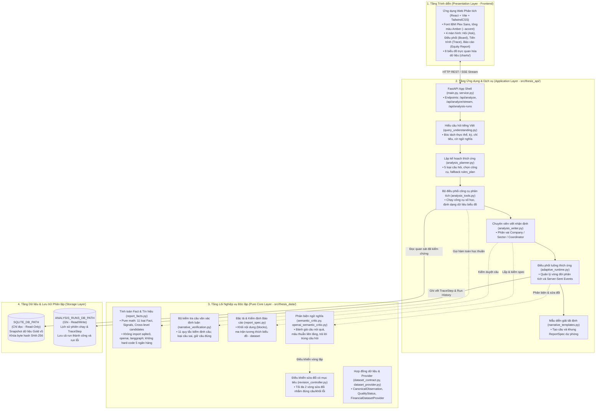
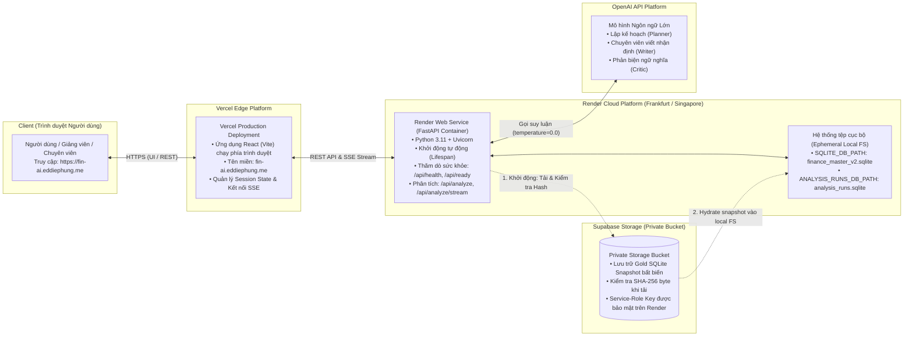

# CHƯƠNG 4. THIẾT KẾ VÀ TRIỂN KHAI HỆ THỐNG

Chương này trình bày kiến trúc phần mềm, nguyên tắc phân ranh giới, quy trình xử lý phân tích thích ứng theo câu hỏi, giải pháp kiểm tra nhận định, giao diện tác nghiệp và hạ tầng triển khai thực tế. Toàn bộ thiết kế bám sát các quyết định kiến trúc từ D-063 đến D-075 và các ranh giới bảo vệ hệ thống đã đề ra, nhằm bảo đảm kết quả phân tích có độ tin cậy cao, giải thích rõ ràng và truy vết được nguồn gốc dữ liệu.

---

## 4.1. Kiến trúc phân tầng và nguyên tắc ranh giới hệ thống

### 4.1.1. Tách tầng lõi xử lý dữ liệu và tầng ứng dụng

Hệ thống phân tách giữa logic tính toán tài chính cốt lõi và hạ tầng ứng dụng tham chiếu (Hình 4.1). Cách làm này bảo đảm việc thay đổi giao diện hay công nghệ máy chủ không làm thay đổi các phép tính kinh tế cốt lõi:

1. Tầng lõi nghiệp vụ và thuật toán thuần túy:
- Thiết kế dưới dạng thư viện thuật toán độc lập, không phụ thuộc vào khung giao diện web, cơ sở dữ liệu vật lý hay dịch vụ trí tuệ nhân tạo bên ngoài.
- Ràng buộc kỹ thuật: mã nguồn tầng lõi không được kết nối trực tiếp đến cơ sở dữ liệu hay thư viện của các mô hình ngôn ngữ lớn.
- Tính độc lập với dữ liệu cụ thể: không chứa định danh cố định của năm ngân hàng thử nghiệm (VCB, MBB, TCB, ACB, VPB). Nhờ đó, các thuật toán có thể dùng lại cho các ngân hàng khác.
- Trách nhiệm chính: định nghĩa hợp đồng dữ liệu chuẩn, tính toán số liệu và tín hiệu tài chính, vận hành bộ kiểm tra câu văn, thẩm định tính hợp lệ của báo cáo, định nghĩa quy trình phản biện ngữ nghĩa và điều khiển sửa đổi có mục tiêu.

2. Tầng ứng dụng và dịch vụ phân tích:
- Đóng vai trò là lớp vỏ điều phối, hiện thực hóa các tương tác với người dùng và quản lý vòng đời của một phiên phân tích.
- Trách nhiệm chính: cung cấp dịch vụ qua giao diện lập trình ứng dụng (Application Programming Interface - API), giải mã câu hỏi tiếng Việt, lập kế hoạch phân tích kết hợp giữa mô hình ngôn ngữ và quy tắc cố định, điều phối công cụ tính toán, phân công chuyên viên viết nhận định, duy trì mẫu câu diễn giải dự phòng và truyền sự kiện thời gian thực đến trình duyệt.

*Hình 4.1: Kiến trúc phân tầng và ranh giới hệ thống.*

### 4.1.2. Phân lập lưu trữ giữa Dữ liệu Phân tích và Lịch sử Thực thi

Hệ thống tách rời hai cơ sở dữ liệu vật lý để tránh việc ghi nhật ký làm thay đổi dữ liệu phân tích:

- Cơ sở dữ liệu phân tích chỉ đọc: chứa các bảng chỉ tiêu tài chính đã đối soát. Tệp dữ liệu này mở ở chế độ chỉ đọc và dùng cơ chế nhật ký ghi trước. Hệ thống không ghi hoặc sửa dữ liệu trong tệp này nhằm giữ nguyên mã băm bảo mật SHA-256 của bộ dữ liệu chuẩn.
- Cơ sở dữ liệu lịch sử phiên chạy: chuyên dùng lưu trữ trạng thái của từng phiên phân tích và nhật ký vết từng bước. Đây là cơ sở dữ liệu có quyền ghi và tách biệt với tệp dữ liệu phân tích.
- Cơ chế chống trùng lặp định danh tệp: khi khởi động, hệ thống kiểm tra để bảo đảm hai đường dẫn trên không trỏ về cùng một tệp vật lý hay liên kết phần cứng. Nếu trùng nhau, hệ thống sẽ dừng khởi động và báo lỗi.

---

## 4.2. Luồng xử lý một lượt phân tích

Quy trình xử lý một yêu cầu phân tích từ câu hỏi tiếng Việt tự nhiên đến khi tạo thành báo cáo phân tích cổ phiếu (Equity Research Report) gồm tám bước tuần tự có kiểm soát (Hình 4.2).

*Hình 4.2: Luồng một lượt phân tích thích ứng (End-to-End Analysis Workflow).*

### 4.2.1. Bước 1: Hiểu câu hỏi tiếng Việt tự nhiên

Bước này chuyển câu hỏi tự do của người dùng thành cấu trúc thông tin gồm ngân hàng mục tiêu, kỳ phân tích, chỉ tiêu tài chính và ý định phân tích:

- Chuẩn hóa văn bản: đưa chuỗi ký tự về bảng mã chuẩn Unicode NFC, chuyển về chữ thường, hợp nhất dấu gạch nối và bỏ khoảng trắng thừa.
- Nhận diện ngân hàng: đối chiếu với danh mục ngân hàng được hỗ trợ. Hệ thống nhận diện linh hoạt mã cổ phiếu như VCB, ACB và tên thông dụng bằng tiếng Việt như Vietcombank, Á Châu, Kỹ thương, Quân đội, Thịnh Vượng. Nếu câu hỏi nhắc tới ngân hàng chưa hỗ trợ như BID hay CTG, hệ thống ghi nhận vào danh sách từ khóa chưa hỗ trợ để từ chối lịch sự.
- Xác định kỳ báo cáo: nhận diện linh hoạt các cách biểu đạt thời gian trong tiếng Việt:
  - Cụ thể theo quý và năm: "quý 4/2024", "quý 4 năm 2024", "Q4/2024" quy về quý 4 năm 2024.
  - Toàn bộ năm: "năm 2024", "cả năm 2024" tự động mở rộng thành chuỗi bốn quý liên tiếp từ quý 1 đến quý 4 năm 2024, lấy quý 4 làm mốc so sánh.
  - Mặc định: nếu người dùng không nêu thời gian, hệ thống chọn kỳ dữ liệu mới nhất là quý 4 năm 2024.
- Nhận diện chỉ tiêu tài chính: bóc tách các cụm từ chỉ tiêu tiếng Việt và tên viết tắt như nợ xấu, tỷ lệ nợ xấu (NPL), tỷ lệ bao phủ nợ xấu (LLR), tỷ suất sinh lời trên tổng tài sản (ROA), tỷ suất sinh lời trên vốn chủ sở hữu (ROE). Hệ thống cũng hỗ trợ nhóm chủ đề như nhóm chất lượng tài sản (NPL, LLR) hay nhóm khả năng sinh lời (ROA, ROE).
- Phát hiện cờ ý định phân tích: nhận diện từ khóa để xác định ý định:
  - Ý định tra cứu: "bao nhiêu", "là mấy", "giá trị", "con số";
  - Ý định xếp hạng: "nào", "nhất", "top", "xếp hạng", "đứng thứ", "dẫn đầu";
  - Ý định so sánh: "so sánh", "so với", "cùng nhóm", "ngành", "trung vị", "đối thủ";
  - Ý định xu hướng: "diễn biến", "xu hướng", "thay đổi", "qua các quý";
  - Ý định tìm nguyên nhân: "vì sao", "tại sao", "nguyên nhân";
  - Ý định kinh tế vĩ mô: "vĩ mô", "lãi suất điều hành", "chính sách tiền tệ", "Ngân hàng Nhà nước", "lạm phát".

### 4.2.2. Bước 2: Phân loại câu hỏi và Cố định kế hoạch trước khi chạy

Hệ thống phân loại yêu cầu vào một trong năm dạng phân tích chính:

1. Tra cứu số liệu đơn lẻ (lookup): tra cứu một giá trị số học của một ngân hàng tại một kỳ, ví dụ: "Tỷ lệ nợ xấu của ACB trong quý 4 năm 2024 là bao nhiêu?".
2. Hồ sơ doanh nghiệp (company profile): đánh giá tổng thể tài chính một ngân hàng và so sánh vị thế với nhóm đồng đẳng, ví dụ: "Đánh giá chất lượng tài sản và sinh lời của VCB quý 4 năm 2024 so với nhóm".
3. Xếp hạng nhóm ngành (ranking): xếp hạng tất cả ngân hàng theo chỉ tiêu tại một kỳ, ví dụ: "Xếp hạng ROE các ngân hàng trong quý 4 năm 2024".
4. Xu hướng chuỗi thời gian (trend): phân tích biến động chỉ tiêu qua hai đến bốn quý liên tiếp, ví dụ: "Xu hướng nợ xấu của TCB qua các quý năm 2024".
5. So sánh đối đầu trực diện (head to head): so sánh trực tiếp giữa hai ngân hàng, ví dụ: "So sánh ACB và TCB trong quý 4 năm 2024".
Hai dạng câu hỏi về chủ đề ngành và tương quan chỉ tiêu đã được thiết kế sẵn nhưng tạm thời bảo lưu trong đợt triển khai này.

Cơ chế lập kế hoạch hai tầng:
- Đề xuất từ mô hình ngôn ngữ lớn: mô hình đề xuất dạng câu hỏi và danh mục tối đa năm lệnh gọi công cụ kèm tham số và lời giải thích ngắn gọn bằng tiếng Việt.
- Thẩm định quy tắc: hệ thống đối chiếu đề xuất của mô hình với danh mục năng lực, chỉ chấp nhận các thực thể, chỉ tiêu và kỳ có thật trong dữ liệu chuẩn.
- Kế hoạch dự phòng theo luật: nếu mô hình gặp sự cố hoặc đề xuất không hợp lệ, hệ thống chuyển sang kế hoạch theo luật có sẵn dựa trên các cờ ý định đã bóc tách.
- Cố định kế hoạch trước khi chạy: kế hoạch sau khi thẩm định được khóa lại. Các tác tử (agent) chuyên viên ở bước sau chỉ được thao tác trong phạm vi công cụ và thực thể đã duyệt.

### 4.2.3. Bước 3: Hộp công cụ phân tích theo quy tắc sinh dữ kiện và tập dữ liệu

Mọi phép tính toán số học tài chính đều do chương trình máy tính thực hiện theo công thức cố định, không để mô hình ngôn ngữ tự tính hay ước lượng số liệu:

- Các công cụ tính toán gồm:
  - Công cụ tra cứu: lấy giá trị quan sát trực tiếp tại kỳ phân tích;
  - Công cụ vị thế ngành: tính trung vị nhóm, xếp hạng cạnh tranh, khoảng cách tới trung vị, tỷ số so với trung vị và biên độ phân tán giữa ngân hàng cao nhất và thấp nhất;
  - Công cụ xếp hạng: sắp xếp các ngân hàng theo thứ tự giảm dần và thứ tự chất lượng tốt hơn;
  - Công cụ xu hướng thời gian: tính biến động điểm phần trăm qua các quý của ngân hàng và biến động trung vị của nhóm;
  - Công cụ so sánh đối đầu: tính chênh lệch trực tiếp giữa hai ngân hàng và đếm số chỉ tiêu vượt trội;
  - Công cụ phân rã chỉ tiêu: tính tỷ số giữa các chỉ tiêu, ví dụ tỷ số giữa ROE và ROA thể hiện mức độ dùng đòn bẩy tài chính.

Khả năng truy vết của số liệu đã tính sẵn:
Mỗi con số được lưu cùng nguồn và công thức tính. Công cụ tạo ra các dữ kiện tài chính có gắn kèm phiên bản công thức và mã quan sát đầu vào, cho phép truy ngược về từng dòng trong cơ sở dữ liệu. Công cụ cũng chuẩn bị sẵn các cấu trúc tập dữ liệu để vẽ biểu đồ ở bước sau.

*Bảng 4.1: Mười một loại số liệu do chương trình tính sẵn.*

| Loại số liệu | Ý nghĩa | Cách tính |
|---|---|---|
| Giá trị quan sát | Giá trị của một chỉ tiêu tại một kỳ | Lấy trực tiếp từ bộ dữ liệu đã kiểm chứng |
| Trung vị nhóm | Mức giữa của nhóm năm ngân hàng | Trung vị các giá trị hợp lệ trong nhóm |
| Thứ hạng | Vị trí của ngân hàng trong nhóm | Xếp theo chiều tốt của chỉ tiêu (với nợ xấu, thấp hơn là tốt hơn) |
| Chênh lệch so với trung vị | Ngân hàng cao hay thấp hơn mức giữa của nhóm | Giá trị của ngân hàng trừ trung vị nhóm |
| Biến động theo kỳ | Chỉ tiêu tăng hay giảm giữa hai kỳ | Giá trị kỳ sau trừ giá trị kỳ trước |
| Biến động của trung vị | Mức giữa của nhóm tăng hay giảm | Trung vị kỳ sau trừ trung vị kỳ trước |
| Chênh lệch giữa hai ngân hàng | Khoảng cách trực tiếp giữa hai ngân hàng | Giá trị ngân hàng thứ nhất trừ ngân hàng thứ hai |
| Biên độ phân tán | Khoảng cách giữa ngân hàng cao nhất và thấp nhất | Giá trị lớn nhất trừ giá trị nhỏ nhất |
| Tỷ số so với trung vị | Ngân hàng gấp bao nhiêu lần mức giữa | Giá trị của ngân hàng chia trung vị |
| Tỷ số giữa hai chỉ tiêu | Ví dụ ROE chia ROA, cho biết mức sử dụng đòn bẩy | Chỉ tiêu thứ nhất chia chỉ tiêu thứ hai |
| Số chỉ tiêu dẫn trước | Ngân hàng tốt hơn đối thủ ở bao nhiêu chỉ tiêu | Đếm các chỉ tiêu có chênh lệch theo chiều tốt |

### 4.2.4. Bước 4: Tín hiệu và Ứng viên mâu thuẫn liên tầng

Dựa trên các con số đã tính, hệ thống tổng hợp thành nhận định vị thế và phát hiện các điểm tài chính bất thường:

1. Phân loại tín hiệu vị thế: nhóm các chỉ tiêu thành từng mảng nghiệp vụ (như nợ xấu và bao phủ nợ xấu thuộc mảng chất lượng tài sản) để xác định vị thế:
- Vị thế vượt trội: tốt hơn rõ rệt so với nhóm so sánh;
- Vị thế kém hơn: thấp hơn rõ rệt so với nhóm;
- Vị thế tương đương: chênh lệch nằm trong biên độ đi ngang quanh mức trung vị;
- Tín hiệu hỗn hợp: các chỉ tiêu trong cùng mảng có kết quả trái ngược (ví dụ nợ xấu thấp nhưng bao phủ nợ xấu cũng mỏng);
- Thiếu dữ liệu: không đủ quan sát để đối chuẩn.

2. Nhận diện mâu thuẫn liên tầng: thuật toán tự động tìm các hiện tượng:
- Tín hiệu phân kỳ nội tại: mâu thuẫn giữa hai chỉ tiêu trong cùng mảng (ví dụ ROE thuộc nhóm đầu nhưng ROA lại dưới trung vị);
- Xu hướng ngược chiều ngành: ngân hàng đi ngược xu hướng chung (ví dụ nợ xấu ngân hàng tăng trong khi trung vị ngành giảm);
- Cực trị trái chiều: ngân hàng đứng đầu ở chỉ tiêu này nhưng đứng cuối ở chỉ tiêu khác.

Các phát hiện này được gắn mã và chuyển sang các bước sau để đưa vào hộp lưu ý trên báo cáo.

### 4.2.5. Bước 5: Chuyên viên phân tích viết câu nhận định trích dẫn dữ kiện

Hệ thống cho phép mô hình ngôn ngữ viết câu nhận định tự nhiên nhưng buộc phải dựa trên bằng chứng số học đã tính:

- Phân vai chuyên môn: Chuyên viên Doanh nghiệp phân tích ngân hàng mục tiêu, Chuyên viên Ngành đánh giá bối cảnh toàn nhóm. Mỗi câu nhận định viết ngắn gọn, không quá 30 từ.
- Trích dẫn bằng chứng: mỗi câu nhận định phải khai báo mã dữ kiện làm căn cứ số liệu.
- Ràng buộc con số: khi nêu số liệu, câu văn phải dùng đúng chuỗi văn bản đã định dạng sẵn từ dữ kiện gốc, không tự làm tròn hay tính nhẩm số mới.
- Kiểm soát ngôn từ: không dùng các từ chỉ nguyên nhân mang tính chủ quan như "do", "vì", "nhờ vào", "dẫn đến". Chỉ dùng từ "hàm ý" cho các quan hệ phân rã cấu trúc toán học (như tỷ số ROE/ROA). Không đưa ra khuyến nghị mua bán cổ phiếu.

Hệ thống có sẵn kho mẫu câu diễn giải dự phòng. Khi mô hình gặp sự cố hoặc câu viết ra bị loại ở bước kiểm tra, các câu mẫu chuẩn sẽ được dùng để thay thế, bảo đảm báo cáo không bị gián đoạn.

### 4.2.6. Bước 6: Bộ kiểm tra câu văn

Toàn bộ các câu nhận định đều phải qua bộ kiểm tra câu văn trước khi đưa vào báo cáo (Hình 4.3). Bộ kiểm tra này hoạt động độc lập với mô hình ngôn ngữ và quét tuần tự qua mười một quy tắc, dừng lại ngay tại vi phạm đầu tiên:

1. Quy tắc 1 - Trích dẫn dữ kiện: câu văn không khai báo mã dữ kiện hoặc trích dẫn mã không tồn tại sẽ bị loại.
2. Quy tắc 2 - Cấm từ chỉ nguyên nhân chủ quan: rà soát các từ như "bởi vì", "xuất phát từ", "dẫn đến", "kéo theo", "gây ra", "nhờ vào", "khiến", "do", "vì", trừ các từ ghép thông dụng như "lý do", "tự do", "do dự".
3. Quy tắc 3 - Cấm khuyến nghị đầu tư: rà soát các từ tư vấn tài chính như "định giá hấp dẫn", "giá mục tiêu", "nên đầu tư", "khuyến nghị", "nắm giữ", "mua", "bán", trừ các thuật ngữ ngân hàng như "bán lẻ", "bán buôn", "mua bán nợ".
4. Quy tắc 4 - Thực thể trong kế hoạch: câu văn không được nhắc tên ngân hàng ngoài phạm vi kế hoạch đã duyệt.
5. Quy tắc 5 - Khớp kỳ báo cáo: các mốc thời gian trong câu (như quý 4 năm 2024) phải thuộc danh sách kỳ của các dữ kiện trích dẫn.
6. Quy tắc 6 - Số đếm chỉ tiêu: cụm từ đếm số lượng (ví dụ "2 trên 4 chỉ tiêu") phải khớp đúng số chỉ tiêu dẫn trước.
7. Quy tắc 7 - Thứ hạng cạnh tranh: từ chỉ thứ bậc (như "hạng nhất", "dẫn đầu", "thấp nhất") phải có dữ kiện xếp hạng đi kèm và khớp đúng chiều đánh giá.
8. Quy tắc 8 - Quy mô nhóm thực thể: số lượng ngân hàng (ví dụ "5 ngân hàng") phải khớp với số thành viên hợp lệ trong nhóm so sánh.
9. Quy tắc 9 - Khớp con số và dung sai hiển thị: mọi số thực kèm đơn vị đo lường (như phần trăm, điểm phần trăm, lần) đều được đối chiếu với dữ kiện gốc. Sai lệch cho phép bằng một nửa đơn vị của chữ số cuối cùng được viết ra: ví dụ câu viết "1,51%" thì giá trị gốc phải nằm trong khoảng 1,505% đến 1,515%; viết "1,5%" thì khoảng cho phép là 1,45% đến 1,55%. Con số cũng phải gắn kết với tên chỉ tiêu và tên ngân hàng trong phạm vi sáu từ lân cận.
10. Quy tắc 10 - Chiều xu hướng thời gian: từ chỉ xu hướng ("tăng", "giảm", "đi ngang", "cải thiện", "xấu đi") phải có dữ kiện biến động chuỗi thời gian chứng minh và vượt ngưỡng đi ngang mặc định là 0,05 điểm phần trăm.
11. Quy tắc 11 - Chiều so sánh tương đối: từ so sánh ("cao hơn", "thấp hơn", "vượt", "tốt hơn", "kém hơn") phải có dữ kiện chênh lệch chứng minh và dấu chênh lệch phải khớp với tính chất chỉ tiêu.

*Hình 4.3: Quy trình kiểm tra câu văn theo quy tắc cố định.*

Xử lý câu lỗi:
Câu nhận định vi phạm quy tắc sẽ bị loại bỏ riêng lẻ và lưu vào hồ sơ kiểm định kèm mã lý do. Hệ thống không hủy bỏ cả lượt phân tích khi có câu lỗi. Các câu hợp lệ còn lại tiếp tục được dùng để lắp ráp báo cáo.

### 4.2.7. Bước 7: Lắp ráp báo cáo theo khối và Kiểm định đặc tả báo cáo

Báo cáo được ghép từ các khối nội dung chuyên biệt theo bản đặc tả báo cáo thống nhất, gồm hai dạng:
- Thẻ trả lời nhanh: dành cho câu hỏi tra cứu đơn lẻ, gồm đúng một khối câu trả lời và tối đa một hình minh họa;
- Báo cáo phân tích chuyên sâu: dành cho bốn dạng câu hỏi còn lại, bắt đầu bằng tiêu đề chính (tối đa 16 từ, mở đầu bằng mã ngân hàng và dấu hai chấm) và các khối nội dung tiếp theo.

*Bảng 4.2: Danh mục các khối nội dung và giới hạn ngân sách trong đặc tả báo cáo.*

| Loại khối nội dung | Chức năng nghiệp vụ trong báo cáo | Giới hạn ngân sách tối đa |
|---|---|:---:|
| Khối trả lời trực tiếp | Hiển thị giá trị trả lời câu hỏi tra cứu kèm nhận định ngắn gọn. | Đúng 1 khối (chỉ áp dụng cho thẻ trả lời nhanh) |
| Tiêu đề chính | Tiêu đề nêu nhận định bao quát của toàn bộ báo cáo phân tích. | Đúng 1 khối (bắt buộc cho báo cáo chuyên sâu, không quá 16 từ) |
| Điểm nhấn then chốt | Danh sách các phát hiện và luận điểm cốt lõi nhất của báo cáo. | Tối đa 5 ý |
| Mục phân tích chuyên sâu | Phân tích chi tiết theo từng chủ đề như chất lượng tài sản hoặc khả năng sinh lời. | Tối đa 3 mục |
| Hình trực quan hóa | Khối hình ảnh biểu đồ tài chính kèm tiêu đề và câu thông điệp rút ra. | Tối đa 4 hình |
| Hộp lưu ý đặc biệt | Hộp nổi bật làm rõ các phát hiện mâu thuẫn liên tầng quan trọng. | Tối đa 3 hộp |
| Bảng số liệu chi tiết | Bảng tổng hợp các chỉ tiêu đối chuẩn giữa các ngân hàng. | Không giới hạn riêng |
| Tổng ngân sách toàn bài | Tổng số lượng tất cả các khối trong một báo cáo phân tích | Tối đa 12 khối |

Tương thích giữa biểu đồ và cấu trúc dữ liệu:
Mỗi hình yêu cầu một loại biểu đồ phù hợp với cấu trúc dữ liệu:
- Dải thẻ chỉ số nhanh: dùng cho một đến sáu chỉ số tổng hợp;
- Biểu đồ thanh ngang xếp hạng: cần tối thiểu ba ngân hàng hợp lệ;
- Biểu đồ đường xu hướng: cần chuỗi thời gian từ hai kỳ trở lên;
- Lưới biểu đồ đường thu nhỏ: cần từ hai chỉ tiêu và từ hai kỳ trở lên;
- Biểu đồ phân tán hai chiều: cần tối thiểu ba ngân hàng có đủ cả hai chỉ tiêu đối xứng;
- Bản đồ nhiệt thứ hạng: cần bảng dữ liệu từ ba ngân hàng và từ hai chỉ tiêu trở lên;
- Biểu đồ cột nhóm và bảng so sánh trực diện: cần từ hai đến năm ngân hàng so sánh.

Nếu biểu đồ đề xuất không tương thích với dữ liệu thực tế, hệ thống tự động đổi sang biểu đồ an toàn hoặc chuyển thành bảng số liệu, tránh lỗi hiển thị trên giao diện.

### 4.2.8. Bước 8: Phản biện ngữ nghĩa và Sửa đổi có mục tiêu

Ở Cấu hình C, tác tử phản biện ngữ nghĩa rà soát nội dung báo cáo sau khi lắp ráp theo các tiêu chí:
1. Phát hiện nhận định nói quá bằng chứng hoặc suy diễn vượt quá số liệu đã trích dẫn;
2. Phát hiện báo cáo chưa trả lời trúng câu hỏi của người dùng;
3. Phát hiện hình ảnh thừa, không phục vụ luận điểm nào;
4. Phát hiện mâu thuẫn giữa nhận định về doanh nghiệp và bối cảnh ngành.

Quy trình sửa đổi có mục tiêu:
Khi phát hiện lỗi, tác tử phản biện lập danh sách nêu rõ câu lỗi, chuyên viên phụ trách, mô tả khuyết tật và yêu cầu sửa đổi. Bộ điều khiển sửa đổi chỉ gửi yêu cầu viết lại cho đúng chuyên viên và đúng câu bị gắn cờ, không chạy lại toàn hệ thống để tiết kiệm chi phí tính toán.

Quy trình sửa đổi giới hạn tối đa hai vòng lặp để tránh lặp vô hạn. Câu viết lại bắt buộc phải qua bộ kiểm tra câu văn. Nếu vẫn không đạt, câu đó sẽ bị loại và thay bằng câu mẫu an toàn từ kho mẫu có sẵn.

---

## 4.3. Cơ chế giám sát, Lưu vết và Xử lý lỗi

### 4.3.1. Lưu vết tuần tự từng bước

Hệ thống ghi lại hành động của từng tác tử theo trình tự thời gian để tiện kiểm tra hoạt động:
- Mỗi bản ghi vết gồm: chỉ số bước, dấu thời gian, tác tử thực hiện (điều phối viên, chuyên viên doanh nghiệp, chuyên viên ngành, bộ kiểm tra câu, tác tử phản biện, hoặc hệ thống), tác tử nhận, loại hành động (lập kế hoạch, gọi công cụ, viết bản thảo, kiểm tra câu, lắp ráp báo cáo, phản biện, sửa đổi, hoàn thành, báo lỗi), tóm tắt bằng tiếng Việt và dữ liệu chi tiết kèm theo.
- Bản ghi vết không lưu các lời nhắc thô hay chuỗi suy nghĩ nội bộ của mô hình, giúp bảo mật và tiết kiệm dung lượng lưu trữ.

### 4.3.2. Lưu trữ bền vững phiên chạy

Toàn bộ thông tin của mỗi phiên phân tích được lưu vào cơ sở dữ liệu trên đĩa:
- Bản ghi lưu giữ mã phiên, câu hỏi ban đầu, kế hoạch phân tích đã duyệt, đặc tả báo cáo, hồ sơ kiểm định câu văn, danh sách mâu thuẫn liên tầng, số vòng phản biện, trạng thái kết thúc (hoàn thành, bị chặn, hoặc thất bại), thời gian thực thi (giây), số token đã dùng và chuỗi bản ghi vết từng bước.
- Lưu trữ cả phiên thất bại: khi yêu cầu bị từ chối do ngoài phạm vi dữ liệu hoặc sự cố mạng, hệ thống vẫn ghi lại phiên chạy kèm lý do lỗi. Điều này giúp kiểm toán đầy đủ mẫu thực nghiệm mà không bỏ sót trường hợp biên.

### 4.3.3. Xử lý lỗi thân thiện bằng tiếng Việt

Khi yêu cầu phân tích không thể thực hiện, hệ thống đưa ra thông điệp giải thích rõ ràng bằng tiếng Việt thay vì mã lỗi kỹ thuật:
- Khi hỏi về ngân hàng ngoài danh mục: "Ngân hàng [Mã] hiện chưa có dữ liệu kiểm định trong hệ thống. Vui lòng chọn một trong các ngân hàng: VCB, MBB, TCB, ACB, VPB."
- Khi hỏi về kỳ thời gian ngoài phạm vi: "Kỳ phân tích [Kỳ] vượt quá phạm vi dữ liệu đã kiểm định (năm 2024)."
- Khi hỏi về kinh tế vĩ mô chưa có dữ liệu: "Dữ liệu kinh tế vĩ mô chưa được tích hợp trong bộ dữ liệu hiện tại. Hệ thống tập trung phân tích số liệu tài chính doanh nghiệp và nhóm so sánh."
- Khi phát hiện ô dữ liệu thiếu: "Chỉ tiêu [Tên chỉ tiêu] của [Ngân hàng] trong [Kỳ] không được công bố đầy đủ trong báo cáo tài chính gốc, hệ thống ghi nhận trạng thái thiếu dữ liệu có kiểm soát."

---

## 4.4. Thiết kế giao diện

Mục này mô tả các màn hình chính; ảnh chụp từng màn hình theo đúng thứ tự sử dụng được trình bày ở mục 4.7.

Giao diện người dùng là ứng dụng trang đơn xây dựng bằng React, Vite và TailwindCSS. Thiết kế dùng phông chữ phi chân phương (IBM Plex Sans), tông màu nhấn hổ phách cho ngân hàng mục tiêu, màu xám trung tính cho nhóm so sánh, bố cục trang tập trung vào tính dễ đọc của số liệu tài chính. Giao diện gồm bốn màn hình chính:

### 4.4.1. Màn hình Đặt câu hỏi
- Cung cấp ô nhập liệu câu hỏi tiếng Việt tự nhiên với trải nghiệm tìm kiếm tối giản.
- Có sẵn các câu hỏi mẫu theo năm dạng phân tích (tra cứu, hồ sơ doanh nghiệp, xếp hạng, xu hướng bốn quý, so sánh đối đầu) để người dùng dễ làm quen.

### 4.4.2. Màn hình Bàn điều phối tác tử
- Hiển thị cấu trúc của hệ thống đa tác tử thích ứng theo từng câu hỏi.
- Chỉ hiển thị tác tử thực sự tham gia: ví dụ với câu hỏi về một ngân hàng đơn lẻ, thẻ Chuyên viên Ngành sẽ không hiện; các tác tử chưa có dữ liệu cũng không vẽ thẻ chờ để tránh gây hiểu lầm.
- Hiển thị tóm tắt kế hoạch phân tích, các chỉ tiêu liên quan và lý do lựa chọn của điều phối viên.

### 4.4.3. Màn hình Dòng thời gian tiến trình
- Nhận dữ liệu truyền dòng thời gian thực từ máy chủ qua cơ chế máy chủ chủ động gửi từng bước về trình duyệt ngay khi xảy ra.
- Thể hiện dòng thời gian của các bước: Lập kế hoạch → Tính toán công cụ → Nhận định chuyên viên → Kiểm định câu văn → Lắp ráp báo cáo → Phản biện ngữ nghĩa và sửa đổi.
- Cho phép người dùng mở rộng từng bước để xem chi tiết các con số đã tính, các câu bị loại kèm lý do và ý kiến của tác tử phản biện.

### 4.4.4. Màn hình Báo cáo phân tích chuyên sâu
- Báo cáo tự động điều chỉnh cách trình bày theo dạng câu hỏi:
  - Câu hỏi tra cứu: hiển thị thẻ trả lời nhanh với con số kết quả ở trung tâm, nhãn chỉ tiêu, kỳ báo cáo và liên kết mở nguồn gốc;
  - Các câu hỏi còn lại: hiển thị báo cáo nghiên cứu gồm tiêu đề nhận định, danh sách phát hiện then chốt, các mục chuyên sâu và hộp lưu ý.
- Thư viện tám loại biểu đồ tài chính:
  1. Dải thẻ chỉ số nhanh: hiển thị các chỉ số tài chính cốt lõi tại kỳ phân tích;
  2. Biểu đồ thanh ngang xếp hạng: xếp hạng các ngân hàng từ cao xuống thấp;
  3. Biểu đồ đường xu hướng: thể hiện biến động chỉ tiêu qua các quý;
  4. Lưới biểu đồ đường thu nhỏ: so sánh đồng thời xu hướng của nhiều chỉ tiêu;
  5. Biểu đồ phân tán hai chiều: thể hiện tương quan giữa hai chỉ tiêu (ví dụ nợ xấu và ROE);
  6. Bản đồ nhiệt thứ hạng: ma trận xếp hạng của các ngân hàng trên tất cả chỉ tiêu;
  7. Biểu đồ cột nhóm: so sánh nhiều chỉ tiêu giữa hai đến ba ngân hàng;
  8. Bảng so sánh trực diện: đối chuẩn tài chính trực tiếp từng đôi một, dùng màu tương phản thể hiện khoảng cách chênh lệch.
- Bảng số liệu đối soát: cho phép chuyển sang xem bảng số liệu chi tiết kèm số trang và dòng trích dẫn trong báo cáo tài chính gốc đã kiểm toán.

---

## 4.5. Kiến trúc triển khai đám mây và Vận hành thực tế

Hệ thống được đóng gói và triển khai trên hạ tầng đám mây phân tán, đảm bảo tính sẵn sàng cao và phục vụ trực tiếp người dùng qua Internet (Hình 4.4):

*Hình 4.4: Sơ đồ kiến trúc triển khai hệ thống trên đám mây.*

1. Ứng dụng giao diện người dùng:
- Triển khai trên nền tảng phân phối biên đám mây, tối ưu hóa phân phối nội dung tĩnh qua mạng phân phối nội dung (Content Delivery Network - CDN).
- Hoạt động tại tên miền: https://fin-ai.eddiephung.me.
- Kết nối với máy chủ phân tích qua giao thức truyền dữ liệu bảo mật và kênh truyền dòng sự kiện thời gian thực.

2. Dịch vụ máy chủ phân tích:
- Đóng gói trong môi trường vùng chứa và chạy trên dịch vụ máy chủ đám mây với môi trường thực thi ngôn ngữ hiện đại.
- Cấu hình qua các biến môi trường, thiết lập chia sẻ tài nguyên an toàn chỉ cho phép tên miền giao diện chính thức kết nối.

3. Cơ chế tự động nạp bộ dữ liệu chuẩn:
- Do máy chủ miễn phí có đặc tính tệp tạm thời (dữ liệu cục bộ bị xóa mỗi khi máy chủ khởi động lại), tệp cơ sở dữ liệu tài chính chuẩn được lưu cố định trên kho lưu trữ đám mây riêng tư.
- Khi máy chủ khởi động, dịch vụ tự động tải tệp dữ liệu chuẩn từ kho đám mây về bộ nhớ máy chủ cục bộ.
- Quy trình kiểm tra toàn vẹn gồm hai bước:
  1. Tính mã băm SHA-256 trên chuỗi byte của tệp vừa tải và đối chiếu với mã băm chuẩn đã công bố;
  2. Thực thi lệnh kiểm tra tính toàn vẹn cấu trúc vật lý của cơ sở dữ liệu.
  Nếu phát hiện sai khác mã băm hoặc lỗi cấu trúc bảng, ứng dụng sẽ dừng khởi động và từ chối phục vụ.

4. Hệ thống thăm dò trạng thái hoạt động:
- Cổng thăm dò sự sống: phản hồi trạng thái hoạt động cho bộ cân bằng tải của dịch vụ đám mây biết máy chủ đang chạy.
- Cổng thăm dò mức độ sẵn sàng: chỉ khi cơ sở dữ liệu chuẩn đã tải xong, kiểm tra mã băm đạt và kết nối sẵn sàng, cổng này mới xác nhận sẵn sàng phục vụ. Nếu chưa hoàn tất, hệ thống trả về mã báo dịch vụ chưa sẵn sàng để tránh phân tích khi dữ liệu chưa kiểm chứng.
- Cổng thông tin phiên bản và năng lực: cung cấp thông tin phiên bản hệ thống cùng danh mục ngân hàng và chỉ tiêu sẵn sàng phục vụ.

---

## 4.6. Chiến lược kiểm thử và Cổng nghiệm thu kỹ thuật

Chất lượng hệ thống được bảo đảm qua hệ thống kiểm thử tự động nhiều tầng:

1. Bộ kiểm thử đơn vị toàn diện:
Gồm 781 bài kiểm thử tự động đạt kết quả thành công, bao phủ các thành phần từ tầng thuật toán lõi đến tầng dịch vụ ứng dụng:
- Kiểm thử hợp đồng dữ liệu chuẩn, tính toàn vẹn của dữ liệu và cơ chế nạp dữ liệu từ kho đám mây;
- Kiểm thử các công cụ tính toán số học theo quy tắc, tính toán dữ kiện tài chính và chuẩn bị dữ liệu biểu đồ;
- Kiểm thử bộ giải mã câu hỏi tiếng Việt và bộ lập kế hoạch phân tích thích ứng;
- Kiểm thử mười một quy tắc của bộ kiểm tra câu văn;
- Kiểm thử tính tương thích của đặc tả báo cáo và cấu trúc biểu đồ;
- Kiểm thử bộ điều khiển sửa đổi có mục tiêu và cơ chế phản biện ngữ nghĩa;
- Kiểm thử luồng xử lý toàn trình từ đầu đến cuối, ghi nhận vết từng bước và truyền dòng dữ liệu thời gian thực.

2. Kiểm soát ranh giới kiến trúc tự động:
Công cụ tự động quét cây mã nguồn để ngăn vi phạm kiến trúc:
- Đảm bảo tầng thuật toán lõi độc lập, không phụ thuộc cơ sở dữ liệu vật lý hay thư viện của các mô hình ngôn ngữ lớn, và không chứa định danh của năm ngân hàng thử nghiệm;
- Đảm bảo các mô hình dữ liệu của tầng giao tiếp không rò rỉ vào tầng thuật toán lõi;
- Đảm bảo cơ sở dữ liệu phân tích chỉ đọc và cơ sở dữ liệu lịch sử chạy luôn tách biệt nhau.

3. Kiểm tra tính tương thích hợp đồng giao diện:
Hệ thống tự động đối chiếu lược đồ giao diện lập trình ứng dụng xuất ra từ mã nguồn với bản đặc tả hợp đồng chuẩn, tránh việc thay đổi làm đứt gãy liên lạc với giao diện người dùng trên đám mây.

4. Quy trình tích hợp liên tục tự động:
Mọi thay đổi mã nguồn trước khi hợp nhất vào nhánh chính đều phải qua chuỗi kiểm định tự động: kiểm tra định dạng mã nguồn, kiểm tra kiểu dữ liệu tĩnh, xác thực ranh giới kiến trúc, kiểm tra hợp đồng giao diện và vượt qua 781 bài kiểm thử tự động. Nguyên tắc bàn giao không lỗi bảo đảm nhánh chính luôn ở trạng thái ổn định và sẵn sàng phục vụ.
